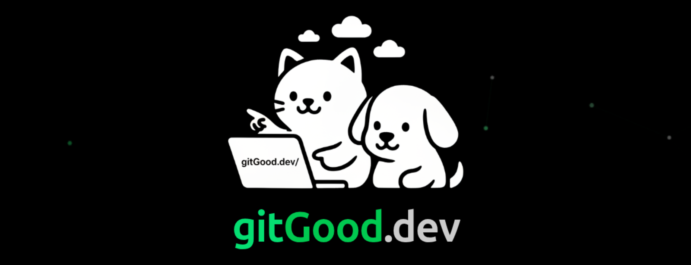

<!-- markdown="1" lets the documentation site render the markdown inside this
     centered block. GitHub ignores the attribute, so rendering there is unchanged. -->
<div align="center" markdown="1">

<a href="https://noblerworks.com/"></a>

### Built by [Patrick Wiloak](https://patricklukewilson.com) at [Nobler Works](https://noblerworks.com/)

We build custom software and products at Nobler Works. Open source projects and training like this one are our way of giving back - we're nothing without the community that supports us.<br>
If you need custom software built, [get in touch](https://noblerworks.com/).

[](https://noblerworks.com/)
[](https://x.com/Nobler_Works)
[](https://www.youtube.com/@NoblerWorks)
[](https://www.tiktok.com/@noblerworks)
[](https://www.threads.com/@noblerworks)

---

<a href="https://gitgood.dev"></a>

### 🚀 Like what you see? We built a whole platform for this.

**[gitGood.dev](https://gitgood.dev) is our flagship tech training platform - train for the role, not just the interview.**

Built for **every kind of technologist**, across 21 role-targeted learning paths. This repo gives you the material. gitGood gives you the reps, and tells you whether you actually know it.

[](https://gitgood.dev)

**$8/month** or **$64/year** after the trial. Free tier needs no card: 20 practice questions, the free coding challenges, streaks, achievements, and the job board.

<details class="promo" markdown="1">
<summary>What's inside gitGood.dev</summary>

**Roles** - backend, frontend, full-stack and mobile development, SRE and DevOps, platform engineering, cloud and solutions architecture, security engineering, machine learning and AI engineering, data science, data analytics, data engineering, QA and SDET, engineering management, product management, TPM, and new grads breaking into tech.

**Cloud certification practice exams** - 13 banks and 608 original scenario-style questions (never brain dumps), with per-domain scoring and a timed exam simulator: AWS Cloud Practitioner CLF-C02, Solutions Architect Associate SAA-C03 and Developer Associate DVA-C02; Azure AZ-900, AZ-104, AZ-305 and AI-900; Google Cloud Digital Leader and Associate Cloud Engineer; Kubernetes CKA and CKAD; CompTIA Security+; HashiCorp Terraform Associate.

**Everything else** - 1,950+ practice questions across 34 categories · coding challenges with real sandboxed execution in JavaScript, Python and TypeScript · a 45-problem SQL playground · 32 system design walkthroughs including LLM inference and RAG · behavioral and STAR interview prep · curated interview packs for 39 companies · AI mock interviews · AI resume reviews · salary negotiation coaching · a live tech job-market pulse and job board.

</details>

</div>

---

# ☁️ Cloud Zero to Hero

> **Cloud from absolute zero to hired: AWS, Azure, GCP, OCI and IBM Cloud, Kubernetes, Linux, networking, Terraform, DevOps, platform engineering, SRE and FinOps. Concepts in plain English, hands-on builds, deep references, and a full cloud certification library.**
>
> Whether you've never opened a terminal or you're chasing your fifth cloud cert, start here.
>
> Patrick: Ex-AWS Solutions Architect | 10 Years in Tech | 64 Certifications & Accreditations | 19x Multi Cloud Certified
>
> 🎥 [@patrickwiloak](https://youtube.com/@patrickwiloak) | 💼 [LinkedIn](https://www.linkedin.com/in/patricklukewilson/)


<div align="center" markdown="1">

[](https://cloud.noblerworks.com/)

**[→ cloud.noblerworks.com](https://cloud.noblerworks.com/)**

Full-text search across all 1.8M words, dark mode, mobile-friendly.

</div>

---

## 🧭 Zero to Hero family

This is one of four free, open-source sites. Each one covers its own subject in depth and links to the others where the subjects meet.

| Site | Covers | Website | Repo |
|---|---|---|---|
| ☁️ **Cloud Zero to Hero** (you are here) | AWS, Azure, GCP, OCI, Kubernetes, Linux, networking, Terraform, DevOps, SRE, FinOps | **[cloud.noblerworks.com](https://cloud.noblerworks.com/)** | [cloud-zero-to-hero](https://github.com/PatrickWiloak/cloud-zero-to-hero) |
| 📊 **Data Zero to Hero** | Data engineering, databases, streaming, analytics, Snowflake, Databricks, data certs | **[data.noblerworks.com](https://data.noblerworks.com/)** | [data-zero-to-hero](https://github.com/PatrickWiloak/data-zero-to-hero) |
| 🔒 **Security Zero to Hero** | Cloud and application security, IAM, compliance, CISSP, Security+, CCSP and more | **[security.noblerworks.com](https://security.noblerworks.com/)** | [security-zero-to-hero](https://github.com/PatrickWiloak/security-zero-to-hero) |
| 🤖 **AI Zero to Hero** | LLMs, RAG, agents, evals, AI at work, AI certs, landmark papers in plain language | **[ai.noblerworks.com](https://ai.noblerworks.com/)** | [ai-zero-to-hero](https://github.com/PatrickWiloak/ai-zero-to-hero) |

All four are free, by [Nobler Works](https://noblerworks.com/).

---

## 🏛️ The Four Pillars

| | Pillar | What it is | Start here |
|---|---|---|---|
| 🎓 | **Learn** | Plain-English cloud concepts, a beginner on-ramp, a structured path. No exam scaffolding. | [learn/](./learn/) |
| 🛠️ | **Build** | Hands-on projects, architecture patterns, CLI cheat sheets. Practitioner reference. | [resources/hands-on-projects/](./resources/hands-on-projects/) |
| 🎯 | **Certify** | 72 cert study guides across 16 providers. Fact sheets, practice plans, scenarios, practice questions. | [STUDY-HUB.md](./STUDY-HUB.md) |
| 📚 | **Reference** | Cross-cloud service comparisons, career roadmaps, migration, cost and troubleshooting guides. | [resources/](./resources/) |

Cross-pillar **[topic index](./topics/)** ties Learn + Build + Reference + Certify together by subject (Kubernetes, networking, serverless, observability, SRE, platform engineering, FinOps).

---

## 🎯 I'm here to...

| Goal | Go to |
|------|-------|
| 🌅 Start from absolute zero (terminal, git, HTTP) | **[Day One](./learn/day-one/)** |
| 💡 Look up a concept (VPC, DNS, containers, Kubernetes, Terraform) | **[Concepts](./learn/concepts/)** |
| ☁️ Learn cloud without an exam | **[Cloud from Scratch](./learn/cloud-from-scratch.md)** |
| 🛠️ Build something hands-on (3-tier app, CI/CD, K8s cluster) | **[Hands-on projects](./resources/hands-on-projects/)** (with time estimates) |
| 📺 Learn from videos | **[Curated YouTube playlist](./learn/youtube.md)** |
| 🔍 Compare AWS vs Azure vs GCP for a service | **[Service comparisons](./resources/)** |
| 🎯 Pick the right certification | **[Study Hub decision tree](./STUDY-HUB.md#-decision-tree-find-your-cert)** |
| 🚀 Follow a career path | **[Roadmaps](#-certification-roadmaps)** |
| 📚 Browse every cert guide | **[STUDY-HUB.md](./STUDY-HUB.md)** |
| 🤖 Learn AI, 📊 data or 🔒 security | **[AI](https://ai.noblerworks.com/)** · **[Data](https://data.noblerworks.com/)** · **[Security](https://security.noblerworks.com/)** Zero to Hero |

---

## 📰 What's new

See the **[CHANGELOG](./CHANGELOG.md)** for the rolling history. Recent batches:

- **2026-10-21** - This repo is now **Cloud Zero to Hero**. The old all-in-one repo was split by subject into four sibling sites: cloud stays here, and the data, security and AI material moved to [Data](https://data.noblerworks.com/), [Security](https://security.noblerworks.com/) and [AI](https://ai.noblerworks.com/) Zero to Hero. Links between them are absolute, so nothing you bookmarked on a subject page is lost.
- **2026-09-28** - New [CompTIA A+ (220-1201 and 220-1202)](./exams/comptia/a-plus/) guide: nine notes across both Core exams, a fact sheet, study plan, scenarios, strategy and 20 [practice questions](./resources/practice-questions/comptia-a-plus-220-1201-1202.md). On the site, every page now has its own search description and a title led by its exam code, and deploys notify search engines through IndexNow.
- **2026-09-18** - Every dead vendor link repaired: each replacement fetched and matched to the page the citation meant. The sweep now also catches soft 404s and deep links that silently redirect to a homepage. The record of every old-to-new replacement is [docs/link-rot-2026-09-17.md](./docs/link-rot-2026-09-17.md).
- **2026-08-14** - The whole repo is now a searchable website: [cloud.noblerworks.com](https://cloud.noblerworks.com/), with its own landing page, full-text search, dark mode and mobile nav, generated from these same markdown files. Every counted claim in the README is checked in CI.

---

## 🎯 What's Inside This Repository?

A complete cloud learning resource. Whether you're starting fresh, building production systems, or chasing certifications:

- ✅ **[Day One on-ramp](./learn/day-one/)** - terminal, git, HTTP, servers
- ✅ **[18 concept pages](./learn/concepts/)** - cloud computing, regions, VPCs, DNS, CDNs, load balancing, containers, Kubernetes, serverless, Terraform, CI/CD, observability, cost
- ✅ **[Cloud from Scratch](./learn/cloud-from-scratch.md)** - a structured 8-phase path
- ✅ **72 certification study guides** across 16 providers, 6,000+ embedded vendor doc links
- ✅ **[7 cross-pillar topic indexes](./topics/)** - Kubernetes, networking, serverless, observability, SRE, platform engineering, FinOps (find everything by topic, not provider)
- ✅ **7 cross-cloud service comparisons** - compute, storage, networking, containers, DevOps/CI/CD, observability, serverless
- ✅ **9 CLI cheat sheets** (AWS, Azure, GCP, kubectl, Terraform, Docker, Helm, GitHub CLI, multi-cloud)
- ✅ **12 architecture patterns** with multi-cloud implementations
- ✅ **7 hands-on projects** - 3-tier app, CI/CD, monitoring, Kubernetes, Terraform, serverless, DR drill
- ✅ **7 certification roadmaps** by career path
- ✅ **4 interview prep guides**
- ✅ **Migration, cost optimization, well-architected, networking and troubleshooting** deep-dives
- ✅ **[Freshness ledger](./docs/freshness.md)** - per-cert last-verified dates
- ✅ **Free tier guides** to minimize study costs

---

## 📚 Browse Certifications

Full per-provider breakdown lives in **[STUDY-HUB.md](./STUDY-HUB.md)**. Quick links:

<!-- BEGIN GENERATED: readme-provider-table - edit .github/scripts/build-provider-indexes.py, not this block -->

| Provider | Certs | Highlights |
|----------|------:|------------|
| ☁️ [AWS](./exams/aws/) | 10 | CLF-C02, SAA-C03, SOA-C03, DVA-C02, SAP-C02, DOP-C02, Advanced Networking (ANS-C01), SAP on AWS (PAS-C01), Quantum (QPC-C01); retired SOA-C02 retained |
| ☁️ [Azure](./exams/azure/) | 10 | AZ-900/104/204/305/400/700, MS-900, PL-100/200/900 |
| ☁️ [GCP](./exams/gcp/) | 7 | Digital Leader, Associate Cloud Engineer, Cloud Architect, Cloud Developer, DevOps, Network Engineer, Workspace Admin |
| ☸️ [Kubernetes/CNCF](./exams/kubernetes/) | 10 | KCNA, CKA, CKAD, plus Argo (CAPA), Cilium (CCA), GitOps (CGOA), Istio (ICA), OpenTelemetry (OTCA), Prometheus (PCA), Platform Engineering (CNPA) |
| 🔧 [HashiCorp](./exams/hashicorp/) | 5 | Terraform Assoc + Pro, Consul, Packer, Nomad |
| 🐙 [GitHub](./exams/github/) | 3 | Foundations, Actions, Administration |
| 🎩 [Red Hat](./exams/redhat/) | 2 | RHCSA (EX200), OpenShift Administrator (EX280) |
| 🌐 [Cisco](./exams/cisco/) | 2 | CCNA (200-301), CCNP Enterprise ENCOR (350-401) |
| ☁️ [Salesforce](./exams/salesforce/) | 3 | Administrator, Platform Developer I, Platform Developer II |
| 💰 [FinOps Foundation](./exams/finops/) | 4 | Practitioner, Engineer, Analyst, Professional |
| 🔒 [CompTIA](./exams/comptia/) | 3 | A+ (220-1201/1202), Cloud+ (CV0-004), Network+ (N10-009) |
| 🐧 [Linux Foundation](./exams/linux-foundation/) | 2 | LFCS, LFCA |
| ☁️ [Oracle Cloud (OCI)](./exams/oracle/) | 5 | OCI Foundations, Architect Assoc + Pro, Developer Assoc, Operations Assoc |
| ☁️ [IBM Cloud](./exams/ibm/) | 4 | Advocate, Developer, Solution Architect, SRE |
| 🧰 [ServiceNow](./exams/servicenow/) | 1 | Certified System Administrator |
| 🖥️ [VMware](./exams/vmware/) | 1 | VCP-DCV (2V0-21.23) |
| **Total** | **72** | across 16 providers |

Highlights are a sample, not the full list - the Certs column is the total. Open a provider for everything it covers.

<!-- END GENERATED: readme-provider-table -->

**[→ Full per-provider breakdown in STUDY-HUB.md](./STUDY-HUB.md#-certifications-by-provider)**

Looking for data, security or AI certifications (Snowflake, Databricks, CISSP, Security+, AWS AI Practitioner, Anthropic Claude and more)? They live on the [Data](https://data.noblerworks.com/STUDY-HUB/), [Security](https://security.noblerworks.com/STUDY-HUB/) and [AI](https://ai.noblerworks.com/) sites.

---

## 🗺️ Certification Roadmaps

Career-focused learning paths:

- **[☁️ Cloud Engineer](./resources/certification-roadmap-cloud-engineer.md)** | **[🏗️ Solutions Architect](./resources/certification-roadmap-solutions-architect.md)** | **[⚙️ DevOps/SRE](./resources/certification-roadmap-devops-sre.md)** | **[🌐 Multi-Cloud](./resources/certification-roadmap-multi-cloud.md)**
- **[☸️ Kubernetes Specialist](./resources/certification-roadmap-kubernetes-specialist.md)** | **[🛠️ Platform Engineer](./resources/certification-roadmap-platform-engineer.md)** | **[💰 FinOps](./resources/certification-roadmap-finops.md)**
- On the sibling sites: **[📊 Data Engineer](https://data.noblerworks.com/resources/certification-roadmap-data-engineer/)** | **[🗄️ Database Specialist](https://data.noblerworks.com/resources/certification-roadmap-database-specialist/)** | **[🔒 Security Engineer](https://security.noblerworks.com/resources/certification-roadmap-security-engineer/)** | **[🤖 AI Engineer](https://ai.noblerworks.com/careers/roles/ai-engineer-roadmap/)**

---

## 📚 Study Resources

### **Service Comparisons** (cross-cloud)
[Compute](./resources/service-comparison-compute.md) · [Storage](./resources/service-comparison-storage.md) · [Networking](./resources/service-comparison-networking.md) · [Containers/K8s](./resources/service-comparison-containers-kubernetes.md) · [DevOps/CI/CD](./resources/service-comparison-devops-cicd.md) · [Observability](./resources/service-comparison-observability-monitoring.md) · [Serverless](./resources/service-comparison-serverless.md)

On the sibling sites: [Databases](https://data.noblerworks.com/resources/service-comparison-databases/) · [Messaging](https://data.noblerworks.com/resources/service-comparison-messaging-queues/) · [Security tools](https://security.noblerworks.com/resources/service-comparison-security-tools/) · [Identity/IAM](https://security.noblerworks.com/resources/service-comparison-identity-iam/) · [Cloud AI/ML services](https://ai.noblerworks.com/tools/comparisons/cloud-ai-ml-services/)

### **CLI Quick References**
[AWS](./resources/cli-cheat-sheet-aws.md) | [Azure](./resources/cli-cheat-sheet-azure.md) | [GCP](./resources/cli-cheat-sheet-gcp.md) | [Multi-cloud](./resources/cli-cheat-sheet-comparison.md) | [kubectl](./resources/cli-cheat-sheet-kubectl.md) | [Terraform](./resources/cli-cheat-sheet-terraform.md) | [Docker](./resources/cli-cheat-sheet-docker.md) | [Helm](./resources/cli-cheat-sheet-helm.md) | [GitHub CLI](./resources/cli-cheat-sheet-github-cli.md)

### **Architecture Patterns**
[3-Tier Web App](./resources/architecture-patterns/web-app-3-tier.md) · [Serverless API](./resources/architecture-patterns/serverless-api.md) · [Microservices](./resources/architecture-patterns/microservices-architecture.md) · [Event-Driven](./resources/architecture-patterns/event-driven-architecture.md) · [Disaster Recovery](./resources/architecture-patterns/disaster-recovery-patterns.md) · [Multi-Region Active-Active](./resources/architecture-patterns/multi-region-active-active.md) · [CQRS/Event Sourcing](./resources/architecture-patterns/cqrs-event-sourcing.md) · [API Gateway](./resources/architecture-patterns/api-gateway-pattern.md) · [Strangler Fig](./resources/architecture-patterns/strangler-fig-migration.md) · [Cell-Based](./resources/architecture-patterns/cell-based-architecture.md) · [Chaos Engineering](./resources/architecture-patterns/chaos-engineering-patterns.md) · [Hybrid Cloud](./resources/architecture-patterns/hybrid-cloud-connectivity.md)

On the sibling sites: [Data Pipeline/ETL](https://data.noblerworks.com/resources/architecture-patterns/data-pipeline-etl/) · [Data Mesh](https://data.noblerworks.com/resources/architecture-patterns/data-mesh/) · [Lakehouse](https://data.noblerworks.com/resources/architecture-patterns/lakehouse-architecture/) · [Zero Trust](https://security.noblerworks.com/resources/architecture-patterns/zero-trust-architecture/) · [AI/ML Pipeline](https://ai.noblerworks.com/build/patterns/ai-ml-pipeline/)

### **Hands-on Projects**
[3-Tier App](./resources/hands-on-projects/deploy-3-tier-app.md) · [CI/CD Pipeline](./resources/hands-on-projects/build-ci-cd-pipeline.md) · [Monitoring Stack](./resources/hands-on-projects/setup-monitoring-stack.md) · [K8s Cluster](./resources/hands-on-projects/kubernetes-cluster-setup.md) · [Terraform Infra](./resources/hands-on-projects/terraform-infrastructure.md) · [Serverless App](./resources/hands-on-projects/serverless-application.md) · [DR Drill](./resources/hands-on-projects/disaster-recovery-drill.md)

On the sibling sites: [Data Pipeline](https://data.noblerworks.com/resources/hands-on-projects/build-data-pipeline/) · [Zero Trust](https://security.noblerworks.com/resources/hands-on-projects/implement-zero-trust/) · [RAG pipeline](https://ai.noblerworks.com/build/projects/build-rag-pipeline/) · [Claude agent with MCP](https://ai.noblerworks.com/build/projects/build-claude-agent-with-mcp/)

### **Deep Dive Guides**
- **Migration:** [On-Prem to AWS](./resources/migration-guides/on-prem-to-aws.md) | [to Azure](./resources/migration-guides/on-prem-to-azure.md) | [to GCP](./resources/migration-guides/on-prem-to-gcp.md) | [Cloud-to-Cloud](./resources/migration-guides/cloud-to-cloud.md) | [Database (Data site)](https://data.noblerworks.com/resources/migration-guides/database-migration/)
- **Well-Architected:** [AWS](./resources/well-architected/aws-well-architected.md) | [Azure](./resources/well-architected/azure-well-architected.md) | [GCP](./resources/well-architected/gcp-well-architected.md)
- **Cost Optimization:** [AWS](./resources/cost-optimization/aws-cost-optimization.md) | [Azure](./resources/cost-optimization/azure-cost-optimization.md) | [GCP](./resources/cost-optimization/gcp-cost-optimization.md) | [FinOps Principles](./resources/cost-optimization/finops-principles.md)
- **Troubleshooting:** [AWS](./resources/troubleshooting/aws-troubleshooting.md) | [Azure](./resources/troubleshooting/azure-troubleshooting.md) | [GCP](./resources/troubleshooting/gcp-troubleshooting.md) | [Kubernetes](./resources/troubleshooting/kubernetes-troubleshooting.md)
- **Networking:** [Hybrid Connectivity](./resources/networking-deep-dives/hybrid-connectivity.md) | [Multi-Cloud](./resources/networking-deep-dives/multi-cloud-networking.md) | [DNS Deep Dive](./resources/networking-deep-dives/dns-deep-dive.md) | [Load Balancing](./resources/networking-deep-dives/load-balancing-deep-dive.md)
- **Compliance** (SOC 2, HIPAA, PCI DSS, GDPR, FedRAMP) lives on the [Security site](https://security.noblerworks.com/resources/compliance-guides/).

### **Interview Prep**
[Solutions Architect](./resources/interview-prep/solutions-architect-interview.md) | [DevOps](./resources/interview-prep/devops-interview.md) | [Cloud Engineer](./resources/interview-prep/cloud-engineer-interview.md) | [SRE](./resources/interview-prep/sre-interview.md)

### **Decision Matrices** - score-driven product picks
[IaC tool](./resources/decision-matrix-iac-tool.md)

### **Postmortem Study Guides** - real public outages, mapped to exam domains
[AWS S3 us-east-1, 2017](./resources/postmortem-aws-s3-2017.md) | [Cloudflare regex, 2019](./resources/postmortem-cloudflare-regex-2019.md) | [GCP networking, 2019](./resources/postmortem-gcp-networking-2019.md)

### **Persona Playlists** - curated reading sequences
[SRE in 1 hour](./resources/playlist-sre-1hour.md)

### **Practice & Strategy**
- [📝 Practice Question Banks](./resources/practice-questions/) - scenario questions with explained answers, one bank per certification
- [🎯 Practice Resources Guide](./resources/practice-resources.md)
- [💰 Free Tier Guides](./resources/free-tier-guide.md)
- [📝 Study Tips & Strategies](./resources/study-strategies.md)
- [✅ Exam Day Checklist](./resources/exam-day-checklist.md)
- [📅 Freshness Ledger](./docs/freshness.md) - per-page last-verified dates

---

## 🎓 Study Paths by Experience Level

### **Beginner (0-6 months cloud experience)**
1. Start with a **Fundamentals** cert: AWS Cloud Practitioner | Azure AZ-900 | GCP Cloud Digital Leader | Oracle OCI Foundations
2. Follow [Study Strategies](./resources/study-strategies.md)
3. Use [Free Tier](./resources/free-tier-guide.md) for hands-on practice

### **Intermediate (6-18 months experience)**
1. Pick an **Associate** cert: AWS SAA / DVA / SOA | Azure AZ-104 | GCP Associate Cloud Engineer
2. Study 2-3 hours daily for 2-3 months
3. Work through the practice question bank for your cert until you score well on scenarios you have not seen

### **Advanced (18+ months experience)**
1. Choose **Professional** or **Expert**: AWS SAP / DOP | Azure AZ-305 / AZ-400 | GCP Cloud Architect / DevOps Engineer
2. Focus on complex scenarios and design patterns
3. Build production-grade projects

---

## 📈 What Makes These Materials Special?

1. **Documentation-rich** - 6,000+ embedded vendor doc links, format `**[📖 Title](URL)** - description`
2. **Multi-cloud** - AWS, Azure, GCP, OCI and IBM side by side, with cross-cloud comparisons and CLI cheat sheets
3. **Comprehensive + structured** - consistent format across every cert (README → fact-sheet → notes → practice-plan → scenarios → strategy)
4. **Practical + hands-on** - guided builds with inline code, free-tier guides
5. **Exam-focused** - exam tips, common scenarios, time management strategies

---

## 💰 Cost-Effective Study Strategy

| Item | Typical Cost |
|------|-------------:|
| All study materials in this repo | Free |
| Official documentation | Free |
| Free tier sandbox accounts | Free |
| Video course (optional) | $15-50 |
| Third-party practice tests (optional) | $15-30 |
| Exam fee (per cert) | $100-700 |

**[→ Detailed budget guide](./resources/budget-study-plan.md)**

---

## 🤝 Community

- **Reddit:** r/AWSCertifications, r/AZURE, r/googlecloud, r/kubernetes, r/devops, r/sre
- **Discord:** Cloud certification study servers ([community-resources.md](./resources/community-resources.md))
- **LinkedIn:** Search for "[Cert name] Study Group"
- **GitHub:** Star this repo and watch for updates

---

## 📊 Repository Statistics

- **Certifications:** 72
- **Documentation links:** 6,000+
- **Providers:** 16
- **Concept pages:** 18
- **Service comparisons:** 7
- **CLI cheat sheets:** 9
- **Architecture patterns:** 12
- **Hands-on projects:** 7
- **Topic indexes:** 7 (cross-pillar)
- **Career roadmaps:** 7
- **Interview prep guides:** 4
- **Migration guides:** 4

---

## 🗂️ Repository Structure

```
cloud-zero-to-hero/
├── README.md (you are here)
├── STUDY-HUB.md (full per-provider navigation)
├── CHANGELOG.md
├── learn/                # plain-English learning content
│   ├── concepts/         # 18 bite-size concept pages
│   ├── day-one/          # absolute-beginner on-ramp
│   ├── cloud-from-scratch.md
│   └── glossary.md
├── exams/                # 72 certs across 16 providers
├── resources/            # comparisons, cheat sheets, roadmaps, guides, projects
├── topics/               # cross-pillar topic indexes
├── assets/diagrams/      # PNG diagrams, for the few too dense for inline Mermaid
└── docs/
    ├── ARCHITECTURE.md
    ├── certs.json        # generated cert index, source of truth for counts
    ├── freshness.md      # per-cert last-verified dates
    ├── improvement-roadmap.md
    └── tag-taxonomy.md   # controlled vocabulary for the optional tags: field
```

---

## 🎯 Quick Links

- [📚 Study Hub](./STUDY-HUB.md) - main navigation
- [🗂️ Topic indexes](./topics/) - browse by subject across pillars
- [🆕 What's new](./CHANGELOG.md)
- [📅 Freshness ledger](./docs/freshness.md)
- [🧪 Labs by certification](./resources/hands-on-projects/labs-by-cert.md) - which hands-on build backs which exam
- [🛠️ Improvement roadmap](./docs/improvement-roadmap.md) - known gaps and what is being done about them
- [📝 Contributing](./CONTRIBUTING.md)

---

## 📝 Contributing

Found a typo? Have a suggestion? Want to add content? See **[CONTRIBUTING.md](./CONTRIBUTING.md)** for submission rules, doc-link format, frontmatter convention, and the local validation scripts.

---

## ⚖️ Usage & Disclaimer

**Free to use for educational purposes with attribution.** All technical information is sourced from and linked to official cloud provider documentation (12,000+ embedded links throughout).

**Disclaimer:** This repository is an independent educational resource and is not affiliated with, endorsed by, or sponsored by AWS, Microsoft, Google, Oracle, IBM, the Linux Foundation, HashiCorp, or any other vendor referenced. All trademarks and cloud technologies are the property of their respective owners.

---

## 📄 License

**Written content: [CC BY 4.0](./LICENSE).** The guides, explanations, exam material and
documentation are free to share and adapt, including commercially, as long as you credit
this repository and link the license.

**Code samples: [MIT](./LICENSE-CODE).** The fenced code blocks throughout the content and
the scripts under `.github/scripts/` are MIT, so you can paste a snippet into your own project
without carrying an attribution obligation for ten lines of Terraform.

---

## 🌟 Star This Repo!

If these materials helped you pass a certification or advance your career, please **star this repository** ⭐ to help others discover these resources.

---

<div align="center" markdown="1">

### 🚀 Ready to Start?

**[Get Started with the Study Hub →](./STUDY-HUB.md)** · **[Browse Topics →](./topics/)** · **[Day One →](./learn/day-one/)**

---

**Good luck on your learning and certification journey!** 🎉

---

### 👨‍💻 About the Author

Created and maintained by **[Patrick Wiloak](https://patricklukewilson.com)**

**19x Multi Cloud Certified** | **64 Certifications & Accreditations** | **Prev @ AWS** | **14x AWS Certified** | **3x GCP** | **2x Azure**

🎥 **[YouTube: @patrickwiloak](https://youtube.com/@patrickwiloak)** - Cloud certification tips and tutorials
💼 **[LinkedIn: Patrick Luke Wilson](https://www.linkedin.com/in/patricklukewilson/)** - Let's connect
🌐 **[Portfolio: patricklukewilson.com](https://patricklukewilson.com)**

If this repository helped you, please ⭐ star it and share with others.

</div>

<!-- nobler-footer:start - shared block, kept in sync across Nobler Works public repos -->

---

<div align="center" markdown="1">

## More from Nobler Works

Free, open-source projects from the [Nobler Works](https://noblerworks.com/) team. If one helps you, a ⭐ helps the next person find it.

</div>

| Project | What it is | |
|---|---|---|
| 🛰️ **[IRONSIGHT](https://github.com/NoblerWorks-HQ/IRONSIGHT)** | Real-time OSINT command center - 50+ live intel feeds, no API keys | **[Website →](https://ironsight.noblerworks.com/)** |
| 🌍 **[War Games](https://github.com/NoblerWorks-HQ/WarGames)** | NATO, Russia, and China on one map, each commanded by an LLM | **[Website →](https://wargames.noblerworks.com/)** |
| ⛏️ **[Minecraft Agentic Builder](https://github.com/NoblerWorks-HQ/minecraft-agentic)** | A crew of AI agents builds Minecraft worlds live in your browser | [Repo →](https://github.com/NoblerWorks-HQ/minecraft-agentic) |
| 🧠 **[Bedrock RAG with S3 Vectors](https://github.com/PatrickWiloak/bedrock-rag-s3-vectors-tutorial)** | Deploy document Q&A on AWS Bedrock in under 10 minutes (CDK or Terraform) | [Repo →](https://github.com/PatrickWiloak/bedrock-rag-s3-vectors-tutorial) |
| 🏃 **[Proper Training for Distance Running](https://github.com/PatrickWiloak/proper-distance-running-training-guidance)** | Evidence-based running guide with twelve 5K-to-marathon plans | **[Read online →](https://achilles.fit/guides)** |

<div align="center" markdown="1">

**Our products:** [gitGood.dev](https://gitgood.dev) - train for the tech role, not just the interview · [Achilles.fit](https://achilles.fit) - adaptive training plans with an AI coach

**Follow Nobler Works**

[](https://noblerworks.com/) [](https://x.com/Nobler_Works) [](https://www.youtube.com/@NoblerWorks) [](https://www.tiktok.com/@noblerworks) [](https://www.threads.com/@noblerworks)

**Follow Patrick Wiloak**, founder

[](https://www.linkedin.com/in/patricklukewilson) [](https://x.com/PatrickWiloak) [](https://youtube.com/@patrickwiloak) [](https://instagram.com/patrickwiloak) [](https://patricklukewilson.com)

**Need something like this built for your domain? [Get in touch →](https://noblerworks.com/)**

</div>

<!-- nobler-footer:end -->
