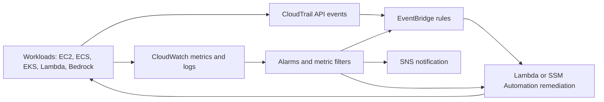

# Domain 1 (part 1): Monitoring, Logging, Analysis, and Remediation

Domain 1 is "Monitoring, Logging, Analysis, Remediation, and Performance Optimization" and carries **22%** of the scored content. It has three tasks. This note covers the first two: Task 1.1 (metrics, alarms, filters, dashboards, notifications) and Task 1.2 (finding and fixing problems from those signals). Task 1.3, performance optimization for compute, storage and databases, lives in its own note: [01b - Performance Optimization](./01b-performance-optimization.md).

The thread that runs through this whole domain is a loop: **collect** a signal, **decide** whether it matters, **notify** a human or **act** automatically, and then **verify** the fix. Most exam questions in this domain describe one broken link in that loop - a metric that is never collected, an alarm stuck in `INSUFFICIENT_DATA`, a rule that never fires, a runbook that has no permission - and ask you to find it.



The diagram shows the monitoring loop the exam keeps returning to: workloads emit metrics, logs and API events; alarms and EventBridge rules evaluate them; SNS tells people and Lambda or Systems Manager Automation fixes the resource.

---

## Task 1.1 - Implement metrics, alarms, and filters by using AWS monitoring and logging services

### 1.1.1 Configure monitoring and logging for workloads (CloudWatch, CloudTrail, Amazon Managed Service for Prometheus)

#### CloudWatch metrics: what you get for free and what you do not

A CloudWatch **metric** is a time-ordered set of data points identified by a **namespace** (for example `AWS/EC2` or `Custom/MyApp`), a **metric name** (`CPUUtilization`) and up to 30 **dimensions** (name/value pairs such as `InstanceId=i-0abc`). A metric with a different set of dimensions is a different metric. This matters when an alarm "has no data": very often the alarm is pointed at the right metric name but the wrong dimension combination, for example `AutoScalingGroupName` instead of `InstanceId`.

AWS services publish **standard (vended) metrics** automatically. The classic exam trap is EC2: the hypervisor can see CPU, network, disk operations on instance store and status checks, but it cannot see inside the guest operating system. So **memory utilization, disk space used and swap are not standard EC2 metrics**. To get them you install the CloudWatch agent (1.1.2) or publish them yourself with `PutMetricData`.

Basic EC2 monitoring publishes at 5-minute intervals; **detailed monitoring** (paid) publishes at 1-minute intervals. Custom metrics can be **standard resolution** (60 seconds) or **high resolution** (down to 1 second). High resolution only helps if the alarm also evaluates at a short period (10 or 30 seconds), and short-period alarms cost more.

**Metric math** lets you derive a new time series from existing ones, for example an error rate `100 * errors / requests`, and alarm on the result. **Anomaly detection** builds a band of expected values from the metric's history (it learns daily and weekly seasonality) and alarms when the value leaves the band. Use it when a fixed threshold would be wrong half the day, such as traffic that is naturally high at 9am and low at 3am.

```bash
# Publish a custom metric (one data point) from a script or cron job
aws cloudwatch put-metric-data \
  --namespace "Custom/Orders" \
  --metric-name QueueBacklog \
  --dimensions Service=checkout \
  --value 42 --unit Count
```

**[📖 CloudWatch metrics concepts](https://docs.aws.amazon.com/AmazonCloudWatch/latest/monitoring/cloudwatch_concepts.html)** - namespaces, dimensions, resolution and statistics
**[📖 Publishing custom metrics](https://docs.aws.amazon.com/AmazonCloudWatch/latest/monitoring/publishingMetrics.html)** - PutMetricData and high-resolution metrics
**[📖 Using metric math](https://docs.aws.amazon.com/AmazonCloudWatch/latest/monitoring/using-metric-math.html)** - expressions across metrics

#### CloudWatch Logs: groups, retention, filters and queries

Logs land in **log streams** (one per source, such as one per instance or per Lambda execution environment) grouped into **log groups**. Settings that matter operationally - **retention**, **KMS encryption**, **subscription filters**, **metric filters** and access policy - are set on the log group, not the stream. New log groups default to **never expire**, which is a silent cost leak; the fix is to set a retention period (from one day up to ten years).

A **metric filter** scans incoming log events for a pattern and increments a CloudWatch metric. It only counts events that arrive after the filter is created; it does not backfill history. This is the standard way to alarm on something that only exists in logs, such as `"ERROR"` lines, HTTP 5xx entries or a specific CloudTrail API call. The filter pattern syntax supports plain terms, space-delimited fields and JSON selectors such as `{ $.errorCode = "AccessDenied" }`.

A **subscription filter** streams matching log events in near real time to Lambda, Kinesis Data Streams, Amazon Data Firehose or OpenSearch Service. Use it for real-time processing or for centralizing logs from many accounts into one account (with a cross-account destination).

**CloudWatch Logs Insights** is the interactive query language. You use it to answer a question after the fact ("which IP generated the most 5xx errors in the last hour?"), not to alert. Queries can span many log groups and use commands like `fields`, `filter`, `stats`, `sort`, `parse` and `limit`:

```
fields @timestamp, @message
| filter @message like /ERROR/
| stats count(*) as errors by bin(5m)
| sort errors desc
```

**[📖 CloudWatch Logs concepts](https://docs.aws.amazon.com/AmazonCloudWatch/latest/logs/CloudWatchLogsConcepts.html)** - groups, streams, retention
**[📖 Creating metrics from log events using filters](https://docs.aws.amazon.com/AmazonCloudWatch/latest/logs/MonitoringLogData.html)** - metric filter patterns
**[📖 Analyzing log data with CloudWatch Logs Insights](https://docs.aws.amazon.com/AmazonCloudWatch/latest/logs/AnalyzingLogData.html)** - query syntax

#### AWS CloudTrail: who did what, when

CloudTrail records API activity. Three event categories matter for the exam:

- **Management events** - control-plane calls such as `RunInstances`, `PutBucketPolicy`, `CreateUser`. The last 90 days of management events are visible in **Event history** in every account at no charge, even without a trail.
- **Data events** - high-volume data-plane calls such as S3 `GetObject`/`PutObject`, Lambda `Invoke` and DynamoDB item operations. They are **off by default** and must be enabled on a trail (or event data store). "We cannot see who downloaded the object" almost always means data events are not enabled.
- **Insights events** - CloudTrail Insights learns your normal rate of write (and error) API calls and records an event when the rate is unusual, for example a sudden burst of `TerminateInstances`.

A **trail** delivers events to an S3 bucket and optionally to CloudWatch Logs. Create **multi-Region** trails (the default for new trails) so activity in a Region you never use is still recorded, and an **organization trail** from the management or delegated administrator account to capture every member account. Turn on **log file integrity validation**, which writes signed digest files so you can prove later that log files were not modified or deleted. Sending a trail to CloudWatch Logs is what lets you build metric filters and alarms on specific API calls (for example, alarm on any `ConsoleLogin` failure or any `StopLogging` call).

**[📖 What is AWS CloudTrail?](https://docs.aws.amazon.com/awscloudtrail/latest/userguide/cloudtrail-user-guide.html)** - events, trails, event history
**[📖 Logging data events](https://docs.aws.amazon.com/awscloudtrail/latest/userguide/logging-data-events-with-cloudtrail.html)** - enabling S3, Lambda and DynamoDB data events
**[📖 Validating CloudTrail log file integrity](https://docs.aws.amazon.com/awscloudtrail/latest/userguide/cloudtrail-log-file-validation-intro.html)** - digest files

#### Amazon Managed Service for Prometheus

Amazon Managed Service for Prometheus is a managed, Prometheus-compatible metrics store. You create a **workspace**, point Prometheus-format collectors at it (for EKS, either an AWS managed collector or an agent such as the AWS Distro for OpenTelemetry or Prometheus server using **remote write**), and query it with **PromQL**, typically from Amazon Managed Grafana. Choose it when a team already runs Prometheus exporters and dashboards on Kubernetes and wants to stop operating the storage and scaling themselves. Choose CloudWatch when the question is about AWS service metrics, alarms that trigger AWS actions, or the simplest native option. It also supports alerting rules and recording rules evaluated in the workspace, with alerts routed through an alert manager to SNS.

**[📖 What is Amazon Managed Service for Prometheus?](https://docs.aws.amazon.com/prometheus/latest/userguide/what-is-Amazon-Managed-Service-Prometheus.html)** - workspaces, ingestion, querying

#### Monitoring by workload type: serverless, compute, AI

The exam guide names three workload families, and each has its own "first metrics to look at".

**Serverless (Lambda).** Lambda publishes `Invocations`, `Errors`, `Throttles`, `Duration`, `ConcurrentExecutions` and, for stream and queue sources, `IteratorAge` and related metrics. Function logs go to CloudWatch Logs automatically, provided the execution role has the logs permissions (the `AWSLambdaBasicExecutionRole` managed policy). If a function runs but no logs appear, check the execution role before anything else. **Lambda Insights** adds system-level metrics (memory, CPU time, cold starts) through a Lambda extension layer. **AWS X-Ray** tracing (or CloudWatch Application Signals, which builds on OpenTelemetry) shows where time is spent across a chain of services; the X-Ray daemon listens on UDP port 2000.

**Compute (EC2, ECS, EKS).** Standard EC2 metrics plus the CloudWatch agent for memory and disk; **Container Insights** for ECS and EKS cluster, service, task and pod metrics; EC2 **status checks** (`StatusCheckFailed_System` for the underlying host, `StatusCheckFailed_Instance` for the guest OS, and `StatusCheckFailed_AttachedEBS` for attached volumes).

**AI (Amazon Bedrock).** Bedrock was added to the in-scope services in guide v1.1. The Bedrock runtime publishes metrics in the `AWS/Bedrock` namespace, including `Invocations`, `InvocationLatency`, `InvocationClientErrors`, `InvocationServerErrors`, `InvocationThrottles`, `InputTokenCount`, `OutputTokenCount` and, for streaming calls, `TimeToFirstToken`. Throttled requests are counted in `InvocationThrottles` and not in `Invocations`, so an alarm on throttles is how you spot a quota problem. **Model invocation logging** is off by default; when you enable it, Bedrock writes request and response data to CloudWatch Logs and/or S3, which is how you audit what was sent to a model. Bedrock API calls themselves are recorded by CloudTrail like any other service.

**[📖 Monitoring Lambda functions](https://docs.aws.amazon.com/lambda/latest/dg/lambda-monitoring.html)** - metrics, logs, Lambda Insights
**[📖 Monitor Bedrock runtime inference using CloudWatch metrics](https://docs.aws.amazon.com/bedrock/latest/userguide/monitoring-runtime-metrics.html)** - the AWS/Bedrock namespace
**[📖 Monitor model invocation using CloudWatch Logs and Amazon S3](https://docs.aws.amazon.com/bedrock/latest/userguide/model-invocation-logging.html)** - enabling invocation logging
**[📖 AWS X-Ray concepts](https://docs.aws.amazon.com/xray/latest/devguide/xray-concepts.html)** - traces, segments, sampling

### 1.1.2 Configure and manage the CloudWatch agent (EC2, ECS, EKS)

The **unified CloudWatch agent** runs on EC2 instances and on-premises servers (Linux and Windows) and collects two things the hypervisor cannot see: **guest OS metrics** (memory, disk space, swap, per-process metrics through `procstat`, and custom application metrics through StatsD or collectd) and **log files** (application logs, `/var/log/messages`, Windows Event Log).

A working agent needs four things, and each one is a classic troubleshooting answer:

1. **The agent installed** - by package, by Systems Manager Distributor (package `AmazonCloudWatchAgent`), or baked into the AMI.
2. **A configuration file** - a JSON file with `agent`, `metrics` and `logs` sections. You can generate it with the configuration wizard and **store it in Systems Manager Parameter Store**, so every instance can fetch the same configuration. Fleets are then configured with the `AmazonCloudWatch-ManageAgent` Run Command document or a State Manager association that re-applies it on a schedule.
3. **Permissions** - an instance profile role with the `CloudWatchAgentServerPolicy` managed policy (plus Parameter Store read access if the configuration lives there). On-premises servers use credentials in a named profile instead.
4. **A network path** - to the CloudWatch and CloudWatch Logs endpoints. Instances in private subnets with no NAT need **interface VPC endpoints** for `monitoring` and `logs`.

When metrics are missing, read the agent's own log (on Linux, `/opt/aws/amazon-cloudwatch-agent/logs/amazon-cloudwatch-agent.log`). It usually names the problem directly: access denied, a malformed configuration, or a timeout reaching the endpoint.

```json
{
  "metrics": {
    "append_dimensions": { "InstanceId": "${aws:InstanceId}" },
    "metrics_collected": {
      "mem":  { "measurement": ["mem_used_percent"] },
      "disk": { "measurement": ["used_percent"], "resources": ["/"] }
    }
  },
  "logs": {
    "logs_collected": {
      "files": { "collect_list": [
        { "file_path": "/var/log/app/app.log", "log_group_name": "app-logs",
          "log_stream_name": "{instance_id}", "retention_in_days": 30 }
      ]}
    }
  }
}
```

**Containers.** For **ECS**, enable **Container Insights** on the cluster to collect cluster, service and task metrics; for EC2-backed clusters you can also run the agent as a daemon service for instance-level metrics. Container stdout and stderr reach CloudWatch Logs through the `awslogs` log driver in the task definition (or FireLens for routing to other destinations). For **EKS**, the recommended path is the **Amazon CloudWatch Observability EKS add-on**, which deploys the CloudWatch agent and Fluent Bit as DaemonSets and turns on Container Insights (including the enhanced observability metrics). The node or pod identity used by the agent needs the same `CloudWatchAgentServerPolicy` permissions.

**[📖 Collect metrics and logs with the CloudWatch agent](https://docs.aws.amazon.com/AmazonCloudWatch/latest/monitoring/Install-CloudWatch-Agent.html)** - installation and setup
**[📖 CloudWatch agent configuration file](https://docs.aws.amazon.com/AmazonCloudWatch/latest/monitoring/CloudWatch-Agent-Configuration-File-Details.html)** - every section explained
**[📖 Container Insights](https://docs.aws.amazon.com/AmazonCloudWatch/latest/monitoring/ContainerInsights.html)** - ECS, EKS and Kubernetes on EC2

### 1.1.3 Configure, identify and troubleshoot CloudWatch alarms

#### How a metric alarm decides

A metric alarm watches one metric or one metric math expression and has three states: `OK`, `ALARM` and `INSUFFICIENT_DATA`. Three numbers control it:

- **Period** - the length of each evaluation bucket (for example 60 seconds).
- **Evaluation periods (N)** - how many recent periods to look at.
- **Datapoints to alarm (M)** - how many of those N must breach. "3 out of 5" (M of N) tolerates a single spike; "5 out of 5" requires a sustained breach.

**Missing data treatment** decides what a gap means: `missing` (the default, ignore the gap when possible), `notBreaching`, `breaching` or `ignore`. For a metric that only exists when something goes wrong (for example a metric filter counting errors), set `notBreaching` so the alarm returns to `OK` in quiet periods. For a heartbeat metric whose absence is the problem, set `breaching`.

An alarm stuck in `INSUFFICIENT_DATA` usually means one of: the metric does not exist with those exact dimensions; the period is shorter than the metric's publishing interval (a 1-minute alarm on a 5-minute basic-monitoring metric); or the resource has stopped reporting.

#### What an alarm can do directly

Alarm **actions** run on state transitions (`ALARM`, `OK` or `INSUFFICIENT_DATA`). Supported direct actions are:

- **SNS** - notify a topic (email, SMS, HTTPS, SQS, Lambda subscribers).
- **EC2 Auto Scaling** - run a step or simple scaling policy (target tracking creates and owns its own alarms).
- **EC2 actions** - stop, terminate, reboot or **recover** an instance. Recover moves the instance to new hardware and keeps its instance ID, private IPs, Elastic IPs and EBS volumes; use it with `StatusCheckFailed_System`.
- **Lambda** - an alarm can invoke a Lambda function directly.
- **Systems Manager** - create an OpsCenter OpsItem or a Systems Manager incident.

Anything else - starting a Systems Manager Automation runbook, a Step Functions workflow, sending to another account's bus - goes **through EventBridge**. Every alarm state change also emits a `CloudWatch Alarm State Change` event to the default event bus, so you can write a rule that matches a specific alarm name and new state and target whatever you need. This is "alarms that invoke AWS services directly or through EventBridge" in the guide.

#### Composite alarms

A **composite alarm** has no metric. Its state is a rule over other alarms, using `AND`, `OR` and `NOT`, for example `ALARM(HighCPU) AND ALARM(HighLatency)`. You use composites for two reasons. First, **noise reduction**: page only when several symptoms agree, while the child alarms stay silent (no actions). Second, **action suppression**: a composite can be configured with a suppressor alarm, so during a known event (for example a deployment or a maintenance alarm in `ALARM`) its actions are held back.

#### Troubleshooting checklist

| Symptom | Likely cause |
|---|---|
| Alarm never leaves `INSUFFICIENT_DATA` | Wrong dimensions, wrong Region, period shorter than publishing interval |
| Alarm flaps between `OK` and `ALARM` | Datapoints to alarm too low; use M of N or a composite |
| Alarm in `ALARM` but no email | SNS subscription unconfirmed; topic access policy does not allow `cloudwatch.amazonaws.com`; encrypted topic whose KMS key policy does not let CloudWatch use the key |
| EventBridge rule never fires on alarm | Pattern does not match `detail-type` "CloudWatch Alarm State Change" or the exact alarm name; rule on a different bus or Region |
| EC2 recover action not available | Instance type or configuration does not support recovery (for example instance store volumes) |

**[📖 Using Amazon CloudWatch alarms](https://docs.aws.amazon.com/AmazonCloudWatch/latest/monitoring/AlarmThatSendsEmail.html)** - states, evaluation, missing data, actions
**[📖 Combining alarms (composite alarms)](https://docs.aws.amazon.com/AmazonCloudWatch/latest/monitoring/Create_Composite_Alarm.html)** - rule expressions and suppression
**[📖 Create alarms to stop, terminate, reboot, or recover an instance](https://docs.aws.amazon.com/AWSEC2/latest/UserGuide/UsingAlarmActions.html)** - EC2 alarm actions

### 1.1.4 Create and manage customizable, shareable dashboards across accounts and Regions

A CloudWatch **dashboard** is a JSON document of widgets (line, stacked area, number, gauge, bar, text, alarm status, Logs Insights query results, and custom widgets backed by Lambda). Dashboards are global: one dashboard can show widgets from **any Region**, because each widget names its own Region.

For **multiple accounts**, use **CloudWatch cross-account observability**: you designate a **monitoring account** and link **source accounts** to it (manually or for a whole organization). The monitoring account can then browse, graph, query and alarm on metrics, logs and traces from the source accounts as if they were local. The older approach, the cross-account cross-Region console option with a sharing role in each account, still exists, but the exam's "single pane of glass across the organization" answer is the monitoring account.

Ways to **share** a dashboard with people who have no AWS console access: share with specific email addresses, share publicly with a link, or share through a single sign-on provider. Behind the scenes CloudWatch uses an Amazon Cognito identity pool so viewers get read-only access to just the shared dashboard.

To keep dashboards **consistent and reviewable**, define them as code: `PutDashboard` with a JSON body, or the `AWS::CloudWatch::Dashboard` CloudFormation resource. **Automatic dashboards** give you a per-service starting point with no work. Text widgets are a good place to link the runbook for each panel.

**[📖 Using Amazon CloudWatch dashboards](https://docs.aws.amazon.com/AmazonCloudWatch/latest/monitoring/CloudWatch_Dashboards.html)** - widgets, sharing, cross-account
**[📖 CloudWatch cross-account observability](https://docs.aws.amazon.com/AmazonCloudWatch/latest/monitoring/CloudWatch-Unified-Cross-Account.html)** - monitoring and source accounts
**[📖 Sharing CloudWatch dashboards](https://docs.aws.amazon.com/AmazonCloudWatch/latest/monitoring/cloudwatch-dashboard-sharing.html)** - email, public and SSO sharing

### 1.1.5 Configure services and alarms to notify Amazon SNS

Amazon SNS is the fan-out point for operational notifications. A **topic** has **subscriptions** (email, SMS, HTTPS, SQS, Lambda, Amazon Data Firehose and mobile push). Email subscriptions must be **confirmed** by the recipient before they receive anything - "the alarm fired but nobody got the email" is often just an unconfirmed subscription.

Many services can publish to SNS directly. Know these examples: **CloudWatch alarms**, **EC2 Auto Scaling** lifecycle notifications (launch, terminate, failures), **CloudFormation** stack events, **RDS event subscriptions** (failover, reboot, low storage), **S3 Event Notifications**, **AWS Config** (configuration and compliance changes through its delivery channel), **AWS Backup** job notifications, **CloudTrail** (log delivery notifications) and **AWS Budgets**. For anything else, an **EventBridge rule with an SNS target** turns any service event into a notification.

Two permission traps come up repeatedly:

1. **Topic access policy.** When a service publishes on your behalf (S3, CloudWatch, EventBridge), the topic's resource policy must allow that service principal to call `sns:Publish`, usually scoped with `aws:SourceArn` or `aws:SourceAccount`.
2. **Encrypted topics.** If the topic uses SSE with a customer managed KMS key, the **key policy** must also let the publishing service use the key (`kms:GenerateDataKey*` and `kms:Decrypt`). An encrypted topic with the default AWS managed key cannot receive from these services, because you cannot edit that key's policy.

**[📖 Amazon SNS access control examples](https://docs.aws.amazon.com/sns/latest/dg/sns-access-policy-use-cases.html)** - allowing services to publish
**[📖 Amazon SNS encryption at rest](https://docs.aws.amazon.com/sns/latest/dg/sns-server-side-encryption.html)** - key policy requirements for publishers

---

## Task 1.2 - Identify and remediate issues by using monitoring and availability metrics

### 1.2.1 Analyze performance metrics and automate remediation

Analysis on the exam means reading a set of symptoms and choosing the cheapest reliable automation. A few standard pairings:

| Signal | Automated remediation |
|---|---|
| `StatusCheckFailed_System` on an instance | Alarm with the EC2 **recover** action (or rely on simplified automatic recovery, which is on by default for supported instances) |
| `StatusCheckFailed_Instance` | Alarm with the **reboot** action, or an Automation runbook to collect diagnostics then reboot |
| Disk nearly full (agent `disk_used_percent`) | Alarm, then EventBridge, then an Automation runbook that cleans logs or expands the EBS volume |
| Risky API call (for example a security group opened to 0.0.0.0/0) | CloudTrail event, then EventBridge rule, then Lambda or Automation that reverts it |
| Resource drifts from a compliance rule | AWS Config rule with automatic remediation through an Automation runbook |
| Unhealthy instances behind a load balancer | Auto Scaling group with **ELB health checks** replaces them (see Domain 2) |

**CloudTrail in analysis.** When a metric changes suddenly, the next question is "what changed?". CloudTrail event history (or a CloudTrail Lake or Athena query) shows the API calls around that time: a modified security group, a resized instance, a parameter group change.

**Systems Manager in analysis.** **OpsCenter** collects OpsItems (from alarms, EventBridge rules or Config) with related resources and links to runbooks, so the operator has one place to triage and run the fix.

#### AWS Health Dashboard

Not every problem is yours. The **AWS Health Dashboard** has a public view of service status and a personalized **your account health** view of events that affect your resources: service issues in a Region you use, **scheduled changes** (for example an EC2 instance scheduled for retirement or maintenance), and account notifications such as expiring certificates. AWS Health publishes these events to **EventBridge** (source `aws.health`), so you can automate a response - for example a rule that matches an EC2 scheduled retirement event and runs a runbook to stop and start the instance onto new hardware in your own maintenance window. With AWS Organizations you can enable an organizational view to see events for all accounts in one place.

**[📖 AWS Health events on Amazon EventBridge](https://docs.aws.amazon.com/health/latest/ug/aws-health-concepts-and-terms.html)** - event types and concepts
**[📖 AWS Health event structure in EventBridge](https://docs.aws.amazon.com/eventbridge/latest/ref/events-ref-health.html)** - matching aws.health events

#### Kiro and AWS DevOps Agent (added in guide v1.1)

Version 1.1 of the exam guide names two AI tools in this task. Learn what each one is for; the exam is about choosing the right tool, not about deep configuration.

- **Kiro** is an agentic development system from AWS, available as an IDE, a CLI and an autonomous web agent. It helps developers go from a stated intent to working, validated code across large codebases. In an operations context, think of it as the place where code-level fixes are written: for example, AWS DevOps Agent can produce agent-ready instructions for a code improvement that Kiro then implements. AWS also publishes Kiro "powers" that connect it to services such as AWS DevOps Agent and CloudFormation/CDK.
- **AWS DevOps Agent** is an AI-powered operations agent. When an alert or ticket arrives it **investigates automatically**, correlating telemetry (CloudWatch and third-party observability tools), code and deployment data to find a likely root cause, then proposes a **mitigation plan** with steps to resolve, validate and revert. It also analyzes past incidents to recommend **preventive** improvements, handles on-demand SRE questions in natural language, and can route findings to Slack, ServiceNow or PagerDuty or open an AWS Support case. It is organized into **Agent Spaces**, logical containers that define which accounts and tools the agent may access; administrators configure Agent Spaces in the AWS console and operators work in the DevOps Agent web app.

The exam-level distinction: CloudWatch alarms, EventBridge and Systems Manager Automation are **deterministic** remediation you design in advance. DevOps Agent helps **investigate** an incident whose cause you do not yet know and proposes what to do. Kiro is a **development** tool for writing the code or infrastructure change.

**[📖 About AWS DevOps Agent](https://docs.aws.amazon.com/devopsagent/latest/userguide/about-aws-devops-agent.html)** - capabilities, Agent Spaces and the web app
**[📖 Kiro in the AWS overview](https://docs.aws.amazon.com/whitepapers/latest/aws-overview/machine-learning.html)** - what Kiro is

### 1.2.2 Use EventBridge to route, enrich and deliver events, and troubleshoot event bus rules

Amazon EventBridge receives events on an **event bus** and uses **rules** to send matching events to **targets**.

- The **default bus** in each account and Region receives events from AWS services (EC2 state changes, Auto Scaling, Health, CloudWatch alarm state changes, Config, GuardDuty, and API calls recorded by CloudTrail).
- **Custom buses** receive your applications' events (`PutEvents`) and events forwarded from other accounts.
- **Partner buses** receive events from SaaS partners.

A rule has either an **event pattern** or a schedule (for new schedules AWS recommends **EventBridge Scheduler**, which supports one-time and recurring schedules with time zones). A pattern is JSON that must match the event's structure exactly, for example:

```json
{
  "source": ["aws.ec2"],
  "detail-type": ["EC2 Instance State-change Notification"],
  "detail": { "state": ["stopped", "terminated"] }
}
```

**Routing and delivery.** One rule can have up to five targets: Lambda, SNS, SQS, Step Functions, Systems Manager Automation and Run Command, ECS tasks, Kinesis, another event bus (including one in another account or Region), API destinations and more. Each target has a **retry policy** and an optional **dead-letter queue** (SQS) for events that could not be delivered. **Archive and replay** keeps events so you can re-send them after fixing a broken consumer.

**Enrichment.** An **input transformer** reshapes the event before delivery: extract fields into variables and build a readable message ("Instance i-0abc in us-east-1 is now stopped") instead of sending raw JSON to an email subscriber. **EventBridge Pipes** connect a source (such as SQS, Kinesis or DynamoDB Streams) to a target with optional filtering and an **enrichment** step (Lambda, Step Functions, API Gateway or an API destination) that can add data before delivery.

**Troubleshooting a rule that does not fire or does not deliver:**

1. **Is the rule on the right bus and in the right Region?** Events are Regional. Events from **global services such as IAM** are emitted in **us-east-1**, so a rule for `CreateUser` in another Region never matches.
2. **Does the pattern match?** Matching is exact and case-sensitive; check field names, nesting and array syntax. Test with the sandbox or `aws events test-event-pattern`.
3. **Is the event even produced?** Events with a CloudTrail `detail-type` (such as "AWS API Call via CloudTrail") need a **CloudTrail trail with logging enabled**, and they arrive on the **default bus only**. A rule in the normal `ENABLED` state matches write (mutating) management events; to match read-only calls (`Get`, `List`, `Describe`) the rule state must be `ENABLED_WITH_ALL_CLOUDTRAIL_MANAGEMENT_EVENTS`.
4. **Can EventBridge invoke the target?** Lambda, SNS and SQS targets need a **resource-based policy** allowing `events.amazonaws.com`; Automation, Step Functions, ECS and Kinesis targets need an **IAM role** that EventBridge assumes. Check the rule's `FailedInvocations` CloudWatch metric (and `TriggeredRules`/`Invocations` to see whether matching happened at all).
5. **Encrypted target?** An encrypted SQS queue or SNS topic needs a KMS key policy that allows EventBridge.

**[📖 What is Amazon EventBridge?](https://docs.aws.amazon.com/eventbridge/latest/userguide/eb-what-is.html)** - buses, rules, targets
**[📖 Event patterns](https://docs.aws.amazon.com/eventbridge/latest/userguide/eb-event-patterns.html)** - matching syntax
**[📖 Input transformation](https://docs.aws.amazon.com/eventbridge/latest/userguide/eb-transform-target-input.html)** - reshaping events for targets
**[📖 Troubleshooting Amazon EventBridge](https://docs.aws.amazon.com/eventbridge/latest/userguide/eb-troubleshooting.html)** - rules that do not fire or deliver

### 1.2.3 Create and run custom and predefined Systems Manager Automation runbooks

**Automation** is the Systems Manager capability for multi-step operational tasks across AWS resources. A **runbook** is an Automation document (schema version 0.3, YAML or JSON) made of steps. AWS provides hundreds of **predefined runbooks** (names starting `AWS-`, `AWSSupport-` or `AWSConfigRemediation-`), for example:

- `AWS-RestartEC2Instance`, `AWS-StopEC2Instance` - simple lifecycle actions.
- `AWS-CreateImage`, `AWS-UpdateLinuxAmi` - image creation and patching (EC2 Image Builder is the managed alternative, see Domain 3).
- `AWSSupport-ExecuteEC2Rescue` - diagnose and fix an unreachable instance.
- `AWSConfigRemediation-*` - the runbooks AWS Config uses for automatic remediation.

**Custom runbooks** chain actions such as `aws:executeAwsApi` (call any API), `aws:executeScript` (run Python or PowerShell inside the step), `aws:runCommand` (run a command on instances), `aws:waitForAwsResourceProperty`, `aws:branch` (conditional logic), `aws:approve` (pause for a human approval) and `aws:sleep`.

```yaml
schemaVersion: '0.3'
description: Snapshot then reboot an instance
assumeRole: '{{ AutomationAssumeRole }}'
parameters:
  InstanceId: { type: String }
  AutomationAssumeRole: { type: String }
mainSteps:
  - name: snapshotRoot
    action: aws:executeScript
    inputs:
      Runtime: python3.11
      Handler: handler
      InputPayload: { InstanceId: '{{ InstanceId }}' }
      Script: |
        import boto3
        def handler(event, context):
            ec2 = boto3.client('ec2')
            vols = ec2.describe_instances(InstanceIds=[event['InstanceId']])
            # ...create snapshots of attached volumes...
            return {'status': 'ok'}
  - name: reboot
    action: aws:executeAwsApi
    inputs:
      Service: ec2
      Api: RebootInstances
      InstanceIds: ['{{ InstanceId }}']
```

**Running runbooks.** You can start an execution from the console, CLI or any SDK (`StartAutomationExecution`), from an EventBridge rule target, from an AWS Config remediation action, from a State Manager association or maintenance window, or from OpsCenter. Executions can target many resources at once by **tag**, resource group or parameter values, with **rate control** (maximum concurrency and error threshold) so a bad runbook stops before it damages the whole fleet. Automation can also run across **multiple accounts and Regions** from a central account.

**Permissions.** A runbook runs with the permissions of the caller unless it specifies an **assume role** (`AutomationAssumeRole`). For anything triggered by a service (EventBridge, Config), use a dedicated assume role with exactly the permissions the steps need, and remember the caller needs `iam:PassRole` for that role. "The runbook fails with AccessDenied on step 2" is a permissions question on the assume role, not on the person who clicked Run.

**[📖 AWS Systems Manager Automation](https://docs.aws.amazon.com/systems-manager/latest/userguide/systems-manager-automation.html)** - runbooks, executions, rate control
**[📖 Systems Manager Automation runbook reference](https://docs.aws.amazon.com/systems-manager-automation-runbooks/latest/userguide/automation-runbook-reference.html)** - predefined runbooks
**[📖 Automation actions reference](https://docs.aws.amazon.com/systems-manager/latest/userguide/automation-actions.html)** - every step type

---

## Exam traps

- **Memory and disk space are not standard EC2 metrics.** The answer is the CloudWatch agent, configured from Parameter Store, with `CloudWatchAgentServerPolicy` on the instance role.
- **Metric filters do not backfill.** They count only events ingested after creation.
- **Data events are off by default** in CloudTrail; "who read this S3 object?" needs them.
- **Alarms cannot run an Automation runbook directly.** Go alarm, then EventBridge, then Automation. Alarms can call SNS, Auto Scaling, EC2 actions, Lambda and Systems Manager OpsItems or incidents directly.
- **IAM events land in us-east-1.** An EventBridge rule for an IAM API call in another Region never fires.
- **Target permissions differ.** Lambda, SNS and SQS targets need a resource policy; most others need an IAM role.
- **Encrypted SNS topics** need a customer managed key whose policy allows the publishing service.
- **Composite alarms** reduce noise and can suppress actions during known events.
- **Cross-account dashboards and alarms**: use a CloudWatch cross-account observability monitoring account.
- **DevOps Agent investigates; Automation executes.** Choose deterministic automation (EventBridge plus Automation) for a known fix, DevOps Agent for root-cause investigation, Kiro for writing the code change.

## Key terms

- **CloudWatch namespace** - a container for metrics such as AWS/EC2 or Custom/MyApp; metrics in different namespaces are separate
- **Metric dimension** - a name/value pair such as InstanceId that identifies a metric; a different dimension set is a different metric
- **Metric filter** - a CloudWatch Logs pattern that turns matching log events into a metric; it does not backfill older events
- **Subscription filter** - streams matching log events in near real time to Lambda, Kinesis, Firehose or OpenSearch
- **CloudTrail data events** - high-volume data-plane calls such as S3 GetObject; off by default and must be enabled on a trail
- **CloudTrail Insights** - detects unusual rates of write API calls or errors compared with the account's normal baseline
- **Datapoints to alarm** - the M in an M-of-N alarm: how many of the last N evaluation periods must breach to enter ALARM
- **Composite alarm** - an alarm whose state is an AND/OR/NOT rule over other alarms, used to cut noise and suppress actions
- **EC2 recover action** - alarm action that moves an instance to new hardware keeping its ID, IPs and EBS volumes
- **Cross-account observability** - links source accounts to a CloudWatch monitoring account that can view their metrics, logs and traces
- **Input transformer** - EventBridge feature that reshapes an event into a custom payload before it is delivered to a target
- **AutomationAssumeRole** - the IAM role a Systems Manager Automation runbook assumes to perform its steps
- **AWS Health events** - account-specific service issues and scheduled changes, published to EventBridge with source aws.health
- **AWS DevOps Agent** - AI operations agent that investigates incidents by correlating telemetry, code and deployments and proposes mitigations
- **Kiro** - agentic development system from AWS, available as an IDE, CLI and autonomous agent, used to write and validate code changes

## Vendor documentation

**[📖 SOA-C03 Domain 1 in the exam guide](https://docs.aws.amazon.com/aws-certification/latest/sysops-administrator-associate-03/sysops-administrator-associate-03-domain1.html)** - the official task statements
**[📖 What is Amazon CloudWatch?](https://docs.aws.amazon.com/AmazonCloudWatch/latest/monitoring/WhatIsCloudWatch.html)** - service overview
**[📖 What is Amazon CloudWatch Logs?](https://docs.aws.amazon.com/AmazonCloudWatch/latest/logs/WhatIsCloudWatchLogs.html)** - log service overview
**[📖 What is AWS Systems Manager?](https://docs.aws.amazon.com/systems-manager/latest/userguide/what-is-systems-manager.html)** - capabilities overview
**[📖 Amazon SNS developer guide](https://docs.aws.amazon.com/sns/latest/dg/welcome.html)** - topics and subscriptions
