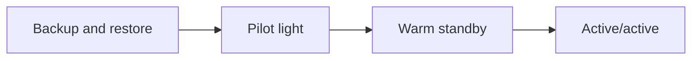

# Domain 2: Reliability and Business Continuity

Domain 2 carries **22%** of the scored content. It has three tasks: **2.1** scalability and elasticity, **2.2** highly available and resilient environments, and **2.3** backup and restore. As an operations exam, SOA-C03 asks less about designing these patterns from scratch (designing distributed architectures is listed as out of scope) and more about **configuring, troubleshooting and running** them: why an Auto Scaling group is not scaling, why a health check marks good targets unhealthy, how to restore a database to 10:42 this morning.

---

## Task 2.1 - Implement scalability and elasticity

### 2.1.1 Configure and manage scaling mechanisms in compute environments

#### EC2 Auto Scaling groups

An **Auto Scaling group (ASG)** keeps a number of instances between a **minimum** and **maximum**, aiming at a **desired capacity**, spread across the subnets (and so the Availability Zones) you give it. It launches instances from a **launch template**. Launch templates are versioned and support mixed instance types and purchase options; the older launch configurations cannot be created for new groups and should be migrated. A **mixed instances policy** lets one group combine On-Demand and Spot capacity across several instance types, which improves both cost and the chance of getting capacity.

**Scaling policies**, from most to least commonly correct:

- **Target tracking** - "keep average CPU at 50%" or "keep `ALBRequestCountPerTarget` at 1000". The group creates and manages its own CloudWatch alarms. This is the default answer for "scale with load".
- **Step scaling** - different adjustments for different alarm breach sizes (add 1 instance at 60% CPU, 3 at 80%). Use it when you need explicit control.
- **Simple scaling** - one adjustment per alarm, then a cooldown. Legacy; prefer step or target tracking.
- **Scheduled scaling** - change min, max or desired at known times (business hours, month-end batch).
- **Predictive scaling** - forecasts load from history and launches capacity ahead of a recurring daily or weekly peak. Combine it with target tracking for the unexpected.

Other knobs that come up in troubleshooting:

- **Default instance warmup** (and the health check grace period) - stops metrics from a booting instance from triggering more scaling, and stops health checks from killing an instance that is still starting.
- **Warm pools** - keep pre-initialized instances stopped (or running, or hibernated) so scale-out is fast for applications with long boot times.
- **Lifecycle hooks** - pause an instance in `Pending:Wait` or `Terminating:Wait` to run setup or drain work, then complete the action with `CONTINUE` or `ABANDON`.
- **Instance refresh** - replace instances in rolling batches after a launch template or AMI change, with a minimum healthy percentage and optional checkpoints.
- **Termination policies and scale-in protection** - control which instance goes first, or protect specific instances.

**Why is my ASG not scaling out?** Work through: is desired already at **max**? Does the launch template reference a valid **AMI**, key pair and security group? Does the subnet have free **IP addresses**? Is there **capacity** for that instance type in that AZ (add types or AZs)? Is a **service quota** (vCPU limit) reached? Is the launch failing on **KMS** permissions for an encrypted AMI or volume? The group's **activity history** shows the exact error.

#### Containers and serverless

- **ECS service auto scaling** uses Application Auto Scaling to change a service's desired task count with target tracking (for example on `ECSServiceAverageCPUUtilization`), step or scheduled policies. On EC2-backed clusters, **capacity providers** with **managed scaling** grow the underlying ASG so new tasks have somewhere to run. Fargate removes that second layer.
- **EKS** scales pods with the Horizontal Pod Autoscaler and nodes with Cluster Autoscaler or Karpenter (or EKS Auto Mode, which manages nodes for you).
- **Lambda** scales by itself. Your levers are **reserved concurrency** (cap and guarantee for one function), **provisioned concurrency** (pre-initialized environments, which can itself be scaled with Application Auto Scaling) and the account concurrency quota.

**[📖 What is Amazon EC2 Auto Scaling?](https://docs.aws.amazon.com/autoscaling/ec2/userguide/what-is-amazon-ec2-auto-scaling.html)** - groups, launch templates, capacity
**[📖 Dynamic scaling for Amazon EC2 Auto Scaling](https://docs.aws.amazon.com/autoscaling/ec2/userguide/as-scale-based-on-demand.html)** - target tracking, step and simple scaling
**[📖 Predictive scaling](https://docs.aws.amazon.com/autoscaling/ec2/userguide/ec2-auto-scaling-predictive-scaling.html)** - forecast-based scaling
**[📖 Amazon EC2 Auto Scaling lifecycle hooks](https://docs.aws.amazon.com/autoscaling/ec2/userguide/lifecycle-hooks.html)** - custom actions on launch and terminate
**[📖 Troubleshooting Amazon EC2 Auto Scaling](https://docs.aws.amazon.com/autoscaling/ec2/userguide/CHAP_Troubleshooting.html)** - launch failures and their messages
**[📖 ECS service auto scaling](https://docs.aws.amazon.com/AmazonECS/latest/developerguide/service-auto-scaling.html)** - scaling task counts

### 2.1.2 Implement caching to enhance dynamic scalability

Caching scales a system by taking repeated reads off the origin. The exam names two services.

**Amazon CloudFront** caches content at edge locations close to users. For dynamic sites it still helps: static assets are cached for a long time, API responses for a short time (even a few seconds of caching absorbs a traffic spike), and uncacheable requests still benefit from persistent connections to the origin over the AWS network. **Origin Shield** adds a central caching layer in front of the origin so that many edge locations do not all miss to the origin. Cache behavior and invalidation troubleshooting is Task 5.3.3 in [note 05](./05-networking.md#533-identify-and-remediate-cloudfront-caching-issues).

**Amazon ElastiCache** (Valkey, Redis OSS or Memcached engines) caches database query results, sessions and computed values in memory.

- **Lazy loading (cache-aside)** - read from cache; on a miss, read the database and write the result to the cache. Only requested data is cached, but the first read is slow and data can go stale.
- **Write-through** - update the cache every time the database is written. Data is fresh, but you cache data nobody reads.
- **TTL** - an expiry on every key bounds staleness; combine it with either strategy.
- Valkey and Redis OSS support replication, Multi-AZ automatic failover, persistence and rich data types; Memcached is a simple multi-threaded cache with no replication. **ElastiCache Serverless** removes capacity planning entirely.
- Watch `CPUUtilization` (or `EngineCPUUtilization`), `Evictions` (memory too small), `CacheHits`/`CacheMisses`, and `CurrConnections`.

**DynamoDB Accelerator (DAX)** is the DynamoDB-specific in-memory cache: an API-compatible write-through cache with microsecond reads, so applications switch to it with a client change rather than new cache logic.

**[📖 Amazon CloudFront caching](https://docs.aws.amazon.com/AmazonCloudFront/latest/DeveloperGuide/ConfiguringCaching.html)** - cache keys, TTLs, Origin Shield
**[📖 ElastiCache caching strategies](https://docs.aws.amazon.com/AmazonElastiCache/latest/dg/Strategies.html)** - lazy loading, write-through, TTL
**[📖 In-memory acceleration with DAX](https://docs.aws.amazon.com/amazondynamodb/latest/developerguide/DAX.html)** - DynamoDB caching

### 2.1.3 Configure and manage scaling in AWS managed databases (RDS, DynamoDB)

#### Amazon RDS and Aurora

- **Vertical scaling** - change the instance class. On Multi-AZ this is applied to the standby first and then fails over, so downtime is short.
- **Read scaling** - **read replicas** use asynchronous replication and can be in the same or another Region. They serve reads and can be **promoted** to standalone databases (used in DR). Monitor `ReplicaLag`.
- **Aurora** shares one cluster volume across up to 15 **Aurora Replicas**, offers a **reader endpoint** that load-balances across them, and supports **Aurora Auto Scaling** of replicas based on CPU or connections. **Aurora Serverless v2** scales capacity in fine-grained increments of Aurora capacity units (ACUs) between a minimum and maximum you set.
- **Storage autoscaling** grows RDS storage automatically when free space runs low, up to a maximum you define.
- **RDS Proxy** pools connections so a scaling application tier does not exhaust the database's connection limit (see [note 01b](./01b-performance-optimization.md#135-monitor-rds-metrics-and-modify-configurations)).

#### Amazon DynamoDB

- **On-demand capacity mode** - pay per request, no capacity planning, instantly accommodates traffic up to previous peaks and beyond. Best for unknown or spiky traffic.
- **Provisioned capacity mode** - you set read and write capacity units, optionally with **auto scaling** (target tracking on consumed capacity). Cheaper for steady, predictable load. Auto scaling reacts in minutes, so a sudden spike can still throttle.
- **Throttling** shows as `ReadThrottleEvents`/`WriteThrottleEvents` and `ThrottledRequests`. Causes: capacity too low, a **hot partition key** (adaptive capacity helps but cannot fix a single very hot key), or a **global secondary index** with too little write capacity, which throttles writes on the base table.
- **Global tables** replicate a table across Regions for multi-Region reads and writes.

**[📖 Working with read replicas](https://docs.aws.amazon.com/AmazonRDS/latest/UserGuide/USER_ReadRepl.html)** - creating, monitoring and promoting replicas
**[📖 Aurora Auto Scaling with Aurora Replicas](https://docs.aws.amazon.com/AmazonRDS/latest/AuroraUserGuide/Aurora.Integrating.AutoScaling.html)** - replica scaling policies
**[📖 Aurora Serverless v2](https://docs.aws.amazon.com/AmazonRDS/latest/AuroraUserGuide/aurora-serverless-v2.html)** - ACU-based scaling
**[📖 DynamoDB read/write capacity modes](https://docs.aws.amazon.com/amazondynamodb/latest/developerguide/capacity-mode.html)** - on-demand versus provisioned
**[📖 Managing throughput capacity with DynamoDB auto scaling](https://docs.aws.amazon.com/amazondynamodb/latest/developerguide/AutoScaling.html)** - target tracking for tables and indexes

---

## Task 2.2 - Implement highly available and resilient environments

### 2.2.1 Configure and troubleshoot ELB and Route 53 health checks

#### Elastic Load Balancing health checks

Each **target group** has its own health check: protocol, port, path (for HTTP/HTTPS), success codes, interval, timeout, and the healthy and unhealthy threshold counts. A target receives traffic only while healthy.

Load balancer types, briefly: **Application Load Balancer** (layer 7, HTTP/HTTPS, path and host routing, Lambda targets), **Network Load Balancer** (layer 4, TCP/UDP/TLS, static IP per AZ, very high throughput, preserves client IP), **Gateway Load Balancer** (layer 3, inserts third-party appliances using GENEVE on port 6081).

**Why are healthy instances marked unhealthy?**

| Cause | Fix |
|---|---|
| Instance **security group** does not allow traffic from the load balancer's security group (or NLB source IPs) on the health check port | Allow it |
| Health check **path** returns 301/302/404 or requires authentication | Point at a lightweight `/health` page that returns 200, or widen success codes |
| App takes longer to start than the grace period | Increase the ASG **health check grace period** or default instance warmup |
| Timeout too short for a slow dependency check | Increase timeout, or make the health page shallow |
| Health check port differs from traffic port and nothing listens there | Correct the port |

Targets that are **deregistered** keep serving in-flight requests during **deregistration delay** (connection draining, 300 seconds by default). **Cross-zone load balancing** is always on for ALB and off by default for NLB and GWLB; without it, uneven targets per AZ lead to uneven load.

An ASG uses **EC2 status checks** by default. Turn on **ELB health checks** for the group so instances that are running but failing the application check are **replaced**, not just taken out of rotation. Useful CloudWatch metrics: `HealthyHostCount`, `UnHealthyHostCount`, `HTTPCode_Target_5XX_Count`, `HTTPCode_ELB_5XX_Count` (502 and 503 from the load balancer itself often mean no healthy targets or targets closing connections), and `TargetResponseTime`.

#### Route 53 health checks

Route 53 health checkers in several locations around the world test an endpoint (by IP or domain, over HTTP, HTTPS or TCP, optionally looking for a string in the response). Other types are **calculated health checks** (combine child checks with a threshold) and checks that follow the state of a **CloudWatch alarm**, which is how you health-check a **private resource** the public checkers cannot reach. Health checks drive **failover**, and they also apply to weighted, latency, geolocation and multivalue records so unhealthy answers are withdrawn.

Troubleshooting: the endpoint's firewall or security group must allow the **Route 53 health checker IP ranges**; an HTTPS check does not validate the certificate; for alias records pointing at an AWS resource, set **Evaluate Target Health** instead of attaching a separate check; and a check on a private IP address will always fail, so use the CloudWatch-alarm type.

**[📖 Health checks for Application Load Balancer target groups](https://docs.aws.amazon.com/elasticloadbalancing/latest/application/target-group-health-checks.html)** - settings and reason codes
**[📖 Troubleshoot your Application Load Balancers](https://docs.aws.amazon.com/elasticloadbalancing/latest/application/load-balancer-troubleshooting.html)** - unhealthy targets, 502/503/504
**[📖 Health checks for instances in an Auto Scaling group](https://docs.aws.amazon.com/autoscaling/ec2/userguide/ec2-auto-scaling-health-checks.html)** - EC2 versus ELB checks
**[📖 Route 53 health checks and DNS failover](https://docs.aws.amazon.com/Route53/latest/DeveloperGuide/dns-failover.html)** - types and configuration
**[📖 Viewing health check status and the reason for failures](https://docs.aws.amazon.com/Route53/latest/DeveloperGuide/health-checks-view-status.html)** - why checks are unhealthy

### 2.2.2 Configure fault-tolerant systems (Multi-AZ deployments)

**The rule:** every tier must survive the loss of one Availability Zone.

- **Compute** - an ASG spanning at least two (preferably three) AZs behind a load balancer enabled in the same AZs. If one AZ fails, the group rebalances into the others.
- **RDS Multi-AZ DB instance deployment** - a synchronous **standby** in another AZ that serves no traffic. On failure, maintenance or instance class change, RDS fails over automatically by repointing the **DNS endpoint**; applications must reconnect and should not cache DNS for long. The standby is not a read replica.
- **RDS Multi-AZ DB cluster deployment** - a writer and two **readable standbys** in three AZs, with faster failover than the single-standby model.
- **Aurora** - six copies of data across three AZs at the storage layer; replicas in other AZs are failover targets in priority order (tiers).
- **ElastiCache** - replication groups with Multi-AZ and automatic failover.
- **EFS** - Regional (multi-AZ) file systems; add a mount target in every AZ that has clients.
- **NAT gateways** - zonal; deploy one per AZ and route each private subnet to its own AZ's gateway, or an AZ failure cuts egress for the others.
- **Stateless application tier** - store sessions in ElastiCache or DynamoDB, not on the instance, so any instance can be replaced.

**[📖 Configuring and managing a Multi-AZ deployment](https://docs.aws.amazon.com/AmazonRDS/latest/UserGuide/Concepts.MultiAZ.html)** - instance and cluster deployments
**[📖 Multi-AZ DB cluster deployments](https://docs.aws.amazon.com/AmazonRDS/latest/UserGuide/multi-az-db-clusters-concepts.html)** - readable standbys
**[📖 AWS Well-Architected Reliability pillar](https://docs.aws.amazon.com/wellarchitected/latest/reliability-pillar/welcome.html)** - fault isolation principles

---

## Task 2.3 - Implement backup and restore strategies

### 2.3.1 Automate snapshots and backups with AWS Backup

**AWS Backup** centralizes backup across services: EC2, EBS, RDS and Aurora, DynamoDB, EFS, FSx, S3, Storage Gateway, DocumentDB, Neptune and others.

- A **backup plan** has **rules**: schedule (cron or frequency), backup window, **lifecycle** (move to cold storage, then delete), and **copy actions** to another Region or another account.
- **Resource assignments** select what to back up, usually **by tag** (for example `backup=daily`) so new resources are protected automatically.
- **Backup vaults** store recovery points, each encrypted with a KMS key and protected by a vault access policy. **AWS Backup Vault Lock** makes recovery points immutable (WORM); in compliance mode, once the grace period ends nobody, including the root user, can delete them early or change the lock.
- With **AWS Organizations**, **backup policies** deploy plans to every account, and cross-account monitoring shows jobs organization-wide.
- **Restore testing** runs scheduled restores to prove backups work, and **AWS Backup Audit Manager** reports on whether resources meet your backup controls.
- Job state changes go to EventBridge and SNS, so failures can alarm.

The older single-service tool, **Amazon Data Lifecycle Manager**, still automates EBS snapshots and EBS-backed AMIs by tag, and is fine when that is all you need.

**[📖 What is AWS Backup?](https://docs.aws.amazon.com/aws-backup/latest/devguide/whatisbackup.html)** - plans, vaults, supported services
**[📖 Creating a backup plan](https://docs.aws.amazon.com/aws-backup/latest/devguide/creating-a-backup-plan.html)** - rules, lifecycle and copies
**[📖 AWS Backup Vault Lock](https://docs.aws.amazon.com/aws-backup/latest/devguide/vault-lock.html)** - governance and compliance modes
**[📖 Amazon Data Lifecycle Manager](https://docs.aws.amazon.com/ebs/latest/userguide/snapshot-lifecycle.html)** - EBS snapshot policies

### 2.3.2 Restore databases (point-in-time restore) to meet RTO, RPO and cost

**RPO** (recovery point objective) is how much data you can lose; **RTO** (recovery time objective) is how long you can be down.

- **RDS automated backups** take a daily snapshot plus transaction logs, with a retention period of up to 35 days. They allow **point-in-time restore (PITR)** to any second in the window, up to the **latest restorable time**, typically within about five minutes of now. A restore always creates a **new DB instance** with a new endpoint, so applications must be repointed (or the old instance renamed and the new one given its name). Restores also use the default parameter and security groups unless you specify otherwise.
- **Manual snapshots** are kept until you delete them, survive instance deletion, and can be copied across Regions and shared with other accounts (encrypted snapshots require sharing the KMS key too).
- **Aurora** supports PITR in the same way, and **Aurora Backtrack** (MySQL-compatible) rewinds the existing cluster in place to an earlier time without a restore, which gives a much shorter RTO for "someone dropped a table ten minutes ago".
- **DynamoDB PITR** provides continuous backups with per-second granularity for a recovery period you configure (up to 35 days) and restores to a **new table**. **On-demand backups** are kept until deleted. Neither affects table performance.

Matching to RTO and RPO: snapshots alone give an RPO of the snapshot interval; PITR gives an RPO of minutes; a cross-Region read replica or Aurora Global Database gives an RPO of seconds and a fast RTO, at higher cost.

**[📖 Restoring a DB instance to a specified time](https://docs.aws.amazon.com/AmazonRDS/latest/UserGuide/USER_PIT.html)** - RDS PITR
**[📖 Backtracking an Aurora DB cluster](https://docs.aws.amazon.com/AmazonRDS/latest/AuroraUserGuide/AuroraMySQL.Managing.Backtrack.html)** - in-place rewind
**[📖 Point-in-time recovery for DynamoDB](https://docs.aws.amazon.com/amazondynamodb/latest/developerguide/Point-in-time-recovery.html)** - continuous backups

### 2.3.3 Implement versioning for storage services (S3, FSx)

**S3 Versioning** keeps every version of every object. A delete adds a **delete marker** rather than removing data, so you can recover by deleting the marker or restoring a previous version. Once enabled, versioning can only be **suspended**, not turned off. Pair it with:

- **Lifecycle rules** that expire **noncurrent versions** after a number of days, so storage does not grow forever.
- **MFA Delete** (configured by the root user) to require MFA for permanently deleting versions or changing versioning state.
- **S3 Object Lock** (requires versioning) for WORM retention in governance or compliance mode, plus legal holds.
- **Replication** (Cross-Region or Same-Region), which also requires versioning on both buckets and copies new objects only, unless you use Batch Replication for existing ones.

**FSx** "versioning" works through file system snapshots and shadow copies rather than per-object versions: **FSx for Windows File Server** supports Windows **shadow copies**, so users can restore previous versions of files from Windows Explorer; **FSx for NetApp ONTAP** and **FSx for OpenZFS** keep **snapshots** that users can browse to recover earlier versions. All FSx file systems also have automatic daily backups and integrate with AWS Backup.

**[📖 Retaining multiple versions of objects with S3 Versioning](https://docs.aws.amazon.com/AmazonS3/latest/userguide/Versioning.html)** - delete markers and suspension
**[📖 Locking objects with Object Lock](https://docs.aws.amazon.com/AmazonS3/latest/userguide/object-lock.html)** - retention modes
**[📖 Using shadow copies with FSx for Windows File Server](https://docs.aws.amazon.com/fsx/latest/WindowsGuide/shadow-copies-fsxW.html)** - previous versions for users

### 2.3.4 Follow DR procedures and best practices

The four strategies trade cost against recovery speed:

| Strategy | What runs in the recovery Region | RPO / RTO | Cost |
|---|---|---|---|
| **Backup and restore** | Nothing; backups copied there | Hours | Lowest |
| **Pilot light** | Core data replicated live (for example a cross-Region read replica); compute off or minimal | Minutes / tens of minutes | Low |
| **Warm standby** | A scaled-down but fully working copy | Seconds to minutes / minutes | Medium |
| **Multi-site active/active** | Full production serving traffic in both | Near zero | Highest |

The diagram reads left to right as rising cost and falling RPO and RTO.

Operational procedures the exam expects you to know:

- **Copy backups across Regions and accounts** (AWS Backup copy actions, snapshot copy), so a compromised or lost account does not take its backups with it.
- **Promote** a cross-Region read replica, or fail over an **Aurora Global Database**, to recover the data tier.
- **Shift traffic** with Route 53 failover records and health checks; keep TTLs low enough for the RTO.
- **Infrastructure as code** (CloudFormation StackSets, see [note 03](./03-deployment-automation.md)) lets you rebuild the compute tier in the recovery Region quickly.
- **AWS Elastic Disaster Recovery** continuously replicates servers (on-premises or EC2) at block level into a low-cost staging area and launches recovery instances on demand, with non-disruptive **drills** and point-in-time recovery.
- **Test the plan.** A DR strategy that has never been rehearsed has an unknown RTO.

**[📖 Disaster recovery options in the cloud](https://docs.aws.amazon.com/whitepapers/latest/disaster-recovery-workloads-on-aws/disaster-recovery-options-in-the-cloud.html)** - the four strategies
**[📖 What is AWS Elastic Disaster Recovery?](https://docs.aws.amazon.com/drs/latest/userguide/what-is-drs.html)** - replication and drills

---

## Exam traps

- **Target tracking** is the default scaling answer; **scheduled** for known times; **predictive** for recurring patterns.
- An ASG that keeps unhealthy-but-running instances needs **ELB health checks** turned on.
- Healthy apps failing ELB checks: usually the **security group** or the **health check path**.
- Route 53 cannot health-check a **private IP**; use a check based on a **CloudWatch alarm**.
- **Multi-AZ standby is not a read replica.** Read scaling needs read replicas (or Aurora Replicas).
- **PITR creates a new instance or table.** Repoint the application.
- **Aurora Backtrack** rewinds in place - fastest fix for a recent logical error on Aurora MySQL.
- **Versioning cannot be turned off**, only suspended; replication requires it.
- **NAT gateways are zonal** - one per AZ for HA.
- **Vault Lock compliance mode** cannot be undone after the grace period.

## Key terms

- **Target tracking scaling** - Auto Scaling policy that adjusts capacity to keep a metric such as average CPU at a target value
- **Predictive scaling** - forecasts load from history and launches capacity ahead of recurring peaks
- **Lifecycle hook** - pauses an instance during launch or termination so custom actions can run before it continues
- **Instance refresh** - rolling replacement of instances in an Auto Scaling group after a launch template or AMI change
- **Health check grace period** - time after launch before Auto Scaling acts on health checks, so booting instances are not replaced
- **Deregistration delay** - time a load balancer keeps sending in-flight requests to a target being removed; 300 seconds by default
- **Lazy loading** - caching strategy that reads the database on a cache miss and then writes the result to the cache
- **DynamoDB on-demand mode** - pay-per-request capacity with no planning, suited to unknown or spiky traffic
- **RDS Multi-AZ standby** - synchronous copy in another AZ used only for automatic failover; it does not serve reads
- **Point-in-time restore** - restores RDS, Aurora or DynamoDB to a chosen second within the retention window as a new instance or table
- **Aurora Backtrack** - rewinds an Aurora MySQL-compatible cluster in place to an earlier time without restoring from backup
- **AWS Backup Vault Lock** - makes recovery points in a vault immutable; compliance mode cannot be removed after its grace period
- **S3 delete marker** - placeholder created when a versioned object is deleted; removing it restores the previous version
- **Pilot light** - DR strategy that keeps core data replicated in the recovery Region with compute off until needed
- **Warm standby** - DR strategy running a scaled-down but fully functional copy of production in the recovery Region

## Vendor documentation

**[📖 SOA-C03 Domain 2 in the exam guide](https://docs.aws.amazon.com/aws-certification/latest/sysops-administrator-associate-03/sysops-administrator-associate-03-domain2.html)** - official task statements
**[📖 Elastic Load Balancing user guide](https://docs.aws.amazon.com/elasticloadbalancing/latest/userguide/what-is-load-balancing.html)** - load balancer types
**[📖 Route 53 routing policies](https://docs.aws.amazon.com/Route53/latest/DeveloperGuide/routing-policy.html)** - failover and other policies
**[📖 Amazon EBS snapshots](https://docs.aws.amazon.com/ebs/latest/userguide/ebs-snapshots.html)** - incremental block backups
