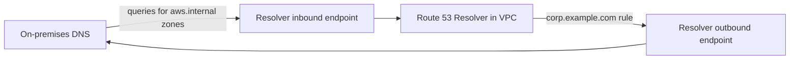

# Domain 5: Networking and Content Delivery

Domain 5 carries **18%** of the scored content. **Task 5.1** is implementing and optimizing networking: VPC configuration, private connectivity, auditing network protection services, and network cost. **Task 5.2** is DNS and content delivery: Route 53 Resolver, routing policies and query logging, CloudFront and Global Accelerator. **Task 5.3** is troubleshooting: VPC configuration, network logs, CloudFront caching, hybrid connectivity and CloudWatch network monitoring.

The exam guide lists **designing hybrid and multi-VPC networks** as out of scope. Expect to configure, read and fix networks that already exist, not to draw a new global topology.

---

## Task 5.1 - Implement and optimize networking features and connectivity

### 5.1.1 Configure a VPC

A **VPC** is a Regional private network with one or more IPv4 CIDR blocks (from /16 to /28) and optionally IPv6. **Subnets** live in one Availability Zone each. Whether a subnet is "public" or "private" is decided only by its **route table**.

| Component | What it does | Key facts |
|---|---|---|
| **Route table** | Decides where traffic leaves a subnet | Each subnet has exactly one; the `local` route for the VPC CIDR cannot be removed; **longest prefix match** wins |
| **Internet gateway (IGW)** | Two-way internet access for resources with public IPs | One per VPC; public subnet = route `0.0.0.0/0` to the IGW |
| **NAT gateway** | Outbound-only IPv4 internet for private subnets | Lives in a public subnet with an Elastic IP; **zonal**, so deploy one per AZ; also a private NAT type for routing between overlapping networks |
| **Egress-only internet gateway** | Outbound-only **IPv6** internet | IPv6 addresses are globally unique, so there is no NAT; route `::/0` to the egress-only IGW |
| **Security group** | Stateful firewall on an ENI | Allow rules only; return traffic is automatic; can reference other security groups |
| **Network ACL** | Stateless firewall on a subnet | Allow and deny rules; evaluated in number order, first match wins; return traffic needs its own rule |

Security groups versus network ACLs is the single most tested networking fact, so be fluent in it:

| | Security group | Network ACL |
|---|---|---|
| Level | Instance (ENI) | Subnet |
| State | Stateful | Stateless |
| Rules | Allow only | Allow and deny |
| Evaluation | All rules together | In order, lowest number first |
| Defaults | Custom SG: no inbound, all outbound | Default NACL allows all; a new custom NACL denies all |

Because NACLs are stateless, a web server subnet that allows inbound 443 must also allow **outbound ephemeral ports** (1024-65535) for the responses, and a private subnet reaching the internet must allow the **inbound** ephemeral replies. Use a NACL deny rule to block a specific malicious IP range; security groups cannot deny.

**[📖 How Amazon VPC works](https://docs.aws.amazon.com/vpc/latest/userguide/how-it-works.html)** - VPC components
**[📖 Route tables](https://docs.aws.amazon.com/vpc/latest/userguide/VPC_Route_Tables.html)** - routing and priority
**[📖 NAT gateways](https://docs.aws.amazon.com/vpc/latest/userguide/vpc-nat-gateway.html)** - public and private NAT
**[📖 Egress-only internet gateways](https://docs.aws.amazon.com/vpc/latest/userguide/egress-only-internet-gateway.html)** - IPv6 outbound
**[📖 Security groups](https://docs.aws.amazon.com/vpc/latest/userguide/vpc-security-groups.html)** - rules and behavior
**[📖 Network ACLs](https://docs.aws.amazon.com/vpc/latest/userguide/vpc-network-acls.html)** - rules, ordering, ephemeral ports

### 5.1.2 Configure private networking connectivity (VPC endpoints, PrivateLink, VPC peering)

**Gateway endpoints** exist only for **S3 and DynamoDB**. They are a route table target (a prefix list route), have no ENI, cost nothing, and only work from inside the VPC (not from on-premises or a peered VPC). Access can be narrowed with an **endpoint policy**, and bucket policies can require `aws:SourceVpce`.

**Interface endpoints** (powered by **AWS PrivateLink**) put an ENI with a private IP in your subnets for most AWS services and for partner or your own services. They are billed per hour per AZ and per GB. They have a **security group**, which must allow 443 from the clients. With **private DNS** enabled (requires the VPC attributes `enableDnsSupport` and `enableDnsHostnames`), the service's normal hostname resolves to the endpoint's private IPs, so applications need no changes. They can be reached from on-premises and peered VPCs. An S3 **interface** endpoint exists too, for access from on-premises.

**PrivateLink endpoint services** let you publish your own service behind a Network Load Balancer (or Gateway Load Balancer) to consumers in other VPCs and accounts, without peering and with overlapping CIDRs allowed. Consumers create an interface endpoint; you accept connection requests and control allowed principals.

**VPC peering** connects two VPCs (same or different account and Region) privately. Rules: **no overlapping CIDRs**, **no transitive routing** (A-B and B-C does not give A-C, and a peer cannot use your IGW, NAT gateway or VPN), routes needed **on both sides**, and security groups may reference peer security groups only within the same Region. For many VPCs, a **Transit Gateway** provides hub-and-spoke transitive routing with its own route tables.

**[📖 Gateway endpoints](https://docs.aws.amazon.com/vpc/latest/privatelink/gateway-endpoints.html)** - S3 and DynamoDB
**[📖 Access an AWS service using an interface VPC endpoint](https://docs.aws.amazon.com/vpc/latest/privatelink/create-interface-endpoint.html)** - private DNS and security groups
**[📖 Share your services through AWS PrivateLink](https://docs.aws.amazon.com/vpc/latest/privatelink/privatelink-share-your-services.html)** - endpoint services
**[📖 What is VPC peering?](https://docs.aws.amazon.com/vpc/latest/peering/what-is-vpc-peering.html)** - rules and limitations
**[📖 What is a transit gateway?](https://docs.aws.amazon.com/vpc/latest/tgw/what-is-transit-gateway.html)** - attachments and route tables

### 5.1.3 Audit network protection services in a single account

The task says **audit** in a **single account**: confirm that protections are attached to the right resources, are configured as intended, and are logging, then read their metrics and logs. (Organization-wide policy enforcement with AWS Firewall Manager is beyond this task.)

**Route 53 Resolver DNS Firewall** filters DNS queries that resources in a VPC send to the Route 53 Resolver. You build **rule groups** of rules that each reference a **domain list** (your own, or AWS managed lists of known malware and botnet domains) and an action: **ALLOW**, **ALERT** (log only), or **BLOCK** with a response of `NODATA`, `NXDOMAIN` or `OVERRIDE` (answer with a domain you choose). Rule groups are **associated with VPCs** with a priority. Audit questions: is the rule group associated with every VPC that needs it? Is the action ALERT where it should be BLOCK? Is the VPC set to **fail open** or **fail closed** if DNS Firewall cannot respond? Matches appear in **Resolver query logs** (5.2.2).

**AWS WAF** protects HTTP(S) at **CloudFront, ALB, API Gateway, AppSync, Cognito user pools, App Runner and Verified Access**. A **web ACL** holds rules (custom, rate-based, and AWS managed rule groups such as the core rule set and known bad inputs) and a default action. Audit: is the web ACL associated with the resource? Are managed rules in **Count** mode by mistake? Check CloudWatch metrics (`AllowedRequests`, `BlockedRequests`, `CountedRequests` per rule), **sampled requests** in the console, and full **web ACL logs** (5.3.2).

**AWS Shield**: **Shield Standard** is automatic and free, protecting against common layer 3 and 4 DDoS attacks for all customers. **Shield Advanced** (paid subscription) adds protection for specific resources (CloudFront, Route 53 hosted zones, Global Accelerator, ELB, Elastic IPs), DDoS detection metrics (`DDoSDetected` and attack vectors in CloudWatch), automatic application-layer mitigation by creating WAF rules, access to the Shield Response Team, and cost protection for scaling during an attack. Audit: are the right resources added as protected resources, with health checks associated for faster detection?

**AWS Network Firewall** is a managed, stateful network firewall and IPS for VPCs. You deploy **firewall endpoints** in dedicated firewall subnets and **change route tables** so traffic passes through them (for example IGW ingress routing to the endpoint, and the workload subnet's default route to the endpoint). A **firewall policy** combines **stateless rule groups** (5-tuple, fast pass/drop/forward) and **stateful rule groups** (domain allow and deny lists, 5-tuple rules, and **Suricata-compatible** IPS rules). Audit: if traffic is not being inspected, the most common cause is **routing** that bypasses the endpoint (asymmetric or missing routes). Network Firewall publishes **alert, flow and TLS logs** to S3, CloudWatch Logs or Firehose, plus CloudWatch metrics such as `DroppedPackets` and `PassedPackets`.

**[📖 Route 53 Resolver DNS Firewall](https://docs.aws.amazon.com/Route53/latest/DeveloperGuide/resolver-dns-firewall.html)** - rule groups, domain lists, actions
**[📖 How AWS WAF works](https://docs.aws.amazon.com/waf/latest/developerguide/how-aws-waf-works.html)** - web ACLs and rules
**[📖 How AWS Shield works](https://docs.aws.amazon.com/waf/latest/developerguide/ddos-overview.html)** - Standard and Advanced
**[📖 What is AWS Network Firewall?](https://docs.aws.amazon.com/network-firewall/latest/developerguide/what-is-aws-network-firewall.html)** - endpoints, policies, rule groups
**[📖 Logging network traffic from AWS Network Firewall](https://docs.aws.amazon.com/network-firewall/latest/developerguide/firewall-logging.html)** - alert, flow and TLS logs

### 5.1.4 Optimize the cost of network architectures

This is the cost content that remains in scope (cost analysis, TCO and billing are not). Network charges come mostly from **data processing** and **data transfer**. Without memorizing prices, know which choices move the bill:

- **NAT gateway data processing** is charged per GB in addition to hourly cost. Traffic from private subnets to **S3 or DynamoDB** through a NAT gateway is the classic waste: add a free **gateway endpoint** and that traffic stops crossing the NAT gateway. Interface endpoints for other heavily used services can also be cheaper than NAT processing.
- **Cross-AZ traffic** is charged in both directions. Keep chatty tiers in the same AZ where availability allows, make each AZ's private subnets use their **own AZ's NAT gateway**, and be aware that disabling **cross-zone load balancing** on an NLB reduces cross-AZ transfer (at the cost of even distribution).
- **Data transfer out to the internet** costs more than transfer from **CloudFront**, and CloudFront caching reduces origin load and origin egress. Transfer from AWS origins to CloudFront is not charged.
- **VPC peering** has no hourly charge; **Transit Gateway** charges per attachment hour and per GB processed. Peering is cheaper for a few high-volume pairs; Transit Gateway is simpler for many VPCs.
- **Direct Connect** data transfer out is billed at a lower rate than internet egress, which matters for large, steady hybrid flows.
- **Idle resources**: unattached Elastic IPs, all public IPv4 addresses (charged hourly), unused NAT gateways, load balancers with no targets, and interface endpoints nobody uses. **VPC IP Address Manager (IPAM)** and **Public IP Insights** help find public IPv4 usage; using IPv6 with an egress-only IGW avoids public IPv4 charges.
- **Measure first**: VPC Flow Logs and **Cost and Usage data by usage type** (for example `NatGateway-Bytes` and `DataTransfer-Regional-Bytes`) show which flows cost money.

**[📖 Overview of data transfer costs for common architectures](https://aws.amazon.com/blogs/architecture/overview-of-data-transfer-costs-for-common-architectures/)** - where transfer charges arise
**[📖 NAT gateway pricing considerations](https://docs.aws.amazon.com/vpc/latest/userguide/nat-gateway-pricing.html)** - reducing NAT data processing
**[📖 Gateway endpoints](https://docs.aws.amazon.com/vpc/latest/privatelink/gateway-endpoints.html)** - free private S3 and DynamoDB access

---

## Task 5.2 - Configure domains, DNS services, and content delivery

### 5.2.1 Configure DNS (Route 53 Resolver)

Every VPC has the **Route 53 Resolver** (also called the Amazon-provided DNS server) at the VPC base CIDR plus two (for example `10.0.0.2`) and at `169.254.169.253`. It answers for public DNS, for **private hosted zones** associated with the VPC, and for AWS internal names. Two VPC attributes must be on for private hosted zones and private DNS on endpoints to work: **`enableDnsSupport`** and **`enableDnsHostnames`**.

For **hybrid DNS**, Resolver adds endpoints:

- **Inbound endpoint** - ENIs in your VPC that on-premises DNS servers forward to, so on-premises clients can resolve private hosted zones and VPC names.
- **Outbound endpoint** - ENIs that Resolver uses to forward queries **to** on-premises DNS servers, as directed by **forwarding rules** (for example "forward `corp.example.com` to 10.10.0.53 and 10.10.0.54").
- **Rules** are associated with VPCs and can be **shared with other accounts through AWS RAM**, so a central network account defines forwarding once for the whole organization.



The diagram shows both directions of hybrid DNS: on-premises servers forward AWS zones to the inbound endpoint, and Resolver forwards on-premises domains out through the outbound endpoint according to a forwarding rule.

Troubleshooting: endpoint **security groups** must allow DNS (TCP and UDP 53) from the right sources; the path to on-premises (VPN or Direct Connect) must route to the endpoint subnets; a private hosted zone not **associated** with the VPC will not resolve there; overlapping private zones and forwarding rules resolve to the most specific match.

**[📖 What is Route 53 Resolver?](https://docs.aws.amazon.com/Route53/latest/DeveloperGuide/resolver.html)** - inbound and outbound endpoints, rules
**[📖 DNS attributes for your VPC](https://docs.aws.amazon.com/vpc/latest/userguide/AmazonDNS-concepts.html)** - enableDnsSupport and enableDnsHostnames
**[📖 Working with private hosted zones](https://docs.aws.amazon.com/Route53/latest/DeveloperGuide/hosted-zones-private.html)** - VPC association

### 5.2.2 Configure Route 53 routing policies, configurations and query logging

**Records.** `A`/`AAAA` map to addresses; `CNAME` maps to another name but **cannot be used at the zone apex**; **alias** records point to AWS resources (CloudFront, ELB, S3 website, API Gateway, another record in the zone) and **can** be used at the apex, with no charge for alias queries to AWS resources. TTL controls caching by resolvers; lower it before a planned change.

**Routing policies:**

| Policy | Use |
|---|---|
| **Simple** | One resource; no health checks |
| **Weighted** | Split by percentage (canary, blue/green) |
| **Latency** | Lowest-latency Region for the user |
| **Failover** | Active-passive with a health check on the primary |
| **Geolocation** | By user's continent or country (with a default record) |
| **Geoproximity** | By distance to resources, with a **bias** to grow or shrink a region (Traffic Flow) |
| **IP-based** | By client IP CIDR blocks you define |
| **Multivalue answer** | Up to eight healthy records returned at random |

**Query logging** has two separate features, and the exam likes to confuse them:

- **Public DNS query logging** records queries that reach Route 53 for a **public hosted zone**. Logs go to **CloudWatch Logs**, and the log group must be in **us-east-1**.
- **Resolver query logging** records DNS queries made **from inside your VPCs** (to private zones, public names and forwarded domains, plus DNS Firewall actions). Destinations: CloudWatch Logs, S3 or Firehose. Configurations can be shared via RAM.

**[📖 Choosing a routing policy](https://docs.aws.amazon.com/Route53/latest/DeveloperGuide/routing-policy.html)** - all policies
**[📖 Choosing between alias and non-alias records](https://docs.aws.amazon.com/Route53/latest/DeveloperGuide/resource-record-sets-choosing-alias-non-alias.html)** - apex and pricing
**[📖 Public DNS query logging](https://docs.aws.amazon.com/Route53/latest/DeveloperGuide/query-logs.html)** - us-east-1 log groups
**[📖 Resolver query logging](https://docs.aws.amazon.com/Route53/latest/DeveloperGuide/resolver-query-logs.html)** - VPC DNS queries

### 5.2.3 Configure content and service distribution (CloudFront, Global Accelerator)

**Amazon CloudFront** is a CDN for HTTP(S). A **distribution** has **origins** (S3, ALB, API Gateway, any HTTP server, or a **origin group** of primary and secondary for **origin failover** on chosen error codes) and **cache behaviors** matched by path pattern, each with a **cache policy** (what forms the cache key and the TTLs), an **origin request policy** (what is forwarded to the origin but not cached on), and a **response headers policy**. Security features: **Origin Access Control (OAC)** so an S3 origin only accepts requests from the distribution (the bucket policy grants the CloudFront service principal for that distribution), HTTPS with an ACM certificate in **us-east-1**, **geo restriction**, **signed URLs and signed cookies**, and AWS WAF. Edge code: **CloudFront Functions** (lightweight JavaScript for header and URL manipulation at very high scale) and **Lambda@Edge** (Node.js or Python, more power, network access, at regional edge caches).

**AWS Global Accelerator** gives your application **two static anycast IP addresses** that route users onto the AWS global network at the nearest edge and then to the best healthy **endpoint** (ALB, NLB, EC2 instance or Elastic IP) in one or more Regions. It does **not cache**. Each Region is an **endpoint group** with a **traffic dial** (percentage of traffic for that Region) and per-endpoint **weights**; health checks drive fast Regional failover without waiting on DNS TTLs.

| Need | Choose |
|---|---|
| Cache static or dynamic HTTP content near users | **CloudFront** |
| Non-HTTP traffic (TCP or UDP: gaming, VoIP, IoT) with better global performance | **Global Accelerator** |
| Fixed IP addresses for allowlisting by customers | **Global Accelerator** |
| Fast multi-Region failover without DNS caching delays | **Global Accelerator** |

**[📖 What is Amazon CloudFront?](https://docs.aws.amazon.com/AmazonCloudFront/latest/DeveloperGuide/Introduction.html)** - distributions and behaviors
**[📖 Restrict access to an S3 origin with OAC](https://docs.aws.amazon.com/AmazonCloudFront/latest/DeveloperGuide/private-content-restricting-access-to-s3.html)** - origin access control
**[📖 Origin failover with origin groups](https://docs.aws.amazon.com/AmazonCloudFront/latest/DeveloperGuide/high_availability_origin_failover.html)** - error-code failover
**[📖 What is AWS Global Accelerator?](https://docs.aws.amazon.com/global-accelerator/latest/dg/what-is-global-accelerator.html)** - static IPs, endpoint groups, traffic dials

---

## Task 5.3 - Troubleshoot network connectivity issues

### 5.3.1 Troubleshoot VPC configurations

Work outward from the instance, one layer at a time:

1. **Security group** of the source (outbound) and destination (inbound): right port, protocol and source?
2. **Network ACLs** on both subnets, in both directions, including ephemeral ports.
3. **Route tables** of both subnets: is there a route to the destination (IGW, NAT gateway, peering connection, transit gateway, endpoint)?
4. **Gateways**: IGW attached; NAT gateway in a **public** subnet whose route table points to the IGW, with an Elastic IP.
5. **Addressing**: public IP present if reached from the internet; no **overlapping CIDRs** across peering or TGW.
6. **Transit Gateway**: the attachment must be **associated** with a TGW route table and the destination's routes **propagated** (or static) in that table; the VPC subnet route table must also point the remote CIDR at the TGW.
7. **OS level**: host firewall, service listening on the right interface.

**VPC Reachability Analyzer** automates this: it analyzes the configuration between a source and destination (no packets sent) and names the **blocking component**, such as a security group, NACL rule or missing route. **Network Access Analyzer** finds unintended network access paths across an account, for example "any path from the internet to a database subnet".

Classic cases:

| Symptom | Usual cause |
|---|---|
| Private instance cannot reach the internet | No `0.0.0.0/0` route to a NAT gateway, NAT gateway in a private subnet, or NACL blocking return traffic |
| Public instance unreachable | No public IP, no IGW route, security group or NACL blocking |
| Peered VPCs cannot talk | Route missing on one side, overlapping CIDRs, or expecting transitive routing |
| Instance cannot reach S3 privately | Gateway endpoint not in that subnet's route table, or endpoint or bucket policy denying |
| Interface endpoint not used | Private DNS off, VPC DNS attributes off, or endpoint security group blocks 443 |

**[📖 What is Reachability Analyzer?](https://docs.aws.amazon.com/vpc/latest/reachability/what-is-reachability-analyzer.html)** - path analysis
**[📖 What is Network Access Analyzer?](https://docs.aws.amazon.com/vpc/latest/network-access-analyzer/what-is-network-access-analyzer.html)** - unintended access paths
**[📖 Transit gateway route tables](https://docs.aws.amazon.com/vpc/latest/tgw/tgw-route-tables.html)** - association and propagation

### 5.3.2 Collect and interpret networking logs

**VPC Flow Logs** capture IP traffic metadata at the VPC, subnet or ENI level, to CloudWatch Logs, S3 or Firehose. They do not capture payloads, DNS queries to the Amazon DNS server, or instance metadata traffic. The default record format is:

```
version account-id interface-id srcaddr dstaddr srcport dstport protocol packets bytes start end action log-status
2 123456789012 eni-0abc 203.0.113.10 10.0.1.25 49152 443 6 10 840 1700000000 1700000060 ACCEPT OK
```

Reading them: `action` is `ACCEPT` or `REJECT`; protocol 6 is TCP, 17 UDP, 1 ICMP. Because security groups are stateful and NACLs are not, a pattern of **inbound ACCEPT followed by outbound REJECT** for the reply points at a **NACL** blocking ephemeral ports; an inbound **REJECT** points at the security group or NACL on the way in. Custom formats add fields such as `vpc-id`, `subnet-id`, `tcp-flags`, `pkt-srcaddr` (the original source behind a NAT gateway) and `flow-direction`. Query them with Logs Insights or Athena.

**ELB access logs** (ALB and NLB, delivered to S3 every few minutes, off by default; the bucket policy must allow the ELB log delivery) show client IP, target, request processing, target processing and response processing times, ELB and target status codes. An ELB status of 502 with target status `-` means the target closed or reset the connection; 504 means the target did not answer within the idle timeout. ALB **connection logs** record TLS handshake details.

**AWS WAF web ACL logs** record every inspected request with the terminating rule and action. Destinations are CloudWatch Logs, S3 or Firehose, and the destination **name must start with `aws-waf-logs-`**. Use them to find false positives (a managed rule blocking legitimate requests) before switching a rule from Count to Block.

**CloudFront logs**: **standard logs** (access logs) delivered to S3, CloudWatch Logs or Firehose, with the edge location, `x-edge-result-type` (`Hit`, `Miss`, `RefreshHit`, `Error`), status and time taken; **real-time logs** delivered through Kinesis Data Streams within seconds for chosen fields and a sampling rate.

**Container logs**: ECS tasks use the `awslogs` log driver (or FireLens) to send stdout and stderr to CloudWatch Logs; EKS uses Fluent Bit (deployed by the CloudWatch Observability add-on) to ship container logs, and Container Insights for metrics. A task whose logs never appear usually lacks the **task execution role** permissions to write to CloudWatch Logs or the log group does not exist and auto-create is off.

**[📖 Logging IP traffic using VPC Flow Logs](https://docs.aws.amazon.com/vpc/latest/userguide/flow-logs.html)** - destinations and records
**[📖 Flow log records](https://docs.aws.amazon.com/vpc/latest/userguide/flow-log-records.html)** - fields and examples
**[📖 Access logs for your Application Load Balancer](https://docs.aws.amazon.com/elasticloadbalancing/latest/application/load-balancer-access-logs.html)** - fields and bucket policy
**[📖 AWS WAF logging](https://docs.aws.amazon.com/waf/latest/developerguide/logging.html)** - destinations and naming
**[📖 CloudFront standard logging](https://docs.aws.amazon.com/AmazonCloudFront/latest/DeveloperGuide/AccessLogs.html)** - log fields
**[📖 Using the awslogs log driver](https://docs.aws.amazon.com/AmazonECS/latest/developerguide/using_awslogs.html)** - ECS container logs

### 5.3.3 Identify and remediate CloudFront caching issues

| Symptom | Cause and fix |
|---|---|
| **Low cache hit ratio** | The cache key includes too much: all headers, all cookies or all query strings forwarded. Use a **cache policy** that includes only the values that actually change the response; send everything else to the origin with an **origin request policy** |
| **Users see stale content after a deploy** | TTLs are long and object names unchanged. Create an **invalidation** for the changed paths now; long term, use **versioned file names** (`app.v42.js`) so new content has new URLs |
| **Content not cached at all** | Origin sends `Cache-Control: no-cache`, `private` or `max-age=0`, or sets cookies on every response; or the behavior's minimum TTL is 0 and the origin sends no cache headers. Fix origin headers or set behavior TTLs |
| **Wrong content for some users** | A header or cookie that changes the response (language, device) is not in the cache key |
| **Origin overloaded despite CloudFront** | Many edge locations missing to origin; enable **Origin Shield**; check for uncacheable behaviors |
| **403 from S3 origin** | OAC not configured or bucket policy missing the distribution's permission; object does not exist (S3 returns 403 for missing objects without `ListBucket`) |

Measure with the CloudFront `CacheHitRate` metric (an additional metric you turn on), the `x-cache` response header (`Hit from cloudfront` or `Miss from cloudfront`), and `x-edge-result-type` in logs. Invalidations remove objects from edge caches before TTL expiry; wildcard paths such as `/images/*` count as one path.

**[📖 Control the cache key with a policy](https://docs.aws.amazon.com/AmazonCloudFront/latest/DeveloperGuide/controlling-the-cache-key.html)** - cache policies
**[📖 Increase the proportion of requests served from CloudFront caches](https://docs.aws.amazon.com/AmazonCloudFront/latest/DeveloperGuide/cache-hit-ratio.html)** - hit ratio guidance
**[📖 Invalidate files to remove content](https://docs.aws.amazon.com/AmazonCloudFront/latest/DeveloperGuide/Invalidation.html)** - invalidations and versioned names
**[📖 Manage how long content stays in the cache](https://docs.aws.amazon.com/AmazonCloudFront/latest/DeveloperGuide/Expiration.html)** - TTLs and Cache-Control

### 5.3.4 Troubleshoot hybrid and private connectivity issues

**Site-to-Site VPN.** Each connection has **two tunnels** to different AWS endpoints for redundancy. Check the `TunnelState` CloudWatch metric (1 up, 0 down) and tunnel status; common causes of a down tunnel are mismatched IKE or IPsec parameters, the customer gateway's public IP changing, or a firewall blocking UDP 500/4500 and ESP. A tunnel that is up but passes no traffic is usually **routing**: the VPC route table lacks the on-premises CIDR (enable **route propagation** from the virtual private gateway, or add static routes), BGP is not advertising the expected prefixes, or the on-premises side has no return route. Turn on **VPN tunnel logs** to CloudWatch Logs for IKE negotiation detail. Use dead peer detection and keep traffic flowing so idle tunnels do not drop.

**Direct Connect.** A connection carries **virtual interfaces**: **private VIF** (to a VPC through a virtual private gateway or Direct Connect gateway), **transit VIF** (to Transit Gateways through a Direct Connect gateway), **public VIF** (to AWS public endpoints). Check `ConnectionState` and the BGP session status per VIF; BGP down means wrong ASN, peer IPs, MD5 key or VLAN. BGP up but no traffic means prefixes are not advertised or not allowed, or route tables lack propagation. Direct Connect is **not encrypted** by default; run a Site-to-Site VPN over it (or use MACsec on supported connections) when encryption is required, and use a VPN as backup for a single Direct Connect.

**Private connectivity in general**: **overlapping CIDRs** between on-premises and VPC break routing; **MTU** mismatches (Direct Connect supports jumbo frames on some VIFs, VPN does not) cause stalled transfers; **DNS** problems often masquerade as connectivity problems, so test by IP and check Resolver endpoints (5.2.1); for interface endpoints and PrivateLink services check endpoint security groups, endpoint policies and accepted connections.

**[📖 Troubleshooting Site-to-Site VPN](https://docs.aws.amazon.com/vpn/latest/s2svpn/Troubleshooting.html)** - tunnel and routing problems
**[📖 Monitoring Site-to-Site VPN with CloudWatch](https://docs.aws.amazon.com/vpn/latest/s2svpn/monitoring-cloudwatch-vpn.html)** - TunnelState and data metrics
**[📖 Troubleshooting AWS Direct Connect](https://docs.aws.amazon.com/directconnect/latest/UserGuide/Troubleshooting.html)** - physical, BGP and routing issues
**[📖 Direct Connect virtual interfaces](https://docs.aws.amazon.com/directconnect/latest/UserGuide/WorkingWithVirtualInterfaces.html)** - private, public and transit VIFs

### 5.3.5 Configure and analyze CloudWatch network monitoring services

CloudWatch groups three network monitoring capabilities. Match each one to the question it answers:

| Service | Answers | How it works |
|---|---|---|
| **Network Flow Monitor** | "Is the network between my EC2 instances, or to S3 and DynamoDB, losing packets or adding latency, and is it AWS's network or mine?" | Lightweight agents on instances report TCP connection statistics; monitors and dashboards show packet loss, latency and a **network health indicator** for AWS network issues |
| **Internet Monitor** | "Are my internet users in a city or ISP having trouble reaching my application?" | Uses AWS's global connectivity data to baseline performance and availability for traffic to your VPCs, CloudFront distributions or other resources; raises **health events** and suggests improvements such as using CloudFront or other Regions |
| **Network Synthetic Monitor** (the guide's "Network Monitor") | "Is my hybrid link (VPN or Direct Connect) to on-premises degrading?" | You create **probes** from AWS-hosted resources to on-premises IP addresses; it tracks latency and packet loss with no agent to install and can alert on thresholds |

All three publish to CloudWatch, so you can alarm on their metrics and health events like any other metric. They complement, not replace, flow logs (which tell you what was accepted or rejected) and Reachability Analyzer (which tells you whether the configuration allows a path).

**[📖 CloudWatch network monitoring](https://docs.aws.amazon.com/AmazonCloudWatch/latest/monitoring/CloudWatch-Network-Monitoring-Sections.html)** - the three services
**[📖 What is Network Flow Monitor?](https://docs.aws.amazon.com/AmazonCloudWatch/latest/monitoring/CloudWatch-NetworkFlowMonitor-What-is-NetworkFlowMonitor.html)** - agents and monitors
**[📖 Using Internet Monitor](https://docs.aws.amazon.com/AmazonCloudWatch/latest/monitoring/CloudWatch-InternetMonitor.html)** - health events and insights
**[📖 Using Network Synthetic Monitor](https://docs.aws.amazon.com/AmazonCloudWatch/latest/monitoring/what-is-network-monitor.html)** - hybrid probes

---

## Exam traps

- **Security groups are stateful, NACLs are stateless** - remember ephemeral ports for NACLs.
- **NAT gateways are zonal** and must sit in a **public** subnet; IPv6 outbound uses an **egress-only IGW**.
- **Gateway endpoints**: S3 and DynamoDB only, free, route table based, not usable from on-premises.
- **Interface endpoint private DNS** needs `enableDnsSupport` and `enableDnsHostnames`.
- **Peering is not transitive** and cannot overlap CIDRs.
- **Network Firewall that inspects nothing** is almost always a routing problem.
- **WAF log destinations** must be named `aws-waf-logs-...`.
- **Public DNS query logs go to us-east-1**; Resolver query logs cover queries from your VPCs.
- **CNAME cannot be at the apex**; alias can.
- **CloudFront caches; Global Accelerator does not** - Global Accelerator for static IPs, TCP/UDP and fast failover.
- **Low hit ratio = cache key too broad.** Stale content = invalidate now, version file names later.
- **VPN up but no traffic = routing** (propagation, BGP advertisements).
- **Network Flow Monitor** for workload flows, **Internet Monitor** for end users on the internet, **Network Synthetic Monitor** for hybrid links.

## Key terms

- **Egress-only internet gateway** - gives IPv6 resources outbound-only internet access, the IPv6 counterpart of a NAT gateway
- **Gateway endpoint** - free route-table target for private access to S3 and DynamoDB from inside a VPC
- **Interface endpoint** - PrivateLink ENI with private IPs in your subnets for private access to AWS and partner services
- **Route 53 Resolver DNS Firewall** - filters DNS queries from VPCs against domain lists with allow, alert or block actions
- **AWS Network Firewall** - managed stateful firewall and IPS for VPCs, using stateless and Suricata-compatible stateful rule groups
- **Resolver outbound endpoint** - ENIs that forward DNS queries from a VPC to on-premises DNS servers according to forwarding rules
- **Resolver inbound endpoint** - ENIs that let on-premises DNS servers resolve private hosted zones and VPC names
- **Resolver query logging** - logs DNS queries made from VPCs to CloudWatch Logs, S3 or Firehose
- **Alias record** - Route 53 record pointing to an AWS resource that works at the zone apex and has no charge for queries to AWS resources
- **Origin Access Control** - lets an S3 origin accept requests only from a specific CloudFront distribution
- **AWS Global Accelerator** - two static anycast IPs that route TCP and UDP traffic over the AWS network to healthy Regional endpoints
- **Reachability Analyzer** - analyzes VPC configuration between a source and destination and names the blocking component
- **VPC Flow Logs** - IP traffic metadata with ACCEPT or REJECT action, captured per VPC, subnet or ENI
- **Network Flow Monitor** - agent-based CloudWatch feature showing packet loss and latency for flows between EC2 and AWS services
- **Network Synthetic Monitor** - CloudWatch probes from AWS to on-premises IPs that track hybrid latency and packet loss

## Vendor documentation

**[📖 SOA-C03 Domain 5 in the exam guide](https://docs.aws.amazon.com/aws-certification/latest/sysops-administrator-associate-03/sysops-administrator-associate-03-domain5.html)** - official task statements
**[📖 Amazon VPC user guide](https://docs.aws.amazon.com/vpc/latest/userguide/what-is-amazon-vpc.html)** - VPC overview
**[📖 Amazon Route 53 developer guide](https://docs.aws.amazon.com/Route53/latest/DeveloperGuide/Welcome.html)** - DNS service
**[📖 AWS Direct Connect user guide](https://docs.aws.amazon.com/directconnect/latest/UserGuide/Welcome.html)** - dedicated connectivity
