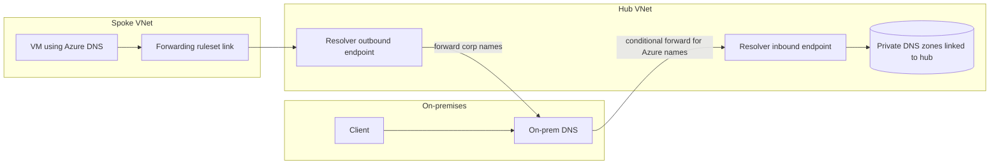

# 01 - Design and Implement Core Networking Infrastructure (25-30%)

This is the heaviest domain on AZ-700, and it is the foundation every other domain sits on. It has four parts in the skills outline as of July 27, 2026: IP addressing, name resolution, VNet connectivity and routing, and monitoring. If you get the address plan, DNS and routing right, the hybrid, application delivery and security questions become much easier, because most of them are really asking "where does this packet go, and what resolves this name?"

**[📖 AZ-700 study guide](https://learn.microsoft.com/en-us/credentials/certifications/resources/study-guides/az-700)** - the official skills outline this note follows

---

## 1. Design and implement IP addressing for Azure resources

### Address spaces and segmentation

A virtual network (VNet) is a private network that lives in one region and one subscription. You give it one or more address spaces in CIDR notation, such as `10.10.0.0/16`, and then carve subnets out of those spaces. Azure does not stop you choosing public ranges, but the safe default is RFC 1918 space (`10.0.0.0/8`, `172.16.0.0/12`, `192.168.0.0/16`).

The planning rule that matters most is: **no overlaps** with anything you will ever connect to. Peering, VPN and ExpressRoute all refuse or misbehave when address spaces overlap, and renumbering a running VNet is painful. A sensible enterprise plan reserves a large block per region (for example `10.10.0.0/16` for East US, `10.20.0.0/16` for West Europe), keeps on-premises ranges out of it, and leaves room for future spokes. You can add address spaces to a VNet later, and you can resize a peered VNet's address space and then sync the peering, but you cannot shrink a subnet that has resources in it.

Segmentation is the "why" of subnets. You split a VNet into subnets so you can apply different network security groups, route tables and service features to different tiers - web, app, data, management - and so that platform services that need a dedicated subnet get one.

### Subnet sizing and the reserved addresses

Azure reserves five addresses in every subnet: the network address, `.1` for the default gateway, `.2` and `.3` for Azure DNS mapping, and the last address (broadcast). A `/29` therefore gives three usable addresses and a `/24` gives 251. The smallest IPv4 subnet is `/29`.

Several services insist on a subnet with an exact name and a minimum size. The exam loves these because they are easy to test and easy to get wrong:

| Service | Subnet name | Size guidance from Microsoft |
|---|---|---|
| VPN gateway or ExpressRoute gateway | `GatewaySubnet` | `/27` or larger (bigger if VPN and ExpressRoute coexist) |
| Azure Firewall | `AzureFirewallSubnet` | `/26` |
| Azure Firewall forced tunneling management NIC | `AzureFirewallManagementSubnet` | `/26` |
| Azure Bastion | `AzureBastionSubnet` | `/26` or larger |
| Azure Route Server | `RouteServerSubnet` | `/26` or larger |
| Application Gateway v2 | any name, but dedicated to Application Gateway | `/24` recommended so autoscale has room |

The names are case sensitive and the services will not deploy into a wrongly named subnet. Do not put an NSG or a route table on `GatewaySubnet` unless the documentation for your scenario says it is supported - it is a classic way to break a gateway.

### Shared versus dedicated subnets, and delegation

Some resources happily share a subnet with VMs: private endpoints, internal load balancer frontends, and most IaaS resources. Others need a subnet to themselves. **Subnet delegation** is how you hand a subnet to a PaaS service so the service can create its own resources inside it. You delegate a subnet to one service, such as `Microsoft.Web/serverFarms` for App Service VNet integration, `Microsoft.Sql/managedInstances` for SQL Managed Instance, `Microsoft.ContainerInstance/containerGroups`, or `Microsoft.Network/dnsResolvers` for DNS Private Resolver endpoints. Once delegated, the subnet can only hold that service's resources, and the service may add its own network intent policies (for example SQL Managed Instance adds required NSG rules and routes).

The exam pattern is: "a service needs VNet integration and the deployment fails" - the answer is usually that the subnet is not delegated, is delegated to a different service, or is too small.

### Service-specific subnet planning

The outline names a long list of things you must plan subnets for: virtual network gateways, private endpoints, service endpoints, firewalls, application gateways, VNet-integrated platform services and Azure Bastion. The underlying question is always the same: does this service need a dedicated (and possibly named) subnet, how much room does it need to scale, and will an NSG or route table on that subnet interfere with it? Private endpoints take one IP each from an ordinary subnet. Service endpoints are a setting on an existing subnet and consume no addresses. Gateways, firewalls, Bastion and Route Server need their named subnets. Application Gateway needs its own subnet. Delegated PaaS services need a delegated subnet.

### Public IP addresses and prefixes

A public IP address is a standalone resource you associate with a VM NIC, a load balancer frontend, a NAT gateway, a VPN gateway, an Application Gateway, Azure Firewall or Bastion. Use the **Standard SKU**: it is secure by default (inbound is closed until an NSG allows it), supports availability zones, and is required by Standard Load Balancer, NAT Gateway and new VPN gateways. The Basic public IP SKU was retired on September 30, 2025, so treat any answer that relies on Basic as wrong.

A Standard public IP is either zone-redundant, zonal (pinned to one zone) or non-zonal. Allocation is static.

A **public IP address prefix** is a contiguous block of static Standard public IPs that you reserve once and then create individual public IPs from. Choose a prefix when a partner or firewall needs to allowlist your egress addresses: you give them one CIDR range and you can add resources later without asking them to change anything. NAT Gateway can take a whole prefix directly.

A **custom IP address prefix** is bring your own IP (BYOIP). You prove you own a public range (a Route Origin Authorization at your regional internet registry plus a signed message), provision it into Azure, commission it so Microsoft advertises it from its network, and then derive public IP prefixes from it. Choose it when your own public addresses are hard-coded in partners' allowlists or customer configurations and you are migrating the workloads into Azure.

---

## 2. Design and implement name resolution

### Inside a VNet

By default a VNet uses **Azure-provided DNS** at the virtual IP `168.63.129.16`. It resolves public names and gives VMs basic hostname resolution inside the same VNet. It does not resolve names across VNets, and you cannot add your own records to it.

You can instead set **custom DNS servers** on the VNet (or per NIC). Every VM then queries those servers. This is how you point Azure VMs at domain controllers or DNS forwarders. Change the VNet DNS setting and the VMs pick it up when they renew DHCP or restart.

### Public DNS zones

An Azure public DNS zone hosts records for a domain you own on Microsoft's anycast name servers. You create the zone, then **delegate** the domain by setting the NS records at your registrar (or in the parent zone) to the four Azure name servers. You can create child zones and delegate to them. **Alias records** point an apex or other record at an Azure resource (a public IP, a Traffic Manager profile, a Front Door endpoint) and follow it automatically when its IP changes - useful for the zone apex, which cannot be a CNAME.

### Private DNS zones

A private DNS zone holds records only visible to VNets you **link** to it. A link can enable **auto-registration**, which creates and removes A records for VMs in that VNet automatically. A VNet can have auto-registration on only one private zone, but it can be linked for resolution to many zones. Private zones are global resources, so one zone can serve VNets in every region.

Two design patterns to know. First, a central set of private zones linked to the hub and every spoke, which is the standard pattern for private endpoint zones such as `privatelink.blob.core.windows.net`. Second, **split-horizon**, where a public and a private zone share the same name: VNets linked to the private zone get private answers, everyone else gets public ones.

### Azure DNS Private Resolver

Before Private Resolver, hybrid DNS meant running DNS forwarder VMs in Azure. **Azure DNS Private Resolver** is the managed replacement. It has two kinds of endpoint, each in its own subnet delegated to `Microsoft.Network/dnsResolvers`:

- An **inbound endpoint** gets a private IP that on-premises DNS servers can forward to over VPN or ExpressRoute. Queries arriving there are resolved by Azure DNS in the context of the resolver's VNet, so on-premises clients can resolve your private zones, including `privatelink` zones.
- An **outbound endpoint** is used by a **DNS forwarding ruleset**: rules like "send `corp.contoso.com` to `10.1.0.4` and `10.1.0.5`". You link the ruleset to VNets so their VMs, still using Azure-provided DNS, get on-premises names resolved by conditional forwarding.

The exam question shape: "On-premises clients must resolve the private endpoint of a storage account" - conditional forwarder on-premises for `blob.core.windows.net` (or the `privatelink` zone) pointing to the Private Resolver inbound endpoint. "Azure VMs must resolve on-premises names without custom DNS on the VNet" - outbound endpoint plus a forwarding ruleset linked to the VNet.

The diagram shows both directions of hybrid DNS: on-premises DNS forwards Azure names to the resolver's inbound endpoint, and spoke VMs reach on-premises names through a forwarding ruleset that uses the outbound endpoint.

---

## 3. Design and implement VNet connectivity and routing

### VNet peering and service chaining

Peering connects two VNets over the Microsoft backbone with no gateway in the path. It works in the same region or across regions (global peering), and across subscriptions and tenants. Peering is **not transitive**: if A peers with B and B peers with C, A cannot reach C unless you build a path through B.

Each side of a peering has settings. **Allow virtual network access** lets traffic flow. **Allow forwarded traffic** accepts traffic that did not originate in the peer, which you need when a firewall in the hub forwards spoke-to-spoke traffic. **Allow gateway transit** on the hub side plus **use remote gateways** on the spoke side lets spokes use the hub's VPN or ExpressRoute gateway. That combination is what the outline calls **gateway transit**.

**Service chaining** means steering traffic from a spoke to a network virtual appliance or Azure Firewall in the hub with user-defined routes, so that spoke-to-spoke and spoke-to-internet traffic is inspected. Peering provides the path; the UDR decides that packets take it.

### Azure Virtual Network Manager

Azure Virtual Network Manager (AVNM) manages connectivity and security for many VNets at once, across subscriptions, from a single scope (a management group or subscriptions). The building blocks are:

- **Network groups** - sets of VNets, with static membership or dynamic membership driven by Azure Policy conditions (for example "every VNet tagged `env=prod`").
- **Connectivity configurations** - **hub-and-spoke** (AVNM creates the peerings to a hub you name, optionally with gateway transit and with **direct connectivity** so spokes in a group talk to each other directly) or **mesh** (every VNet in the group can reach every other, regionally or globally, using a connected group rather than individual peerings).
- **Security admin configurations** - rules that are evaluated before NSGs (covered in the security note).
- **Routing configurations** - centrally managed UDRs pushed to subnets.

Nothing takes effect until you **deploy** (commit) a configuration to the target regions. A common exam trap is "configuration created but nothing changed" - it was never deployed.

### User-defined routes and route selection

Every subnet gets **system routes**: the VNet's own space, peered VNets, routes learned from a gateway, `0.0.0.0/0` to the internet, and a few routes to `None` for reserved ranges. You override them with a **route table** of user-defined routes associated to one or more subnets. Next hop types are Virtual appliance (an IP, usually a firewall or an internal load balancer frontend in front of NVAs), Virtual network gateway, Virtual network, Internet and None (drop).

Azure picks a route by **longest prefix match** first. When two routes have the same prefix, the order is user-defined route, then BGP route, then system route. That rule explains most routing questions. If a spoke has a UDR `0.0.0.0/0 -> 10.0.1.4` and also learns `10.50.0.0/16` from on-premises by BGP through gateway transit, traffic to `10.50.1.1` follows the more specific BGP route and bypasses the firewall unless you add a UDR for `10.50.0.0/16` too. Turning off **BGP route propagation** on the route table (the "propagate gateway routes" setting) is how you stop spokes learning gateway routes at all.

### Forced tunneling

Forced tunneling sends internet-bound traffic back to on-premises (or to a firewall) instead of out of Azure directly, so it can be inspected. Three ways to do it:

1. A UDR `0.0.0.0/0` with next hop Virtual appliance (Azure Firewall or NVA) - the common hub-and-spoke pattern.
2. On a VPN gateway, advertise a default route from on-premises over BGP, or set a **default site** on the gateway for static setups.
3. On ExpressRoute, on-premises advertises `0.0.0.0/0` over private peering.

Watch what breaks: VMs lose direct internet for things like Windows activation unless you allow them through, and some PaaS services in delegated subnets do not support forced tunneling.

### Diagnosing routing

Start with **effective routes** on the NIC (what the platform will actually use) and Network Watcher **Next hop** (for a given source VM and destination IP, which route and next hop wins). Typical faults: a UDR with next hop Virtual appliance pointing at an NVA whose NIC does not have **IP forwarding** enabled, asymmetric routing where return traffic skips the firewall, a missing route on the reverse path, or gateway route propagation turned off when it was needed.

### Azure Route Server

Route Server is a managed BGP route reflector that sits in `RouteServerSubnet`. NVAs (SD-WAN appliances, firewalls) peer with it over BGP; Route Server programs the routes they advertise into the VNet's effective routes and peered spokes, and advertises the VNet's ranges back to them. It is in the control plane only - traffic never flows through it. Turn on **branch-to-branch** to let routes exchange between the NVA and a VPN or ExpressRoute gateway in the same VNet. Choose Route Server when you would otherwise maintain dozens of UDRs by hand every time an SD-WAN site appears.

### Azure NAT Gateway

NAT Gateway gives a subnet **outbound-only** internet access through one or more Standard public IPs or a public IP prefix. It is the recommended way to provide explicit outbound connectivity, and it provides far more SNAT ports than load balancer outbound rules (each public IP gives 64,512 SNAT ports), which ends SNAT exhaustion problems. Once associated, NAT Gateway takes precedence over instance-level public IPs and load balancer outbound rules for outbound flows from that subnet. It does not accept inbound connections.

This has become more important because of the retirement of **default outbound access**. Microsoft's API versions released after March 31, 2026 create new VNets with private subnets by default, so VMs in them have no internet access until you add an explicit method: NAT Gateway, a Standard load balancer outbound rule, a public IP on the NIC, or a UDR to a firewall. Existing VNets are not changed.

Use cases for NAT Gateway on the exam: predictable egress IPs for allowlisting, SNAT exhaustion on a busy app tier, and outbound for private subnets.

---

## 4. Monitor networks

### Network Watcher

Network Watcher is enabled per region (Azure enables it automatically when you create a VNet in a region). Its tools split into diagnostics and monitoring:

- **IP flow verify** - would a packet with this 5-tuple be allowed or denied, and by which NSG rule?
- **NSG diagnostics** - the same question across all NSGs and AVNM security admin rules in the path.
- **Next hop** - which route wins for a destination.
- **Effective security rules** - the merged NSG rules on a NIC.
- **Connection troubleshoot** - a one-off test from a VM, App Gateway or Bastion host to a destination, with hop-by-hop results.
- **Connection monitor** - continuous tests between endpoints (Azure VMs, on-premises machines with the agent, URLs), reporting latency, loss and path changes into Log Analytics with alerting.
- **Packet capture** - capture on a VM or scale set to storage or a local file.
- **VPN troubleshoot** - diagnose a VPN gateway or connection.
- **Topology** - a visual map of resources and their relationships.
- **Flow logs** and **traffic analytics** - covered under network security, because the security domain names them.

### Azure Monitor for Networks

**Network insights** in Azure Monitor is the dashboard over all of this: health and metrics for every networking resource in your subscriptions, a topology view, and shortcuts to Connection monitor and traffic analytics. Each networking resource also has **diagnostic settings** that send platform logs and metrics to a Log Analytics workspace (for KQL queries and alerts), a storage account (archive) or Event Hubs (stream to a SIEM). Metrics plus alerts are how you watch VPN tunnel bandwidth, ExpressRoute BGP availability, load balancer health probe status and Application Gateway unhealthy host counts.

### DDoS protection

Every Azure public IP gets **infrastructure DDoS protection** automatically, tuned to protect Azure itself rather than your app. For tuned, per-resource protection you choose a paid tier:

- **DDoS Network Protection** - a protection plan you link to VNets; it covers the public IPs in them, adaptive tuning per IP, attack analytics, cost protection and DDoS rapid response support.
- **DDoS IP Protection** - enabled on individual public IPs, with the same core mitigation but without the rapid response team, cost protection or WAF discount.

To **monitor** it, use the public IP metrics (for example "Under DDoS attack or not" and the inbound packets dropped metrics), alert on them, and turn on the DDoS diagnostic logs (notifications, mitigation flow logs and mitigation reports) through diagnostic settings.

### Microsoft Defender for Cloud

The July 2026 outline lists three Defender for Cloud skills. You are not configuring Defender here; you are reading what it says about your network.

- **Secure Score recommendations** - networking recommendations such as "internet-facing VMs should be protected with NSGs", "management ports should be closed", "subnets should be associated with an NSG" or "storage accounts should restrict network access". You evaluate each, fix or exempt it, and the score moves.
- **Attack path analysis** - Defender builds a graph of how an attacker could move from an exposed entry point (an internet-facing VM with an open port and a vulnerability) to a sensitive resource. Each path comes with recommendations that break it. It needs the Defender CSPM plan.
- **Cloud Security Explorer** - a query builder over that same graph, for questions like "which VMs are exposed to the internet and have high-severity vulnerabilities" or "which storage accounts allow public network access". Use it to **identify network resources** that match a risk condition.

---

## Exam traps

1. Peering is not transitive. Spoke-to-spoke needs a hub firewall with UDRs, AVNM direct connectivity or mesh, or Virtual WAN.
2. Longest prefix wins first; only on a tie does UDR beat BGP beat system.
3. An NVA in a UDR path needs IP forwarding enabled on its NIC.
4. Private DNS zones resolve only for linked VNets; on-premises needs a forwarder to a Private Resolver inbound endpoint.
5. Auto-registration: one registration zone per VNet.
6. NAT Gateway is outbound only and overrides load balancer outbound rules and instance public IPs for outbound.
7. New VNets created with API versions after March 31, 2026 have private subnets by default.
8. Route Server is control plane only; traffic does not pass through it.
9. AVNM configurations do nothing until deployed to a region.
10. DDoS IP Protection lacks rapid response and cost protection; Network Protection has them.

---

## Key terms

- **Address space** - one or more CIDR ranges assigned to a VNet; must not overlap with any network you connect to
- **Subnet delegation** - handing a subnet to one PaaS service so it can create its own resources inside it
- **Public IP prefix** - a contiguous block of static Standard public IPs, useful for partner allowlists
- **Custom IP prefix** - bring your own public IP range into Azure (BYOIP), validated by a Route Origin Authorization
- **Azure-provided DNS** - the default resolver at 168.63.129.16, which resolves names only within the VNet
- **Auto-registration** - a private DNS zone link setting that creates A records for VMs automatically; one registration zone per VNet
- **DNS Private Resolver inbound endpoint** - a private IP that on-premises DNS servers forward to for Azure private zones
- **DNS forwarding ruleset** - rules used by a Private Resolver outbound endpoint to forward domains such as corp names to on-premises DNS
- **Gateway transit** - a peering option that lets spokes use the hub's VPN or ExpressRoute gateway
- **Azure Virtual Network Manager** - central management of connectivity, security admin rules and routing for groups of VNets
- **User-defined route** - a route table entry that overrides system routes, for example 0.0.0.0/0 to a firewall
- **Azure Route Server** - a managed BGP route reflector that exchanges routes with NVAs but never carries traffic
- **NAT Gateway** - outbound-only internet for a subnet with 64,512 SNAT ports per public IP
- **DDoS Network Protection** - a per-VNet plan with adaptive tuning, rapid response support and cost protection
- **Attack path analysis** - a Defender for Cloud feature that shows exploitable paths from exposed resources to sensitive ones

---

## Vendor documentation

- **[📖 Plan virtual networks](https://learn.microsoft.com/en-us/azure/virtual-network/virtual-network-vnet-plan-design-arm)** - address space, segmentation and naming guidance
- **[📖 Subnet delegation](https://learn.microsoft.com/en-us/azure/virtual-network/subnet-delegation-overview)** - which services delegate and what it changes
- **[📖 Public IP address prefix](https://learn.microsoft.com/en-us/azure/virtual-network/ip-services/public-ip-address-prefix)** - contiguous static public IPs
- **[📖 Custom IP address prefix (BYOIP)](https://learn.microsoft.com/en-us/azure/virtual-network/ip-services/custom-ip-address-prefix)** - bring your own public range
- **[📖 Azure DNS Private Resolver](https://learn.microsoft.com/en-us/azure/dns/dns-private-resolver-overview)** - inbound and outbound endpoints, forwarding rulesets
- **[📖 Private DNS zones](https://learn.microsoft.com/en-us/azure/dns/private-dns-privatednszone)** - links, auto-registration and split horizon
- **[📖 Virtual network traffic routing](https://learn.microsoft.com/en-us/azure/virtual-network/virtual-networks-udr-overview)** - system routes, UDRs and route selection
- **[📖 Azure Virtual Network Manager](https://learn.microsoft.com/en-us/azure/virtual-network-manager/overview)** - network groups, connectivity and security admin configurations
- **[📖 Azure Route Server](https://learn.microsoft.com/en-us/azure/route-server/overview)** - BGP with NVAs
- **[📖 Azure NAT Gateway](https://learn.microsoft.com/en-us/azure/nat-gateway/nat-overview)** - outbound connectivity and SNAT
- **[📖 Default outbound access](https://learn.microsoft.com/en-us/azure/virtual-network/ip-services/default-outbound-access)** - the private subnet default and explicit outbound methods
- **[📖 Network Watcher overview](https://learn.microsoft.com/en-us/azure/network-watcher/network-watcher-overview)** - every diagnostic tool
- **[📖 Azure DDoS Protection tiers](https://learn.microsoft.com/en-us/azure/ddos-protection/ddos-protection-sku-comparison)** - Network Protection versus IP Protection
- **[📖 Attack path analysis](https://learn.microsoft.com/en-us/azure/defender-for-cloud/concept-attack-path)** - and Cloud Security Explorer in Defender for Cloud
