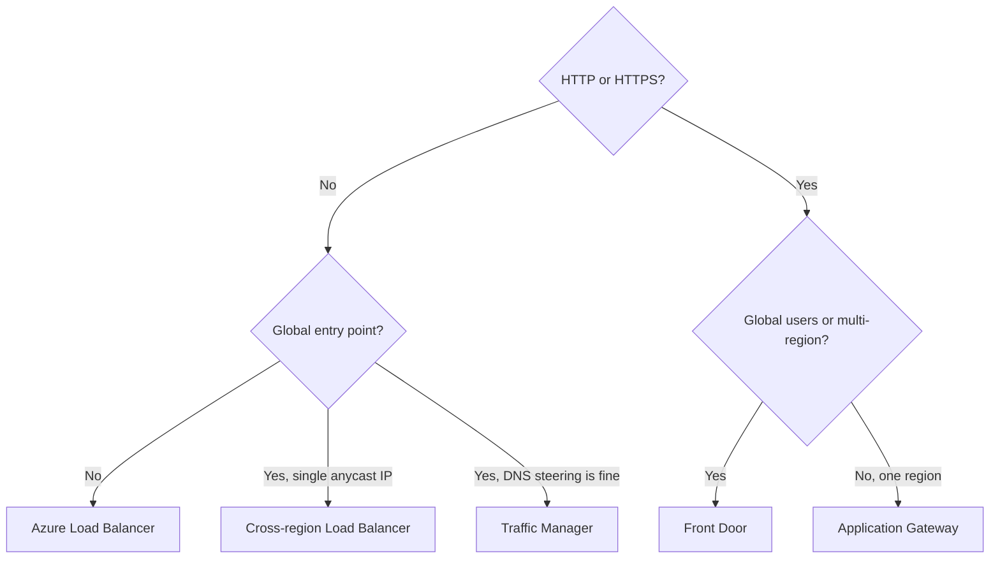

# 03 - Design and Implement Application Delivery Services (15-20%)

Application delivery is how users reach the apps you run on Azure networks. The July 27, 2026 outline has three skills: Azure Load Balancer together with Traffic Manager, Application Gateway, and Front Door. Almost every question in this domain is a selection question first ("which service?") and a configuration question second ("which setting fixes this?"). So learn the selection logic until it is automatic, then learn each service's moving parts.

**[📖 AZ-700 study guide](https://learn.microsoft.com/en-us/credentials/certifications/resources/study-guides/az-700)** - the official skills outline this note follows

---

## Choosing the service

Two questions settle most selection problems: is the traffic HTTP(S), and is the scope one region or global?

| Service | Layer | Scope | Proxies traffic? | TLS offload | WAF |
|---|---|---|---|---|---|
| Azure Load Balancer | 4 (TCP/UDP) | Regional, or global with the cross-region tier | No, passthrough | No | No |
| Gateway Load Balancer | 3/4 | Regional | Transparent NVA insertion | No | No (the NVA does the inspection) |
| Traffic Manager | DNS | Global | No, answers DNS only | No | No |
| Application Gateway | 7 (HTTP/S) | Regional | Yes | Yes | Yes (WAF_v2) |
| Front Door | 7 (HTTP/S) | Global edge | Yes | Yes | Yes |

The flowchart shows the selection logic: non-HTTP traffic goes to Load Balancer (regional or cross-region) or Traffic Manager, and HTTP traffic goes to Front Door when it is global and Application Gateway when it is regional. Many real designs combine them, for example Front Door in front of an Application Gateway in each region.

---

## 1. Azure Load Balancer and Azure Traffic Manager

### Load Balancer features and use cases

Azure Load Balancer distributes TCP and UDP flows at layer 4. It does not terminate connections or look at HTTP, which is exactly why it is fast and cheap and why it can balance any protocol: SQL Server Always On listeners, RDP gateways, custom TCP services, UDP game servers, and network virtual appliances.

### SKUs and tiers

Use the **Standard** SKU. The Basic SKU was retired on September 30, 2025; Standard is secure by default (closed to inbound until an NSG allows it), supports availability zones, scales to large backend pools and has an SLA. Standard has two tiers:

- **Regional** - the normal load balancer, public or internal, in one region.
- **Global (cross-region)** - a single static anycast public IP whose backends are regional Standard public load balancers in several regions. It gives instant regional failover and routes users to the closest healthy region, while preserving the client IP. Use it for a global layer-4 front door for non-HTTP traffic.

There is also **Gateway Load Balancer**, a separate SKU built for inserting third-party NVAs transparently. You chain a Standard public load balancer frontend (or a VM's public IP) to a Gateway Load Balancer, and traffic is sent through the NVA pool over VXLAN tunnels and back, without UDRs and without the app seeing any change. It is the answer to "insert a firewall appliance in front of a public app without changing routing or source IPs".

### Public versus internal

A **public** load balancer has a public IP frontend and balances internet traffic to VMs. An **internal** load balancer has a private IP frontend in a subnet and balances traffic inside the VNet, from peered VNets, or from on-premises. Internal load balancers support **HA ports**: one rule that balances all ports and protocols, which is how you put a highly available NVA pair behind a single next-hop IP for UDRs.

### Components and rules

- **Frontend IP configuration** - the public or private address clients hit.
- **Backend pool** - VMs or scale set instances, defined by NIC or by IP address.
- **Health probe** - TCP, HTTP or HTTPS. A backend that fails the probe stops receiving new flows. Remember that probes come from `168.63.129.16` and the `AzureLoadBalancer` service tag, which NSGs must allow.
- **Load balancing rule** - maps a frontend IP and port to a backend pool and port, with a probe, a session persistence mode (none, client IP, or client IP and protocol), an idle timeout and optional **floating IP** (direct server return, needed for SQL Always On listeners).
- **Inbound NAT rule** - forwards a frontend port to one backend instance, for example a unique port per VM for SSH. The newer form maps a frontend port range across a whole backend pool.
- **Outbound rule** - explicitly configures SNAT for backend VMs: which frontend IPs to use and how many SNAT ports each instance gets. Allocate ports manually to avoid SNAT exhaustion, or use NAT Gateway, which is usually the better outbound answer.

### Traffic Manager

Traffic Manager is a DNS-based global traffic director. A client looks up the Traffic Manager name, Traffic Manager returns the DNS name or IP of a healthy endpoint according to the routing method, and the client then connects directly. Because it never touches the traffic, it works for any protocol, but failover is only as fast as DNS caching allows (keep the TTL low).

Routing methods:

| Method | Behavior |
|---|---|
| Priority | Active/passive: the highest priority healthy endpoint wins |
| Weighted | Split by weight, for gradual migrations or canaries |
| Performance | The endpoint with the lowest network latency from the user's DNS resolver |
| Geographic | Fixed mapping from user geography to endpoint, for data sovereignty |
| MultiValue | Returns several healthy IPv4/IPv6 endpoints for client-side retry |
| Subnet | Maps client IP ranges to endpoints |

Endpoints can be Azure endpoints (public IPs, App Service), external endpoints (any FQDN or IP) or **nested** profiles, which let you combine methods (for example Performance across regions and Weighted inside each). Traffic Manager monitors endpoints with HTTP, HTTPS or TCP probes from its own probing agents.

**Traffic Manager versus Front Door**: Traffic Manager only answers DNS, so it adds no latency to the data path but has no caching, TLS offload or WAF and fails over at DNS speed. Front Door proxies the HTTP traffic, so it can cache, terminate TLS, apply WAF and fail over in seconds.

---

## 2. Azure Application Gateway

### Features and use cases

Application Gateway is a regional layer 7 load balancer and reverse proxy for HTTP, HTTPS, HTTP/2 and WebSocket. Pick it when you need, in one region: path-based routing (`/images/*` to one pool, `/api/*` to another), multi-site hosting (many host names on one gateway), TLS termination or end-to-end TLS, cookie-based session affinity, header and URL rewrites, or a WAF in front of web apps. It can be public, private, or both, and its backends can be VMs, scale sets, App Service, IP addresses and FQDNs, including on-premises servers over VPN or ExpressRoute.

Use the **v2** SKUs: Standard_v2 and WAF_v2. They autoscale, support zones, static VIPs, Key Vault certificates and header rewrites. The v1 SKUs are being retired (Microsoft announced April 28, 2026 for v1), so any answer that depends on v1 is suspect. For Kubernetes ingress, Microsoft's newer offering is **Application Gateway for Containers**, a separate service; know the name, the exam focuses on classic Application Gateway.

### Manual versus autoscale

A v2 gateway runs in one of two capacity modes. **Autoscale** sets a minimum and maximum instance count and lets the gateway grow with traffic; set the minimum high enough to absorb a sudden spike without waiting for scale-out. **Manual** (fixed capacity) pins the instance count, which gives predictable cost and avoids scale-out lag when traffic is steady. The exam pattern: "traffic is spiky and unpredictable" means autoscale with a sensible minimum; "fixed load, fixed budget" means manual.

### The configuration chain

Application Gateway is configured as a chain, and most troubleshooting is about a broken link in it:

1. **Frontend IP** - public, private, or both.
2. **Listener** - a frontend IP, port, protocol and (for HTTPS) certificate. A **basic** listener accepts any host name; a **multi-site** listener matches specific host names (wildcards allowed), which is how one gateway hosts many sites. Multi-site listeners are evaluated before basic ones.
3. **Routing rule** - ties a listener to a target. A **basic** rule sends everything to one backend pool; a **path-based** rule uses a URL path map to send paths to different pools, with a default. Rules have priorities.
4. **Backend settings** (formerly called HTTP settings) - backend protocol and port, cookie-based affinity, connection draining, request timeout, host name override (pick host name from backend target, which App Service needs), custom probe and trusted root certificates for end-to-end TLS.
5. **Backend pool** - the targets.
6. **Health probe** - the default probe hits `/` on the backend settings' protocol and port; create a **custom probe** to set a path, host, interval, unhealthy threshold and accepted status codes. A 502 Bad Gateway usually means every backend failed its probe, often because the probe path returns 401 or 404, the host header is wrong, or an NSG blocks the probe.

### TLS

- **TLS termination** - the listener holds the certificate (uploaded or, better, referenced from **Key Vault** using a managed identity so renewals flow through automatically). Traffic to the backend is plain HTTP.
- **End-to-end TLS** - the gateway re-encrypts to the backend. Backend settings use HTTPS, and the gateway must trust the backend certificate: well-known CA certificates are trusted automatically on v2, and for private CAs you upload the trusted root certificate. The backend certificate's name must match the host name the gateway sends.
- **TLS policy** - predefined or custom policies set the minimum TLS version and cipher suites. Use a policy with TLS 1.2 as the minimum.
- **HTTP to HTTPS redirect** - a redirect configuration on a rule attached to the port 80 listener.

### Rewrite rule sets

A rewrite set changes requests and responses as they pass through: add, remove or change request and response headers (for example strip `Server` or `X-Powered-By`, add `X-Forwarded-For` or HSTS), and rewrite the URL path and query string. Each rewrite rule can have conditions based on server variables, headers or the path, using regular expressions. You attach the rewrite set to a routing rule (or to individual path rules). This is the answer for "fix the Location header that exposes the backend host name" or "add security headers without changing the app".

---

## 3. Azure Front Door

### Features and use cases

Front Door is Microsoft's global layer 7 entry point and CDN. Clients connect to the nearest of Microsoft's edge locations over anycast; Front Door terminates TLS there, applies WAF and caching, then forwards to the best origin over Microsoft's backbone. Choose it for global web apps and APIs, multi-region active-active or active-passive failover, static content acceleration, and a global WAF. It is also Microsoft's replacement for the older Azure CDN offerings.

### Tiers

- **Standard** - content delivery, routing, caching, custom domains with managed certificates, and WAF **custom rules**.
- **Premium** - everything in Standard plus WAF **managed rule sets** and **bot protection**, **Private Link origins**, and enhanced security analytics.

Front Door (classic) is the legacy tier being retired; new designs use Standard or Premium. The rule of thumb: if the question mentions managed OWASP-style rules, bot protection or private origins, the answer is Premium.

### Profiles, endpoints, routes and origins

- A **profile** holds everything.
- An **endpoint** is a host name such as `contoso-abc123.z01.azurefd.net`. You attach **custom domains** to it, validated by a DNS TXT record, with a Front Door managed certificate or your own from Key Vault.
- An **origin group** is a set of **origins** (App Service, storage static websites, Application Gateway, public IPs, any public host name) with health probe settings and load balancing settings (sample size, successful samples required, latency sensitivity).
- Each origin has a **priority** (lower is preferred; use it for active-passive) and a **weight** (split among equal priorities; use it for active-active and canaries).
- A **route** maps domains and path patterns to an origin group, sets accepted and forwarding protocols, whether to redirect HTTP to HTTPS, and caching.

### TLS termination and end-to-end encryption

Front Door always terminates the client TLS session at the edge, so it can inspect and cache. Set the forwarding protocol to HTTPS only and it opens a new TLS session to the origin, which gives you end-to-end encryption. The origin must present a valid certificate from a trusted CA whose name matches the origin host header, unless you disable certificate subject name validation (do not, in production). You can set the minimum TLS version for client connections on each custom domain.

### Caching

Caching is enabled per route. Key settings: **query string caching behavior** (ignore query strings, use all, include specified, or exclude specified), **compression** for supported content types, and cache duration, which honors origin `Cache-Control` headers unless a rule overrides it. **Purge** removes cached content by path (with wildcards) when you deploy new assets. Do not cache personalized or authenticated responses.

### Traffic acceleration

Even without caching, Front Door speeds up dynamic traffic. Anycast lands users at a nearby edge, **split TCP** shortens the TCP and TLS handshakes to that edge, and Front Door keeps warm connections to origins over Microsoft's private backbone. That is why "speed up a dynamic API for global users without caching" points at Front Door.

### Rules, URL rewrite and URL redirect

A **rule set** is an ordered list of rules with conditions (request URL, path, header, query string, device type, geography, cookies) and actions. Actions include URL **redirect** (301, 302, 307 or 308, to a new protocol, host, path or query), URL **rewrite** (change the path sent to the origin without the client seeing it), **route configuration override** (send matching requests to a different origin group or change caching), and modifying request or response headers. Rule sets are attached to routes.

### Securing the origin with Private Link

On **Premium**, an origin can be reached through **Private Link**. Front Door creates a private endpoint request to the origin (App Service, storage, internal load balancer through a Private Link service, and others); you **approve** the pending private endpoint connection on the origin, then disable the origin's public access. Now only Front Door can reach the app, privately. For origins that must stay public, the fallback hardening is to allow only the `AzureFrontDoor.Backend` service tag and check the `X-Azure-FDID` header for your profile ID, so other people's Front Door profiles cannot reach you.

---

## Common combined patterns

- **Global plus regional**: Front Door at the edge with WAF, routing to an Application Gateway in each region that does path routing and end-to-end TLS to private backends.
- **Non-HTTP multi-region**: cross-region Load Balancer over regional public load balancers, or Traffic Manager when DNS-based failover is acceptable.
- **Highly available NVAs**: internal Standard Load Balancer with HA ports as the UDR next hop, or Gateway Load Balancer for transparent insertion in front of public apps.

---

## Exam traps

1. Load Balancer is passthrough: no TLS offload, no WAF, no path routing.
2. Health probes come from `168.63.129.16` (`AzureLoadBalancer` tag); block it and every backend goes unhealthy.
3. Traffic Manager returns DNS answers and never sees the traffic; failover speed depends on TTL.
4. Application Gateway 502s are almost always failed health probes or a host name mismatch.
5. App Service backends need "pick host name from backend target" (or a host override) in backend settings.
6. End-to-end TLS needs the backend certificate trusted and its name matching.
7. Multi-site listeners are evaluated before basic listeners.
8. Front Door managed WAF rules, bot protection and Private Link origins are Premium only.
9. Origin priority is for failover; weight is for splitting traffic among the same priority.
10. Gateway Load Balancer inserts NVAs transparently, without UDRs.

---

## Key terms

- **Cross-region load balancer** - the global Load Balancer tier with one anycast IP over regional public load balancers
- **Gateway Load Balancer** - a Load Balancer SKU that chains NVAs transparently into the traffic path using VXLAN
- **HA ports** - an internal load balancer rule that balances all ports and protocols, used for NVA pairs
- **Outbound rule** - a Standard Load Balancer setting that configures SNAT IPs and ports for backend VMs
- **Floating IP** - direct server return on a load balancing rule, needed for SQL Server Always On listeners
- **Nested Traffic Manager profile** - a profile used as an endpoint of another, to combine routing methods
- **Multi-site listener** - an Application Gateway listener that matches specific host names, evaluated before basic listeners
- **Backend settings** - Application Gateway settings for backend protocol, port, affinity, host name and probes
- **Custom health probe** - an Application Gateway probe with its own path, host, interval and accepted status codes
- **Rewrite set** - Application Gateway rules that change request and response headers or the URL path
- **Origin group** - a set of Front Door origins with shared health probe and load balancing settings
- **Origin priority** - the Front Door setting for failover order; lower numbers are preferred
- **Rule set** - an ordered list of Front Door rules that redirect, rewrite or override routing
- **Private Link origin** - a Front Door Premium origin reached privately after you approve the private endpoint connection

---

## Vendor documentation

- **[📖 Load balancing options](https://learn.microsoft.com/en-us/azure/architecture/guide/technology-choices/load-balancing-overview)** - Microsoft's decision tree for these services
- **[📖 Azure Load Balancer overview](https://learn.microsoft.com/en-us/azure/load-balancer/load-balancer-overview)** - SKUs, components and rules
- **[📖 Cross-region load balancer](https://learn.microsoft.com/en-us/azure/load-balancer/cross-region-overview)** - the global tier
- **[📖 Gateway Load Balancer](https://learn.microsoft.com/en-us/azure/load-balancer/gateway-overview)** - transparent NVA insertion
- **[📖 Outbound rules](https://learn.microsoft.com/en-us/azure/load-balancer/outbound-rules)** - explicit SNAT configuration
- **[📖 Traffic Manager routing methods](https://learn.microsoft.com/en-us/azure/traffic-manager/traffic-manager-routing-methods)** - all six methods
- **[📖 Application Gateway components](https://learn.microsoft.com/en-us/azure/application-gateway/application-gateway-components)** - listeners, rules, backend settings and probes
- **[📖 Application Gateway TLS overview](https://learn.microsoft.com/en-us/azure/application-gateway/ssl-overview)** - termination and end-to-end TLS
- **[📖 Rewrite HTTP headers and URL](https://learn.microsoft.com/en-us/azure/application-gateway/rewrite-http-headers-url)** - rewrite sets
- **[📖 Azure Front Door overview](https://learn.microsoft.com/en-us/azure/frontdoor/front-door-overview)** - tiers and architecture
- **[📖 Front Door caching](https://learn.microsoft.com/en-us/azure/frontdoor/front-door-caching)** - query string behavior, compression and purge
- **[📖 Front Door rule sets](https://learn.microsoft.com/en-us/azure/frontdoor/front-door-rules-engine)** - conditions and actions
- **[📖 Secure your origin with Private Link](https://learn.microsoft.com/en-us/azure/frontdoor/private-link)** - Premium private origins
