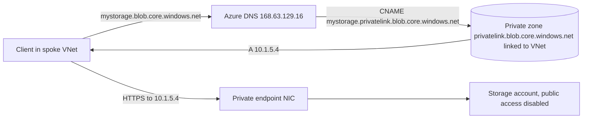

# 04 - Design and Implement Private Access to Azure Services (10-15%)

Most Azure PaaS services (Storage, SQL Database, Key Vault, Cosmos DB and many more) listen on public endpoints by default. This domain is about reaching them privately instead. The July 27, 2026 outline has two skills: Private Link with private endpoints, and service endpoints. The domain is small in weight, but its ideas reappear in the core networking (DNS) and security domains, so it is worth more study time than 10-15% suggests.

**[📖 AZ-700 study guide](https://learn.microsoft.com/en-us/credentials/certifications/resources/study-guides/az-700)** - the official skills outline this note follows

---

## The two approaches side by side

| | Service endpoint | Private endpoint (Private Link) |
|---|---|---|
| What it creates | A setting on a subnet | A NIC with a private IP in your subnet |
| Service address clients use | Still the public IP | A private IP from your VNet |
| Can the service turn off public access? | No, it filters it (VNet rules on the service firewall) | Yes, disable public network access entirely |
| Scope | The whole service type in the region (all storage accounts), narrowed by service endpoint policies for Storage | One specific resource (one storage account sub-resource) |
| Reachable from on-premises or peered VNets | No, only from the enabled subnet | Yes, over peering, VPN and ExpressRoute |
| DNS changes needed | None | Yes, a `privatelink` private DNS zone |
| Cost | No charge | Hourly per endpoint plus data processed |
| Data exfiltration protection | Only with service endpoint policies (Storage) | Inherent: the endpoint maps to one resource |

The default answer for production and for anything with "on-premises", "no public access" or "exfiltration" in the question is a **private endpoint**. Service endpoints are the answer when cost or simplicity matters and only VNet-sourced traffic needs restricting.

---

## 1. Azure Private Link service and private endpoints

### How a private endpoint works

A **private endpoint** is a network interface in one of your subnets with a private IP address, mapped to a specific **sub-resource** of a specific PaaS resource. For a storage account the sub-resources are `blob`, `file`, `queue`, `table`, `web` and `dfs`, so a workload that uses blob and Data Lake needs two endpoints. Traffic from your VNet to that IP travels the Microsoft backbone to the resource, and because the IP is in your address space, anything that can route to your VNet - peered VNets, on-premises over VPN or ExpressRoute - can reach it too.

### Planning private endpoints

Planning questions cover:

- **Subnet**: private endpoints can share an ordinary subnet with other resources; each takes one IP (a few services take more). Many designs put them in a dedicated "endpoints" subnet in the hub or in each spoke.
- **Network policies**: by default NSGs and UDRs do not apply to private endpoint traffic. You enable **private endpoint network policies** on the subnet (for NSGs, route tables or both) when you want NSG filtering or want a UDR to steer endpoint traffic through a firewall. A common trap is a firewall that never sees endpoint traffic because the policies are off.
- **Region**: the endpoint must be in the same region as its VNet, but the target resource can be in any region.
- **Which sub-resources**: one endpoint per sub-resource you need.
- **Approval**: if you have the right permission on the target, the connection is **auto-approved**; otherwise it lands as **pending** and the resource owner must approve it. Cross-tenant connections usually use manual approval.

### Creating and configuring access

You create the endpoint (portal, CLI, Bicep or Terraform), choose the target resource and sub-resource, the subnet, and whether to integrate with a private DNS zone. Then you **configure access**: on the target, set public network access to Disabled (or keep selected networks) so the private endpoint is the only path, and apply NSG rules on the endpoint subnet if network policies are enabled. Check the connection state on the resource's **Networking** blade: Approved, Pending, Rejected or Disconnected.

### DNS integration, the part people get wrong

Clients keep using the normal name, for example `mystorage.blob.core.windows.net`. When a private endpoint exists, Azure's public DNS returns a CNAME to `mystorage.privatelink.blob.core.windows.net`. What that name then resolves to depends on who is asking:

- Inside a VNet linked to a **private DNS zone** named `privatelink.blob.core.windows.net` that holds an A record for `mystorage`, it resolves to the private IP.
- Anywhere else, it resolves to the public IP (which is blocked if public access is disabled).

So the work is:

1. Create the private DNS zone with the exact `privatelink` name Microsoft documents for that service.
2. Let the endpoint's **private DNS zone group** create and maintain the A record (choose "integrate with private DNS zone" at creation).
3. **Link** the zone to every VNet whose clients need private resolution. In hub-and-spoke designs, keep one set of zones centrally (often deployed by Azure Policy) and link them to the hub and spokes, or point spokes' DNS at a central resolver.
4. For **on-premises** clients, add a conditional forwarder on the on-premises DNS servers for the public zone (for example `blob.core.windows.net`) pointing to an **Azure DNS Private Resolver inbound endpoint** (or a DNS forwarder VM) in a VNet linked to the private zone.

Do not create a private zone named after the public zone itself (for example `blob.core.windows.net`): it would capture every storage account name, including other people's, and break them. Do not edit hosts files except for a quick test.

The diagram shows the resolution chain: the public name returns a `privatelink` CNAME, the linked private zone answers with the endpoint's private IP, and traffic then flows to the private endpoint NIC.

### Private Link service: exposing your own service

A **Private Link service** is the provider side. You put your application behind a **Standard internal load balancer**, create a Private Link service on that load balancer's frontend, and consumers in other VNets, subscriptions or tenants create private endpoints that connect to it. Neither side's address spaces matter, because the provider sees traffic arrive from **NAT IPs** taken from a subnet you pick for the Private Link service, and the consumer sees only its own private endpoint IP. This is how SaaS providers offer private connectivity to customers without peering.

Key settings:

- **Visibility** - who can find and request a connection (role-based, specific subscriptions, or anyone with the alias).
- **Auto-approval** - subscriptions whose requests are approved automatically.
- **NAT IP configuration** - how many NAT IPs to allocate (more IPs give more source ports for many connections).
- **TCP proxy protocol v2** - lets the backend see the consumer's original source information, because otherwise it only sees NAT IPs.
- The subnet holding the Private Link service needs its **network policies for Private Link service** disabled.

### Private Link with on-premises clients

Two cases come up. **Reaching Azure PaaS from on-premises**: on-premises traffic reaches a private endpoint over VPN or ExpressRoute private peering like any other VNet address; DNS is the hard part, solved with the conditional forwarder to a Private Resolver inbound endpoint described above. **Exposing an on-premises service through Private Link**: put an internal load balancer in Azure whose backend reaches the on-premises servers (for example through forwarding VMs over the hybrid link), publish a Private Link service on it, and consumers connect privately without seeing your network.

---

## 2. Service endpoints

### When to choose a service endpoint

A **service endpoint** is a subnet setting for a service type, such as `Microsoft.Storage`, `Microsoft.Sql`, `Microsoft.KeyVault`, `Microsoft.AzureCosmosDB`, `Microsoft.ServiceBus`, `Microsoft.EventHub` or `Microsoft.Web`. Once enabled, traffic from that subnet to the service uses an optimal route over the Azure backbone, and the **source address the service sees changes from a public IP to the VM's private IP** (plus the VNet and subnet identity). That identity lets the service's firewall allow "this subnet" instead of a public IP.

Choose it when:

- Only VNet resources need access and on-premises access is not required.
- You want to restrict a PaaS resource to specific subnets quickly and for free.
- You can accept that the resource keeps a public endpoint (filtered, not removed).

Do not choose it when on-premises clients must reach the service privately, when the requirement is "no public endpoint at all", or when the service does not support service endpoints.

### Creating service endpoints and configuring access

Enabling is two steps on two sides:

1. On the **subnet**, enable the service endpoint for the service type. Existing connections drop briefly as the routing changes, so plan it.
2. On the **resource** (for example the storage account's networking settings), add a **virtual network rule** for that subnet and set public access to selected networks. Without the resource-side rule nothing is restricted; without the subnet-side endpoint the rule cannot be added (the portal offers to enable it).

Remember the routing side effect. If you force-tunnel the subnet's internet traffic to a firewall with a `0.0.0.0/0` UDR, service endpoint traffic still goes direct, because service endpoints add a route with next hop type `VirtualNetworkServiceEndpoint` that is more specific than the default route. That is often the reason given for "storage traffic is bypassing the firewall".

### Service endpoint policies

A service endpoint on `Microsoft.Storage` allows the subnet to reach **any** storage account in the region over the endpoint, including an attacker's. **Service endpoint policies** close that gap for Azure Storage: you create a policy listing the allowed storage accounts (or all accounts in a resource group or subscription) and associate it with the subnet. Traffic from the subnet to any other storage account over the service endpoint is then denied. This is the answer to "prevent data exfiltration to other storage accounts while keeping service endpoints". Policies need the `Microsoft.Storage` service endpoint enabled on the same subnet, and note some service-managed storage traffic needs aliases or exceptions documented by Microsoft.

---

## Exam traps

1. Service endpoint keeps the public endpoint; private endpoint can remove it.
2. Service endpoints do not work from on-premises or across peering; private endpoints do.
3. The resource firewall needs a virtual network rule for the subnet, or the service endpoint restricts nothing.
4. Private endpoint DNS needs the `privatelink` zone, the A record and a link to every client VNet.
5. On-premises resolution of private endpoints needs a conditional forwarder to a resolver inside Azure.
6. NSGs and UDRs ignore private endpoint traffic until network policies are enabled on the subnet.
7. One private endpoint per sub-resource (blob and dfs are separate).
8. Private Link service sits behind a Standard internal load balancer; the provider sees NAT IPs unless proxy protocol v2 is enabled.
9. Service endpoint policies are the exfiltration control for Storage over service endpoints.
10. A `0.0.0.0/0` UDR does not capture service endpoint traffic.

---

## Key terms

- **Private endpoint** - a NIC with a private IP in your subnet mapped to one sub-resource of one PaaS resource
- **Sub-resource** - the target service type of a private endpoint, such as blob, file or dfs for a storage account
- **Private DNS zone group** - the private endpoint setting that creates and maintains its A record in a privatelink zone
- **privatelink zone** - the private DNS zone, such as privatelink.blob.core.windows.net, that returns private endpoint IPs
- **Private endpoint network policies** - a subnet setting that makes NSGs and UDRs apply to private endpoint traffic
- **Private Link service** - a provider-side resource that publishes an app behind a Standard internal load balancer
- **NAT IP configuration** - the source addresses a Private Link service presents to the provider's backend
- **Proxy protocol v2** - lets a Private Link service backend see the consumer's original connection details
- **Service endpoint** - a subnet setting that routes traffic to a PaaS service type over the backbone with the subnet identity
- **Virtual network rule** - a PaaS firewall entry that allows traffic from a subnet with a service endpoint
- **Service endpoint policy** - restricts a subnet's service endpoint traffic to named storage accounts to stop exfiltration

---

## Vendor documentation

- **[📖 What is Azure Private Link?](https://learn.microsoft.com/en-us/azure/private-link/private-link-overview)** - concepts and supported services
- **[📖 What is a private endpoint?](https://learn.microsoft.com/en-us/azure/private-link/private-endpoint-overview)** - sub-resources, approval and limitations
- **[📖 Private endpoint DNS configuration](https://learn.microsoft.com/en-us/azure/private-link/private-endpoint-dns)** - the `privatelink` zone names per service
- **[📖 Private endpoint DNS integration scenarios](https://learn.microsoft.com/en-us/azure/private-link/private-endpoint-dns-integration)** - hub-and-spoke and on-premises patterns
- **[📖 Manage network policies for private endpoints](https://learn.microsoft.com/en-us/azure/private-link/disable-private-endpoint-network-policy)** - NSG and UDR support
- **[📖 What is Private Link service?](https://learn.microsoft.com/en-us/azure/private-link/private-link-service-overview)** - provider-side configuration
- **[📖 Virtual network service endpoints](https://learn.microsoft.com/en-us/azure/virtual-network/virtual-network-service-endpoints-overview)** - how they change routing and source identity
- **[📖 Service endpoint policies](https://learn.microsoft.com/en-us/azure/virtual-network/virtual-network-service-endpoint-policies-overview)** - exfiltration control for Storage
- **[📖 Manage private endpoints](https://learn.microsoft.com/en-us/azure/private-link/manage-private-endpoint)** - approval and connection states
