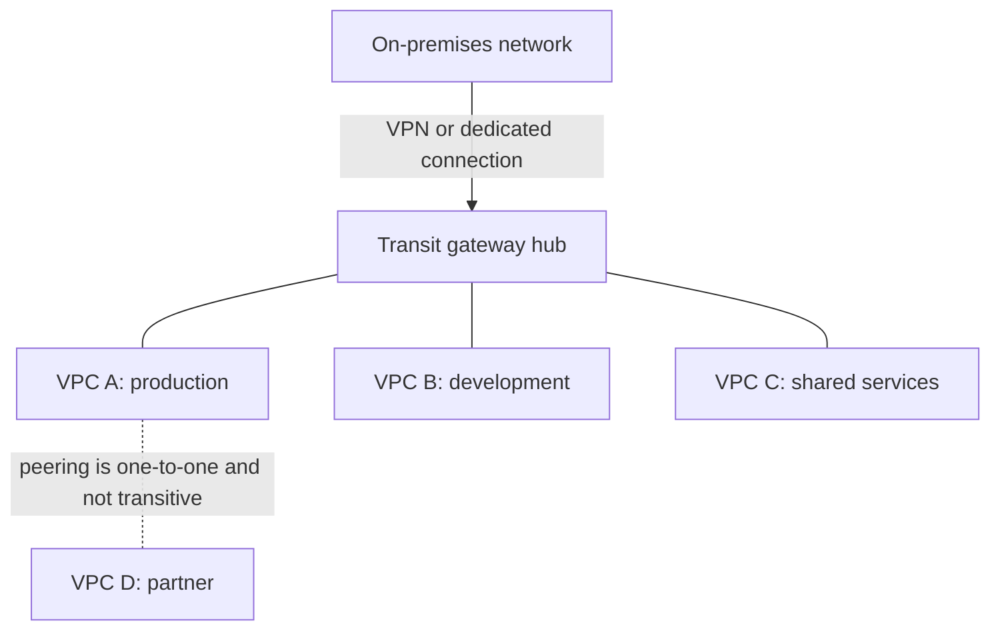

# Domain 1: Cloud Architecture (23%)

This note covers objectives 1.1 to 1.11: service models, availability, networking, storage, cloud-native design, containers, virtualization, cost, databases, workload optimization and evolving technologies. Deployment models (public, private, hybrid, community) sit in Domain 2 under objective 2.1, so they are in [02-deployment.md](02-deployment.md).

**[📖 CompTIA Cloud+ CV0-004 Exam Objectives v2.0 (PDF)](https://comptiacdn.azureedge.net/webcontent/docs/default-source/exam-objectives/comptia-cloud-cv0-004-exam-objectives-%282-0%29.pdf)** - the official topic list this note follows.

**[📖 NIST SP 800-145 - The NIST Definition of Cloud Computing](https://csrc.nist.gov/pubs/sp/800/145/final)** - the short, standard definition of service and deployment models.

Architecture is the heaviest domain on CV0-004, almost a quarter of the exam. It is also the foundation for everything else. A troubleshooting question about a missing route only makes sense if you know what a route table and a transit gateway do. A cost question only makes sense if you know what spot capacity is. Read this note first, and come back to it when later domains refer to a concept.

## 1.1 Use the appropriate cloud service model

A service model answers one question: how much of the stack does the provider run for you? The more the provider runs, the less you control and the less you have to operate. Every exam question on service models is really a trade between control and operational effort.

- **Infrastructure as a service (IaaS)** - the provider runs the physical hardware, network and hypervisor. You get virtual machines, virtual networks and block storage, and you run the operating system and everything above it. AWS EC2, Azure Virtual Machines and Google Compute Engine are IaaS.
- **Platform as a service (PaaS)** - the provider also runs the operating system, middleware and runtime. You deploy code and manage data. Azure App Service, AWS Elastic Beanstalk and Google App Engine are PaaS.
- **Software as a service (SaaS)** - the provider runs the whole application. You configure it and manage users and data. Microsoft 365, Salesforce and Google Workspace are SaaS.
- **Function as a service (FaaS)** - you upload a function and the provider runs it when an event fires. You pay per invocation and execution time, and you never see a server. AWS Lambda, Azure Functions and Google Cloud Run functions are FaaS.

How do you pick one in a scenario? Look for the constraint the question emphasises. "Needs a specific kernel module", "must install a legacy agent" or "full control of the OS" points to IaaS. "Small team, wants to focus on code, no patching" points to PaaS. "Needs email and collaboration this month, no developers" points to SaaS. "Runs for a few seconds when a file lands in storage" or "traffic is spiky and mostly idle" points to FaaS.

**Exam trap:** FaaS is not the answer for long-running or stateful work. Functions have execution time limits (15 minutes on AWS Lambda, for example) and keep no state between calls. A nightly batch job that runs for three hours belongs on a VM, a container or a managed batch service.

### The shared responsibility model

The shared responsibility model says who secures what. The provider is always responsible for security **of** the cloud: data centres, hardware, the hypervisor and the global network. The customer is always responsible for security **in** the cloud: their data, their identities and how they configure access. The boundary in between moves with the service model.

| Layer | IaaS | PaaS | SaaS |
|---|---|---|---|
| Data and access | Customer | Customer | Customer |
| Application | Customer | Customer | Provider |
| Runtime and middleware | Customer | Provider | Provider |
| Operating system | Customer | Provider | Provider |
| Virtualization, servers, storage, network | Provider | Provider | Provider |
| Physical facility | Provider | Provider | Provider |

Two rows never move. Data and identity are always yours, even in SaaS. If a SaaS user shares a confidential file publicly, that is a customer failure, not a provider failure. The physical facility is always the provider's, so a question about badge readers or fire suppression in a public cloud data centre is about the provider's controls, which you verify through their audit reports (SOC 2, ISO 27001), not by visiting.

**Exam trap:** In IaaS, OS patching is the customer's job. Candidates who assume "the cloud patches it" pick the wrong answer. In PaaS, OS patching moves to the provider, but patching your application's libraries is still yours.

## 1.2 Explain concepts related to service availability

### Resource availability

- **Region** - a geographic area containing several data centres. Regions are independent of each other, so a regional outage does not spread. You pick a region for latency to users, data residency law, service availability and price.
- **Availability zone (AZ)** - one or more data centres inside a region with independent power, cooling and networking, linked by low-latency connections. Spreading instances across AZs protects you from a single data-centre failure without the latency cost of going cross-region.
- **Cloud bursting** - running normally in a private data centre and overflowing to public cloud when demand exceeds local capacity. It needs compatible images, network connectivity and usually an orchestration layer that knows when to burst.
- **Edge computing** - running compute close to where data is created or consumed, such as a factory floor, a retail store or a CDN point of presence. It cuts latency and reduces how much raw data travels back to a region.
- **Availability monitoring** - checking from outside that a service actually answers. Synthetic checks (a probe that loads a page every minute from several locations) catch failures that internal metrics miss, such as a DNS or certificate problem.

The pattern behind all of these is "remove single points of failure at the level you need". Multi-AZ protects against a building failing. Multi-region protects against a whole region failing, at higher cost and with harder data replication. The exam will give you an availability target and a budget, and expect you to pick the smallest design that meets the target.

### Disaster recovery

Disaster recovery (DR) is how you come back after something has already failed. High availability tries to stop downtime happening; DR limits how bad it is when it does.

- **Recovery time objective (RTO)** - the maximum acceptable time from the failure to service being restored. It is about downtime.
- **Recovery point objective (RPO)** - the maximum acceptable data loss, measured in time back from the failure. An RPO of 15 minutes means backups or replication must capture changes at least every 15 minutes.
- **Hot site** - a fully running duplicate environment with current data. Failover takes minutes or less. Highest cost.
- **Warm site** - infrastructure is in place and partly running, data is fairly recent, but it needs scaling up and some configuration before it can take full load. Hours.
- **Cold site** - space, power and maybe network, but no running systems and no current data. You restore from backup. Days. Lowest cost.

A useful memory aid: RTO is about **T**ime to recover, RPO is about the **P**oint you roll back to. Lower numbers cost more for both. In cloud terms, a hot site is often called active-active or multi-site, a warm site is warm standby, and a cold site is backup and restore. AWS also uses "pilot light" for a minimal warm setup where only the database replicates and the rest is provisioned on failover.

**Exam trap:** A question that says "the business can tolerate four hours of downtime but no more than five minutes of data loss" has a long RTO and a short RPO. The answer is continuous or near-continuous replication to a warm site, not a hot site. Do not over-buy.

### Multicloud tenancy

Multicloud means using more than one public provider. Reasons include avoiding vendor lock-in, using a best-of-breed service from each provider, meeting a regulator's concentration-risk requirement, and negotiating leverage. The costs are real: different IAM models, different networking, egress charges between clouds and the need for staff who know several platforms. Tenancy also refers to how isolated you are on shared hardware. Multi-tenant means your workload shares hosts with other customers, separated by the hypervisor. Single-tenant (dedicated hosts or instances) removes neighbours, which helps with licensing and some compliance rules.

## 1.3 Explain cloud networking concepts

### Public and private connections to the cloud

- **Virtual private network (VPN)** - an encrypted tunnel over the public internet. A site-to-site VPN joins an office or data centre network to a cloud virtual network, usually with IPsec. A client (remote access) VPN connects a single user. VPNs are quick to set up and cheap, but bandwidth and latency depend on the internet path.
- **Dedicated connection** - a private circuit from your premises or a colocation facility into the provider's network. AWS calls this Direct Connect, Azure calls it ExpressRoute, Google calls it Cloud Interconnect. It gives predictable bandwidth and latency and avoids the internet, but it takes weeks to provision and costs more. It is not encrypted by default, so some designs run a VPN over it.

When the scenario mentions "consistent latency", "large daily data transfers" or "must not traverse the internet", pick the dedicated connection. When it says "needed this week" or "low cost backup link", pick VPN. A common real design uses both: dedicated connection as primary, VPN as failover.

### Network functions, components and services

- **Application load balancer** - works at Layer 7. It reads HTTP, so it can route by path (`/api` to one group, `/images` to another) or host header, terminate TLS and insert headers.
- **Network load balancer** - works at Layer 4 (TCP and UDP). It does not look inside the request, so it handles very high throughput with very low latency, supports non-HTTP protocols and can keep a static IP.
- **Application gateway** - a Layer 7 reverse proxy that often combines load balancing, TLS termination and a web application firewall. Azure uses this exact name. In other clouds the same job is done by an application load balancer plus a WAF, or by an API gateway for API traffic.
- **Content delivery network (CDN)** - a global network of edge caches that serve static content close to users. It reduces latency, offloads the origin and absorbs some DDoS traffic.
- **Firewall** - filters traffic by rules. In cloud you meet stateful instance-level rules (security groups), stateless subnet-level rules (network ACLs) and managed firewall appliances for inspection between networks.
- **Virtual private cloud (VPC)** - your logically isolated network in a provider, with your own IP range, subnets and route tables. Azure calls it a virtual network (VNet).
- **VPC peering** - a private, direct link between two VPCs. It is **not transitive**: if A peers with B and B peers with C, A cannot reach C through B.
- **Transit gateway** - a regional hub that many VPCs and VPN or dedicated connections attach to. It replaces a mesh of peering links with hub and spoke, and it supports transitive routing through its own route tables. Azure's equivalent is Virtual WAN or a hub VNet; Google uses Network Connectivity Center.

**Exam trap:** "Ten VPCs must all reach each other and the on-premises network, and peering is becoming unmanageable" is a transit gateway question. Ten VPCs in a full mesh need 45 peering connections; a hub needs ten attachments.

The transit gateway lets every spoke reach every other spoke and on-premises through one hub, while a peering link only joins the two VPCs at its ends.

### Subnets, routing and switching

- **Subnet** - a slice of the VPC's address range, usually tied to one availability zone. A public subnet has a route to an internet gateway. A private subnet does not, and reaches the internet (if at all) through a NAT gateway.
- **Virtual local area network (VLAN)** - a Layer 2 broadcast domain separated by a tag (802.1Q) on the frames. VLANs segment traffic on shared switches. In private clouds and on-premises virtualization you still configure VLANs directly.
- **Software-defined network (SDN)** - networking where the control plane (decisions) is separated from the data plane (forwarding) and managed centrally through software and APIs. Every public cloud VPC is SDN, which is why you can create a network with an API call.
- **Border Gateway Protocol (BGP)** - the routing protocol that exchanges routes between autonomous systems. Dedicated connections and many VPNs use BGP so routes are learned dynamically and failover happens automatically.
- **Static route** - a route typed in by hand. Simple and predictable, but it does not react to failures.
- **Route table** - the list of destinations and next hops attached to a subnet. The most specific matching prefix wins.

Why does BGP matter for a Cloud+ candidate? Because a dedicated connection with a VPN backup only fails over cleanly if routes are dynamic. With static routes you would have to change the table by hand during an outage.

## 1.4 Compare and contrast storage resources and technologies

### Tiered storage

- **Hot tier** - frequently accessed data. Highest storage price per GB, lowest access cost and latency.
- **Warm tier** - accessed occasionally, perhaps monthly. Cheaper to store, with a per-access charge and sometimes a minimum storage duration.
- **Cold tier** - rarely accessed, perhaps a few times a year. Cheaper again, with higher retrieval charges.
- **Archive tier** - kept for compliance or history. Very cheap to store, but retrieval can take hours and costs the most. AWS S3 Glacier Deep Archive, Azure Archive and Google Archive storage are examples.

Lifecycle policies move objects between tiers automatically by age. The exam likes "logs must be kept seven years but are almost never read": move them to archive after a short hot period.

**Exam trap:** Archive is wrong when the scenario needs data "within minutes". Retrieval from the deepest archive classes takes hours.

### Disk types

- **Solid-state drive (SSD)** - no moving parts, high IOPS and low latency. The default for boot volumes and databases.
- **Hard disk drive (HDD)** - spinning media, cheap per GB, good sequential throughput but poor random IOPS. Fits large sequential workloads such as log processing or a data warehouse staging area.

### Storage types

- **Block storage** - raw volumes presented to a VM as disks. The OS formats them. Lowest latency, usually attached to one instance at a time. AWS EBS, Azure Managed Disks, Google Persistent Disk.
- **File storage** - a shared file system over NFS or SMB that many machines can mount at once. Good for shared content and lift-and-shift apps that expect a network drive. AWS EFS and FSx, Azure Files, Google Filestore.
- **Object storage** - objects in flat buckets, accessed over HTTP APIs, with metadata and practically unlimited scale. Cheapest per GB and very durable, but you cannot mount it as a normal disk or edit part of an object in place. AWS S3, Azure Blob Storage, Google Cloud Storage.

### Performance and cost implications

Performance is measured as IOPS (operations per second, which matters for small random reads and writes such as databases), throughput (MB per second, which matters for large sequential transfers such as video or backups) and latency. Cost has several parts: capacity stored, provisioned performance, requests, retrieval and data transfer out. A cheap tier with expensive retrieval can cost more than a hot tier if you read the data often. Read the access pattern in the question before picking the cheapest-sounding answer.

## 1.5 Explain the purpose of cloud-native design concepts

Cloud-native design builds systems that expect failure, scale by adding copies and lean on provider services instead of hand-built servers.

- **Cloud-provided managed services** - databases, queues, caches and identity that the provider runs and patches. You trade some control for much less operational work and built-in high availability.
- **Microservices** - an application split into small services, each owning one business capability and its own data, deployed independently. The benefit is independent scaling and release. The cost is more network calls, distributed debugging and the need for good observability.
- **Loosely coupled architecture** - components talk through queues, events or stable APIs instead of direct, synchronous calls. If one component slows down or fails, the others keep working and the queue absorbs the backlog.
- **Fan-out** - one message is delivered to many consumers in parallel, for example a "new order" event going to billing, shipping and analytics. A publish-subscribe topic feeding several queues is the classic pattern (AWS SNS to SQS, Azure Service Bus topics, Google Pub/Sub).
- **Service discovery** - how services find each other when instances come and go. A registry or DNS-based system keeps the current address list, so callers ask "where is the payments service?" instead of hard-coding IPs. Kubernetes Services, AWS Cloud Map and Consul do this.

**Exam trap:** "Tightly coupled" is never the cloud-native answer. If a question says one component's outage takes down the whole order flow, the fix is a queue between them, not a bigger server.

## 1.6 Compare and contrast containerization concepts

A container packages an application with its libraries and runs it as an isolated process on a shared kernel. It starts in seconds and is far smaller than a VM, because it has no guest OS of its own.

- **Stand-alone containers** - containers run directly on one host by a runtime such as Docker. Fine for development, simple tools or a single small service. Nothing restarts them on another host if this host dies.
- **Workload orchestration** - a platform that schedules containers across a cluster, restarts failed ones, scales replicas, rolls out updates and handles service discovery. Kubernetes is the standard. Managed versions are Amazon EKS, Azure AKS and Google GKE. Simpler provider-specific options include Amazon ECS and serverless containers such as AWS Fargate, Azure Container Apps and Google Cloud Run.
- **Port mapping** - publishing a container's internal port on the host, for example host 8080 to container 80 (`docker run -p 8080:80`). Two containers cannot both bind the same host port.
- **Persistent volumes** - storage that outlives the container, mounted from a host path, network file share or cloud block volume. Databases in containers need this.
- **Ephemeral storage** - the container's writable layer. It disappears when the container is removed. Anything written there, including logs, is lost unless shipped elsewhere.
- **Image registry** - a repository that stores and versions container images. Public registries (Docker Hub) are convenient but can carry untrusted images. Private registries (Amazon ECR, Azure Container Registry, Google Artifact Registry) add access control and vulnerability scanning.

**Exam trap:** "Data disappears every time the container restarts" means the app writes to ephemeral storage. The fix is a persistent volume, not a bigger container.

## 1.7 Compare and contrast virtualization concepts

Virtualization runs several virtual machines on one physical host through a hypervisor. A Type 1 hypervisor runs on bare metal (VMware ESXi, Hyper-V, KVM) and is what clouds and data centres use. A Type 2 hypervisor runs on top of a desktop OS (VirtualBox, VMware Workstation) and is used for labs.

- **Stand-alone host** - one hypervisor host with no shared management. If it fails, its VMs go down with it.
- **Clustering** - several hosts managed as a pool with shared storage, so VMs can move between hosts (live migration) and restart on a surviving host after a failure.
- **Cloning** - copying a VM to create a new one quickly. Clones of Windows machines need a fresh identity (sysprep) so they do not share security identifiers. Templates are the managed version of this idea.
- **Host affinity** - rules that keep VMs together on the same host (affinity, for low latency between them) or apart on different hosts (anti-affinity, so one host failure does not take down both members of a cluster). Licensing rules sometimes require affinity to specific hosts.
- **Hardware pass-through** - giving a VM direct access to a physical device such as a GPU or NIC (PCI pass-through, SR-IOV). It delivers near-native performance but ties the VM to that host, which can block live migration.
- **Overlay networks** - virtual networks built on top of the physical network by encapsulating traffic (VXLAN, Geneve). They let VMs or containers on different hosts share a logical network without reconfiguring physical switches. Cloud VPCs and Kubernetes pod networks are overlays.
- **VM networks** - the virtual switches and port groups that connect VMs on a host to each other and to physical uplinks, often mapped to VLANs.
- **Local storage** - disks inside the host. Fast and cheap, but VMs on it cannot live-migrate and are lost if the host is lost.
- **Storage area network (SAN)** - block storage shared over a dedicated network (Fibre Channel or iSCSI). Hosts see LUNs as local disks. It enables clustering and live migration.
- **Network-attached storage (NAS)** - file storage shared over the normal network (NFS or SMB).

The most tested distinction is SAN versus NAS: SAN is block level, NAS is file level. Another is anti-affinity: two domain controllers or two database nodes on the same host give you no protection against a host failure.

## 1.8 Summarize cost considerations related to cloud usage

- **Dedicated host** - a whole physical server reserved for you. The most expensive option, chosen for per-socket or per-core software licensing (bring your own licence) or compliance that forbids shared hardware.
- **Reserved resources** - a one or three year commitment in exchange for a large discount, often 40 to 70 percent. Best for steady, predictable baseload. Savings plans are a more flexible form.
- **Pay-as-you-go** - on-demand pricing billed per second or hour with no commitment. Highest unit price, full flexibility. Right for new, short-lived or unpredictable workloads.
- **Spot instance** - spare capacity at up to around 90 percent off, which the provider can reclaim with very short notice (two minutes on AWS, 30 seconds on Azure and Google). Right for fault-tolerant, interruptible work such as batch, rendering and CI runners. Wrong for a primary database.
- **Resource metering** - measuring usage per resource (hours, GB, requests, GB transferred) so billing reflects consumption. Metering data is what chargeback and showback reports are built from.
- **Tagging** - key-value labels such as `CostCenter=Finance` or `Environment=Prod`. Tags let you split the bill by team or project and find orphaned resources. A tagging policy only works if it is enforced at creation time.
- **Rightsizing** - matching instance size to actual use. A VM averaging 8 percent CPU is a rightsizing candidate. Rightsize before you buy reservations, or you lock in waste for three years.

A good exam answer often combines models: reserved capacity for the baseline, on-demand for daily peaks, spot for batch.

## 1.9 Explain the importance of database concepts

- **Relational database** - data in tables with a fixed schema, related by keys and queried with SQL. Strong consistency and ACID transactions. Fits orders, payments and anything where correctness of related records matters. MySQL, PostgreSQL, SQL Server, Oracle.
- **Non-relational (NoSQL) database** - flexible or no schema, designed to scale out horizontally. Families include key-value (DynamoDB, Redis), document (MongoDB, Cosmos DB), wide-column (Cassandra, Bigtable) and graph (Neo4j). Fits high-volume, simple-access-pattern or rapidly changing data such as sessions, catalogues and IoT readings.
- **Self-managed** - you install and run the database on a VM or container. Full control of version, extensions and tuning; you also own patching, backups, replication and failover.
- **Provider-managed** - database as a service (Amazon RDS and Aurora, Azure SQL Database, Google Cloud SQL, DynamoDB). The provider handles patching, backups, multi-AZ failover and scaling options. Less control of the underlying OS.

**Exam trap:** "Needs a database feature or version the managed service does not support" is the main reason to self-manage. Otherwise, a small team with limited staff should get provider-managed.

## 1.10 Compare and contrast methods for optimizing workloads using cloud resources

Optimizing a workload means choosing the right compute shape, storage performance, network path and level of management for what the workload actually does.

**Compute.** A VM gives full control and suits long-running, stateful or OS-dependent applications. A container gives density, fast start and portability, and suits microservices and CI jobs. Serverless gives zero idle cost and automatic scaling, and suits event-driven, short, bursty tasks. The exam often describes a workload that sits idle most of the day and spikes briefly: serverless is the cost-optimal answer.

**Orchestration and workflow.** Orchestration coordinates many resources or containers as one system (Kubernetes scheduling pods, or IaC creating a full stack). A workflow service coordinates the steps of a business process with retries, branching and waiting, such as AWS Step Functions, Azure Logic Apps or Google Workflows. Use a workflow engine instead of chaining functions by hand when a process has many steps and must handle failures.

**Network.** Latency is the delay for one round trip and is set mostly by distance and hops. Throughput is how much data moves per second. To cut latency, put compute near users (region choice, CDN, edge) and keep chatty components in the same AZ. To raise throughput, use larger instance types with higher network bandwidth, enhanced networking or parallel transfers.

**Storage.** IOPS matters for many small random operations, such as a busy OLTP database. Throughput matters for large sequential reads and writes, such as video processing or backups. Provisioned-IOPS SSD volumes suit the first. Throughput-optimized HDD or striped volumes can suit the second for much less money.

**Managed services.** Replacing a self-run component with a managed one (a managed queue, cache or database) often optimizes both cost and reliability, because you stop paying for idle capacity and engineer time.

**Exam trap:** "The database is slow and the volume shows maxed-out IOPS while CPU is at 20 percent" is a storage problem. A bigger instance will not fix it; a higher-IOPS volume will.

## 1.11 Identify evolving technologies in the cloud

CV0-004 expects you to recognise what managed AI and IoT services do and when a scenario calls for them. You do not need to build models.

### Machine learning and AI services

Providers sell pre-trained AI as simple APIs. You send data and get a result, with no data science team needed.

- **Text recognition** - optical character recognition (OCR) that extracts printed or handwritten text from images and documents. AWS Textract, Azure AI Document Intelligence, Google Document AI.
- **Text translation** - machine translation between languages. AWS Translate, Azure AI Translator, Google Cloud Translation.
- **Visual recognition** - detecting objects, faces, scenes or unsafe content in images and video. AWS Rekognition, Azure AI Vision, Google Cloud Vision.
- **Sentiment analysis** - judging whether text is positive, negative or neutral, for example in product reviews or support tickets. AWS Comprehend, Azure AI Language.
- **Voice-to-text** - speech recognition that turns audio into a transcript. AWS Transcribe, Azure AI Speech, Google Speech-to-Text.
- **Text-to-voice** - speech synthesis that reads text aloud in a natural voice. AWS Polly, Azure AI Speech, Google Text-to-Speech.
- **Generative AI** - large models that create new text, code or images from a prompt. Delivered through managed platforms such as Amazon Bedrock, Azure OpenAI Service and Google Vertex AI. Key cloud concerns are data privacy (does the prompt leave your boundary?), cost per token and output review.

In a scenario, match the verb. "Extract invoice numbers from scanned PDFs" is text recognition. "Flag angry customer emails" is sentiment analysis. "Generate captions for a call centre recording" is voice-to-text. "Draft product descriptions" is generative AI.

### Internet of Things

- **Sensors** - small devices that measure the physical world, such as temperature, vibration or location.
- **Gateways** - local devices that collect sensor data, translate protocols, filter and buffer, then forward to the cloud. A gateway is often where edge computing happens.
- **Communication** - how devices connect: Wi-Fi, cellular, Bluetooth Low Energy, Zigbee or low-power wide-area networks such as LoRaWAN.
- **Transmission protocols** - lightweight messaging protocols such as MQTT (publish-subscribe, small overhead, the most common IoT protocol), CoAP and AMQP, plus HTTPS where devices are less constrained.

Cloud IoT platforms (AWS IoT Core, Azure IoT Hub) register devices, authenticate them with certificates and route their messages to storage, analytics or functions. The security point the exam likes: each device needs its own identity and credentials, and default passwords must go.

---

## Key takeaways

1. Service model choice is a trade between control and operational effort. Data and identity are always the customer's.
2. RTO is downtime, RPO is data loss. Hot, warm and cold sites trade cost against both.
3. Peering is one-to-one and not transitive. A transit gateway is the hub for many networks.
4. Application load balancers read HTTP (Layer 7). Network load balancers do not (Layer 4).
5. Block for one VM's disk, file for shared mounts, object for scale and cheap durability. SAN is block, NAS is file.
6. Containers lose ephemeral data on restart. Use persistent volumes for state.
7. Rightsize first, then reserve the baseline, use on-demand for peaks and spot for interruptible work.
8. Recognise AI services by what they do to the data, and IoT by sensor, gateway, protocol (MQTT) and cloud hub.
