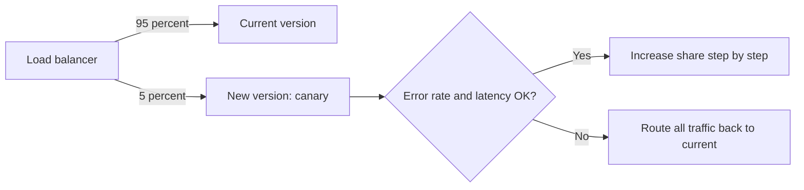

# Domain 2: Deployment (19%)

This note covers objectives 2.1 to 2.5: deployment models, deployment strategies, migration, using code to deploy and configure resources, and provisioning to a set of requirements. Source control and CI/CD pipelines are Domain 5, in [05-devops-fundamentals.md](05-devops-fundamentals.md).

**[📖 CompTIA Cloud+ CV0-004 Exam Objectives v2.0 (PDF)](https://comptiacdn.azureedge.net/webcontent/docs/default-source/exam-objectives/comptia-cloud-cv0-004-exam-objectives-%282-0%29.pdf)** - the official topic list this note follows.

Deployment is where architecture becomes real resources. Three of the five objectives start with "Given a scenario" or "Given a set of requirements", so expect questions that describe a business and ask what you would build or how you would roll it out. Performance-based questions in this domain often show a snippet of YAML or JSON, or a list of requirements and a menu of resources to drag into place.

## 2.1 Compare and contrast cloud deployment models

A deployment model describes who owns the infrastructure and who shares it. NIST SP 800-145 defines four, and CV0-004 lists the same four.

**[📖 NIST SP 800-145 - The NIST Definition of Cloud Computing](https://csrc.nist.gov/pubs/sp/800/145/final)** - the source of the four deployment model definitions.

- **Public cloud** - infrastructure owned and run by a provider and shared by many customers (multi-tenant). No capital outlay, near-unlimited scale, pay for what you use. Less control over the physical layer, and data sits in someone else's facility.
- **Private cloud** - cloud-style self-service and automation on infrastructure used by one organization only. It may be on premises (you own the data centre and hardware) or hosted (a third party runs dedicated hardware for you). Full control and isolation, but you pay for capacity whether you use it or not, and you need the staff to run it.
- **On premises** - the private cloud variant in your own building. CompTIA calls it out because the exam distinguishes "private cloud you run" from "private cloud someone hosts".
- **Hybrid cloud** - two or more distinct clouds (usually private plus public) connected so data and applications can move between them. Typical drivers are keeping regulated data on premises while using public cloud for burst capacity or new services, and gradual migration.
- **Community cloud** - shared by several organizations with common concerns such as a mission, security requirements or regulation. Government agencies, a hospital group or a research consortium are typical. Costs are spread among members.

Multicloud (several public providers) is not a separate NIST model; it is covered under availability in [01-cloud-architecture.md](01-cloud-architecture.md). A hybrid environment can also be multicloud.

How the exam frames it: look for the driver. "Variable demand, startup, no data centre" is public. "Strict control, regulator forbids shared hardware, existing data centre investment" is private. "Keep the customer database on premises but use cloud for the web tier" is hybrid. "Several state agencies want to share infrastructure that meets the same government standard" is community.

**Exam trap:** A virtual private cloud (VPC) is still public cloud. It is a private network inside a shared provider, not a private cloud deployment model.

## 2.2 Implement appropriate deployment strategies

A deployment strategy is how a new version replaces the old one. Each strategy trades speed, cost, risk and how easy it is to roll back.

- **Blue-green** - two identical environments. Blue runs the current version. You deploy the new version to green, test it, then switch all traffic (usually at the load balancer or DNS). Rollback is switching back. It needs double capacity during the cutover and careful handling of database schema changes that both versions must tolerate.
- **Canary** - release the new version to a small slice of traffic or users (say 5 percent), watch error rates and latency, then widen in steps. If metrics degrade, route the canary traffic back. It limits blast radius and tests with real users, but it needs good monitoring and traffic-splitting.
- **Rolling** - replace instances in batches, for example 25 percent at a time, while the rest keep serving. No extra capacity is needed, but for a while two versions run side by side, and rollback means rolling the old version back out batch by batch.
- **In-place** - stop the application on existing servers, install the new version, start it again. Cheapest and simplest, but it causes downtime and the rollback is a reinstall. Acceptable for internal tools and maintenance windows.

| Strategy | Downtime | Extra cost | Rollback speed | Risk to users |
|---|---|---|---|---|
| Blue-green | None | High (two full environments) | Instant | Low after testing |
| Canary | None | Low to medium | Fast | Very low (small slice) |
| Rolling | None | None or small | Slow | Medium (mixed versions) |
| In-place | Yes | None | Slow | High |



A canary release sends a small share of traffic to the new version and only widens it while monitoring stays healthy.

How to pick in a scenario: "zero downtime and instant rollback, budget is not a concern" is blue-green. "Test with a small percentage of real users first" is canary. "No additional infrastructure, no downtime" is rolling. "Small internal app, maintenance window is fine" is in-place.

**Exam trap:** Blue-green and canary both avoid downtime. The difference is all-at-once switch (blue-green) versus gradual exposure (canary). If the question stresses "minimize the number of users affected by a bad release", it is canary.

## 2.3 Summarize aspects of cloud migration

### Migration types

- **On-premises to cloud** - the classic migration. You move workloads out of your data centre.
- **Cloud to on-premises** - repatriation. It happens when cloud cost for a steady, heavy workload exceeds owning hardware, when regulation changes, or when latency to on-premises systems matters.
- **Cloud to cloud** - moving between providers or between regions or accounts of one provider. Drivers include cost, a service only another provider offers, mergers and avoiding lock-in.

### Resource allocation

Before migrating you size target resources from measured use, not from the old server's specification. Old servers are usually over-provisioned. Collect CPU, memory, disk and network data for a few weeks, including month-end peaks, then size to that with headroom. Discovery tools (AWS Application Discovery Service, Azure Migrate) automate this.

### Considerations

- **Storage** - how much data, how fast it changes and how long the transfer will take. Large datasets may need an offline transfer device (AWS Snowball, Azure Data Box) followed by online sync of changes.
- **Platform compatibility** - OS versions, CPU architecture, hypervisor formats and licences supported by the target. An old 32-bit OS or an unsupported database version can block a rehost.
- **Compute** - instance families that match the workload profile (general, compute-optimized, memory-optimized, GPU).
- **Cost** - not only running cost but transfer cost, dual running during cutover, licences and staff time. Data egress charges are a common surprise in cloud to cloud and cloud to on-premises moves.
- **Networking** - bandwidth for the transfer, connectivity back to remaining on-premises systems, IP addressing that must not overlap, and DNS changes at cutover.
- **Management overhead** - who will run the new environment and what tooling changes.
- **Service availability** - whether the services you need exist in the target region or provider.
- **Vendor lock-in** - deep use of proprietary managed services makes future moves harder. It is a trade, not a sin: managed services save effort now.
- **Environmental: power and cooling** - for a move to on premises, the data centre must have the power, cooling and floor space for the new hardware. For a move to cloud, retiring a data centre frees these costs and is part of the business case.
- **Regulatory and compliance** - data residency, industry rules (PCI DSS, HIPAA) and contractual obligations decide which regions and services are allowed.

### Application migration strategies

These are often called the Rs of migration.

- **Rehost** - lift and shift. Move the VM as-is to IaaS. Fastest, least change, least cloud benefit. Good for a deadline such as a data centre lease ending.
- **Replatform** - lift, tinker and shift. Small changes to gain a cloud benefit without rewriting, such as moving a self-managed database to a managed database service, or a web app onto PaaS.
- **Refactor** - change the code to fit the cloud better, for example extracting a component into a function or making the app stateless so it can scale out.
- **Re-architect** - a deeper redesign, such as breaking a monolith into microservices or moving to event-driven design. Most effort, most cloud-native benefit. Many sources treat refactor and re-architect as one; CompTIA lists both, with re-architect as the bigger structural change.
- **Retain** - keep it where it is for now, perhaps because it was recently upgraded, has hard latency ties to on-premises systems or cannot legally move.
- **Retire** - switch it off. Discovery often finds applications nobody uses.

Some sources add **repurchase** (replace with SaaS) and **relocate** (move a whole hypervisor estate). They are not on the CV0-004 list, but the logic is the same.

**Exam trap:** "Migrate quickly with minimal changes" is rehost, even if the app would benefit from redesign. "Reduce database administration effort with minimal code change" is replatform, not refactor.

### Testing a migration

Test functionality, performance against the old baseline, security controls, integrations with systems left behind and the rollback plan. Run a pilot with a low-risk application first, migrate in waves, and keep the source running until the target is validated.

## 2.4 Use code to deploy and configure cloud resources

### Infrastructure as code and configuration as code

- **Infrastructure as code (IaC)** - describing infrastructure (networks, VMs, databases, load balancers) in files that a tool reads to create and update real resources. Terraform, AWS CloudFormation, Azure Bicep and ARM templates, and Pulumi are IaC tools.
- **Configuration as code (CaC)** - describing the configuration inside systems (packages installed, files present, services running, settings applied) in files that a tool enforces. Ansible, Chef, Puppet and PowerShell DSC are CaC tools.

The usual split: IaC builds the house, CaC furnishes it. Terraform creates the VM; Ansible installs and configures the web server on it. Container images and immutable infrastructure blur the line, because configuration gets baked into an image instead of applied afterwards.

Most IaC tools are **declarative**: you describe the end state and the tool works out the steps. Scripts are **imperative**: you write each step. Declarative code is **idempotent**, meaning running it twice produces the same result, which is what makes it safe to re-run.

### Scripting logic

The exam expects you to read simple scripts and templates, not to write programs. Know these building blocks:

- **Variables** - named values that make code reusable, such as `region = "us-east-1"` or `$instanceCount = 3`. Hard-coded values are the opposite and a common review finding.
- **Conditionals** - if/else logic, such as creating a second replica only when `environment == "prod"`.
- **Operators** - comparison (`==`, `!=`, `>`, `<`), logical (`and`, `or`, `not`) and arithmetic operators used inside conditionals and expressions.
- **Data types** - strings, integers, booleans, lists (arrays) and maps (dictionaries or objects). A common error is passing a string `"3"` where a number is expected, or a single value where a list is required.
- **Functions** - reusable blocks of code that take inputs and return outputs. IaC languages also ship built-in functions such as joining strings or computing subnet ranges.

### Repeatability, drift, versioning, testing and documentation

- **Repeatability** - the same code produces the same environment every time, in any region or account. This is the main reason to use IaC: dev, test and prod stay consistent.
- **Drift detection** - comparing what the code says with what actually exists. Drift happens when someone changes a resource by hand in the console. `terraform plan` shows drift as planned changes; CloudFormation has a drift detection feature. The fix is to bring the change into code or let the tool revert it, then stop manual changes.
- **Versioning** - storing templates in source control so every change has an author, a reason and a way back. Pin tool and module versions too, so an upstream update does not change your infrastructure unexpectedly.
- **Testing** - linting and validation (`terraform validate`), policy checks (no public buckets, required tags), plan review and deploying to a test environment before prod.
- **Documentation** - comments, README files and generated diagrams that explain what the code builds and why. Good IaC is partly self-documenting, but intent still needs words.

### Formats: JSON and YAML

Most templates and configuration files are JSON or YAML.

- **JavaScript Object Notation (JSON)** - braces for objects, brackets for lists, double-quoted keys and strings, no comments allowed. Used by CloudFormation, ARM templates, IAM policies and many APIs.
- **YAML (YAML Ain't Markup Language, listed by CompTIA as Yet Another Markup Language)** - indentation shows structure, lists use dashes, comments use `#`. Used by Kubernetes manifests, Ansible playbooks, CloudFormation (as an alternative to JSON), GitHub Actions and docker compose files.

Here is the same small definition in both formats:

```json
{
  "name": "web",
  "replicas": 3,
  "ports": [80, 443],
  "public": true
}
```

```yaml
name: web
replicas: 3
ports:
  - 80
  - 443
public: true
```

**Exam trap:** In YAML, indentation is syntax. A PBQ that shows a Kubernetes manifest failing to apply often has a mis-indented line, or tabs instead of spaces. In JSON, look for a trailing comma or a missing quote.

## 2.5 Provision the appropriate cloud resources for a set of requirements

This objective tests whether you can turn a requirements list into a resource choice. Work through each requirement type in turn, because a single question may hide several.

- **Storage requirements** - capacity, access pattern and sharing. Shared by many servers points to file storage. Unstructured data at scale points to object storage. A database disk points to SSD block storage.
- **Performance requirements** - IOPS, throughput, latency and CPU or memory profile. Pick instance families and volume types to match, and place resources close to users.
- **Security requirements** - encryption at rest and in transit, private subnets, least-privilege roles, key management. A "must not be reachable from the internet" requirement means a private subnet with no public IP.
- **Cost requirements** - budget ceilings and pricing model. Steady workloads get reserved capacity, interruptible ones get spot, unknown ones start on demand.
- **Availability requirements** - an SLA or uptime target. 99.9 percent can usually be met in one AZ with good recovery; 99.99 percent usually needs multiple AZs and load balancing; a regional-failure requirement needs multi-region.
- **Compliance requirements** - data residency, audit logging, certified services. They often decide the region before anything else.
- **Network requirements** - bandwidth, latency, connectivity to on premises (VPN or dedicated connection), IP ranges that must not overlap.
- **Compute requirements** - VM, container or serverless, CPU architecture, GPU need, licensing that requires dedicated hosts.

A good habit for PBQs: underline every requirement word in the scenario, then check that each resource you place satisfies at least one, and that nothing you place violates any. A cheap answer that misses the availability target is wrong. So is a highly available answer that puts data in a forbidden region.

Uptime targets are worth being able to convert quickly:

| SLA | Downtime per year | Downtime per month (30 days) |
|---|---|---|
| 99% | about 3.65 days | about 7.2 hours |
| 99.9% | about 8.77 hours | about 43.8 minutes |
| 99.99% | about 52.6 minutes | about 4.4 minutes |
| 99.999% | about 5.26 minutes | about 26 seconds |

When components are in series, multiply their availabilities: two services at 99.9 percent that both must work give about 99.8 percent. When redundant copies are in parallel, availability rises: two independent 99 percent instances behind a load balancer give 1 - (0.01 x 0.01) = 99.99 percent.

---

## Key takeaways

1. Four deployment models: public, private (on premises or hosted), hybrid, community. A VPC is still public cloud.
2. Blue-green switches all at once with instant rollback; canary exposes a small slice first; rolling needs no extra capacity; in-place has downtime.
3. Migration types run in all directions, including cloud to on-premises repatriation.
4. Rehost is fastest, replatform swaps in managed services, refactor and re-architect change the code, retain keeps it, retire turns it off.
5. IaC builds infrastructure, CaC configures inside it. Declarative and idempotent code makes deployments repeatable.
6. Drift is a manual change the code does not know about. Detect it with a plan or drift check, then fix the process.
7. Read JSON and YAML fluently. YAML indentation is syntax.
8. For "given requirements" questions, satisfy every requirement and violate none.
