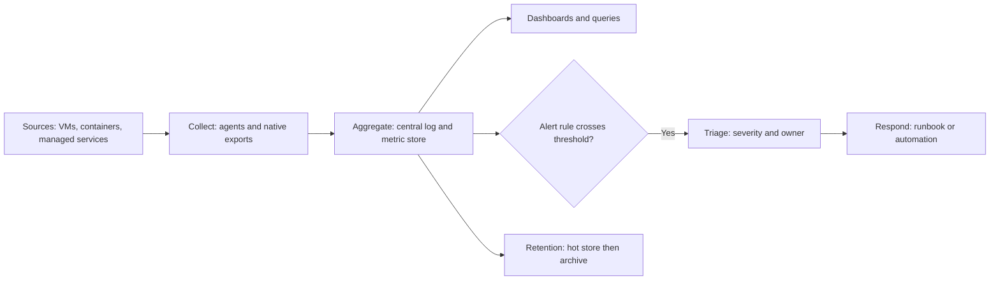
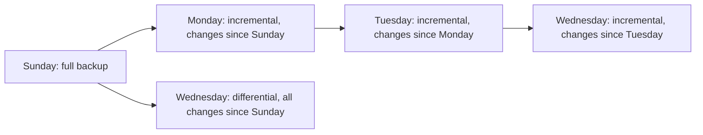

# Domain 3: Operations (17%)

This note covers objectives 3.1 to 3.4: observability, scaling, backup and recovery, and managing the life cycle of cloud resources.

**[📖 CompTIA Cloud+ CV0-004 Exam Objectives v2.0 (PDF)](https://comptiacdn.azureedge.net/webcontent/docs/default-source/exam-objectives/comptia-cloud-cv0-004-exam-objectives-%282-0%29.pdf)** - the official topic list this note follows.

Operations is what happens after the deployment succeeds. Every objective in this domain starts with "Given a scenario", so expect a situation (a slow application, an audit request, a failed restore, a vendor end-of-support notice) and a choice of what to configure or do. The objectives spell out backup and recovery in unusual detail (types, locations, testing, recovery types and options), so expect several questions on it.

## 3.1 Configure appropriate resources to achieve observability

Monitoring tells you **that** something is wrong. Observability is the wider ability to work out **why**, from the data the system emits. The three classic signals are logs, metrics and traces, and alerting turns them into action.

### Logging

A log is a timestamped record of an event: a request served, a login failed, a configuration changed. Logs answer "what exactly happened?"

- **Collection** - getting logs off the source. Agents on VMs (the CloudWatch agent, Azure Monitor Agent, Fluent Bit, Filebeat) read files and system journals and ship them. Managed services usually emit logs natively, but you often have to switch them on, for example load balancer access logs or storage access logs.
- **Aggregation** - bringing logs from many sources into one place, in one format, so you can search and correlate them. A single request may touch a load balancer, three microservices and a database; without aggregation you would log in to each one. The ELK stack (Elasticsearch, Logstash, Kibana), Splunk, AWS CloudWatch Logs, Azure Monitor Logs (Log Analytics) and Google Cloud Logging all aggregate.
- **Retention** - how long logs are kept, and where. Retention is set by regulation, contract and internal policy, then balanced against cost. Keep recent logs in a fast, searchable store and move older logs to cheap object or archive storage. PCI DSS, for example, requires at least one year of audit log history with the last three months immediately available.

Two extra points the exam likes. First, audit logs of control-plane actions (who created, changed or deleted a resource) are separate from application logs: AWS CloudTrail, Azure Activity Log and Google Cloud Audit Logs. Second, logs used as evidence must be protected from tampering, so send them to a separate account or an immutable (write once, read many) store.

**Exam trap:** "Logs disappear when the instance is replaced by auto scaling" means logs were only written locally. The fix is collection and aggregation to a central store, not a larger disk.

### Tracing

A trace follows one request as it passes through many services, recording a span for each hop with its timing. In a microservices system, tracing is how you find that a slow checkout is caused by the third call to the inventory service, not the web tier. Tools include OpenTelemetry (the open standard for instrumenting code), Jaeger, AWS X-Ray, Azure Application Insights and Google Cloud Trace. A trace ID passed in request headers ties the spans together and can be added to log lines so logs and traces link up.

### Monitoring and metrics

A metric is a number measured over time: CPU percentage, requests per second, queue depth, error rate, p95 latency. Metrics are cheap to store and fast to graph, so they are what dashboards and alarms are built on.

- **Metrics** - numeric time series. Infrastructure metrics include CPU, memory, disk IOPS and network throughput. Application metrics include request rate, error rate and latency. Business metrics include orders per minute.
- **Baseline** - the normal range for a metric. You cannot judge "high" without knowing normal, and baselines also matter for security in Domain 4.

A useful frame for which metrics to watch is the four golden signals from Google's SRE practice: latency, traffic, errors and saturation. Note that memory and disk-space metrics on a VM usually need an agent; the hypervisor cannot see inside the guest OS, so default cloud metrics often stop at CPU, network and disk operations.

### Alerting: triage and response

An alert is a rule that fires when a metric or log pattern crosses a threshold and notifies a person or triggers automation.

- **Triage** - deciding how serious an alert is and who owns it. Use severity levels (for example, critical pages the on-call engineer now; warning opens a ticket for business hours). Group related alerts so one outage does not produce two hundred pages.
- **Response** - what happens next. Every alert should link to a runbook. Some responses can be automated: restart a failed service, scale out, isolate a compromised instance. Escalate if nobody acknowledges within a set time.

Good alerting is about signal, not volume. Alert on symptoms users feel (error rate, latency, availability check failing) rather than every cause (one CPU spike). Too many noisy alerts cause alert fatigue, and then the real one is ignored.

Telemetry flows from sources through collection and aggregation into dashboards, alerts and long-term retention.

## 3.2 Configure appropriate scaling approaches

### Types: horizontal and vertical

- **Vertical scaling (scale up or down)** - make one instance bigger or smaller: more vCPU or memory. Simple, works for applications that cannot be split, but has a ceiling (the largest instance size) and usually needs a restart.
- **Horizontal scaling (scale out or in)** - add or remove instances behind a load balancer. Practically no ceiling, adds redundancy, and does not need a restart. It requires the application to be stateless, or to keep session state in a shared store such as a cache or database.

The exam's default cloud-native answer is horizontal. Vertical is right for a legacy single-instance application or a relational database primary that cannot easily shard.

### Approaches

- **Triggered by trend** - scaling based on a pattern over time, often called predictive scaling. The system learns that load rises every weekday at 08:00 and adds capacity ahead of it.
- **Triggered by load** - reactive scaling on a live metric crossing a threshold, such as average CPU above 70 percent or queue depth above 1,000 messages. This is classic auto scaling. Use cooldown periods so the group does not flap up and down.
- **Triggered by event** - scaling in response to a specific event, such as a message arriving, a file landing in storage or an external webhook. Serverless platforms and event-driven autoscalers (for example KEDA on Kubernetes) work this way.
- **Scheduled** - scaling at known times set by a calendar: scale out before the 09:00 Monday rush, scale in at night, add capacity for a planned product launch.
- **Manual** - an operator changes the capacity by hand. Fine for one-off changes; poor as a strategy because humans are slow and forget to scale back in.

How to pick: "load is predictable by time of day" is scheduled (or trend-based). "Load is unpredictable" is load-triggered. "Work arrives as jobs in a queue" is event-triggered or queue-depth based. Combining them is common: a schedule for the known peak plus a load-based rule for surprises.

**Exam trap:** If the scenario says the application keeps user sessions in local memory and users get logged out after scale-in, the problem is state, not the scaling rule. Move sessions to a shared store or enable session affinity (sticky sessions) as a stopgap.

## 3.3 Use appropriate backup and recovery methods

Backups protect against deletion, corruption, ransomware and disasters. Replication alone is not a backup, because it copies a deletion or an encryption by ransomware to the replica just as faithfully as it copies good data.

### Backup types

- **Full** - copies everything selected, every time. Simplest and fastest to restore (one set), but slowest to run and uses the most storage.
- **Incremental** - copies only what changed since the **last backup of any type**. Fastest and smallest to run. To restore you need the last full plus every incremental since, in order, so restore is slower and a single missing increment breaks the chain.
- **Differential** - copies everything changed since the **last full** backup. Each differential grows through the week. To restore you need the last full plus only the latest differential.

A Wednesday restore needs the full plus three incrementals, or the full plus just the Wednesday differential.

Cloud snapshots of block volumes are usually incremental at the block level behind the scenes, but each snapshot can be restored on its own because the provider tracks the chain for you.

**Exam trap:** "Shortest backup window" points to incremental. "Fastest restore with the fewest backup sets" points to full, or to differential if a daily full is too expensive.

### Locations, schedule, retention and replication

- **On-site backup** - kept in the same location (or region) as the data. Fast to restore, but lost in the same disaster.
- **Off-site backup** - kept in another location, region or account. Survives site loss and, if in a separate account with restricted access, survives an attacker who controls the main account.
- **Schedule** - how often backups run. The schedule is set by the RPO: if the business can lose at most four hours of data, backups (or replication) must happen at least every four hours.
- **Retention** - how long each backup is kept, for example daily backups for 30 days, monthly for a year, yearly for seven years (a grandfather-father-son rotation). Retention is driven by regulation, contracts and the need to go back far enough to find a clean copy after a slow-burning corruption or a long-undetected ransomware infection.
- **Replication** - copying backups (or live data) to a second location automatically. Cross-region backup copy is the cloud form of off-site.
- **Encryption** - backups contain the same sensitive data as production, so encrypt them at rest and in transit, and manage the keys so that a lost key does not make every backup useless.

The 3-2-1 rule is a good summary: three copies of data, on two different media or storage types, with one copy off site. Many teams now add an immutable or offline copy that cannot be deleted even by an administrator, as a ransomware defence.

### Testing

- **Recoverability** - can you actually restore? Run regular test restores into an isolated environment and time them against the RTO.
- **Integrity** - is the restored data correct and complete? Check checksums, row counts and that the application starts and reads the data.

A backup that has never been restored is a hope, not a backup. Exam questions about "the backup job reports success but the restore failed" are about missing testing.

### Recovery types and options

- **In-place recovery** - restore over the original resource, replacing its current contents. Quick and keeps addresses and names, but destroys whatever was there, so you cannot compare or fall back.
- **Parallel recovery** - restore to a new resource alongside the original (a new volume, a new database instance). You can verify the restored data, copy back only what you need, and keep the original for forensics. Slower to cut over because names and connections must be repointed.
- **Bulk recovery** - restore an entire system, volume or database at once. Right after a disaster or full corruption.
- **Granular recovery** - restore a single item: one file, one mailbox, one table or one object version. Right when a user deleted one thing.

**Exam trap:** "A user deleted one folder yesterday; the rest of the server is fine" is granular recovery, ideally parallel so you do not overwrite today's work. "Ransomware encrypted the server" is a bulk restore from a clean, pre-infection backup, often parallel so the infected volume is kept for investigation.

## 3.4 Manage the life cycle of cloud resources

Every resource is created, changed, and eventually retired. This objective covers the middle and the end.

### Patches and updates

- **Patch** - a small fix for a bug or security vulnerability, often urgent. Security patches for actively exploited vulnerabilities should go out quickly, within days.
- **Minor update** - a backward-compatible release with fixes and small features, such as 2.3 to 2.4. Low risk, but still tested.
- **Major update** - a release that can break compatibility, such as a new database major version, an OS upgrade or a Kubernetes version jump. Needs planning, testing, sometimes code changes, and a rollback plan.

Who patches depends on the service model. In IaaS you patch the guest OS, using a patch management service (AWS Systems Manager Patch Manager, Azure Update Manager, Google VM Manager) or by replacing instances with a freshly built image (immutable infrastructure). In PaaS and managed databases the provider patches, but you usually choose the maintenance window and you still schedule major version upgrades.

Patch in rings: development first, then a small production canary group, then the rest. Use rolling patching behind a load balancer to avoid downtime.

### Testing

Every patch and update needs testing proportionate to its risk: automated tests and a staging deployment for minor changes; full regression, performance and compatibility testing for major ones. Keep a rollback path, such as a snapshot taken before the update or the previous image version.

### Data: ephemeral and persistent

- **Ephemeral data** - data that exists only for the life of the resource: an instance store disk, a container's writable layer, a temporary scratch directory. It is lost on stop, termination or replacement.
- **Persistent data** - data on storage that outlives the compute: block volumes set to persist, file shares, object storage, databases.

Life cycle matters here because replacing an instance during patching or scaling wipes ephemeral data. Anything that must survive goes on persistent storage. When decommissioning, the reverse applies: persistent data does not disappear on its own and must be deliberately archived or deleted.

### Decommissioning: end of life and end of support

- **End of life (EOL)** - the vendor stops selling and developing the product. It may still get some fixes for a time.
- **End of support (EOS)** - the vendor stops providing patches, security fixes and help. Running past end of support means unpatched vulnerabilities and often a compliance failure.

In cloud, providers announce deprecation dates for runtimes, instance families, database versions and Kubernetes versions, and some force an upgrade after the date. Track these dates and plan upgrades before them.

Decommissioning a resource properly means: confirm nothing depends on it (check traffic and logs), take a final backup if retention rules require one, remove DNS records and firewall rules that point at it, delete or crypto-shred the data, delete the resource, and update the inventory and documentation. Forgotten resources keep costing money and become "zombie instances", which Domain 4 treats as a security risk.

### SLA math in operations

Operations teams are measured against service level agreements. An SLA of 99.9 percent allows about 43.8 minutes of downtime in a 30-day month; 99.99 percent allows about 4.4 minutes. Planned maintenance usually counts against the SLA unless the contract excludes it, which is another reason to prefer rolling or blue-green patching. A provider SLA credits you money when it misses, but it does not give you your downtime back, so design to your own target, not to the provider's credit terms.

---

## Key takeaways

1. Logs say what happened, metrics say how much, traces say where in the call path. Aggregate them centrally and keep them as long as rules require.
2. Alert on symptoms, triage by severity, respond with runbooks or automation.
3. Horizontal scaling needs stateless apps. Pick trend, load, event, scheduled or manual triggers by how predictable the load is.
4. Incremental is fastest to back up; full is fastest to restore; differential is in between.
5. Off-site, encrypted, tested backups. Replication is not a backup.
6. In-place overwrites; parallel restores alongside. Bulk restores everything; granular restores one item.
7. Patches are urgent fixes; major updates need a plan. Ephemeral data dies with the resource.
8. Past end of support means no security fixes. Decommission deliberately, including the data.
