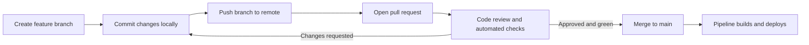

# Domain 5: DevOps Fundamentals (10%)

This note covers objectives 5.1 to 5.4: source control, CI/CD pipelines, integration of systems, and the tools used in DevOps environments.

**[📖 CompTIA Cloud+ CV0-004 Exam Objectives v2.0 (PDF)](https://comptiacdn.azureedge.net/webcontent/docs/default-source/exam-objectives/comptia-cloud-cv0-004-exam-objectives-%282-0%29.pdf)** - the official topic list this note follows.

DevOps Fundamentals is new as a separate domain in CV0-004. It is the smallest domain, and every objective starts with "Explain", so questions test understanding of concepts and tool purposes rather than deep hands-on skill. Expect "which tool would you use for X" and "what happens at this pipeline stage" questions. The ideas also feed Deployment (Domain 2): IaC lives in source control and is applied by pipelines.

DevOps itself is a way of working that joins development and operations: small changes, automated build, test and release, shared ownership of production, and fast feedback. The tools exist to make that loop quick and safe.

## 5.1 Explain source control concepts

Source control (version control) records every change to code and configuration, who made it and why, and lets many people work on the same files without overwriting each other. Git is the standard. Hosted platforms such as GitHub, GitLab, Bitbucket and Azure Repos add collaboration features on top.

- **Version management** - keeping the full history of every file so you can see what changed, compare versions, tag releases (for example `v2.4.0`) and roll back to a known good state.
- **Code commit** - saving a set of changes to the local repository as one snapshot with a message. Good commits are small and describe why the change was made.
- **Code push** - sending local commits to the shared remote repository so others can see them. In Git, commit is local and push is remote; a commit that was never pushed is invisible to the team and to the pipeline.
- **Branch management** - a branch is an independent line of development. Teams create a branch per feature or fix, keep `main` (or `trunk`) always releasable, and delete branches after merging. Branch protection rules stop direct pushes to `main` and require reviews and passing checks.
- **Pull request** - a request to merge one branch into another, which opens a page for review, discussion and automated checks. GitLab calls it a merge request.
- **Code review** - teammates read the change before it merges, catching bugs, security issues and design problems, and spreading knowledge. Automated checks (tests, linting, security scans) run alongside human review.
- **Code merge** - combining the changes from one branch into another. If two branches changed the same lines, Git reports a merge conflict that a person must resolve.

Two branching styles worth recognizing: **trunk-based development** (short-lived branches merged to main at least daily, which suits CI/CD) and **Gitflow** (long-lived develop, release and hotfix branches, which suits scheduled releases).

The usual flow from a local change to a merged, deployed change runs through a pull request with review and automated checks.

**Exam trap:** "A developer committed a fix but the pipeline did not run" is often a commit that was never pushed, or a push to a branch the pipeline does not watch.

## 5.2 Explain concepts related to CI/CD pipelines

Continuous integration (CI) means every change is merged often into a shared branch and automatically built and tested. Continuous delivery means every change that passes CI is automatically prepared for release, with a manual approval to go to production. Continuous deployment goes one step further and releases to production automatically with no human gate. CompTIA's expansion is "continuous integration/continuous deployment", but know the difference between delivery and deployment.

- **Automation** - the core idea. Every repeatable step (build, test, scan, package, deploy) runs without manual clicks, so it runs the same way every time and fast enough to do many times a day.
- **Code integration** - merging developers' changes frequently and verifying them automatically, so conflicts and bugs are found while they are small.
- **Code deployment** - releasing the built artifact to an environment, using the strategies from Domain 2 (blue-green, canary, rolling, in-place).
- **Build** - compiling code, resolving dependencies and producing an artifact. The same artifact should be promoted from test to staging to production; rebuilding per environment risks shipping something you did not test.
- **Testing** - automated unit tests (one function), integration tests (components together), end-to-end tests (a user journey) and performance tests. Fast tests run first so failures surface quickly.
- **Security** - "shift left" by putting security checks in the pipeline: static application security testing (SAST), dependency and software composition analysis, secret scanning, container image scanning and IaC policy checks. A critical finding fails the build. This is often called DevSecOps.
- **Workflow** - the defined sequence of stages and the rules that connect them: what triggers the pipeline (push, pull request, schedule, tag), which stages run in parallel, where approvals sit, and what happens on failure.

A typical pipeline: source change triggers, then build, then test and scan, then publish artifact, then deploy to staging, then approval (for continuous delivery), then deploy to production, then monitor.

### Artifacts and repositories

An artifact is the versioned output of a build that gets deployed.

- **VM images** - prebuilt machine images (golden images) with the OS, patches and application baked in, such as AWS AMIs, Azure managed images or Google Compute Engine images. Often built by HashiCorp Packer.
- **Container images** - Docker or OCI images pushed to a registry.
- **Packages** - software in an installable format: **RPM** (Red Hat Package Manager, for RHEL, Fedora and similar), **Debian** (`.deb`, for Debian and Ubuntu), **ZIP** archives (common for serverless function bundles and Windows) and **tar** archives (often compressed as `.tar.gz` on Linux).
- **Flat files** - plain files such as configuration files, scripts, static website assets or compiled binaries copied directly.
- **Public repositories** - open to anyone, such as Docker Hub public images, the public npm or PyPI registries, and public GitHub repos. Convenient, but a supply-chain risk: pin versions and scan what you pull.
- **Private repositories** - access-controlled stores for your own artifacts and code, such as Amazon ECR, Azure Container Registry, Google Artifact Registry, JFrog Artifactory, Sonatype Nexus and private Git repos.

**Exam trap:** "Production behaves differently from staging even though the code is the same" often means the pipeline rebuilt the artifact per environment, or pulled an unpinned `latest` image. Build once, promote the same versioned artifact.

## 5.3 Explain concepts related to integration of systems

Systems integrate in two broad ways: they ask each other directly (request and response) or they react to things that happened (events).

- **Event-driven architecture** - producers publish events ("order placed") to a broker or bus, and any number of consumers react independently. Producers do not know or wait for consumers. This gives loose coupling, natural fan-out and easy addition of new consumers. The cost is eventual consistency and harder end-to-end tracing. Examples: Amazon EventBridge, SNS and SQS, Azure Event Grid and Service Bus, Google Pub/Sub, Apache Kafka.

### Web services

- **REST (Representational State Transfer)** - an architectural style over HTTP. Resources have URLs (`/orders/42`) and are acted on with HTTP methods: GET reads, POST creates, PUT replaces, PATCH updates, DELETE deletes (which map to CRUD). Usually JSON payloads. Stateless: each request carries everything needed. The most common style for cloud and public APIs.
- **SOAP (Simple Object Access Protocol)** - a protocol with strict XML message envelopes and a formal contract (WSDL). Heavier than REST but has built-in standards for security and reliability (WS-Security). Still common in banking, government and older enterprise systems.
- **RPC (remote procedure call)** - calling a function on another machine as if it were local, such as `getPrice(itemId)`. Modern RPC frameworks such as gRPC use HTTP/2 and Protocol Buffers for fast, strongly typed service-to-service calls, which suits internal microservice traffic.

### Other integration styles

- **WebSockets** - a persistent, two-way connection between client and server over a single TCP connection, upgraded from HTTP. Either side can send at any time, which suits chat, live dashboards, multiplayer games and notifications. REST, by contrast, needs the client to ask (polling).
- **GraphQL** - a query language for APIs where the client asks for exactly the fields it needs in one request to a single endpoint. It avoids over-fetching (getting fields you do not need) and under-fetching (needing several REST calls to build one screen). Useful for mobile apps and front ends that aggregate many data sources.

| Need in the scenario | Best fit |
|---|---|
| Simple public API over HTTP, widely understood | REST |
| Strict contract and WS-Security for a legacy enterprise partner | SOAP |
| Fast, typed internal service-to-service calls | RPC (gRPC) |
| Server must push live updates to the browser | WebSockets |
| Client wants exactly the fields it needs from many sources in one call | GraphQL |
| Many systems must react independently to something that happened | Event-driven architecture |

**Exam trap:** "Real-time updates to the browser without the client polling" is WebSockets, not REST. "Decouple producers from consumers so new consumers can be added without changing the producer" is event-driven, not RPC.

## 5.4 Explain the importance of tools used in DevOps environments

CV0-004 names nine tools. You need to know what each one is for and recognise which one a scenario describes.

- **Ansible** - agentless configuration management and automation from Red Hat. Playbooks written in YAML describe tasks that run over SSH (or WinRM for Windows). Idempotent modules make re-runs safe. Use it to configure servers, install software and orchestrate multi-step operations. Configuration as code.
- **Docker** - builds, ships and runs containers. A Dockerfile defines the image layers; `docker build` creates the image, `docker push` sends it to a registry, `docker run` starts a container. Docker Compose runs multi-container apps on one host.
- **ELK stack** - Elasticsearch (search and analytics engine that stores and indexes data), Logstash (ingests, parses and transforms logs) and Kibana (dashboards and search UI). Together they centralize and search logs. Lightweight Beats shippers often replace or feed Logstash. OpenSearch is a fork with the same roles.
- **Git** - the distributed version control system underneath GitHub, GitLab and Bitbucket. Every clone holds the full history.
- **GitHub Actions** - CI/CD built into GitHub. Workflows are YAML files in `.github/workflows/` that run jobs on runners when events happen (push, pull request, schedule, release).
- **Grafana** - dashboards and visualization for metrics, logs and traces from many data sources, such as Prometheus, Elasticsearch and cloud monitoring services. It also does alerting. Grafana displays data; it is not usually the store.
- **Jenkins** - a long-established, self-hosted, open-source automation server for CI/CD. Pipelines are defined in a Jenkinsfile. Very flexible, with a huge plugin ecosystem, but you run and patch the server and its agents yourself.
- **Kubernetes** - the container orchestration platform. It schedules pods across nodes, restarts failed containers, scales with the Horizontal Pod Autoscaler, rolls out updates through Deployments, provides service discovery through Services, and is configured with YAML manifests. Managed as EKS, AKS and GKE.
- **Terraform** - HashiCorp's declarative infrastructure as code tool. HCL files describe resources across many providers; `terraform plan` previews changes and `terraform apply` makes them. It tracks what it built in a state file, which should be stored remotely with locking so two people cannot apply at once. Multi-cloud, unlike CloudFormation (AWS only) or Bicep (Azure only). OpenTofu is an open-source fork.

**[📖 Terraform documentation](https://developer.hashicorp.com/terraform/docs)** - official reference for HCL, state and the plan and apply workflow.

**[📖 Kubernetes documentation](https://kubernetes.io/docs/home/)** - official concepts, tasks and reference.

**[📖 Ansible documentation](https://docs.ansible.com/)** - playbooks, modules and inventory.

### Picking the tool

| Scenario says | Tool |
|---|---|
| Provision networks and VMs across AWS and Azure from one codebase | Terraform |
| Install and configure packages on 200 existing Linux servers, no agents allowed | Ansible |
| Package an application with its dependencies so it runs the same everywhere | Docker |
| Run, scale and self-heal hundreds of containers across a cluster | Kubernetes |
| Track changes to code and collaborate through branches | Git |
| CI/CD workflows triggered by pull requests in a GitHub repository | GitHub Actions |
| Self-hosted CI server with many plugins, existing on-premises investment | Jenkins |
| Centralize, search and analyse logs from many servers | ELK stack |
| Build a dashboard of metrics from several monitoring sources | Grafana |

**Exam trap:** Terraform versus Ansible is the classic pairing. Terraform creates and destroys infrastructure and tracks state. Ansible configures what runs on it. Both can overlap a little, but the exam wants the primary purpose. Similarly, Docker builds and runs containers; Kubernetes orchestrates many of them.

---

## Key takeaways

1. Commit is local, push is remote, a pull request asks to merge, review happens before merge, branches isolate work.
2. CI integrates and tests every change; continuous delivery stops for approval; continuous deployment does not.
3. Build once and promote the same versioned artifact. Know the artifact types: VM and container images, RPM, Debian, ZIP, tar, flat files.
4. Put security scanning in the pipeline and fail the build on critical findings.
5. REST is resource-oriented HTTP, SOAP is strict XML, RPC is calling remote functions, WebSockets push both ways, GraphQL fetches exactly what is asked.
6. Event-driven architecture decouples producers and consumers and enables fan-out.
7. Terraform provisions, Ansible configures, Docker packages, Kubernetes orchestrates, Git versions, Jenkins and GitHub Actions run pipelines, ELK handles logs, Grafana visualizes.
