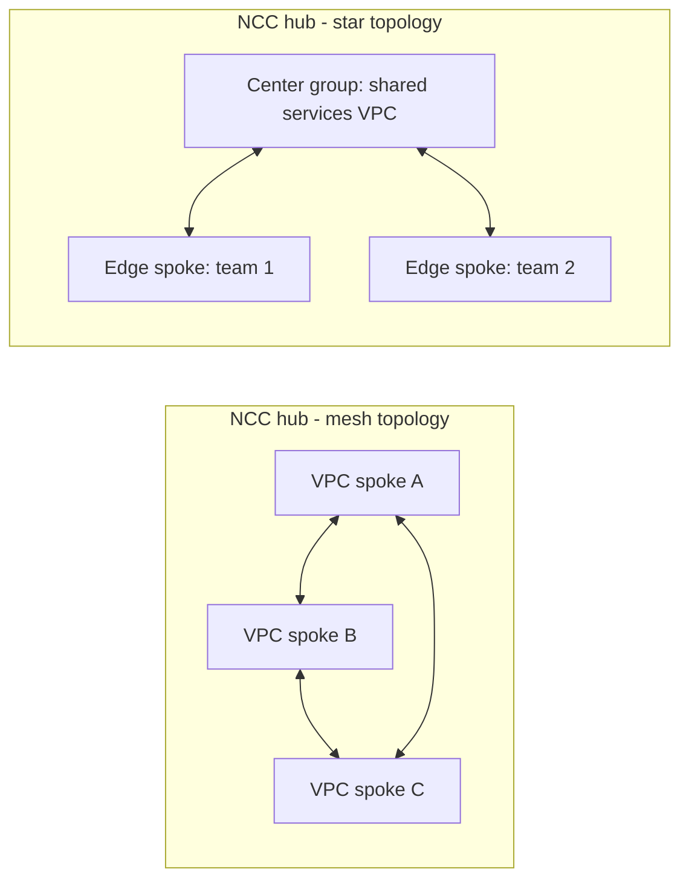
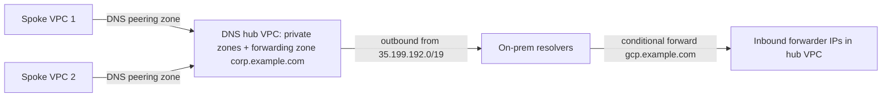

# Section 1: Designing and Planning a Google Cloud VPC Network (~21%)

This is the largest section of the Professional Cloud Network Engineer exam and the one most questions lean on, even when they are nominally about something else. It is about **choosing**, not typing commands: which network tier, which load balancer, how many VPCs, which way to interconnect them, how to carve up IP space, how to reach on-premises and other clouds, and how to lay out a GKE cluster so it does not run out of addresses in a year. The configuration side of the same topics lives in [Section 2](02-implementing-vpc-network.md) (VPC, routing, NCC, GKE), [Section 3](03-managed-network-services.md) (load balancing, CDN, DNS) and [Section 4](04-hybrid-multicloud-interconnectivity.md) (Interconnect, VPN, Cloud Router).

The guide splits the section into four tasks:

| Task | What it asks you to do |
|------|------------------------|
| 1.1 | Design the overall architecture: tiers, HA/DR, DNS topology, load balancer choice, GKE planning, IAM, managed-service connectivity, quotas |
| 1.2 | Design the VPC networks themselves: how many, how they interconnect, IPAM, global vs regional, MTU, appliance insertion |
| 1.3 | Design resilient hybrid and multicloud connectivity, including DNS, IP space, MTU and encryption over Interconnect |
| 1.4 | Design for GKE: node and control plane exposure, subnets and ranges, IP types, IPv6, load balancing, node pools |

A habit that pays off across the whole exam: before you look at the answer options, write down the two or three hard constraints in the question (bandwidth, SLA, encryption, "no public IPs", "overlapping ranges", "central team owns the network"). Most wrong options break exactly one of them.

---

## 1.1 Designing an overall network architecture

### Network Service Tiers: Premium vs Standard

Google Cloud sells internet egress and ingress on two tiers, and the tier is a property of each external IP address or forwarding rule, not of the project.

- **Premium Tier** (the default) carries traffic on Google's own backbone for as much of the path as possible. Inbound traffic enters Google at the edge point of presence closest to the user, and outbound traffic stays on Google's network until the PoP closest to the destination. It is the only tier that supports **global** external load balancers with a single anycast IP, and it is what you want for latency-sensitive or worldwide users.
- **Standard Tier** hands traffic to the public internet close to the Google Cloud region. Users far from the region cross more of the internet, so latency and jitter are higher, but the price is lower. It supports only **regional** external IPs and regional load balancers.

Exam framing: "users all over the world, one IP, lowest latency" points at Premium plus a global external Application Load Balancer. "Cost-sensitive, users in the same geography as the region, regional service is fine" points at Standard. A global external Application Load Balancer or global proxy Network Load Balancer cannot be built on Standard Tier, so an option that combines them is wrong.

```bash
# The tier is chosen per address (or per forwarding rule)
gcloud compute addresses create web-ip --region=us-central1 --network-tier=STANDARD
gcloud compute addresses create global-web-ip --global --network-tier=PREMIUM
```

### Designing for high availability, failover, disaster recovery and scale

Google Cloud's network building blocks have different failure domains, and good designs line those up deliberately:

- **VPC networks are global**, subnets are **regional**, and VMs and zonal NEGs are **zonal**. A single VPC can therefore span every region without any extra plumbing, which is why most designs use one VPC per environment rather than one per region.
- **Spread compute across zones** with regional managed instance groups, and across regions behind a global load balancer when you need regional failure tolerance. Global external Application Load Balancers send users to the closest healthy backend and fail over between regions automatically when health checks fail.
- **Hybrid links need redundancy at every layer**: two edge availability domains per metro, two metros for the 99.99% SLA, and Cloud Routers in two regions with the VPC in **global dynamic routing mode** (see 1.3).
- **DR for DNS and control plane**: Cloud DNS is a global, anycast service with a 100% availability SLA for authoritative serving; your design risk is in forwarding targets and health checks, not the DNS service itself.
- **Scale** shows up as quotas and IP space more often than as raw bandwidth. Design subnets and GKE ranges with headroom, and keep the number of peering connections and routes inside the limits discussed below.

A useful mental model for DR questions: decide the **recovery objective**, then pick the cheapest network construct that meets it. Active-active multi-region behind a global load balancer is the most resilient and most expensive. Active-passive using a Cloud DNS failover routing policy or a load balancer with a backup region is cheaper. Pilot-light designs keep only the network and a small footprint warm in the second region.

### Designing the DNS topology

Cloud DNS gives you **public zones** (authoritative on the internet), **private zones** (visible only to the VPC networks you authorize), **forwarding zones** (send queries for a domain to other name servers), **peering zones** (resolve a domain using another VPC network's resolution order) and **response policies** (override answers, a DNS firewall of sorts). Every VPC also has automatic internal DNS for VM names.

The design question is where each namespace is authoritative and how queries cross boundaries:

- Keep separate namespaces where you can (for example `corp.example.com` on-premises and `gcp.example.com` in the cloud) so each side stays authoritative for its own names.
- On-premises resolvers reach Cloud DNS through an **inbound server policy**, which creates inbound forwarder addresses in the VPC's subnets.
- Cloud resolves on-premises names through **outbound forwarding zones**; queries leave from `35.199.192.0/19`, which on-premises firewalls must allow and which must be routable back over your VPN or Interconnect.
- With many VPCs, designate one **DNS hub VPC** that holds the forwarding zones and let other VPCs use **DNS peering** to it. Google's guidance is to centralize outbound forwarding this way rather than configure every VPC to forward independently, because return traffic to the shared `35.199.192.0/19` source range can only route back to one place.

Hybrid DNS design is covered in depth under 1.3, and configuration in [Section 3.3](03-managed-network-services.md#33-configuring-cloud-dns).

### Choosing an appropriate load balancer

Load balancer choice is one of the most heavily tested decisions. Work through four questions in order:

1. **Internal or external?** Do clients come from the internet or from inside your VPC (or hybrid networks)?
2. **HTTP(S) or not?** If you need URL maps, header routing, TLS termination with HTTP features, Cloud CDN or the full Cloud Armor WAF, you want an **Application Load Balancer** (Layer 7, proxy).
3. **Proxy or passthrough?** For TCP, UDP or other protocols, a **passthrough Network Load Balancer** preserves the client source IP and supports UDP, ESP, GRE, ICMP and (internally) SCTP; a **proxy Network Load Balancer** terminates TCP (optionally TLS) and opens a new connection to the backend.
4. **Global or regional?** Global (or cross-region internal) when users or backends span regions; regional when data residency, Standard Tier, or simplicity requires one region.

| Need | Load balancer |
|------|---------------|
| Worldwide HTTP(S), single anycast IP, CDN, WAF | Global external Application Load Balancer (Premium Tier) |
| HTTP(S) in one region, or Standard Tier | Regional external Application Load Balancer |
| Internal HTTP(S) microservices in one region | Regional internal Application Load Balancer |
| Internal HTTP(S) with backends or clients in several regions | Cross-region internal Application Load Balancer |
| Global TCP with optional TLS offload, non-HTTP | Global external proxy Network Load Balancer |
| UDP, client IP preservation, non-TCP protocols, internet-facing | Regional external passthrough Network Load Balancer |
| Internal TCP/UDP with client IP preserved, or a next hop for appliances | Internal passthrough Network Load Balancer |
| Internal TCP proxy (regional or cross-region) | Internal proxy Network Load Balancer |

Envoy-based load balancers (regional and internal Application LBs, regional and internal proxy NLBs) need a **proxy-only subnet** in each region they use. The internal passthrough Network Load Balancer is the one that can be a **next hop** in a route, which is how network virtual appliances are inserted (1.2 and Section 6.4). Details and configuration are in [Section 3.1](03-managed-network-services.md#31-configuring-load-balancing).

### Planning GKE networking (overview)

At the architecture level you need three decisions, which 1.4 expands:

- **Address space**: VPC-native clusters take node IPs from the subnet's primary range, Pod IPs from a secondary range, and Service IPs from a secondary range or a GKE-managed range. The Pod range is the one that runs out, because by default GKE reserves a `/24` per node to support about 110 Pods.
- **Scale potential**: the Pod range and the per-node allocation together cap the node count. A `/20` Pod range with the default `/24` per node supports only 16 nodes, however large the node subnet is.
- **Control plane access**: whether the control plane is reached by its **DNS-based endpoint** (recommended, IAM controlled), by IP-based endpoints (external and internal, or internal only), and whether nodes are private.

### IAM roles for network architecture

Expect questions that ask for the least-privileged role that still lets someone do a job. The core predefined roles:

| Role | What it allows | Typical holder |
|------|----------------|----------------|
| `roles/compute.networkAdmin` | Create and manage networks, subnets, routes, peering, load balancer networking resources, but **not** firewall rules or SSL certificates | Network team |
| `roles/compute.securityAdmin` | Create and manage firewall rules, firewall policies and SSL certificates | Security team |
| `roles/compute.xpnAdmin` (Shared VPC Admin) | Enable host projects, attach service projects, delegate access; granted at organization or folder | Central platform team |
| `roles/compute.networkUser` | Use subnets of a Shared VPC host project (granted on the host project or on individual subnets) | Service project admins, service agents |
| `roles/compute.networkViewer` | Read-only view of network resources | Auditors, tooling |
| `roles/compute.loadBalancerAdmin` | Create and manage load balancer resources | App/platform team running LBs |
| `roles/compute.loadBalancerServiceUser` | Use a backend service from another project (cross-project service referencing) | Frontend team in Shared VPC |
| `roles/dns.admin`, `roles/dns.peer` | Manage Cloud DNS; create DNS peering/bindings toward another project's network | DNS team |

Two Shared VPC patterns appear often:

- **Subnet-level delegation**: grant `compute.networkUser` on specific subnets so a service project can only place resources in "its" subnets. Granting it on the whole host project gives access to every current and future subnet.
- **Load balancer split**: the host project owns the network and the frontend IP in a shared subnet; service projects own backends. Cross-project service referencing lets a URL map in one project point at a backend service in another, which needs `compute.loadBalancerServiceUser` on the backend service's project.

### Planning connectivity to managed services

Google-managed services reach your VPC in three different ways, and the exam expects you to know which service uses which:

- **Private services access** (PSA): you allocate an internal range, and Google creates a **VPC Network Peering** connection (`servicenetworking`) to a producer network that hosts services like Cloud SQL, Memorystore and others. Because it is peering, it is **non-transitive**: on-premises reaching Cloud SQL over PSA needs custom route export on the peering and custom advertisement of the allocated range from Cloud Router.
- **Private Service Connect** (PSC): the consumer creates an **endpoint** (an internal IP in its own subnet) or a **backend** (a PSC NEG behind a load balancer) that targets a producer's **service attachment** or a Google API bundle. No peering, no IP coordination, overlapping ranges are fine because the producer side uses NAT subnets. Many newer managed services (and Cloud SQL as an option) support PSC.
- **Serverless VPC Access / Direct VPC egress**: Cloud Run, Cloud Run functions and App Engine reach VPC resources either through a **Serverless VPC Access connector** (managed VMs in a dedicated `/28` subnet) or, for Cloud Run, **Direct VPC egress**, which gives instances IPs straight from a subnet. Google recommends Direct VPC egress: lower latency, higher throughput, no connector VMs to pay for, per-service network tags; the trade-off is that it uses more IP addresses.

### Planning for quotas and limits

Google distinguishes **quotas** (adjustable per project or network, request an increase) from **limits** (fixed by design). Network designs most often collide with:

- Peering connections per VPC network and the **peering group** limits, which count resources (instances, internal forwarding rules, subnet ranges) across a network and all of its directly peered networks. A hub VPC peered to many spokes hits these first.
- Routes per network and dynamic routes learned per Cloud Router region.
- Subnet ranges (primary plus secondary) per network.
- Firewall rules per project and rules per firewall policy.
- Cloud NAT ports per IP (64,512 usable ports per NAT IP address), which caps VMs per NAT IP at a given minimum ports setting.

You do not need to memorize current numbers (they change); you need to recognize the symptom ("cannot add another peering", "routes not installed") and know that the fix is either a quota increase or a design change such as moving from many peerings to Network Connectivity Center.

---

## 1.2 Designing VPC networks

### Choosing the VPC type and quantity

- **Auto mode vs custom mode**: auto mode creates a `/20` subnet in every region from `10.128.0.0/9` and adds new regions automatically. It is convenient for experiments but the fixed ranges overlap between every auto mode network and often with on-premises space, so production designs use **custom mode**. An auto mode network can be converted to custom mode (one way only).
- **Standalone VPC per project** is simplest but scatters network administration across teams.
- **Shared VPC** puts one VPC in a **host project** and lets **service projects** create resources in its subnets. It centralizes routing, firewalls, hybrid connectivity and IPAM while teams keep their own projects and billing. A service project attaches to exactly one host project, and a host project cannot also be a service project.
- **How many VPCs?** A common enterprise baseline is one Shared VPC per environment (production, non-production) and sometimes per trust zone, rather than per application. More VPCs give stronger isolation and separate quotas but need interconnection; fewer VPCs are simpler but blur blast radius.

### Determining how networks interconnect

| Option | Transitive? | Key properties | When to choose |
|--------|-------------|----------------|----------------|
| **VPC Network Peering** | No | Exchanges subnet routes (and optionally custom static/dynamic routes); no overlap allowed; each side manages its own firewall; low latency, no gateway | A few VPCs, possibly across organizations, that need full mesh-like reachability |
| **Network Connectivity Center (NCC) with VPC spokes** | Yes, within the hub | Hub route table; **mesh** (all spokes reach all) or **star** (edge spokes reach only center spokes); scales to many VPCs; IP/CIDR export filters; supports Private NAT for overlap and PSC propagation | Many VPCs, hub-and-spoke segmentation, mixing VPC and hybrid spokes |
| **Private Service Connect** | Not a network join | Consumer endpoint to a producer service; overlap fine; service-level, not network-level | Expose a specific service, not a whole network |
| **Cloud VPN between VPCs** (HA VPN gateway to gateway) | Via Cloud Router | Encrypted, BGP, 99.99% SLA; per-tunnel throughput limits | Need encryption between VPCs or BGP-based policy |
| **Multi-NIC appliances** | Through the appliance | Third-party firewall or router VMs with interfaces in several VPCs | Mandatory inspection between VPCs |

The classic trap: three VPCs A-B-C peered A-B and B-C; A cannot reach C through B. The fixes are a direct A-C peering, NCC VPC spokes in a mesh hub, or routing through an appliance in B.



The diagram contrasts the two NCC preset topologies: in mesh every spoke can reach every other spoke; in star, edge spokes reach the center group but not each other. The topology is fixed when the hub is created.

### Planning IP address management (IPAM)

IPAM is where designs succeed or fail years later. Plan these layers:

- **Subnets**: primary ranges hold VM and node IPs; secondary ranges hold alias IPs (GKE Pods and Services). Each subnet reserves four IPv4 addresses (the first two and last two). The smallest subnet is a `/29`. A primary range can be **expanded** later without downtime but never shrunk or replaced, so start smaller than you think and expand into reserved space, keeping the space after each subnet free.
- **IPv6**: subnets can be IPv4-only, dual-stack or IPv6-only. Each IPv6 subnet gets a `/64`. **Internal** IPv6 uses a ULA `/48` assigned to the VPC from `fd20::/20`; **external** IPv6 uses Google-owned global unicast addresses routable on the internet.
- **Bring your own IP (BYOIP)**: you can bring your own public IPv4 (and IPv6) prefixes to Google and use them for external IPs, useful for IP allow-listing continuity during migrations.
- **Non-RFC 1918 and PUPI**: valid internal ranges include RFC 1918, RFC 6598 shared space (`100.64.0.0/10`), and **privately used public IPs (PUPI)**, which are public ranges you use internally and do not announce. PUPI is a common escape from RFC 1918 exhaustion for GKE Pods. PUPI subnet routes are **not exported over peering by default**; you must enable export/import of subnet routes with public IPs on both sides.
- **Private NAT**: when ranges genuinely overlap (mergers, copied environments), Private NAT translates sources from a dedicated `PRIVATE_NAT` subnet so overlapping VPC spokes can talk through NCC, or VPCs can talk to on-premises over hybrid links (hybrid NAT). It translates outbound connections and replies only; it does not allow unsolicited inbound.
- **Managed services**: reserve ranges up front for private services access, proxy-only subnets, PSC NAT subnets, Serverless VPC Access connectors and GKE control planes so they do not collide later.
- **IPAM automation**: **internal ranges** (a Network Connectivity API resource) let you reserve blocks inside a VPC, mark them `FOR_VPC` (usable by subnets) or `EXTERNAL_TO_VPC` (blocked out for on-premises use), and let Google auto-allocate non-overlapping subnets from a parent block. Combine with infrastructure as code (Terraform) and organization policies so teams cannot create ad hoc ranges.

### Planning a global or regional network environment

A VPC is global, so a single network with regional subnets is the default design. Two settings make it behave more "globally" or more "regionally":

- **Dynamic routing mode**: in **regional** mode, Cloud Router installs routes it learns only in its own region and advertises only that region's subnets; in **global** mode it installs learned routes in every region and advertises all subnets. Multi-region hybrid designs, and the 99.99% Interconnect topology, require global mode.
- **Regional resources**: some things are regional by nature (regional load balancers, Cloud NAT gateways, Cloud Routers, proxy-only subnets, regional firewall policies). A "global" design still needs these per region.

Variations you will see: a global Shared VPC with a single hybrid hub region (cheaper, adds cross-region latency for far regions); one VPC per region (simpler data residency, more interconnection); or a global VPC with regional network firewall policies to enforce regional segmentation.

### Determining the correct MTU for the VPC

VPC networks default to an MTU of **1,460 bytes** and can be set anywhere from **1,300 to 8,896** bytes. Jumbo frames (8,896) help throughput for large flows between VMs (HPC, storage, databases), but every hop must agree:

- Google Cloud does **not** fragment packets routed inside a VPC; for TCP, MSS negotiation handles mismatches, but UDP and other protocols must size packets correctly.
- Path MTU Discovery is supported: oversized packets trigger ICMP "Fragmentation Needed" (IPv4) or "Packet Too Big" (ICMPv6) back to the sender, so do not block those ICMP types.
- Use the same MTU on all peered or NCC-connected networks and on all VLAN attachments that connect to the same VPC.
- Cloud VPN has a lower effective MTU because of IPsec overhead (see 1.3), so jumbo-frame VPCs need MSS clamping or matched settings for hybrid paths.

### Planning third-party device insertion

Network virtual appliances (NVAs) such as next-generation firewalls or SD-WAN routers sit in the path by being a route's next hop:

- **Multi-NIC VMs**: each NIC is in a different VPC (up to 8 NICs depending on machine type, and each NIC must be in a different VPC). The VM needs **IP forwarding** (`--can-ip-forward`) to route traffic it did not originate.
- **Custom static routes** with the appliance (or better, an **internal passthrough Network Load Balancer** fronting several appliances) as next hop steer traffic by destination. Routes can be scoped to VMs with specific network tags.
- **Policy-based routes** steer by source, destination and protocol (not port) and are evaluated **before** normal destination-based routes; their next hop must be an internal passthrough NLB. They can apply to all VMs, to tagged VMs, or to traffic arriving on Interconnect VLAN attachments in a region, which is how you force all on-premises traffic through inspection.
- **Load balancing for HA**: an internal passthrough NLB as next hop spreads flows across appliances and fails over when health checks fail. Enable **symmetric hashing** behavior (default for newer forwarding rules) so both directions of a flow land on the same appliance.

Configuration of these patterns is in [Section 2.2](02-implementing-vpc-network.md#22-configuring-vpc-routing) and [Section 6.4](06-network-security.md#64-self-managed-network-virtual-appliances-and-packet-mirroring).

---

## 1.3 Designing a resilient and performant hybrid and multicloud network

### Hybrid connectivity options

| Option | Bandwidth | Encryption | SLA | When |
|--------|-----------|------------|-----|------|
| **HA VPN** | Each tunnel up to about 250,000 packets/s (roughly 1-3 Gbps depending on packet size); add tunnels for more | IPsec built in | 99.99% with the correct two-tunnel topology | Fast to set up, encrypted, moderate bandwidth, branch offices, backup for Interconnect |
| **Classic VPN** | Similar per tunnel | IPsec | 99.9% | Legacy; static routing only (route-based or policy-based), single interface |
| **Dedicated Interconnect** | 10, 100 or 400 Gbps circuits, bundles of up to 8 | Not encrypted by default; add MACsec or HA VPN over Interconnect | 99.9% or 99.99% depending on topology | You can reach a Google colocation facility; high, predictable throughput |
| **Partner Interconnect** | VLAN attachments from 50 Mbps to 50 Gbps via a provider | Same as Dedicated (MACsec with provider support, or HA VPN over Interconnect) | 99.9% or 99.99% depending on topology | You are not in a Google colocation facility, or need smaller capacities |
| **SD-WAN appliances via NCC** | Depends on appliance and underlay | Appliance-provided | Depends on design | You already run SD-WAN; use router appliance spokes so Google Cloud becomes a site on the SD-WAN |

Bandwidth and security constraints drive the choice. If a question says "encrypted and over 10 Gbps", the answer is Interconnect plus MACsec or HA VPN over Interconnect, not plain HA VPN. If it says "cannot reach a colocation facility", Partner Interconnect. If it says "temporary" or "small branch", HA VPN.

### Designing for multicloud connectivity

- **Cross-Cloud Interconnect** is a Google-provisioned dedicated physical connection between Google Cloud and another cloud: **AWS, Microsoft Azure, Oracle Cloud Infrastructure and Alibaba Cloud**. Ports are 10 or 100 Gbps (and 400 Gbps toward AWS and OCI). You order the ports in both clouds; Google provisions the cross-connect to the other provider. It supports MACsec and jumbo MTU. The 99.99% design uses two pairs of connections in different metros; 99.9% uses two connections in different edge availability domains. Google's SLA does not cover the other provider's side.
- **HA VPN to another cloud** works with the other cloud's VPN gateways (for example AWS virtual private gateways or transit gateways, Azure VPN Gateway) using BGP. It is quicker and cheaper, with VPN throughput limits.
- **NCC** can tie Cross-Cloud Interconnect VLAN attachments and VPNs into the same hub as your VPCs and on-premises links.

### Direct Peering vs Verified Peering Provider

**Direct Peering** is a BGP peering between your network and Google's edge at a Google peering location. It reaches **Google's public services (Google Workspace, YouTube, public Google APIs), not your VPC networks**. You need to meet Google's peering requirements (public ASN, presence at a PeeringDB-listed facility, redundancy), and there is **no SLA**. The **Verified Peering Provider** program lets you reach Google's public services through a qualified ISP without meeting those requirements yourself; Google positions it as the better choice for most customers. (Carrier Peering is the older provider-based option.) If the requirement is private access to VPC resources, peering is the wrong answer; use Interconnect or VPN.

### HA and DR across multiple regions

For hybrid links, availability comes from redundant **edge availability domains** (EADs) within a metro and redundant **metros** across regions:

- **99.9% Interconnect**: at least two connections (or VLAN attachments) in the **same metro** in **different edge availability domains**.
- **99.99% Interconnect**: at least **four** connections, **two in each of two metros**, each pair in different EADs, with **Cloud Routers in at least two regions** and the VPC in **global dynamic routing mode** so either region can carry traffic to any subnet. Cloud Routers should advertise the same prefixes on all links (priorities may differ).
- **HA VPN 99.99%**: two tunnels from the HA VPN gateway's two interfaces to two peer interfaces (two peer devices, or one device with two interfaces); across regions, deploy an HA VPN gateway and Cloud Router per region.

Use **global dynamic routing** when on-premises should reach all regions through any link, and use **advertised route priority (MED)** to prefer a primary region and keep another as backup. Regional mode is appropriate when each region has its own hybrid links and you want failures contained.

### Accessing multiple VPCs from on-premises

Because peering is non-transitive and hybrid routes learned in one VPC do not automatically flow to peers, the design options are:

- **Shared VPC**: one VPC (in the host project) carries all workloads, so one set of hybrid links serves every service project. This is the simplest answer when all teams are in one organization.
- **Hub VPC with peering**: terminate hybrid links in a hub VPC; enable **export custom routes** on the hub side and **import custom routes** on each spoke, so spokes learn on-premises routes; on Cloud Router, use **custom advertisement** to advertise spoke subnet ranges to on-premises (default advertisement only includes the local VPC's subnets).
- **NCC**: put the VLAN attachments or VPN tunnels in **hybrid spokes** and VPCs in **VPC spokes** of the same hub; NCC propagates on-premises dynamic routes to VPC spokes and VPC subnet routes to on-premises.
- **Appliance hub**: route through NVAs in a hub when inspection is mandatory.

### Accessing Google APIs (and Vertex AI) privately from on-premises

On-premises hosts reach Google APIs, including **Gemini Enterprise Agent Platform (formerly Vertex AI)**, the managed AI platform the guide still calls Vertex AI, without the internet by sending API traffic over Interconnect or VPN:

- **Private Google Access for on-premises**: advertise `private.googleapis.com` (`199.36.153.8/30`) or `restricted.googleapis.com` (`199.36.153.4/30`, VPC Service Controls-compatible) from Cloud Router with custom advertisement, and configure on-premises DNS so `*.googleapis.com` resolves (CNAME) to the chosen VIP.
- **Private Service Connect endpoint for Google APIs**: create a global PSC endpoint (an internal IP you choose) targeting the `all-apis` or `vpc-sc` bundle, advertise that IP to on-premises, and point DNS at it. This gives you an address inside your own plan and works well with VPC Service Controls.
- Some services, including model endpoints on the AI platform, also offer PSC-based private endpoints for specific resources.

### Accessing managed services through PSC and peering

- For **PSA (peering-based)** services such as Cloud SQL private IP, on-premises access needs the service networking peering to **export custom routes** (so the producer learns your on-premises routes) and Cloud Router to **advertise the allocated PSA range** to on-premises.
- For **PSC** services, on-premises clients reach the consumer endpoint IP like any other VPC address; advertise the endpoint's subnet. PSC endpoints can also be propagated through an NCC hub to other VPC spokes.

### Designing the IP address space across environments

- Allocate a **single enterprise plan** that covers on-premises, every cloud and every environment, with blocks reserved for growth, GKE Pods and managed services.
- Use **internal ranges** with `EXTERNAL_TO_VPC` to block out on-premises space inside a VPC so nobody creates an overlapping subnet.
- When overlap is unavoidable, use **Private NAT** (hybrid NAT toward on-premises over VLAN attachments or VPN, or NCC Private NAT between spokes), or **PSC** to publish only the services that need to be reached.
- Summarize advertisements to on-premises with custom route advertisements so route tables stay small.

### Architecting hybrid DNS

A complete hybrid DNS design defines four things:

1. **Forwarding paths**: outbound forwarding zones in the DNS hub VPC send `corp.example.com` to on-premises resolvers; on-premises conditional forwarders send `gcp.example.com` to the inbound forwarder IPs. Forwarding to RFC 1918 targets goes over your hybrid links; Cloud DNS uses `35.199.192.0/19` as the source, so allow and route it.
2. **Inbound policies**: an inbound **DNS server policy** on the hub VPC allocates inbound forwarder addresses in each region's subnets for on-premises to query.
3. **Cross-project binding**: a private zone can live in a central DNS project and be **bound to a VPC network in another project** in the same organization (needs `dns.networks.bindPrivateDNSZone` on the network's project), which suits Shared VPC where the DNS team is not the network team.
4. **DNS peering strategy**: spoke VPCs use **peering zones** to the hub so all resolution follows the hub's order (private zones, forwarding zones). DNS peering is one-directional and is separate from VPC Network Peering; it works even between VPCs that are not network-peered.



The diagram shows a hub-and-spoke hybrid DNS: on-premises forwards cloud names to the hub's inbound forwarders, the hub forwards corporate names to on-premises, and spokes peer their DNS to the hub.

### Determining MTU for hybrid connections

- **Cloud Interconnect VLAN attachments** support MTU **1440, 1460, 1500 or 8896** bytes (8896 only on unencrypted attachments). Match the attachment MTU to the VPC MTU and to the on-premises interface, and use the same MTU on all attachments to the same VPC.
- **Cloud VPN** has a **gateway MTU** and a smaller **payload MTU** because IPsec adds headers. The gateway MTU is 1460; payload MTU depends on cipher. On-premises devices should clamp TCP MSS so packets fit; otherwise you see "small packets work, large transfers hang".
- **HA VPN over Cloud Interconnect** has a gateway MTU of 1440 and payload MTU of roughly 1354-1386 bytes depending on cipher.

### Interconnect encryption: MACsec and HA VPN over Interconnect

Cloud Interconnect traffic is private but **not encrypted** by default. Two options, which can be layered:

- **MACsec for Cloud Interconnect** encrypts at Layer 2 between **your router and Google's edge router**, at line rate, using GCM-AES-256 (or GCM-AES-256-XPN for high bandwidth) with pre-shared connectivity association keys (CAK/CKN) and hitless rotation of up to five keys. It is available on Dedicated Interconnect (all 100 and 400 Gbps; 10 Gbps by request), Cross-Cloud Interconnect, and Partner Interconnect with provider support. It does not encrypt beyond Google's edge.
- **HA VPN over Cloud Interconnect** runs IPsec tunnels over **encrypted VLAN attachments** (encryption must be chosen when the attachment is created). It encrypts end to end at Layer 3 between your VPN device and the HA VPN gateway. It needs one Cloud Router for the attachments and a separate one for the VPN tunnels, and each tunnel is subject to VPN throughput limits.

Pick MACsec when you need full Interconnect bandwidth with link encryption; pick HA VPN over Interconnect when policy requires IPsec end to end; use both for defense in depth.

---

## 1.4 Designing for Google Kubernetes Engine (GKE)

### Public or private nodes and node pools

**Private nodes** have only internal IPs, so nothing on the internet can reach them directly. Private nodes reach the internet through **Cloud NAT** (or not at all), and reach Google APIs through **Private Google Access** on the node subnet. The private-nodes setting can be applied **per node pool** (Standard) or per workload (Autopilot), overriding the cluster default, so you can mix a public node pool for a specific need with private pools for everything else. Private nodes are the normal production choice; public nodes are acceptable only where external IPs on nodes are actually needed.

### Public or private control plane endpoints

GKE now offers two families of control plane endpoints:

- **DNS-based endpoint** (recommended): each cluster gets a unique, immutable FQDN for the control plane. Access is governed by **IAM** and can be wrapped in **VPC Service Controls**, and it works from any network that can reach Google Cloud APIs, so you do not need a bastion or VPN just to run `kubectl`.
- **IP-based endpoints**: either **external and internal** endpoints, or the **internal endpoint only** (most secure IP-based option). Restrict IP-based access with **authorized networks** (CIDR allow lists; up to 100 ranges counting external and internal together).

Older clusters describe the same idea as "private clusters" with `--enable-private-endpoint` and a `/28` control plane range; the concepts carry over. A frequent trap: an on-premises admin reaching an internal-only control plane through VPN fails because the control plane range is in a Google-managed network reached via peering and needs custom route export, while the DNS-based endpoint avoids that routing problem entirely.

### Planning subnets: primary and secondary ranges

VPC-native clusters (alias IPs, the default and the only mode for new features) use:

| Range | Holds | Sizing rule |
|-------|-------|-------------|
| Subnet primary range | Node IPs (and internal LB IPs) | Max nodes = 2^(32 - S) - 4 for a `/S` subnet |
| Pod secondary range | Pod IPs; each node gets a slice | Per-node slice size is set by max Pods per node: default 110 Pods -> `/24` per node |
| Service range | ClusterIP Services | Newer clusters use a GKE-managed range (`34.118.224.0/20`) by default; otherwise a secondary range |

Worked example: you need 500 nodes at the default 110 Pods per node. Each node takes a `/24` (256 Pod IPs), so you need 500 x 256 = 128,000 Pod IPs, which is a `/15` (131,072). The node subnet needs at least 502 addresses, so a `/23`. Lowering max Pods per node to 32 shrinks each node's slice to `/26` and the Pod range to roughly a `/17`.

### Planning GKE IP addresses by type

- **RFC 1918**: default, but enterprises often lack big enough blocks for Pod ranges.
- **Non-RFC 1918 private ranges** (for example `100.64.0.0/10`) and **PUPI**: frees RFC 1918 space; remember PUPI needs explicit export over peering and IP masquerade configuration (non-masquerade CIDRs) so Pod traffic is not SNATed unexpectedly.
- **Google-managed services range**: the default GKE-managed Service range removes one thing to plan.
- **PSC**: newer clusters reach the control plane over Private Service Connect rather than peering, which avoids peering limits and overlap concerns.
- **Shared IP ranges**: in Shared VPC, the host project network admin must pre-create the subnet and secondary ranges (GKE cannot manage them), and several clusters can share a subnet with separate secondary ranges. With **discontiguous multi-Pod CIDR**, extra Pod ranges can be added later at cluster level or per node pool.

### Planning for IPv6

GKE supports **dual-stack** clusters (IPv4 and IPv6 Pods and Services) on dual-stack subnets. The subnet's IPv6 access type (internal ULA or external GUA) decides whether Pod IPv6 addresses are internet-routable. IPv6 removes Pod address exhaustion as a concern, but you still need IPv4 for anything that is IPv4-only, so plan both.

### Designing load balancing for GKE

- **Container-native load balancing** uses **NEGs** (`GCE_VM_IP_PORT`) so the load balancer targets Pod IPs directly instead of nodes, removing the extra kube-proxy hop and improving health checking. It is the default for Ingress and Gateway on VPC-native clusters.
- **Gateway API** (via the GKE Gateway controller) is the recommended model for HTTP(S): GatewayClasses such as `gke-l7-global-external-managed`, `gke-l7-regional-external-managed` and `gke-l7-rilb` provision global external, regional external and regional internal Application Load Balancers; `-mc` classes span clusters.
- **Ingress** (`gce` and `gce-internal` classes) still works and provisions Application Load Balancers.
- **Services of type LoadBalancer** provision passthrough Network Load Balancers (external, or internal with the internal annotation), for TCP/UDP.

### Adding and managing node pool configuration

Node pools are where many network properties are set: machine type and NIC bandwidth (Tier 1 networking on larger shapes), **max Pods per node** (which sets the per-node Pod slice), a **custom Pod range** for that pool (overrides cluster-level ranges and cannot be changed afterwards), **private nodes**, **network tags** used by firewall rules, and **additional node networks** for multi-network Pods. Changing many of these requires creating a new node pool and migrating workloads, so plan them up front.

---

## Exam traps

- Global external load balancers require **Premium Tier**; Standard Tier means regional only.
- **Peering is not transitive**, PUPI routes are not exported by default, and hybrid routes reach peers only with **custom route export/import** plus **custom advertisement** on Cloud Router.
- **Direct Peering** reaches Google public services, **not VPC** resources, and has **no SLA**.
- **99.99% Interconnect** = four connections, two metros, Cloud Routers in two regions, **global** dynamic routing mode.
- Interconnect is **not encrypted** by default: MACsec (Layer 2, to Google edge) or HA VPN over Interconnect (IPsec, encrypted VLAN attachments chosen at creation).
- `restricted.googleapis.com` = `199.36.153.4/30` (VPC Service Controls); `private.googleapis.com` = `199.36.153.8/30`.
- VPC MTU default 1,460, range 1,300-8,896; VLAN attachments 1440/1460/1500/8896; VPN payload MTU is smaller than its gateway MTU.
- GKE Pod ranges run out first: default `/24` per node for 110 Pods.
- NCC topology (mesh or star) **cannot be changed** after the hub is created.

## Key terms

- **Premium Tier** - Network Service Tier that carries traffic on Google's backbone to the PoP nearest the user; required for global external load balancers.
- **Standard Tier** - Cheaper Network Service Tier that hands traffic to the public internet near the region; regional external IPs and load balancers only.
- **Shared VPC** - One VPC in a host project whose subnets are used by attached service projects, centralizing network administration.
- **VPC Network Peering** - Non-transitive private connection between two VPC networks that exchanges subnet routes and, optionally, custom routes.
- **Network Connectivity Center** - Hub-and-spoke service that connects VPC spokes and hybrid spokes with transitive routing in mesh or star topologies.
- **Privately used public IP (PUPI)** - Public IPv4 range used internally and not announced to the internet; not exported over peering unless enabled.
- **Internal range** - Network Connectivity resource that reserves an internal CIDR block for IPAM, usable FOR_VPC or blocked out EXTERNAL_TO_VPC.
- **Private services access** - VPC Network Peering connection to a Google-managed producer network (for example Cloud SQL) using an allocated range.
- **Direct VPC egress** - Cloud Run feature that gives instances IPs directly from a VPC subnet, recommended over Serverless VPC Access connectors.
- **Edge availability domain** - Independent maintenance domain within an Interconnect metro; redundant connections must use different ones.
- **Cross-Cloud Interconnect** - Google-provisioned dedicated physical link from Google Cloud to AWS, Azure, OCI or Alibaba Cloud.
- **MACsec for Cloud Interconnect** - Layer 2 line-rate encryption between your router and Google's edge router using pre-shared CAK keys.
- **Verified Peering Provider** - Program that lets customers reach Google public services through a qualified ISP without meeting Direct Peering requirements.
- **DNS-based endpoint** - Unique FQDN for a GKE control plane, with access governed by IAM rather than IP allow lists.

## Vendor documentation

- **[📖 Professional Cloud Network Engineer exam guide](https://cloud.google.com/learn/certification/cloud-network-engineer)** - official exam page and current guide
- **[📖 Best practices and reference architectures for VPC design](https://cloud.google.com/architecture/best-practices-vpc-design)** - Google's VPC design guidance
- **[📖 Network Service Tiers overview](https://cloud.google.com/network-tiers/docs/overview)** - Premium vs Standard Tier
- **[📖 Choose a load balancer](https://cloud.google.com/load-balancing/docs/choosing-load-balancer)** - decision guide for load balancer types
- **[📖 Shared VPC](https://docs.cloud.google.com/vpc/docs/shared-vpc)** - host and service projects, IAM roles
- **[📖 Network Connectivity Center overview](https://docs.cloud.google.com/network-connectivity/docs/network-connectivity-center/concepts/overview)** - spokes, hubs and route exchange
- **[📖 NCC connectivity topologies](https://docs.cloud.google.com/network-connectivity/docs/network-connectivity-center/concepts/connectivity-topologies)** - mesh and star
- **[📖 Subnets](https://docs.cloud.google.com/vpc/docs/subnets)** - ranges, purposes, IPv6, expansion
- **[📖 Internal ranges overview](https://docs.cloud.google.com/vpc/docs/internal-ranges)** - IPAM reservations
- **[📖 Maximum transmission unit](https://docs.cloud.google.com/vpc/docs/mtu)** - VPC MTU rules
- **[📖 Dedicated Interconnect overview](https://docs.cloud.google.com/network-connectivity/docs/interconnect/concepts/dedicated-overview)** - circuits, EADs, SLA topologies
- **[📖 Cross-Cloud Interconnect overview](https://docs.cloud.google.com/network-connectivity/docs/interconnect/concepts/cci-overview)** - multicloud dedicated links
- **[📖 MACsec for Cloud Interconnect](https://docs.cloud.google.com/network-connectivity/docs/interconnect/concepts/macsec-overview)** - Layer 2 encryption
- **[📖 HA VPN over Cloud Interconnect](https://docs.cloud.google.com/network-connectivity/docs/interconnect/concepts/ha-vpn-interconnect)** - IPsec over encrypted VLAN attachments
- **[📖 Direct Peering](https://docs.cloud.google.com/network-connectivity/docs/direct-peering)** - peering and the Verified Peering Provider program
- **[📖 Cloud DNS best practices](https://docs.cloud.google.com/dns/docs/best-practices)** - resolution order and hybrid DNS
- **[📖 GKE network isolation](https://docs.cloud.google.com/kubernetes-engine/docs/concepts/network-isolation)** - DNS-based and IP-based control plane endpoints, private nodes
- **[📖 VPC-native clusters and alias IPs](https://docs.cloud.google.com/kubernetes-engine/docs/concepts/alias-ips)** - GKE IP planning
