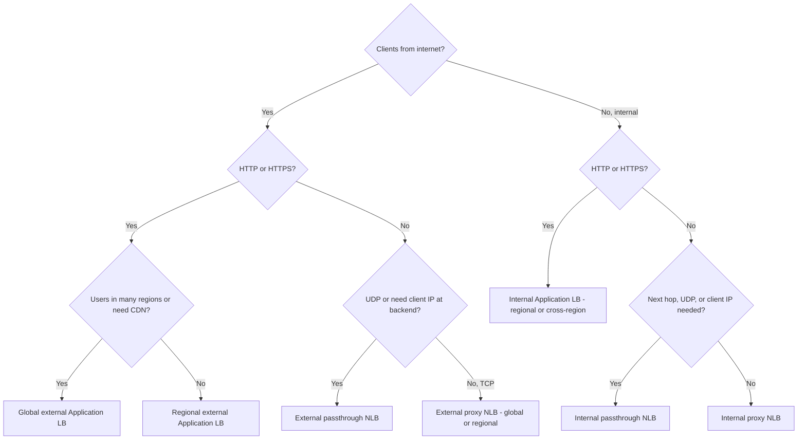

# Section 3: Configuring Managed Network Services (~16%)

This section covers the three managed services that sit in front of almost every application: **Cloud Load Balancing**, **Cloud CDN** and **Cloud DNS**. The exam tests whether you can pick the right load balancer, wire its pieces together, tune backend behavior, manage traffic in GKE, cache content correctly and run DNS for public, private and hybrid namespaces. Cloud Armor, which attaches to load balancers, is covered in [Section 6.1](06-network-security.md#61-google-cloud-armor-policies); load balancer monitoring and draining are in [Section 5](05-network-operations-monitoring-troubleshooting.md).

| Task | Scope |
|------|-------|
| 3.1 | Load balancing: choosing a type, backend services and autoscaling, balancing settings, GKE load balancers, traffic management |
| 3.2 | Cloud CDN: supported origins, internet NEGs and third-party storage, invalidation |
| 3.3 | Cloud DNS: zones and records, migration, routing policies, DNSSEC, hybrid integration, split horizon, cross-project binding and peering, GKE |

---

## 3.1 Configuring load balancing

### The current load balancer family

Google renamed its load balancers around three families. Older names (HTTP(S) LB, TCP/SSL Proxy, Network LB, ILB) still appear in older material and some questions, so map them:

| Current name | Layer / mode | Scope | Network tier | Older name |
|-------------|--------------|-------|--------------|------------|
| Global external Application LB | L7 proxy (Envoy-based GFE) | Global | Premium only | Global HTTP(S) LB |
| Classic Application LB | L7 proxy (GFE) | Global on Premium, regional on Standard | Both | HTTP(S) LB (classic) |
| Regional external Application LB | L7 proxy (Envoy) | Regional | Premium or Standard | Regional HTTP(S) LB |
| Regional internal Application LB | L7 proxy (Envoy) | Regional | - | Internal HTTP(S) LB |
| Cross-region internal Application LB | L7 proxy (Envoy) | Multi-region | - | - |
| Global external proxy Network LB | L4 TCP, optional TLS offload | Global | Premium only | TCP Proxy / SSL Proxy |
| Regional external proxy Network LB | L4 TCP | Regional | Both | - |
| Regional and cross-region internal proxy Network LB | L4 TCP | Regional or multi-region | - | Internal TCP Proxy |
| External passthrough Network LB | L4 TCP, UDP, ESP, GRE, ICMP | Regional (a global variant is in Preview) | Both | Network LB |
| Internal passthrough Network LB | L4 TCP, UDP, ICMP, SCTP, ESP, AH, GRE | Regional | - | Internal TCP/UDP LB |

**Passthrough** load balancers (Maglev externally, Andromeda internally) do not terminate connections: backends see the real client IP and reply directly (direct server return). **Proxy** load balancers terminate the client connection and open a new one to the backend, so backends see proxy addresses (from Google front ends, or from the **proxy-only subnet** for Envoy-based LBs) and get the client IP in `X-Forwarded-For` or the PROXY protocol header.

### Determining the load balancing solution

Run the same four questions as in [Section 1.1](01-designing-planning-vpc-network.md#choosing-an-appropriate-load-balancer): internal or external, HTTP(S) or not, proxy or passthrough, global or regional. A few extra signals:

- **UDP** rules out every proxy load balancer: UDP means a passthrough NLB.
- **"Preserve client source IP" at the backend for non-HTTP** means passthrough.
- **Cloud CDN** needs a global external (or classic) Application LB.
- **"Next hop for appliances"** means internal passthrough NLB.
- **Data must stay in one region / Standard Tier** means a regional load balancer.
- **Internal clients in several regions, one service**: cross-region internal Application LB with **global access**, or a regional internal LB with global access enabled.



The flowchart walks the selection questions from client location to protocol to scope, ending at one load balancer type.

### Anatomy of a proxy load balancer

Every Application LB and proxy NLB is assembled from the same parts:

**Forwarding rule** (IP, port, protocol, scheme) -> **target proxy** (HTTP, HTTPS, TCP or SSL; holds certificates and SSL policy) -> **URL map** (Application LBs only: host and path rules, route actions) -> **backend service** or **backend bucket** (health check, balancing mode, session affinity, timeouts, CDN, Cloud Armor policy, logging) -> **backends** (instance groups or NEGs).

Passthrough NLBs skip the proxy and URL map: forwarding rule -> backend service -> backends. The `--load-balancing-scheme` value identifies the type: `EXTERNAL_MANAGED` (Envoy-based external Application or proxy LB), `EXTERNAL` (classic Application LB or external passthrough NLB), `INTERNAL_MANAGED` (internal Application or proxy LB), `INTERNAL` (internal passthrough NLB).

```bash
# Global external Application LB, end to end
gcloud compute health-checks create http web-hc --port=80 --request-path=/healthz --global

gcloud compute backend-services create web-bes \
  --load-balancing-scheme=EXTERNAL_MANAGED --protocol=HTTP \
  --port-name=http --health-checks=web-hc --global \
  --enable-logging --logging-sample-rate=1.0

gcloud compute backend-services add-backend web-bes --global \
  --instance-group=web-mig-us --instance-group-region=us-central1 \
  --balancing-mode=UTILIZATION --max-utilization=0.8 --capacity-scaler=1.0
gcloud compute backend-services add-backend web-bes --global \
  --instance-group=web-mig-eu --instance-group-region=europe-west1 \
  --balancing-mode=UTILIZATION --max-utilization=0.8

gcloud compute url-maps create web-map --default-service=web-bes --global
gcloud compute ssl-certificates create web-cert --domains=www.example.com --global
gcloud compute target-https-proxies create web-proxy \
  --url-map=web-map --ssl-certificates=web-cert --global
gcloud compute addresses create web-ip --global
gcloud compute forwarding-rules create web-fr --global \
  --load-balancing-scheme=EXTERNAL_MANAGED \
  --address=web-ip --target-https-proxy=web-proxy --ports=443
```

Internal Application LBs follow the same pattern with regional resources, `--load-balancing-scheme=INTERNAL_MANAGED`, and a proxy-only subnet in the region:

```bash
gcloud compute backend-services create int-api-bes \
  --load-balancing-scheme=INTERNAL_MANAGED --protocol=HTTP \
  --health-checks=int-hc --health-checks-region=us-central1 --region=us-central1
gcloud compute url-maps create int-map --default-service=int-api-bes --region=us-central1
gcloud compute target-http-proxies create int-proxy --url-map=int-map --region=us-central1
gcloud compute forwarding-rules create int-fr \
  --load-balancing-scheme=INTERNAL_MANAGED --network=production-vpc \
  --subnet=app-subnet --region=us-central1 --ports=80 \
  --target-http-proxy=int-proxy --allow-global-access
```

### Configuring backend services, NEGs and autoscaling

Backends are either **instance groups** or **network endpoint groups (NEGs)**:

| Backend | Contents | Used for |
|---------|----------|----------|
| Managed instance group (MIG), zonal or regional | Identical VMs from a template; autoscaling, autohealing, rolling updates | Most VM workloads |
| Unmanaged instance group | Arbitrary VMs | Legacy, no autoscaling |
| Zonal NEG `GCE_VM_IP_PORT` | VM or Pod IP plus port | Container-native LB for GKE, multiple services per VM |
| Zonal NEG `GCE_VM_IP` | VM IP only | Internal passthrough NLB backends |
| Serverless NEG | Cloud Run, App Engine, Cloud Run functions, API Gateway | Serverless behind an Application LB |
| Internet NEG `INTERNET_FQDN_PORT` / `INTERNET_IP_PORT` | One external endpoint | Custom origins outside Google Cloud, CDN for external origins |
| Hybrid connectivity NEG `NON_GCP_PRIVATE_IP_PORT` | Private IPs reachable over VPN or Interconnect | On-premises or other-cloud backends |
| PSC NEG | A PSC target (published service or Google API) | Load balancer in front of a producer service |

**Autoscaling** belongs to the MIG, but it can scale on load balancer signals: the **HTTP load balancing utilization** policy scales to keep the backend's serving capacity at a target, which ties directly to the balancing mode you set on the backend service.

```bash
gcloud compute instance-groups managed set-autoscaling web-mig-us \
  --region=us-central1 --min-num-replicas=3 --max-num-replicas=30 \
  --target-load-balancing-utilization=0.8
```

### Balancing method, serving capacity, session affinity, health checks, global access

**Balancing mode** defines a backend's capacity and how the load balancer fills it:

- `UTILIZATION`: by backend CPU utilization (instance groups only; not for internal passthrough NLB).
- `RATE`: by requests per second, per instance or per endpoint (HTTP(S) proxies).
- `CONNECTION`: by concurrent connections (TCP proxies and passthrough NLBs).

**Capacity scaler** (0.0 to 1.0) multiplies a backend's capacity without changing its target. Setting it to `0.0` drains the backend of new traffic; `0.5` halves its share. Global load balancers fill the closest region up to capacity and overflow to the next closest, which is why capacity settings change cross-region behavior.

**Session affinity** options: `NONE`, `CLIENT_IP`, `CLIENT_IP_PROTO`, `CLIENT_IP_PORT_PROTO` (passthrough), and for Application LBs `GENERATED_COOKIE`, `HEADER_FIELD`, `HTTP_COOKIE` (these last two require the `RING_HASH` or `MAGLEV` locality policy), plus stateful cookie affinity on newer LBs. Affinity is best effort: it breaks when backends become unhealthy or capacity overflows. Clients behind a shared NAT all look like one client IP.

**Health checks** are separate resources (HTTP, HTTPS, HTTP/2, gRPC, TCP, SSL). Probes come from `35.191.0.0/16` and `130.211.0.0/22` (and other documented ranges for some LB types), which must be allowed by firewall rules on the backends. Time to mark unhealthy is roughly interval x unhealthy threshold. Without the firewall rule every backend shows unhealthy and the LB returns 502 or 503.

**URL maps** route by host, path, headers, query parameters and method. Simple path rules are enough for many sites; **route rules** (advanced traffic management) add weights, rewrites, mirroring, retries and fault injection.

```yaml
# url-map.yaml (import with: gcloud compute url-maps import web-map --source=url-map.yaml --global)
name: web-map
defaultService: projects/PROJECT/global/backendServices/web-bes
hostRules:
- hosts: ['www.example.com']
  pathMatcher: main
pathMatchers:
- name: main
  defaultService: projects/PROJECT/global/backendServices/web-bes
  pathRules:
  - paths: ['/api/*']
    service: projects/PROJECT/global/backendServices/api-bes
  - paths: ['/static/*']
    service: projects/PROJECT/global/backendBuckets/static-bucket
```

**Global access**: by default, clients of a regional internal LB (passthrough or Application) must be in the same region. `--allow-global-access` on the forwarding rule lets clients in any region of the VPC (and on-premises clients whose traffic enters in another region) reach it.

**Failover for internal passthrough NLB**: you can mark backends as **failover** backends and set a failover ratio; the LB uses primaries until the healthy fraction falls below the ratio. This is a passthrough NLB feature, not a global Application LB one (global LBs fail over between regions automatically through health checks and capacity).

**TLS**: Google-managed certificates (auto-provisioned once DNS points to the LB; CAA records must permit Google's CA), self-managed certificates, and **Certificate Manager** (certificate maps, DNS authorization, wildcards, many certificates per LB). **SSL policies** set minimum TLS version and profile (`COMPATIBLE`, `MODERN`, `RESTRICTED`, `CUSTOM`). **mTLS** on Application LBs uses a Certificate Manager trust config and a server TLS policy.

### Load balancers in GKE

| Kubernetes object | Resulting load balancer |
|-------------------|-------------------------|
| Service `type: LoadBalancer` | External passthrough NLB (backend service-based) |
| Service `type: LoadBalancer` with `networking.gke.io/load-balancer-type: "Internal"` | Internal passthrough NLB (GKE subsetting recommended for large clusters) |
| Ingress, class `gce` | External Application LB (classic) |
| Ingress, class `gce-internal` | Internal Application LB |
| Gateway, class `gke-l7-global-external-managed` | Global external Application LB |
| Gateway, class `gke-l7-regional-external-managed` | Regional external Application LB |
| Gateway, class `gke-l7-rilb` | Regional internal Application LB |
| Gateway, classes with `-mc` suffix | Multi-cluster versions across clusters and regions |

- **NEGs and container-native load balancing**: on VPC-native clusters, Ingress and Gateway create zonal `GCE_VM_IP_PORT` NEGs whose endpoints are Pod IPs, so the LB sends traffic straight to Pods and health-checks Pods, instead of to a node port that kube-proxy forwards. **Standalone NEGs** (annotation `cloud.google.com/neg`) let you attach Pods to a load balancer you manage yourself.
- **GKE Gateway controller** is Google-hosted, watches Gateway API resources and builds load balancers out of band. Gateway API is **role-oriented**: platform teams own `Gateway` (listeners, addresses, certificates); app teams own `HTTPRoute` (routing to Services), and Gateways can restrict which namespaces may attach routes. Policies such as `HealthCheckPolicy` and `GCPBackendPolicy` (timeouts, Cloud Armor, session affinity) attach to Services.
- **Ingress controller** uses `BackendConfig` and `FrontendConfig` CRDs for the same tuning. Prefer Gateway for new work; it supports traffic splitting and cross-namespace routing natively.

```yaml
apiVersion: gateway.networking.k8s.io/v1
kind: Gateway
metadata:
  name: external-http
  namespace: infra
spec:
  gatewayClassName: gke-l7-global-external-managed
  listeners:
  - name: https
    protocol: HTTPS
    port: 443
    tls:
      mode: Terminate
      certificateRefs:
      - name: store-cert
    allowedRoutes:
      namespaces:
        from: All
---
apiVersion: gateway.networking.k8s.io/v1
kind: HTTPRoute
metadata:
  name: store
  namespace: store
spec:
  parentRefs:
  - name: external-http
    namespace: infra
  hostnames: ["store.example.com"]
  rules:
  - backendRefs:
    - name: store-v1
      port: 8080
      weight: 90
    - name: store-v2
      port: 8080
      weight: 10
```

### Traffic management on Application Load Balancers

Envoy-based Application LBs (and the global external one) support **advanced traffic management** in URL map route rules:

- **Traffic splitting** (`weightedBackendServices`): canary or blue/green by weight.
- **Traffic mirroring** (`requestMirrorPolicy`): send a copy of requests to a shadow backend; its responses are discarded.
- **URL rewrites** (`urlRewrite`): change path prefix or host before forwarding; **redirects** (`urlRedirect`) for HTTP to HTTPS or host moves.
- **Header actions**: add or remove request and response headers.
- **Retries, timeouts, fault injection** for resilience testing.

```yaml
pathMatchers:
- name: main
  defaultService: projects/PROJECT/global/backendServices/stable
  routeRules:
  - priority: 1
    matchRules:
    - prefixMatch: /api/
    routeAction:
      weightedBackendServices:
      - backendService: projects/PROJECT/global/backendServices/stable
        weight: 95
      - backendService: projects/PROJECT/global/backendServices/canary
        weight: 5
      requestMirrorPolicy:
        backendService: projects/PROJECT/global/backendServices/shadow
      urlRewrite:
        pathPrefixRewrite: /v2/
      retryPolicy:
        numRetries: 3
        retryConditions: ['5xx', 'gateway-error']
```

```yaml
# HTTP to HTTPS redirect on a separate port-80 URL map
name: http-redirect
defaultUrlRedirect:
  httpsRedirect: true
  redirectResponseCode: MOVED_PERMANENTLY_DEFAULT
```

Header- and query-based routing (`headerMatches`, `queryParameterMatches`) lets you send beta users or API versions to separate backends without changing DNS.

---

## 3.2 Configuring Cloud CDN

Cloud CDN caches responses at Google's edge. It works only behind a **global external Application LB** or a **classic Application LB**, and is enabled per **backend service** or **backend bucket**.

### Supported origins

- **Managed instance groups** and zonal NEGs (VMs or GKE via Ingress/Gateway).
- **Cloud Storage buckets** through a **backend bucket**.
- **Cloud Run**, App Engine and Cloud Run functions through **serverless NEGs**.
- **External origins** through **internet NEGs**, including **third-party object storage** such as Amazon S3, using **private origin authentication** (AWS Signature Version 4) so the bucket does not need to be public.

```bash
# CDN on a backend bucket in front of Cloud Storage
gcloud compute backend-buckets create static-bucket \
  --gcs-bucket-name=my-static-assets --enable-cdn \
  --cache-mode=CACHE_ALL_STATIC

# CDN in front of an external origin with a global internet NEG
gcloud compute network-endpoint-groups create ext-origin \
  --network-endpoint-type=INTERNET_FQDN_PORT --global
gcloud compute network-endpoint-groups update ext-origin --global \
  --add-endpoint="fqdn=origin.example.net,port=443"
gcloud compute backend-services create ext-bes --global \
  --load-balancing-scheme=EXTERNAL_MANAGED --protocol=HTTPS \
  --enable-cdn --cache-mode=USE_ORIGIN_HEADERS
gcloud compute backend-services add-backend ext-bes --global \
  --network-endpoint-group=ext-origin --global-network-endpoint-group
```

Internet NEGs hold one endpoint each and are not health-checked by the load balancer, so origin failover is your job (for example a second backend with a route rule, or the origin's own HA). Set the `Host` header the origin expects with a custom request header if the FQDN differs.

### Cache behavior

- **Cache modes**: `CACHE_ALL_STATIC` (default; caches static content types and honors origin headers), `USE_ORIGIN_HEADERS` (caches only what the origin marks cacheable), `FORCE_CACHE_ALL` (caches everything, ignoring private/no-store; dangerous for personalized content).
- **TTLs**: default TTL, max TTL and client TTL; **serve-while-stale** keeps serving stale content when the origin fails; **negative caching** caches error codes briefly to shield the origin.
- **Cache keys**: include or exclude protocol, host, query string (allow or deny lists of parameters), named headers and cookies. Removing tracking parameters like `utm_*` from the key raises hit ratio.
- **Signed URLs and signed cookies** limit access to cached private content for a time window using keys registered on the backend.

```bash
gcloud compute backend-services update web-bes --global \
  --enable-cdn --cache-mode=CACHE_ALL_STATIC \
  --default-ttl=3600 --max-ttl=86400 --serve-while-stale=86400 \
  --negative-caching \
  --cache-key-query-string-whitelist=version,locale
```

### Invalidating cached content

Invalidation removes objects from every edge cache. It is issued against the **URL map**:

```bash
gcloud compute url-maps invalidate-cdn-cache web-map --path="/images/logo.png" --global
gcloud compute url-maps invalidate-cdn-cache web-map --path="/images/*" --global
gcloud compute url-maps invalidate-cdn-cache web-map --path="/*" \
  --host=www.example.com --global
```

Rules: paths start with `/`, a wildcard is allowed **only at the end**, `?` and `#` are not allowed, invalidation applies to all hosts on the load balancer unless you give `--host`, and Cloud CDN also supports invalidation by **cache tag** (objects tagged by the origin with a `Cache-Tag` header). Invalidations are rate limited and are meant for exceptional cases; Google's guidance is to rely on TTLs and **versioned URLs** (`app.v42.js`) for routine releases.

---

## 3.3 Configuring Cloud DNS

### Zones and records

| Zone type | Visible to | Use |
|-----------|-----------|-----|
| Public | Internet | Authoritative DNS for your domains; supports DNSSEC |
| Private | Authorized VPC networks | Internal names; can override public names (split horizon) |
| Forwarding | Authorized VPC networks | Sends queries for a domain to other name servers (on-premises) |
| Peering | Authorized VPC networks | Resolves a domain using another VPC network's resolution |
| Reverse lookup (managed) | Authorized VPC networks | PTR records for internal IPs |
| Service Directory zone | Authorized VPC networks | Names backed by Service Directory |

```bash
gcloud dns managed-zones create public-zone --dns-name=example.com. \
  --description="Public zone"
gcloud dns record-sets create www.example.com. --zone=public-zone \
  --type=A --ttl=300 --rrdatas=203.0.113.10

gcloud dns managed-zones create corp-internal --dns-name=gcp.example.com. \
  --visibility=private --networks=production-vpc,dev-vpc \
  --description="Private zone"
gcloud dns record-sets create db.gcp.example.com. --zone=corp-internal \
  --type=A --ttl=300 --rrdatas=10.0.3.10

# Atomic multi-record change
gcloud dns record-sets transaction start --zone=public-zone
gcloud dns record-sets transaction add --zone=public-zone \
  --name=api.example.com. --type=CNAME --ttl=300 "www.example.com."
gcloud dns record-sets transaction execute --zone=public-zone
```

### Migrating to Cloud DNS

1. Create the public zone in Cloud DNS.
2. **Import** the existing zone file (`gcloud dns record-sets import zone.txt --zone=public-zone --zone-file-format`, BIND format) or recreate records with Terraform.
3. **Lower TTLs** at the old provider ahead of time so the cutover propagates quickly.
4. Verify answers from Cloud DNS name servers directly (`dig @ns-cloud-x1.googledomains.com`).
5. If the zone is DNSSEC-signed, plan the key transition (disable DNSSEC at the registrar or perform a careful DS change) so validating resolvers never see a broken chain.
6. **Update NS records at the registrar** to the Cloud DNS name servers assigned to the zone, then monitor before decommissioning the old provider.

### Routing policies

Cloud DNS routing policies return different answers for the same name:

- **Weighted round robin (WRR)**: answers in proportion to weights (0-1000); active-active or gradual migration.
- **Geolocation**: answers by the source's region. For public zones, the resolver's IP or EDNS Client Subnet; for private zones, the region of the querying VM, or the region where Cloud VPN/Interconnect traffic enters. Optional **geofencing** stops answers from failing over to another geography.
- **Failover (primary-backup)**: return the primary set while healthy, otherwise the backup set; **trickle traffic** sends a fraction to the backup for testing.

**Health checking**: in **private zones** policies can target internal load balancers (internal Application LBs and internal passthrough NLBs), whose backend health decides availability; in **public zones** policies can health-check external endpoints (any public IP and port, including on-premises), probed from three Google Cloud regions over TCP, HTTP or HTTPS.

```bash
gcloud dns record-sets create api.example.com. --zone=public-zone --type=A --ttl=30 \
  --routing-policy-type=GEO \
  --routing-policy-data="us-central1=198.51.100.10;europe-west1=203.0.113.20"

gcloud dns record-sets create app.gcp.example.com. --zone=corp-internal --type=A --ttl=30 \
  --routing-policy-type=FAILOVER \
  --routing-policy-primary-data=projects/PROJECT/regions/us-central1/forwardingRules/app-ilb \
  --routing-policy-backup-data-type=GEO \
  --routing-policy-backup-data="europe-west1=projects/PROJECT/regions/europe-west1/forwardingRules/app-ilb-eu" \
  --enable-health-checking
```

### Enabling DNSSEC

DNSSEC signs public zone data so validating resolvers can detect tampering. In Cloud DNS you turn it on per public zone; Google manages the zone signing keys and key signing keys. The step people forget: publish the **DS record** at the **registrar** (the parent zone), otherwise the chain of trust is incomplete.

```bash
gcloud dns managed-zones update public-zone --dnssec-state=on
gcloud dns dns-keys list --zone=public-zone   # get the KSK to build the DS record
```

Turning DNSSEC off safely is the reverse: remove the DS record at the registrar, wait for its TTL, then disable signing. You can also set a zone to `transfer` state during migrations.

### Self-hosted DNS integration: forwarding and server policies

- **Outbound forwarding zones** send queries for specific domains to on-premises (or other) name servers. Private (RFC 1918) targets are reached over your VPN or Interconnect from `35.199.192.0/19`; choose **private routing** to force that path even for public target IPs.
- **DNS server policies** apply to a whole VPC network:
  - **Inbound forwarding**: creates inbound forwarder IPs in the network's subnets so on-premises resolvers can query Cloud DNS.
  - **Alternative name servers**: send **all** queries from the VPC to your own resolvers (this bypasses Cloud DNS private zones and internal VM names, so it is rarely the right answer).
  - **Logging**: enables Cloud DNS query logging for the network.

```bash
gcloud dns managed-zones create corp-forward --dns-name=corp.example.com. \
  --visibility=private --networks=hub-vpc \
  --forwarding-targets=192.168.1.10,192.168.1.11 --private-forwarding-targets=192.168.1.12

gcloud dns policies create hub-inbound --networks=hub-vpc \
  --enable-inbound-forwarding --enable-logging \
  --description="On-prem can query Cloud DNS; log queries"

gcloud compute addresses list --filter='purpose=DNS_RESOLVER'   # the inbound forwarder IPs
```

Resolution order inside a VPC is: server policy alternative name servers (if set), then **response policies**, then **private, forwarding and peering zones** (most specific name wins), then Compute Engine internal DNS, then public DNS.

### Private and public zones and split-horizon DNS

**Split horizon** means the same name resolves differently inside and outside: a public zone for `example.com` answers the internet, and a private zone for `example.com` (or a subdomain) attached to your VPCs answers internal clients with private IPs. Private zones override public answers only for the networks they are attached to. Keep in mind a private zone for a whole domain hides every public record in it from those networks unless you duplicate them; a narrower private zone (`internal.example.com`) or a **response policy** for individual names is often safer.

### Cross-project binding and DNS peering

- **Cross-project binding**: create the private zone in a DNS project and bind it to a VPC network owned by another project in the **same organization**. Needs `dns.networks.bindPrivateDNSZone` on the network's project (plus zone create rights). Typical in Shared VPC where a central DNS team manages zones for the host network.
- **DNS peering**: a peering zone in consumer VPC A says "for `gcp.example.com`, resolve as VPC B would". It needs `roles/dns.peer` on the producer network's project. It is one-way, not transitive (peering zones do not chain), and independent from VPC Network Peering. It is the backbone of the hub-and-spoke hybrid DNS pattern in [Section 1.3](01-designing-planning-vpc-network.md#architecting-hybrid-dns).

```bash
gcloud dns managed-zones create to-hub --dns-name=corp.example.com. \
  --visibility=private --networks=spoke-vpc \
  --target-network=projects/hub-project/global/networks/hub-vpc \
  --target-project=hub-project
```

### Cloud DNS and the external-dns operator for GKE

There are two different GKE DNS jobs:

- **In-cluster service discovery**: Cloud DNS for GKE replaces kube-dns (cluster scope, VPC scope, additive VPC scope), described in [Section 2.4](02-implementing-vpc-network.md#configuring-dns-kube-dns-cloud-dns-and-nodelocal-dnscache).
- **Publishing app hostnames**: **ExternalDNS** is an open-source Kubernetes controller that watches Services, Ingresses and Gateway routes and creates matching records in a Cloud DNS zone (public or private). On GKE it should authenticate with **Workload Identity Federation for GKE** to a Google service account (or principal) holding `roles/dns.admin` on the zone's project, rather than node credentials. Use `--domain-filter` to limit which zones it touches and the TXT registry so it only edits records it owns.

```yaml
# excerpt of the ExternalDNS container args
args:
  - --source=service
  - --source=ingress
  - --provider=google
  - --google-project=dns-project
  - --domain-filter=apps.example.com
  - --registry=txt
  - --txt-owner-id=prod-cluster
```

---

## Exam traps

- **UDP** means a passthrough NLB; **CDN** means a global external or classic Application LB; **next hop** means internal passthrough NLB.
- Envoy-based LBs need a **proxy-only subnet**; backends see proxy IPs, not clients, unless you use passthrough.
- Health check probes from `35.191.0.0/16` and `130.211.0.0/22` must be allowed, or everything is unhealthy.
- Capacity scaler `0` drains a backend; failover backends are an internal passthrough NLB feature.
- Regional internal LBs need **global access** for clients in other regions.
- Gateway API: platform team owns `Gateway`, app teams own `HTTPRoute`; GKE uses NEGs for container-native LB.
- CDN invalidation: wildcard only at the end, issued on the URL map; prefer versioned URLs.
- Internet NEGs are not health-checked by the load balancer.
- DNSSEC needs the **DS record at the registrar**.
- Alternative name servers in a server policy bypass private zones; use forwarding zones instead.
- DNS peering is not VPC peering; cross-project binding requires the same organization.

## Key terms

- **Application Load Balancer** - Layer 7 proxy load balancer for HTTP and HTTPS with URL maps, available as global, regional, internal and cross-region variants.
- **Passthrough Network Load Balancer** - Layer 4 load balancer that does not terminate connections, preserving client IPs and supporting UDP and other protocols.
- **Proxy Network Load Balancer** - Layer 4 TCP proxy load balancer with optional TLS offload that opens new connections to backends.
- **URL map** - Application LB resource that routes requests by host, path, header or query to backend services and applies route actions.
- **Backend service** - Resource holding health check, balancing mode, session affinity, timeouts, CDN and Cloud Armor settings for a set of backends.
- **Network endpoint group (NEG)** - Collection of endpoints (VM or Pod IP and port, serverless, internet or hybrid) used as load balancer backends.
- **Capacity scaler** - Backend multiplier from 0.0 to 1.0 that reduces a backend's share of traffic; 0.0 drains it.
- **Global access** - Forwarding rule option that lets clients in any region reach a regional internal load balancer.
- **GKE Gateway controller** - Google-hosted controller that turns Gateway API resources into Cloud Load Balancing configurations.
- **Container-native load balancing** - Load balancing directly to Pod IPs through GCE_VM_IP_PORT NEGs instead of node ports.
- **Traffic mirroring** - URL map route action that copies requests to a shadow backend and discards its responses.
- **Internet NEG** - Global NEG holding one external FQDN or IP endpoint, used for custom origins and Cloud CDN external backends.
- **Cache mode** - Cloud CDN setting (CACHE_ALL_STATIC, USE_ORIGIN_HEADERS, FORCE_CACHE_ALL) that decides which responses are cached.
- **Geolocation routing policy** - Cloud DNS policy that answers based on the region of the client or querying VM.
- **Cross-project binding** - Binding a Cloud DNS private zone in one project to a VPC network in another project of the same organization.
- **ExternalDNS** - Open-source Kubernetes controller that creates Cloud DNS records for Services, Ingresses and Gateway routes.

## Vendor documentation

- **[📖 Cloud Load Balancing overview](https://docs.cloud.google.com/load-balancing/docs/load-balancing-overview)** - every load balancer type
- **[📖 Choose a load balancer](https://cloud.google.com/load-balancing/docs/choosing-load-balancer)** - decision guide
- **[📖 Backend services overview](https://cloud.google.com/load-balancing/docs/backend-service)** - balancing modes, capacity, affinity
- **[📖 Network endpoint groups overview](https://cloud.google.com/load-balancing/docs/negs)** - NEG types
- **[📖 Health checks overview](https://cloud.google.com/load-balancing/docs/health-check-concepts)** - probe ranges and behavior
- **[📖 URL maps overview](https://cloud.google.com/load-balancing/docs/url-map-concepts)** - routing and traffic management
- **[📖 GKE Gateway API](https://docs.cloud.google.com/kubernetes-engine/docs/concepts/gateway-api)** - GatewayClasses and the Gateway controller
- **[📖 Container-native load balancing](https://cloud.google.com/kubernetes-engine/docs/concepts/container-native-load-balancing)** - NEGs for GKE
- **[📖 Cloud CDN overview](https://docs.cloud.google.com/cdn/docs/overview)** - origins and features
- **[📖 Cloud CDN cache invalidation](https://docs.cloud.google.com/cdn/docs/cache-invalidation-overview)** - paths, hosts, cache tags
- **[📖 Cloud DNS overview](https://cloud.google.com/dns/docs/overview)** - zone types and features
- **[📖 Cloud DNS routing policies](https://docs.cloud.google.com/dns/docs/routing-policies-overview)** - WRR, geolocation, failover, health checks
- **[📖 DNSSEC in Cloud DNS](https://cloud.google.com/dns/docs/dnssec)** - signing and DS records
- **[📖 Cross-project binding](https://docs.cloud.google.com/dns/docs/zones/cross-project-binding)** - private zones bound to other projects' networks
- **[📖 Cloud DNS best practices](https://docs.cloud.google.com/dns/docs/best-practices)** - resolution order and hybrid DNS
- **[📖 ExternalDNS on GKE](https://github.com/kubernetes-sigs/external-dns/blob/master/docs/tutorials/gke.md)** - upstream tutorial for the external-dns operator
