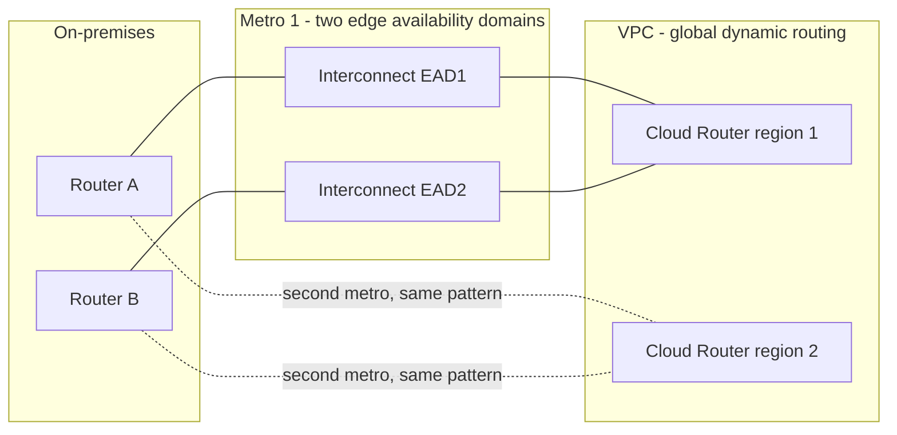

# Section 4: Configuring and Implementing Hybrid and Multicloud Network Interconnectivity (~16%)

[Section 1.3](01-designing-planning-vpc-network.md#13-designing-a-resilient-and-performant-hybrid-and-multicloud-network) decided which hybrid options to use; this section is about building them correctly: ordering and attaching Interconnect, building HA VPN, tuning Cloud Router's BGP, and using Network Connectivity Center to make hybrid links useful to more than one VPC. Almost every hybrid build involves the same three layers, so it helps to keep them apart in your head:

1. **The transport**: a physical Interconnect circuit (Dedicated, Partner via a provider, or Cross-Cloud) or an IPsec tunnel over the internet (HA VPN).
2. **The logical attachment**: a **VLAN attachment** on the Interconnect, or a **VPN tunnel**, which is the per-VPC, per-region link.
3. **The routing**: a **Cloud Router** BGP session over that attachment or tunnel, which exchanges prefixes and programs routes into the VPC.

| Task | Scope |
|------|-------|
| 4.1 | Cloud Interconnect: Dedicated, Partner (Layer 2 vs Layer 3), Cross-Cloud, HA VPN over Interconnect, 99.9% and 99.99% topologies |
| 4.2 | Site-to-site IPsec VPN: HA VPN to on-premises, HA VPN between VPCs, Classic VPN |
| 4.3 | Cloud Router: BGP attributes, BFD, custom advertised and learned routes, best path selection modes |
| 4.4 | NCC for hybrid: hybrid spokes, site-to-site data transfer, router appliances, transitivity |



The diagram shows the three layers for a 99.99% Dedicated Interconnect design: two routers on-premises, two circuits per metro in different edge availability domains, VLAN attachments terminating on a Cloud Router per region, and a second metro and region built the same way.

---

## 4.1 Configuring Cloud Interconnect

### Dedicated Interconnect and VLAN attachments

Dedicated Interconnect is a physical cross-connect between your router and Google's network in a **colocation facility**. Circuits are **10 Gbps, 100 Gbps or 400 Gbps**, and you can bundle up to **8 circuits** of the same type into one connection (80, 800 or 3,200 Gbps). The link type cannot be changed later.

The provisioning flow:

1. **Order** the connection in a chosen location and **edge availability domain** (EAD). Each metro has two EADs with uncoordinated maintenance between them.
2. Google emails a **Letter of Authorization and Connecting Facility Assignment (LOA-CFA)**. Give it to the colocation provider so they run the cross-connect to Google's demarcation point.
3. Google **tests** the circuit (light levels, then a test VLAN); the connection becomes **active**.
4. In each VPC and region that needs access, create a **Cloud Router**, then a **VLAN attachment** on the connection, then a **BGP session**.

```bash
# Cloud Router (ASN of your choice for Dedicated)
gcloud compute routers create ic-router-us --network=production-vpc \
  --region=us-central1 --asn=65001

# VLAN attachment on a Dedicated connection; Google allocates link-local IPs
gcloud compute interconnects attachments dedicated create attach-us-ead1 \
  --interconnect=my-interconnect-ead1 \
  --router=ic-router-us --region=us-central1 \
  --vlan=100 --bandwidth=BPS_10G --mtu=1500 \
  --candidate-subnets=169.254.100.0/29

# Router interface + BGP peer toward your router
gcloud compute routers add-interface ic-router-us --region=us-central1 \
  --interface-name=if-attach-us-ead1 --interconnect-attachment=attach-us-ead1
gcloud compute routers add-bgp-peer ic-router-us --region=us-central1 \
  --peer-name=onprem-ead1 --interface=if-attach-us-ead1 \
  --peer-ip-address=169.254.100.2 --peer-asn=65010
```

Facts worth memorizing:

- A VLAN attachment connects **one connection** to **one Cloud Router** in **one region** of **one VPC**. Several VPCs (or projects) can share a connection with separate attachments.
- Attachment capacities are selectable (from 50 Mbps up to 50 Gbps) and the attachment can carry IPv4 and IPv6 BGP.
- Attachment **MTU** is 1440, 1460, 1500 or 8896 (jumbo only for unencrypted attachments). Use the same MTU on every attachment to the same VPC and match the VPC MTU.
- Interconnect traffic is **private but not encrypted**; add MACsec or HA VPN over Interconnect when policy requires encryption.
- Egress from Google Cloud over Interconnect is billed at lower rates than internet egress, a frequent cost argument in questions.

### Partner Interconnect, VLAN attachments, and Layer 2 vs Layer 3

Partner Interconnect is for when you cannot (or do not want to) reach a Google colocation facility: a **supported service provider** already has connections to Google, and you buy capacity from them. The flow is reversed compared to Dedicated, because you create the attachment first:

1. Create a **Cloud Router** with ASN **16550** (required for Partner Interconnect).
2. Create a Partner **VLAN attachment** in a chosen EAD. Google returns a **pairing key**.
3. Give the **pairing key** to the provider and order the capacity (50 Mbps to 50 Gbps per attachment).
4. The provider provisions the connection; you **activate** the attachment (or pre-activate it at creation).
5. Configure BGP, depending on the type of partner connection.

```bash
gcloud compute routers create partner-router --network=production-vpc \
  --region=us-central1 --asn=16550

gcloud compute interconnects attachments partner create partner-attach-ead1 \
  --router=partner-router --region=us-central1 \
  --edge-availability-domain=availability-domain-1

gcloud compute interconnects attachments describe partner-attach-ead1 \
  --region=us-central1 --format="value(pairingKey)"
```

| | Layer 2 partner connection | Layer 3 partner connection |
|-|---------------------------|----------------------------|
| What the provider supplies | A Layer 2 path (VLAN) from your router to Google | A routed Layer 3 service |
| Who runs BGP with Cloud Router | **You** (your on-premises router peers with Cloud Router across the provider's L2 path) | **The provider** (their router peers with Cloud Router; you peer with the provider) |
| Your configuration after activation | Add Cloud Router interface and BGP peer, configure your router | Usually nothing on the Google side; BGP is set up by the provider and can be pre-activated |

A typical question: "after the provider activated the attachment, the BGP session is down; what next?" For **Layer 2**, you still need to configure the BGP session on your router (and the peer on Cloud Router). For **Layer 3**, check with the provider.

### Cross-Cloud Interconnect

Cross-Cloud Interconnect is a **Google-provisioned** dedicated physical connection between Google's network and another cloud: **AWS, Microsoft Azure, Oracle Cloud Infrastructure and Alibaba Cloud**. Port speeds are 10 or 100 Gbps (400 Gbps also for AWS and OCI).

How it is built:

1. In the **other cloud**, order the dedicated port(s) (for example AWS Direct Connect dedicated connections, Azure ExpressRoute Direct ports) in a location paired with a Google Cross-Cloud Interconnect location, and obtain the LOA from that provider.
2. In Google Cloud, order the Cross-Cloud Interconnect connection(s) referencing the remote cloud and location; Google provisions the cross-connect to the other provider's port.
3. Create **VLAN attachments** and **Cloud Routers** exactly as with Dedicated Interconnect, with custom IP ranges for both ends of the attachment, and configure the matching virtual interfaces and BGP on the other cloud.

Redundancy follows the Dedicated pattern: two connections in different EADs for 99.9%, two pairs across metros for 99.99%. Google's SLA covers Google's side only. MACsec and jumbo MTU are supported.

### Configuring HA VPN over Cloud Interconnect

HA VPN over Cloud Interconnect gives **IPsec encryption across Dedicated or Partner Interconnect** without sending traffic over the internet.

1. Create **encrypted VLAN attachments**: choose `--encryption=IPSEC` at creation (cannot be added later) and reserve an internal IP range for the HA VPN gateway interfaces on each attachment.
2. Create a dedicated **Cloud Router for the attachments** (it carries only the routes needed to reach your VPN device's outer IPs).
3. Create an **HA VPN gateway associated with the VLAN attachments** (the association is immutable).
4. Create a **second Cloud Router** for the VPN tunnels and BGP sessions that carry your real prefixes, then the tunnels to your on-premises VPN device.

Performance and limits: each tunnel handles up to about 250,000 packets per second; each encrypted attachment carries up to 50 Gbps total; gateway MTU is 1440 bytes and the payload MTU is about 1354-1386 bytes depending on cipher; latency overhead is under about 5 ms. Multi-region designs get 99.99%, single-region 99.9%, with at least two VLAN attachments.

```bash
gcloud compute interconnects attachments dedicated create enc-attach-1 \
  --interconnect=my-interconnect-ead1 --router=ic-router-enc \
  --region=us-central1 --encryption=IPSEC \
  --ipsec-internal-addresses=havpn-range-1

gcloud compute vpn-gateways create havpn-over-ic --network=production-vpc \
  --region=us-central1 \
  --interconnect-attachments=enc-attach-1,enc-attach-2
```

### Implementing 99.9% and 99.99% SLAs

| SLA | Dedicated / Cross-Cloud topology | Partner topology |
|-----|-------------------------------|------------------|
| No SLA | One connection | One attachment |
| **99.9%** | At least **two connections in one metro, different EADs**, one Cloud Router region | Two VLAN attachments in one metro, one per EAD |
| **99.99%** | At least **four connections, two per metro in two metros**, each pair in different EADs; Cloud Routers in **two regions**; VPC in **global dynamic routing mode** | Four VLAN attachments across two metros, one per EAD |

Two more rules make the SLA real: Cloud Routers must advertise the **same prefixes on all links** (priorities may differ to choose a primary), and on-premises must have redundant routers so one router failure does not take down both links in a metro. A question that offers "four connections in one metro" for 99.99% is wrong: the second metro is mandatory.

---

## 4.2 Configuring a site-to-site IPsec VPN

### HA VPN toward on-premises VPN gateways

An **HA VPN gateway** is regional and has **two interfaces**, each with its own external IP from a Google pool (no forwarding rules or reserved IPs needed). It supports **only dynamic routing (BGP)** and IKEv1 or IKEv2 (IKEv2 is required for IPv6). The 99.99% SLA requires both interfaces to have tunnels to the peer.

Peer gateway shapes, described by an **external VPN gateway** resource:

| Peer | Redundancy type | Tunnels for 99.99% |
|------|----------------|---------------------|
| Two separate devices (one IP each) | `TWO_IPS_REDUNDANCY` | Interface 0 -> device 1, interface 1 -> device 2 |
| One device with two interfaces | `TWO_IPS_REDUNDANCY` | Interface 0 -> peer IP 0, interface 1 -> peer IP 1 |
| One device with one IP | `SINGLE_IP_INTERNALLY_REDUNDANT` | Both interfaces -> the one IP |
| Four peer interfaces (for example AWS) | `FOUR_IPS_REDUNDANCY` | Four tunnels |

```bash
gcloud compute vpn-gateways create ha-vpn-gw --network=production-vpc --region=us-central1
gcloud compute routers create vpn-router --network=production-vpc \
  --region=us-central1 --asn=65001
gcloud compute external-vpn-gateways create onprem-gw \
  --interfaces=0=198.51.100.1,1=198.51.100.2

gcloud compute vpn-tunnels create tunnel-0 --region=us-central1 \
  --vpn-gateway=ha-vpn-gw --interface=0 \
  --peer-external-gateway=onprem-gw --peer-external-gateway-interface=0 \
  --ike-version=2 --shared-secret=SECRET0 --router=vpn-router
gcloud compute vpn-tunnels create tunnel-1 --region=us-central1 \
  --vpn-gateway=ha-vpn-gw --interface=1 \
  --peer-external-gateway=onprem-gw --peer-external-gateway-interface=1 \
  --ike-version=2 --shared-secret=SECRET1 --router=vpn-router

gcloud compute routers add-interface vpn-router --region=us-central1 \
  --interface-name=if-tunnel-0 --ip-address=169.254.0.1 --mask-length=30 \
  --vpn-tunnel=tunnel-0
gcloud compute routers add-bgp-peer vpn-router --region=us-central1 \
  --peer-name=onprem-0 --interface=if-tunnel-0 \
  --peer-ip-address=169.254.0.2 --peer-asn=65010
# repeat interface + peer for tunnel-1 with 169.254.1.0/30
```

The Terraform equivalent of the core pieces, for reference:

```hcl
resource "google_compute_ha_vpn_gateway" "gw" {
  name    = "ha-vpn-gw"
  network = google_compute_network.production_vpc.id
  region  = "us-central1"
}

resource "google_compute_external_vpn_gateway" "onprem" {
  name            = "onprem-gw"
  redundancy_type = "TWO_IPS_REDUNDANCY"
  interface {
    id         = 0
    ip_address = "198.51.100.1"
  }
  interface {
    id         = 1
    ip_address = "198.51.100.2"
  }
}

resource "google_compute_vpn_tunnel" "t0" {
  name                            = "tunnel-0"
  region                          = "us-central1"
  vpn_gateway                     = google_compute_ha_vpn_gateway.gw.id
  vpn_gateway_interface           = 0
  peer_external_gateway           = google_compute_external_vpn_gateway.onprem.id
  peer_external_gateway_interface = 0
  shared_secret                   = var.secret0
  router                          = google_compute_router.vpn_router.id
}
```

Practical rules: on-premises firewalls must allow **UDP 500, UDP 4500 and ESP** from the gateway IPs; each tunnel is capped at about 250,000 packets per second (roughly 1-3 Gbps depending on packet size), so add tunnel pairs for more throughput and let ECMP spread flows; clamp TCP MSS on-premises for the VPN payload MTU.

### HA VPN toward other Google Cloud VPCs

Two HA VPN gateways can connect two VPC networks (even in different organizations) **gateway to gateway**. Each side creates its gateway, Cloud Router and two tunnels pointing at the other gateway with `--peer-gcp-gateway`. This is the answer when two VPCs need connectivity with **encryption** or **BGP-controlled routing**, or when you need transitive routing that peering cannot provide (Cloud Router can advertise routes learned from elsewhere with custom advertisement).

```bash
gcloud compute vpn-tunnels create a-to-b-0 --region=us-central1 \
  --vpn-gateway=gw-a --interface=0 \
  --peer-gcp-gateway=projects/proj-b/regions/us-central1/vpnGateways/gw-b \
  --ike-version=2 --shared-secret=SECRET --router=router-a
```

### Classic VPN: route-based and policy-based

Classic VPN is the older single-interface gateway with **static routing only** and a **99.9% SLA**. You must reserve an external IP and create forwarding rules for **ESP, UDP 500 and UDP 4500** yourself. It supports two static styles:

- **Route-based**: the tunnel's traffic selectors are `0.0.0.0/0` on both sides, and you create **static routes** pointing destinations at the tunnel. Easiest to interoperate with modern devices.
- **Policy-based**: the tunnel's **local and remote traffic selectors** list the exact CIDRs, and they must match the peer's configuration exactly; mismatched selectors are the classic failure.

Classic VPN has no IPv6 and Google steers new designs to HA VPN; expect it in exam options mainly as the wrong or legacy answer, except when the peer device cannot do BGP and you need a static VPN.

```bash
gcloud compute target-vpn-gateways create classic-gw --network=production-vpc --region=us-central1
gcloud compute addresses create classic-gw-ip --region=us-central1
gcloud compute forwarding-rules create classic-esp --region=us-central1 \
  --address=classic-gw-ip --ip-protocol=ESP --target-vpn-gateway=classic-gw
gcloud compute forwarding-rules create classic-udp500 --region=us-central1 \
  --address=classic-gw-ip --ip-protocol=UDP --ports=500 --target-vpn-gateway=classic-gw
gcloud compute forwarding-rules create classic-udp4500 --region=us-central1 \
  --address=classic-gw-ip --ip-protocol=UDP --ports=4500 --target-vpn-gateway=classic-gw
gcloud compute vpn-tunnels create classic-tunnel --region=us-central1 \
  --target-vpn-gateway=classic-gw --peer-address=198.51.100.1 \
  --shared-secret=SECRET --ike-version=2 \
  --local-traffic-selector=0.0.0.0/0 --remote-traffic-selector=0.0.0.0/0
gcloud compute routes create to-onprem-classic --network=production-vpc \
  --destination-range=192.168.0.0/16 --next-hop-vpn-tunnel=classic-tunnel \
  --next-hop-vpn-tunnel-region=us-central1
```

---

## 4.3 Configuring Cloud Router

### BGP attributes: ASN, priority/MED, link-local addresses, authentication

- **ASN**: Cloud Router uses a private ASN you choose (`64512-65534` or `4200000000-4294967294`), or **16550** for Partner Interconnect. Your peer uses its own ASN, which must differ from Cloud Router's for eBGP. Different NCC spokes must use different ASNs.
- **Link-local addresses**: BGP sessions run over `169.254.0.0/16` addresses: a `/30` per VPN tunnel (you choose it or Google allocates it) and a `/29` candidate range per VLAN attachment (Google allocates by default; Cross-Cloud Interconnect lets you set custom ranges). IPv6 sessions can use IPv6 link-local or ULA addresses.
- **Advertised route priority (MED)**: Cloud Router sends the **advertised route priority** as the MED on prefixes it advertises. On-premises routers prefer the lower MED, so you set a lower value on the primary link and a higher one on the backup. Received MED from your router becomes the **route priority** in the VPC; in global routing mode Google adds an **inter-region cost** for routes learned in other regions.
- **AS path prepending** on your router influences which Interconnect or tunnel Google uses toward you; it works across regions consistently only with **standard** best path selection (below).
- **Authentication**: BGP sessions support **MD5** authentication keys; a key mismatch keeps the session down.
- **Timers and features**: keepalive and hold timers are configurable; **graceful restart** is supported; **BGP route policies** can filter or modify advertised and learned routes.

```bash
# Primary link: preferred (lower MED); backup link: higher MED
gcloud compute routers update-bgp-peer vpn-router --region=us-central1 \
  --peer-name=onprem-0 --advertised-route-priority=100
gcloud compute routers update-bgp-peer vpn-router --region=us-central1 \
  --peer-name=onprem-1 --advertised-route-priority=200

# MD5 authentication on a session
gcloud compute routers update-bgp-peer vpn-router --region=us-central1 \
  --peer-name=onprem-0 --md5-authentication-key=KEY
```

### Configuring Bidirectional Forwarding Detection (BFD)

BGP alone detects a dead peer only when the hold timer expires (tens of seconds). **BFD** detects forwarding-path failures in about a second or two, which is essential for fast failover between Interconnect links.

- Supported on BGP sessions for **Dedicated and Partner Interconnect VLAN attachments**. It is **not** available for HA VPN tunnels or router appliance sessions.
- **Session initialization mode**: `DISABLED` (default), `PASSIVE` (wait for the peer), `ACTIVE` (initiate). At least one side must be `ACTIVE`.
- **Timers**: minimum transmit and receive interval default **1000 ms** (range 1000-30000 ms); **multiplier** default **5** (range 5-16). Detection time is interval x multiplier, so the default is about 5 seconds.
- Match settings on both ends, and keep the expiry timeout at least 5000 ms in each direction to avoid flapping.

```bash
gcloud compute routers update-bgp-peer ic-router-us --region=us-central1 \
  --peer-name=onprem-ead1 \
  --bfd-session-initialization-mode=ACTIVE \
  --bfd-min-transmit-interval=1000 --bfd-min-receive-interval=1000 \
  --bfd-multiplier=5
```

### Custom advertised routes and custom learned routes

**Advertised routes** are what Cloud Router tells your network:

- **Default mode** advertises the VPC's subnet ranges (only the router's region in regional mode, all regions in global mode).
- **Custom mode** lets you advertise **all subnets plus extra ranges** (`--set-advertisement-groups=all_subnets --set-advertisement-ranges=...`), or only specific ranges. You need it to advertise: peered VPC subnets (spokes reached through a hub), the private services access range, Private Google Access VIPs (`199.36.153.4/30` or `.8/30`), PSC endpoint IPs, a summary instead of many subnets, or a default route in special designs.
- You can set custom advertisement on the router or **per BGP peer** (per-peer overrides router-level).

```bash
gcloud compute routers update vpn-router --region=us-central1 \
  --advertisement-mode=custom \
  --set-advertisement-groups=all_subnets \
  --set-advertisement-ranges=10.50.0.0/16,199.36.153.4/30

gcloud compute routers update-bgp-peer vpn-router --region=us-central1 \
  --peer-name=onprem-1 --advertisement-mode=custom \
  --set-advertisement-ranges=10.0.0.0/8
```

**Custom learned routes** are the opposite: you configure, on a BGP peer, prefixes that Cloud Router treats **as if they were learned from that peer**. They are useful when you cannot configure the remote router to advertise them. Unlike static routes, they are **withdrawn automatically when the BGP session goes down**, so they fail over with the link.

```bash
gcloud compute routers update-bgp-peer ic-router-us --region=us-central1 \
  --peer-name=onprem-ead1 \
  --set-custom-learned-route-ranges=192.168.50.0/24 \
  --custom-learned-route-priority=100
```

### Selecting between legacy and standard best path selection

Best path selection is a **VPC network** setting that controls how Cloud Routers rank BGP-learned routes:

| | Legacy (default) | Standard |
|-|------------------|----------|
| AS path | Used only within a single Cloud Router's own BGP decision; not compared across routers in different regions | Considered **across all Cloud Routers** in the VPC, giving consistent AS path-based routing (prepending works network-wide) |
| MED | Always compared, regardless of neighboring AS | **Always compare** or **compare only between routes from the same neighbor AS** (RFC 4271 style) |
| Inter-region cost | Added in global mode | Optionally added to MED or not |
| Recommendation | Google recommends legacy unless you need standard's features | Use for consistent AS-path traffic engineering across regions or features that require it |

```bash
gcloud compute networks update production-vpc \
  --bgp-best-path-selection-mode=STANDARD \
  --bgp-bps-always-compare-med \
  --bgp-bps-inter-region-cost=ADD_COST_TO_MED
```

Exam framing: "on-premises prepends the AS path on the backup circuit but Google still uses it in another region" points at legacy mode, and switching the VPC to standard best path selection is the fix.

---

## 4.4 Configuring Network Connectivity Center for hybrid

### Creating hybrid spokes

A **hybrid spoke** attaches hybrid resources in one VPC and region to an NCC hub: **HA VPN tunnels**, **VLAN attachments** (Dedicated, Partner, Cross-Cloud) or **router appliance** instances. All resources in one spoke must be the same type and in the same region.

```bash
gcloud network-connectivity spokes linked-interconnect-attachments create onprem-us \
  --hub=corp-hub --region=us-central1 \
  --interconnect-attachments=attach-us-ead1,attach-us-ead2 \
  --site-to-site-data-transfer

gcloud network-connectivity spokes linked-vpn-tunnels create branch-east \
  --hub=corp-hub --region=us-east4 \
  --vpn-tunnels=tunnel-0,tunnel-1 --site-to-site-data-transfer
```

Once spokes exist, **dynamic routes learned by hybrid spokes are exported to the hub** and imported by VPC spokes, and VPC spoke subnet routes are re-advertised to on-premises by the hybrid spokes' Cloud Routers, so on-premises can reach every VPC spoke without peering or custom advertisement per VPC.

### Establishing site-to-site data transfer

With **site-to-site data transfer** enabled on hybrid spokes, NCC lets Google's backbone carry traffic **between your external sites**: routes learned from one hybrid spoke are advertised to other hybrid spokes, so branch A reaches branch B through Google. Requirements and limits:

- The participating hybrid spokes must be in the **same VPC network**.
- It is available only in **supported locations** and is billed as data transfer.
- In a **star** hub, hybrid spokes with data transfer must be in the **center** group.

Without the flag, hybrid spokes still serve VPC spokes, but sites do not transit to each other.

### Creating router appliances (RAs)

A **router appliance** is a VM running third-party routing or SD-WAN software that peers with Cloud Router over BGP. It lets you:

- Integrate **SD-WAN**: Google Cloud becomes a site on your SD-WAN fabric, with the appliance learning and advertising routes.
- Connect sites over the internet using your own tunnels, then use site-to-site data transfer between them.
- Insert third-party routing logic that Cloud Router cannot do itself.

Build steps: create the VM with **IP forwarding** enabled (multi-NIC if it bridges networks), create a **router appliance spoke** referencing the VM, then configure **two BGP sessions per appliance** on a Cloud Router using **two router interfaces** (with redundant interface IPs) for redundancy, and configure matching BGP on the appliance.

```bash
gcloud network-connectivity spokes linked-router-appliances create sdwan-us \
  --hub=corp-hub --region=us-central1 \
  --router-appliance=instance=projects/P/zones/us-central1-a/instances/sdwan-1,ip=10.0.1.10 \
  --site-to-site-data-transfer

gcloud compute routers add-interface ra-router --region=us-central1 \
  --interface-name=ra-if-0 --subnetwork=transit-subnet --ip-address=10.0.1.20
gcloud compute routers add-interface ra-router --region=us-central1 \
  --interface-name=ra-if-1 --subnetwork=transit-subnet --ip-address=10.0.1.21 \
  --redundant-interface=ra-if-0
gcloud compute routers add-bgp-peer ra-router --region=us-central1 \
  --peer-name=sdwan-1-a --interface=ra-if-0 --peer-ip-address=10.0.1.10 \
  --peer-asn=65020 --instance=sdwan-1 --instance-zone=us-central1-a
```

BFD is not supported for router appliance sessions, so failover relies on BGP timers (tune them down if needed).

### Solving common transitivity issues

Most hybrid "it cannot reach X" problems are transitivity problems. Recognize the pattern and the fix:

| Symptom | Cause | Fix |
|---------|-------|-----|
| On-premises reaches the hub VPC but not a peered spoke | Peering does not pass on-premises routes and Cloud Router does not advertise peer subnets by default | Export/import custom routes on the peering **and** custom-advertise spoke ranges, or move to NCC VPC + hybrid spokes, or use Shared VPC |
| Spoke VPC A cannot reach spoke VPC C through hub B | Peering is non-transitive | NCC mesh hub, direct peering, or route through an appliance in B |
| On-premises cannot reach Cloud SQL private IP | PSA is a peering; the producer does not know on-premises routes, and on-premises does not know the PSA range | Export custom routes on the `servicenetworking` peering and custom-advertise the PSA allocated range |
| Branch A cannot reach branch B via Google Cloud | Google does not transit between hybrid links by default | NCC hybrid spokes with **site-to-site data transfer** |
| Region 2 VMs cannot reach on-premises | Regional dynamic routing | Global dynamic routing or links in region 2 |
| VPC spoke cannot reach a network peered to another spoke | VPC spokes do not export peering subnet routes | Add that network as its own spoke, or use a producer VPC spoke for managed-service producers |
| Star hub edge spokes cannot reach each other | That is the point of star | Use mesh, or place the shared resource in the center group |
| On-premises reaches a VPC through NCC but not the internet through Cloud NAT | Cloud NAT serves only VM subnets in its VPC, not traffic from hybrid peers | Provide internet egress on-premises or through an appliance; Cloud NAT is not a transit internet gateway |

---

## Exam traps

- Partner Interconnect Cloud Router ASN is **16550**; Layer 2 partner = **you** configure BGP; Layer 3 = the **provider** does.
- Dedicated provisioning uses an **LOA-CFA**; Partner uses a **pairing key**.
- **99.99%** = four connections across **two metros**, Cloud Routers in two regions, **global** routing.
- HA VPN = BGP only, two interfaces, 99.99% only with tunnels on **both** interfaces; Classic VPN = static only, 99.9%.
- Policy-based Classic VPN fails when **traffic selectors** do not match exactly.
- HA VPN over Interconnect needs **encrypted VLAN attachments chosen at creation** and **two Cloud Routers**.
- **BFD** works on Interconnect VLAN attachments only, defaults 1000 ms x 5.
- Custom advertisement is how on-premises learns peered subnets, PSA ranges, PGA VIPs and PSC endpoint IPs.
- **Custom learned routes** withdraw with the BGP session; static routes do not.
- AS path prepending across regions needs **standard** best path selection.
- Site-to-site data transfer requires hybrid spokes in the **same VPC** and supported locations.

## Key terms

- **VLAN attachment** - Logical link on an Interconnect connection that ties it to one Cloud Router in one region of one VPC network.
- **LOA-CFA** - Letter of Authorization and Connecting Facility Assignment that Google issues so the colocation provider can run a Dedicated Interconnect cross-connect.
- **Pairing key** - Key generated by a Partner VLAN attachment that you give the service provider to provision the connection.
- **Layer 2 partner connection** - Partner Interconnect type where the provider supplies an L2 path and you configure BGP with Cloud Router yourself.
- **Layer 3 partner connection** - Partner Interconnect type where the provider runs BGP with Cloud Router on your behalf.
- **Encrypted VLAN attachment** - VLAN attachment created with IPsec encryption so an HA VPN gateway can run over Cloud Interconnect.
- **External VPN gateway** - Resource describing the peer VPN device's interfaces and redundancy type for HA VPN tunnels.
- **Traffic selector** - Local and remote CIDR lists on a Classic VPN tunnel that must match the peer for policy-based VPN.
- **Advertised route priority** - Value Cloud Router sends as BGP MED on its advertisements; lower is preferred by the peer.
- **Bidirectional Forwarding Detection** - Fast link failure detection on Interconnect BGP sessions with intervals of at least 1000 ms and a multiplier of 5-16.
- **Custom learned route** - Prefix configured on a Cloud Router BGP peer that behaves like a learned route and withdraws when the session drops.
- **Standard best path selection** - VPC BGP mode that uses AS path consistently across Cloud Routers and offers RFC 4271 style MED comparison.
- **Hybrid spoke** - NCC spoke made of HA VPN tunnels, VLAN attachments or router appliances in one region.
- **Site-to-site data transfer** - NCC option that lets traffic transit Google's network between external sites connected by hybrid spokes.
- **Router appliance** - VM running third-party routing or SD-WAN software that BGP-peers with Cloud Router as an NCC spoke.

## Vendor documentation

- **[📖 Cloud Interconnect overview](https://cloud.google.com/network-connectivity/docs/interconnect/concepts/overview)** - Dedicated, Partner, Cross-Cloud
- **[📖 Dedicated Interconnect overview](https://docs.cloud.google.com/network-connectivity/docs/interconnect/concepts/dedicated-overview)** - circuits, LOA-CFA, SLA topologies
- **[📖 Partner Interconnect overview](https://docs.cloud.google.com/network-connectivity/docs/interconnect/concepts/partner-overview)** - Layer 2 vs Layer 3, pairing keys
- **[📖 Establish 99.99% availability for Dedicated Interconnect](https://docs.cloud.google.com/network-connectivity/docs/interconnect/tutorials/dedicated-creating-9999-availability)** - production topology
- **[📖 Establish 99.99% availability for Partner Interconnect](https://docs.cloud.google.com/network-connectivity/docs/interconnect/tutorials/partner-creating-9999-availability)** - partner production topology
- **[📖 Cross-Cloud Interconnect overview](https://docs.cloud.google.com/network-connectivity/docs/interconnect/concepts/cci-overview)** - multicloud dedicated links
- **[📖 HA VPN over Cloud Interconnect](https://docs.cloud.google.com/network-connectivity/docs/interconnect/concepts/ha-vpn-interconnect)** - encrypted VLAN attachments
- **[📖 MACsec for Cloud Interconnect](https://docs.cloud.google.com/network-connectivity/docs/interconnect/concepts/macsec-overview)** - Layer 2 encryption
- **[📖 Cloud VPN overview](https://docs.cloud.google.com/network-connectivity/docs/vpn/concepts/overview)** - HA VPN vs Classic VPN
- **[📖 HA VPN topologies](https://cloud.google.com/network-connectivity/docs/vpn/concepts/topologies)** - peer gateway shapes and SLA
- **[📖 Cloud Router overview](https://docs.cloud.google.com/network-connectivity/docs/router/concepts/overview)** - BGP features
- **[📖 BFD for Cloud Router](https://docs.cloud.google.com/network-connectivity/docs/router/concepts/bfd)** - modes and timers
- **[📖 Learned routes and best path selection](https://docs.cloud.google.com/network-connectivity/docs/router/concepts/learned-routes)** - legacy vs standard, custom learned routes
- **[📖 Set routing and best path selection modes](https://docs.cloud.google.com/network-connectivity/docs/router/how-to/configuring-routing-mode)** - how to change modes
- **[📖 NCC overview](https://docs.cloud.google.com/network-connectivity/docs/network-connectivity-center/concepts/overview)** - hybrid spokes, site-to-site data transfer
