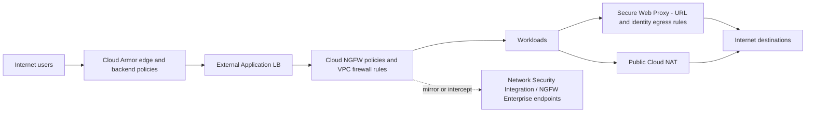

# Section 6: Configuring, Implementing and Managing a Cloud Network Security Solution (~13%)

The smallest section by weight, but its services appear as answer options everywhere else. It covers four layers of network security on Google Cloud:

| Task | Layer | Services |
|------|-------|----------|
| 6.1 | Edge, Layer 7 and DDoS | Google Cloud Armor |
| 6.2 | Layer 3/4 (and Layer 7 with Enterprise) firewalling inside the VPC | Cloud Next Generation Firewall (Cloud NGFW): VPC firewall rules, hierarchical, global and regional network firewall policies |
| 6.3 | Internet egress | Public Cloud NAT, Secure Web Proxy |
| 6.4 | Third-party appliances and traffic copies | Multi-NIC NVAs, internal LB next hop, policy-based routes, Network Security Integration, Packet Mirroring |

VPC Service Controls (API-level data perimeters) is configured in [Section 2.1](02-implementing-vpc-network.md#configuring-vpc-service-controls-perimeters) and Firewall Insights in [Section 5.3](05-network-operations-monitoring-troubleshooting.md#firewall-insights-monitor-identify-and-improve-rules).



The diagram places each control on the traffic path: Cloud Armor in front of the load balancer for inbound web traffic, Cloud NGFW around every workload, Secure Web Proxy and Cloud NAT for egress, and out-of-band or in-band inspection through Network Security Integration or NGFW Enterprise.

---

## 6.1 Google Cloud Armor policies

### Edge and backend security policies

Cloud Armor enforces policies at Google's edge, before traffic reaches your backends. Policy types:

| Policy type | Attaches to | Evaluated | Typical use |
|-------------|-------------|-----------|-------------|
| **Backend security policy** | Backend services of external Application LBs, classic Application LB, proxy NLBs, and regional variants (regional external and regional internal Application LB) | After the cache, for requests that go to the backend | Full WAF, rate limiting, bot management, Adaptive Protection |
| **Edge security policy** | Backend services and **backend buckets** with Cloud CDN, Cloud Storage | **Before** the Cloud CDN cache | Block or allow by IP or geography even for cached content (a subset of match fields) |
| **Network edge security policy** | Regional external passthrough NLBs, protocol forwarding, VMs with public IPs | At Google's network edge, Layer 3/4 | Advanced network DDoS protection and byte-offset filtering (requires Enterprise) |

A policy is an ordered list of **rules**; each has a priority (lower number first), a **match** condition (simple IP list or a CEL **expression**), and an **action**: `allow`, `deny(403|404|502)`, `redirect` (Google reCAPTCHA challenge or external 302), `throttle`, or `rate_based_ban`. Every policy has a **default rule** at priority `2147483647` that always exists and catches anything no other rule matched; set its action to `allow` for a block-list design or `deny` for an allow-list design. **Preview mode** logs what a rule would do without enforcing it, which is how you tune new WAF rules safely.

```bash
gcloud compute security-policies create web-policy --description="Prod web"
gcloud compute backend-services update web-bes --global --security-policy=web-policy

# Allow-list design: deny by default, allow known ranges and countries
gcloud compute security-policies rules update 2147483647 \
  --security-policy=web-policy --action=deny-403
gcloud compute security-policies rules create 100 --security-policy=web-policy \
  --expression="origin.region_code == 'US' || origin.region_code == 'CA'" \
  --action=allow

# Protect an admin path
gcloud compute security-policies rules create 50 --security-policy=web-policy \
  --expression="request.path.matches('/admin/.*') && !inIpRange(origin.ip, '203.0.113.0/24')" \
  --action=deny-403

# Edge policy for a CDN backend bucket
gcloud compute security-policies create cdn-edge --type=CLOUD_ARMOR_EDGE
gcloud compute backend-buckets update static-bucket --edge-security-policy=cdn-edge
```

### WAF rules: SQL injection, cross-site scripting, remote file inclusion

Preconfigured WAF rules are based on the **OWASP ModSecurity Core Rule Set**. Current rule sets come in **CRS 4.22** versions (`sqli-v422-stable`, `xss-v422-stable`, `rfi-v422-stable`, `lfi-v422-stable` and others) and the older **CRS 3.3** versions (`sqli-v33-stable` and so on). Other sets cover remote code execution, scanner detection, protocol attacks, PHP, session fixation, Java and Node.js attacks, and newer CVE rules.

**Sensitivity levels** map to OWASP paranoia levels. **Level 1** enables only the highest-confidence signatures (fewest false positives); **level 4** enables everything (most protection, most false positives). If you do not set a sensitivity, all signatures (level 4) are evaluated. Tune by lowering sensitivity, opting out of noisy signature IDs, or excluding request fields (for example a header carrying a JWT) from inspection.

```bash
gcloud compute security-policies rules create 1000 --security-policy=web-policy \
  --expression="evaluatePreconfiguredWaf('sqli-v422-stable', {'sensitivity': 1})" \
  --action=deny-403 --preview

gcloud compute security-policies rules create 1010 --security-policy=web-policy \
  --expression="evaluatePreconfiguredWaf('xss-v422-stable', {'sensitivity': 2, 'opt_out_rule_ids': ['owasp-crs-v040220-id941150-xss']})" \
  --action=deny-403

gcloud compute security-policies rules create 1020 --security-policy=web-policy \
  --expression="evaluatePreconfiguredWaf('rfi-v422-stable', {'sensitivity': 1})" \
  --action=deny-403
```

Start rules in **preview**, read the logs (`enforcedSecurityPolicy.previewSecurityPolicy` fields), tune, then enforce. (The signature ID in the example illustrates the format; take real IDs from the rule set tuning page.)

### Advanced network DDoS protection and Adaptive Protection

- **Standard protection**: every proxy load balancer (Application LB and proxy NLB) gets always-on volumetric and protocol DDoS protection from Google's edge at no extra charge; attacks at Layer 3/4 against proxies are absorbed by Google's front ends.
- **Advanced network DDoS protection** (Cloud Armor **Enterprise**): extends always-on attack monitoring, targeted mitigation and mitigation telemetry to **passthrough** endpoints: external passthrough NLBs, protocol forwarding and VMs with public IPs. It is enabled per region with a network edge security service and policy.
- **Adaptive Protection**: machine-learning models learn each backend service's normal Layer 7 traffic and alert on anomalies that look like **application-layer (L7) DDoS**, with an attack signature and a **suggested rule**; it can also **auto-deploy** suggested rules when configured load, confidence and impacted-baseline thresholds are met, for a set expiration time. Standard tier gets alerting only; full Adaptive Protection (signatures, suggested rules, auto-deploy) needs Enterprise.

```bash
gcloud compute security-policies update web-policy --enable-layer7-ddos-defense \
  --layer7-ddos-defense-rule-visibility=STANDARD

# Advanced network DDoS protection for passthrough endpoints in a region (Enterprise)
gcloud compute security-policies create ddos-us --type=CLOUD_ARMOR_NETWORK \
  --network-ddos-protection=ADVANCED --region=us-central1
gcloud compute network-edge-security-services create ddos-svc-us \
  --security-policy=ddos-us --region=us-central1
```

**Cloud Armor tiers**: **Standard** (pay as you go per policy and rule and request), **Enterprise Paygo** and **Enterprise Annual**. Enterprise adds full Adaptive Protection, Google Threat Intelligence, named IP lists, advanced network DDoS protection, and (Annual with the right support plan) DDoS response support and DDoS bill protection. Older material calls Enterprise "Managed Protection Plus".

### Configuring rate limiting

Two rate-limiting actions:

- `throttle`: allow up to a threshold per key per interval and apply the **exceed action** (`deny(429)` or similar) to the excess, continuously.
- `rate_based_ban`: when a key exceeds the threshold, **ban** it for `ban-duration-sec` (optionally with a separate, higher ban threshold), then let it back.

The **enforce-on key** decides "per what": `ALL`, `IP`, `HTTP-HEADER`, `XFF-IP`, `HTTP-COOKIE`, `HTTP-PATH`, `SNI`, `REGION-CODE`, and others, and you can combine up to three keys (for example IP plus path).

```bash
gcloud compute security-policies rules create 2000 --security-policy=web-policy \
  --expression="request.path.matches('/login')" \
  --action=rate-based-ban \
  --rate-limit-threshold-count=20 --rate-limit-threshold-interval-sec=60 \
  --ban-duration-sec=600 \
  --conform-action=allow --exceed-action=deny-429 \
  --enforce-on-key=IP

gcloud compute security-policies rules create 2100 --security-policy=web-policy \
  --expression="request.path.matches('/api/.*')" \
  --action=throttle \
  --rate-limit-threshold-count=1000 --rate-limit-threshold-interval-sec=60 \
  --conform-action=allow --exceed-action=deny-429 \
  --enforce-on-key=HTTP-HEADER --enforce-on-key-name=x-api-key
```

### Configuring bot management

Bot management integrates **reCAPTCHA** with Cloud Armor:

- **Redirect to a reCAPTCHA challenge** (`redirect` with type `google-recaptcha`) for suspicious traffic, which issues an exemption cookie to humans who pass.
- **Frictionless assessment** using reCAPTCHA **action tokens** or **session tokens** sent by your pages; rules then match on `token.recaptcha_action.score` or `token.recaptcha_session.score` and allow, deny, redirect or rate limit.
- Request decoration can add headers to tell the backend about the assessment.

```bash
gcloud compute security-policies update web-policy \
  --recaptcha-redirect-site-key=SITE_KEY

gcloud compute security-policies rules create 3000 --security-policy=web-policy \
  --expression="request.path.matches('/checkout') && token.recaptcha_session.score < 0.4" \
  --action=redirect --redirect-type=google-recaptcha

gcloud compute security-policies rules create 3100 --security-policy=web-policy \
  --expression="token.recaptcha_action.score < 0.2" --action=deny-403
```

### Applying Google Threat Intelligence

**Google Threat Intelligence for Cloud Armor** (Enterprise) gives curated, continuously updated IP lists you reference in rule expressions with `evaluateThreatIntelligence()`: for example known malicious IPs, Tor exit nodes, public VPN providers, search engine crawlers (to allow), and public cloud provider ranges. **Named IP lists** (also Enterprise) cover third-party provider ranges, such as a CDN in front of you, with `evaluatePreconfiguredExpr('sourceiplist-...')`.

```bash
gcloud compute security-policies rules create 400 --security-policy=web-policy \
  --expression="evaluateThreatIntelligence('iplist-known-malicious-ips')" \
  --action=deny-403
gcloud compute security-policies rules create 410 --security-policy=web-policy \
  --expression="evaluateThreatIntelligence('iplist-tor-exit-nodes')" \
  --action=deny-403
```

---

## 6.2 Cloud NGFW policies and VPC firewall rules

### Planning the firewall strategy

Cloud Next Generation Firewall (Cloud NGFW) is the umbrella name for Google Cloud's distributed, built-in firewall. Rules are enforced at each VM's virtual NIC (and GKE node), so there is no choke point to size. Four rule containers exist:

| Container | Scope | Notes |
|-----------|-------|-------|
| **Hierarchical firewall policy** | Organization or folder; inherited by every VPC below | Central guardrails; actions include `allow`, `deny`, `goto_next`, `apply_security_profile_group` |
| **Global network firewall policy** | One or more VPC networks, all regions | Recommended replacement for VPC firewall rules; supports secure tags, address groups, FQDN, geolocation, threat intelligence |
| **Regional network firewall policy** | A VPC network in one region | Regional segmentation and regional scope requirements |
| **VPC firewall rules** | One VPC network | The classic model; supports network tags and service accounts, not secure tags or FQDN/geo objects |

**Third-party integration** is the fourth option: send traffic to partner firewalls through **Network Security Integration** or multi-NIC NVAs (6.4) when you need a vendor's features.

A pragmatic strategy: organization-wide **hierarchical** rules for non-negotiables (block known-bad ranges, allow health checks and IAP, delegate the rest with `goto_next`), a **global network firewall policy** per VPC for application rules using **secure tags**, regional policies only where needed, and **Cloud NGFW Enterprise** inspection or partner integration for traffic that needs Layer 7 threat prevention.

### Understanding effective rules with hierarchical policies

The default evaluation order (network setting `AFTER_CLASSIC_FIREWALL`) for a packet to or from a VM is:

1. Hierarchical policy on the **organization**.
2. Hierarchical policies on **folders**, from the top-level folder down to the project's folder.
3. Regional system firewall policies (Google-managed).
4. **VPC firewall rules**.
5. **Global network firewall policy** attached to the VPC.
6. **Regional network firewall policies** attached to the VPC in that region.
7. **Implied rules**: deny ingress, allow egress.

Within each policy, rules are evaluated by priority (`0` is highest) and the first match decides with `allow` or `deny` (or `apply_security_profile_group`); `goto_next` jumps to the next step. A deny in the organization policy therefore cannot be overridden by any folder, project or VPC rule. The network setting `BEFORE_CLASSIC_FIREWALL` moves the network firewall policies ahead of VPC firewall rules, which is useful during migration.

```bash
gcloud compute firewall-policies create --organization=ORG_ID --short-name=org-baseline
gcloud compute firewall-policies rules create 100 --firewall-policy=org-baseline \
  --organization=ORG_ID --direction=INGRESS --action=deny \
  --src-ip-ranges=0.0.0.0/0 --layer4-configs=tcp:3389 \
  --description="No RDP from anywhere"
gcloud compute firewall-policies rules create 200 --firewall-policy=org-baseline \
  --organization=ORG_ID --direction=INGRESS --action=goto_next \
  --src-ip-ranges=10.0.0.0/8 --layer4-configs=all
gcloud compute firewall-policies associations create --firewall-policy=org-baseline \
  --organization=ORG_ID --folder=FOLDER_ID

# See what actually applies to a VM NIC (all layers combined)
gcloud compute instances network-interfaces get-effective-firewalls web-1 \
  --zone=us-central1-a
gcloud compute networks get-effective-firewalls production-vpc
```

The `get-effective-firewalls` commands are the answer to "which rules actually apply to this VM?".

### Cloud NGFW for GKE and Cloud Load Balancing

- **Load balancers**: backends of proxy load balancers receive connections from Google front ends or from the **proxy-only subnet**, and health checks come from `35.191.0.0/16` and `130.211.0.0/22`; allow those sources to the backend ports. For passthrough NLBs, backends see the real client IPs, so the firewall must allow the clients themselves.
- **GKE**: GKE creates VPC firewall rules for node-to-control-plane, node-to-node and Pod communication and for load balancer health checks. In Shared VPC, either give the GKE service agent firewall permissions in the host project or pre-create those rules. Network firewall policies with **secure tags** can target GKE nodes (tags applied through node pool settings), and FQDN and threat intelligence objects in Standard tier apply to node and Pod egress. Kubernetes NetworkPolicy (2.4) still handles Pod-to-Pod rules inside the cluster.

### Creating and troubleshooting rules and policies

```bash
# Global network firewall policy with secure-tag targeting
gcloud compute network-firewall-policies create app-policy --global
gcloud compute network-firewall-policies rules create 1000 --firewall-policy=app-policy \
  --global-firewall-policy --direction=INGRESS --action=allow \
  --layer4-configs=tcp:5432 \
  --src-secure-tags=ORG_ID/app-tier/web \
  --target-secure-tags=ORG_ID/app-tier/db \
  --enable-logging
gcloud compute network-firewall-policies associations create \
  --firewall-policy=app-policy --network=production-vpc --global-firewall-policy

# Regional policy for a region-specific rule
gcloud compute network-firewall-policies create eu-policy --region=europe-west1
```

Troubleshooting order: run a **Connectivity Test** (it names the blocking rule or policy), check **effective firewalls** on the VM NIC, enable **logging** on the suspect rule and read the logs, then check **Firewall Insights** for shadowed rules. Classic gotchas: an organization-level deny you cannot see from the project, a missing egress allow when someone added a broad egress deny, rules targeting a network tag that the VM does not have (typo), and expecting VPC firewall rules to filter traffic that is actually blocked at the hierarchical level.

### Enabling Layer 7 inspection with Cloud NGFW Enterprise

Cloud NGFW Enterprise adds **intrusion detection and prevention (IPS)**, plus URL filtering and advanced malware analysis capabilities, using Palo Alto Networks threat technology run by Google. Building blocks:

1. **Security profile** of type `threat-prevention` (default severity actions, overrides by threat ID or severity) and a **security profile group** that holds it (one threat-prevention profile per group).
2. **Firewall endpoint**: a **zonal** resource created at the organization level that performs the inspection for workloads in the same zone.
3. **Firewall endpoint association**: links the endpoint to a VPC network in that zone.
4. **Firewall policy rule** with action `apply_security_profile_group`: traffic matching the rule's L3/L4 criteria is transparently **intercepted** to the endpoint, inspected at Layer 7, and allowed or blocked according to the profile.
5. Optional **TLS inspection** policy (with a CA pool in Certificate Authority Service) to decrypt selected traffic for inspection.

```bash
gcloud network-security security-profiles threat-prevention create ips-profile \
  --organization=ORG_ID --location=global
gcloud network-security security-profile-groups create ips-group \
  --organization=ORG_ID --location=global \
  --threat-prevention-profile=organizations/ORG_ID/locations/global/securityProfiles/ips-profile
gcloud network-security firewall-endpoints create fw-ep-usc1a \
  --organization=ORG_ID --zone=us-central1-a --billing-project=PROJECT
gcloud network-security firewall-endpoint-associations create fw-assoc-usc1a \
  --zone=us-central1-a --network=production-vpc \
  --endpoint=organizations/ORG_ID/locations/us-central1-a/firewallEndpoints/fw-ep-usc1a
gcloud compute network-firewall-policies rules create 500 --firewall-policy=app-policy \
  --global-firewall-policy --direction=INGRESS --action=apply_security_profile_group \
  --security-profile-group=//networksecurity.googleapis.com/organizations/ORG_ID/locations/global/securityProfileGroups/ips-group \
  --src-ip-ranges=0.0.0.0/0 --layer4-configs=tcp:443
```

**Cloud IDS**, the earlier managed IDS built on Packet Mirroring, is detection only (out of band). Cloud NGFW Enterprise is the in-line prevention option; older questions may still offer Cloud IDS where "detect but do not block" is the requirement.

### Migrating from VPC firewall rules to Cloud NGFW policies

Google provides a **VPC firewall rules migration tool** in gcloud:

- Rules **without network tags or service accounts** migrate directly into a new global network firewall policy (`gcloud compute firewall-rules migrate --source-network=... --target-firewall-policy=...`).
- Rules **with network tags or service accounts** need a **tag mapping file**: you first create **secure tags** that correspond to the network tags, bind them to the VMs, then migrate with `--tag-mapping-file`. Service accounts map to service-account targets in the policy.
- The tool resolves duplicate priorities automatically.

Safe cutover: create the policy, associate it with the network, set the network's enforcement order to `BEFORE_CLASSIC_FIREWALL` so the policy is evaluated first, verify with logs and Connectivity Tests, then delete the old VPC firewall rules.

```bash
gcloud compute firewall-rules migrate --source-network=production-vpc \
  --target-firewall-policy=migrated-policy --export-tag-mapping \
  --tag-mapping-file=tag-map.json
# edit tag-map.json to map each network tag to a secure tag, bind tags to VMs, then:
gcloud compute firewall-rules migrate --source-network=production-vpc \
  --target-firewall-policy=migrated-policy --tag-mapping-file=tag-map.json
gcloud compute networks update production-vpc \
  --network-firewall-policy-enforcement-order=BEFORE_CLASSIC_FIREWALL
```

### Rule criteria

Every rule (VPC rule or policy rule) has:

- **Priority**: VPC rules 0-65535; policy rules 0 to 2,147,483,547. Lower number wins; the first matching rule in a policy decides.
- **Direction**: `INGRESS` (destination is the target) or `EGRESS` (source is the target).
- **Action**: allow, deny, plus `goto_next` and `apply_security_profile_group` in policies.
- **Protocols and ports**: `tcp:443`, `udp:53`, `icmp`, or protocol numbers; `all`.
- **Source** (ingress): IP ranges, network tags or service accounts (VPC rules), secure tags, address groups, FQDNs, geolocations, threat intelligence lists (policies).
- **Destination** (egress): IP ranges, address groups, FQDNs, geolocations, threat intelligence lists.
- **Target**: all instances, network tags or service accounts (VPC rules); secure tags, service accounts or all instances in the network (policies); hierarchical policies can target VPC networks.
- **Logging** and **disabled** state per rule.

### Firewall Rules Logging

Logging is per rule (`--enable-logging`, with optional metadata exclusion). It records each **connection** (not every packet) that a rule allows or denies, with the rule name or policy and priority, so you can prove which rule matched. It feeds Firewall Insights. Logging adds cost and log volume, so enable it on rules you are troubleshooting or auditing rather than everything. Implied rules cannot be logged.

### Micro-segmentation: metadata, secure tags, service accounts, network tags

| Targeting method | Who can change it | Where it works | Security strength |
|------------------|-------------------|----------------|-------------------|
| **Network tags** | Anyone who can edit the instance (`compute.instances.setTags`) | VPC firewall rules, routes | Weak: a VM admin can add a tag to gain access |
| **Service accounts** | Whoever can set the VM's service account (needs `iam.serviceAccountUser`) | VPC rules and policies | Stronger: tied to IAM; one service account per VM |
| **Secure tags** (Resource Manager tags with firewall purpose) | IAM-controlled tag bindings (`tagUser` on the tag value) | Network firewall policies and hierarchical policies | Strongest and most flexible: IAM-governed, multiple tags per VM, scoped to a VPC network or organization |
| **Metadata-based** (address groups, FQDN, geolocation, threat intelligence) | Policy owners | Network and hierarchical policies (FQDN, geo, threat intel need Standard tier) | Expresses intent without listing IPs |

Secure tags are the recommended way to segment by role (`app-tier/web`, `app-tier/db`). They are not network tags: a VPC firewall rule cannot use them, and network firewall policies cannot use network tags, which is why the migration tool needs a mapping.

```bash
gcloud resource-manager tags keys create app-tier --parent=organizations/ORG_ID \
  --purpose=GCE_FIREWALL \
  --purpose-data=network=PROJECT/production-vpc
gcloud resource-manager tags values create web --parent=ORG_ID/app-tier
gcloud resource-manager tags bindings create --location=us-central1-a \
  --tag-value=ORG_ID/app-tier/web \
  --parent=//compute.googleapis.com/projects/PROJECT/zones/us-central1-a/instances/web-1
```

### Cloud NGFW tiers: Essentials, Standard, Enterprise

| Tier | Adds | Billing |
|------|------|---------|
| **Essentials** | Stateful L3/L4 filtering on IPs, ports and protocols; VPC firewall rules; hierarchical, global and regional network firewall policies; **secure tags**; **address groups**; logging | No extra charge |
| **Standard** | **FQDN objects**, **geolocation objects**, **Google Threat Intelligence** lists in rules | Charged on data processed by rules that use these objects |
| **Enterprise** | **Intrusion prevention** via firewall endpoints and security profiles, **TLS inspection**, URL filtering and advanced malware capabilities | Charged per firewall endpoint and data processed |

Exam framing: "block egress to a domain name" needs FQDN objects, so **Standard**; "block traffic from a country" needs geolocation, **Standard**; "detect and block exploits in traffic between VMs" needs **Enterprise**; "allow app tier to DB tier by role" is **Essentials** with secure tags.

---

## 6.3 Securing internet egress: public Cloud NAT and Secure Web Proxy

### Public Cloud NAT IP addressing

Cloud NAT is a **software-defined, distributed** NAT configured on a **Cloud Router** in a region. It lets resources **without external IPs** (VMs, GKE nodes and Pods, Cloud Run with Direct VPC egress, Serverless VPC Access connectors) open connections to the internet. It never allows unsolicited inbound connections, and it does not translate traffic for resources that already have an external IP on the interface.

You choose which subnet ranges it serves (all ranges, all primary ranges, or a list, including secondary ranges for GKE Pods), and how NAT IPs are assigned:

- **Automatic allocation** (`AUTO_ONLY`): Google adds and removes regional external IPs as needed for the VM count and port settings. Simple, but the IPs change, which breaks partners' allow lists.
- **Manual allocation** (`MANUAL_ONLY`): you reserve static external IPs and attach them. Use it when destinations allow-list your egress IPs. You must add enough IPs yourself; when removing an IP, **drain** it first so established connections finish.
- **NAT rules** (public NAT) let specific destination ranges use specific NAT IPs, for example one IP for a partner who allow-lists it.

```bash
gcloud compute routers create nat-router --network=production-vpc --region=us-central1
gcloud compute addresses create nat-ip-1 nat-ip-2 --region=us-central1

gcloud compute routers nats create app-nat --router=nat-router --region=us-central1 \
  --nat-custom-subnet-ip-ranges=app-subnet,gke-subnet,gke-subnet:pods \
  --nat-external-ip-pool=nat-ip-1,nat-ip-2 \
  --enable-logging --log-filter=ERRORS_ONLY

# Drain an address before removal
gcloud compute routers nats update app-nat --router=nat-router --region=us-central1 \
  --nat-external-ip-pool=nat-ip-1 --nat-external-drain-ip-pool=nat-ip-2
```

### Static and dynamic port allocation

Each NAT IP offers **64,512** usable source ports per protocol. Each VM is given a block of ports:

- **Static port allocation** (default for public NAT): every VM gets the same fixed minimum, **64 ports** by default. One NAT IP therefore serves `floor(64,512 / 64) = 1,008` VMs at the default. A VM that needs more concurrent connections to the same destination IP and port than its ports allow will have connections dropped (`OUT_OF_RESOURCES`).
- **Dynamic port allocation (DPA)** (default for Private NAT): each VM starts at a minimum (default **32**) and doubles its allocation up to a maximum as demand grows, then shrinks back. It uses NAT IPs efficiently when VMs have uneven connection needs. DPA cannot be combined with **endpoint-independent mapping** (EIM).

Sizing arithmetic for manual IPs: `NAT IPs needed = ceil(VMs x ports per VM / 64,512)`. For 200 VMs at 1,024 ports: 204,800 / 64,512 = 3.2, so **4** IPs.

```bash
# Static: raise the per-VM minimum for connection-heavy workloads
gcloud compute routers nats update app-nat --router=nat-router --region=us-central1 \
  --min-ports-per-vm=1024

# Dynamic: start small, grow per VM on demand
gcloud compute routers nats update app-nat --router=nat-router --region=us-central1 \
  --enable-dynamic-port-allocation --min-ports-per-vm=64 --max-ports-per-vm=4096 \
  --no-enable-endpoint-independent-mapping
```

Other knobs: idle timeouts per protocol (TCP established, TCP transitory, UDP, ICMP), and the **TCP TIME_WAIT** timeout before a port can be reused for the same destination (30 or 120 seconds depending on when the gateway was created). Lowering TIME_WAIT helps workloads that open many short connections to the same endpoint.

### Configuring Secure Web Proxy

Cloud NAT translates addresses but makes no decision about *where* traffic goes. **Secure Web Proxy (SWP)** is a managed, autoscaling **egress web proxy** that applies policy to HTTP and HTTPS traffic leaving your workloads:

- **Deny by default**: nothing passes until a rule allows it.
- **Identity-aware rules**: match on source **secure tags**, **service accounts**, client certificates (frontend mTLS) or IP ranges, and on destination host, URL, method and other attributes, using **CEL** expressions in `sessionMatcher` (connection-level, for example `host()`) and `applicationMatcher` (request-level, needs TLS inspection for HTTPS).
- **URL lists** hold reusable sets of hosts or URL patterns.
- **TLS inspection** (with a Certificate Authority Service CA pool) lets rules see full HTTPS URLs and paths.
- **Deployment modes**: **explicit proxy** (clients are configured with the proxy address and port), **next-hop / transparent** mode (routes send traffic to the proxy without client configuration, listening on any ports), and access from other VPCs through a **PSC service attachment** for centralized deployments.
- It is a **regional** gateway that needs a **proxy-only subnet** in the region and a **gateway security policy**; egress to the internet goes through Cloud NAT; every request is logged to Cloud Logging.

```bash
# Gateway security policy and a rule allowing one SaaS host for tagged workloads
gcloud network-security gateway-security-policies import egress-policy \
  --source=policy.yaml --location=us-central1
gcloud network-security gateway-security-policies rules import allow-saas \
  --gateway-security-policy=egress-policy --location=us-central1 --source=rule.yaml
```

```yaml
# rule.yaml
name: projects/PROJECT/locations/us-central1/gatewaySecurityPolicies/egress-policy/rules/allow-saas
enabled: true
priority: 100
basicProfile: ALLOW
description: Allow app tier to reach the payments API only
sessionMatcher: "host() == 'api.payments.example.com' && source.matchTag('tagValues/123456789')"
```

```bash
# The proxy gateway itself (explicit proxy on port 443)
gcloud network-services gateways import swp-usc1 --source=gateway.yaml --location=us-central1
```

Choose **Cloud NAT** alone when you only need private workloads to reach the internet; add **Cloud NGFW Standard FQDN rules** for simple domain allow/deny at Layer 4; choose **Secure Web Proxy** when you need URL-level policy, identity-based egress rules, TLS inspection or a full audit log of web requests.

---

## 6.4 Self-managed network virtual appliances and Packet Mirroring

### Routing and inspecting inter-VPC traffic with multi-NIC VMs

A **multi-NIC appliance VM** (for example a third-party NGFW image from Cloud Marketplace) has one interface in each VPC it protects (for example `untrust`, `trust`, `mgmt` VPCs), because each NIC must be in a different VPC and a VM cannot have two NICs in the same one. Requirements:

- **IP forwarding** enabled on the VM (`--can-ip-forward`), set at creation.
- **Routes** in each VPC that send the traffic you want inspected to the appliance's NIC in that VPC (static routes, policy-based routes or routes imported via peering).
- **Firewall rules** in every VPC allowing the traffic to and from the appliance NICs.
- The guest OS (or the appliance) must route between its interfaces and handle return paths, often with per-interface routing tables.

```bash
gcloud compute instances create ngfw-1 --zone=us-central1-a \
  --machine-type=n2-standard-8 --can-ip-forward \
  --network-interface=subnet=untrust-subnet,no-address \
  --network-interface=subnet=trust-subnet,no-address \
  --network-interface=subnet=mgmt-subnet,no-address \
  --image-family=VENDOR_IMAGE --image-project=VENDOR_PROJECT
```

### Internal load balancer as next hop for HA multi-NIC routing

A single appliance is a single point of failure. Put two or more appliances behind an **internal passthrough NLB in each VPC** they serve (one LB per NIC/VPC, all using the same backends), and point routes at those LBs:

- The LB health-checks the appliances and spreads flows across healthy ones.
- **Symmetric hashing** keeps both directions of a connection on the same appliance, which stateful firewalls require; both LBs must use the same session affinity, connection tracking and failover settings.
- Use **failover policy** (active/standby) when the appliance cluster requires a single active member.
- If every backend is unhealthy, the route still forwards to one of them; routes are not withdrawn.

```bash
gcloud compute backend-services create ngfw-trust-bes --load-balancing-scheme=INTERNAL \
  --protocol=UNSPECIFIED --region=us-central1 \
  --health-checks=ngfw-hc --health-checks-region=us-central1 \
  --network=trust-vpc --session-affinity=CLIENT_IP
gcloud compute backend-services add-backend ngfw-trust-bes --region=us-central1 \
  --instance-group=ngfw-ig-a --instance-group-zone=us-central1-a
gcloud compute forwarding-rules create ngfw-trust-ilb --region=us-central1 \
  --load-balancing-scheme=INTERNAL --network=trust-vpc --subnet=trust-subnet \
  --backend-service=ngfw-trust-bes --ip-protocol=L3_DEFAULT --ports=ALL

gcloud compute routes create trust-default-via-ngfw --network=trust-vpc \
  --destination-range=0.0.0.0/0 --next-hop-ilb=ngfw-trust-ilb \
  --next-hop-ilb-region=us-central1 --priority=900
```

### Policy-based routes for HA multi-NIC routing

When the decision depends on **source** as well as destination (for example "traffic from the PCI subnet to anywhere goes through the firewall, but other subnets route normally"), use **policy-based routes** pointing at the appliance LB. They run before normal routes, can be limited to tagged VMs or to traffic from Interconnect VLAN attachments, and need a higher-priority `DEFAULT_ROUTING` exception so health check probes and the appliances' own traffic are not looped back.

```bash
gcloud network-connectivity policy-based-routes create pci-via-ngfw \
  --network=projects/P/global/networks/trust-vpc \
  --source-range=10.20.0.0/24 --destination-range=0.0.0.0/0 \
  --ip-protocol=ALL --next-hop-ilb-ip=10.0.2.10 --priority=200
```

### Out-of-band Network Security Integration strategy

**Network Security Integration (NSI)** is Google Cloud's managed way to plug **third-party security appliances** into VPC traffic without hand-building routes and multi-NIC VMs. It uses a **producer and consumer** model:

- **Producer** (a security team or partner): runs scalable appliance VMs behind internal load balancers in its own VPC, organized as **deployments** (zonal) grouped in a **deployment group**.
- **Consumer** (workload owners): creates an **endpoint group** referencing the producer's deployment group, an **endpoint group association** with its VPC network, and a **security profile** (custom mirroring or custom intercept) inside a **security profile group**.
- Traffic is selected with **network firewall policy rules** using the `apply_security_profile_group` action, matching on IP ranges, secure tags and other attributes. Selected packets are encapsulated in **GENEVE** and sent to the producer's appliances.

Two modes:

- **Out-of-band (mirroring)**: a **copy** of matching packets is sent to the appliances for analysis (IDS, NDR, forensics); the original traffic is unaffected and the appliance cannot block it.
- **In-band (packet intercept)**: matching packets themselves are steered through the appliances, which decide to allow or drop (IPS, next-gen firewalling).

An out-of-band strategy fits when you need visibility without adding latency or a failure point to production traffic: choose which traffic to mirror (by secure tags or ranges), size the collector deployment for the mirrored volume, and keep the producer in a separate project and VPC owned by the security team. NSI mirroring is the policy-driven, multi-VPC evolution of Packet Mirroring.

### Configuring Packet Mirroring toward self-managed collectors

**Packet Mirroring** clones the traffic of selected VMs (ingress and egress, **headers and payload**) and forwards it to a **collector**: an instance group behind an **internal passthrough NLB** whose forwarding rule is marked as a mirroring collector.

- **Sources**: subnets (all current and future VMs in them), network tags, or named instances (limits apply per policy: a handful of subnets or tags, up to 50 instances).
- **Filters**: protocols, CIDR ranges and **direction** (ingress only, egress only, both), to cut volume.
- **Scope**: all mirrored sources must be in the **same project, VPC network and region**; the collector must be in the **same region** but can be in a **peered VPC** or Shared VPC setup.
- **Cost and performance**: mirroring consumes the source VM's bandwidth and is charged on data processed; filter aggressively. You cannot mirror and collect on the same interface, and mirrored packets do not appear in VPC Flow Logs.
- **Firewall**: the collector VMs must allow the mirrored traffic in.

```bash
gcloud compute backend-services create collector-bes --load-balancing-scheme=INTERNAL \
  --protocol=TCP --region=us-central1 --health-checks=collector-hc \
  --health-checks-region=us-central1
gcloud compute backend-services add-backend collector-bes --region=us-central1 \
  --instance-group=collector-ig --instance-group-zone=us-central1-a
gcloud compute forwarding-rules create collector-ilb --region=us-central1 \
  --load-balancing-scheme=INTERNAL --network=production-vpc --subnet=collector-subnet \
  --backend-service=collector-bes --ip-protocol=TCP --ports=ALL \
  --is-mirroring-collector

gcloud compute packet-mirrorings create web-mirror --region=us-central1 \
  --network=production-vpc --collector-ilb=collector-ilb \
  --mirrored-subnets=web-subnet \
  --filter-cidr-ranges=0.0.0.0/0 --filter-protocols=tcp --filter-direction=both
```

On the collector, run tcpdump, Zeek, Suricata or a vendor sensor:

```bash
# Quick look at mirrored HTTP traffic on the collector
sudo tcpdump -i eth0 -nn 'tcp port 80 or tcp port 443' -c 200
```

**Packet Mirroring vs alternatives**: use flow logs when metadata is enough; Packet Mirroring when you need payloads for a self-managed tool in one region and VPC; NSI out-of-band mirroring for partner tools and policy-driven, multi-VPC selection; Cloud NGFW Enterprise or NSI in-band when you must **block**, not just observe.

---

## Exam traps

- Cloud Armor **edge** policies run **before** the CDN cache; **backend** policies run after it; **network edge** policies protect passthrough NLBs and public-IP VMs (Enterprise).
- WAF **sensitivity 1** = fewest, highest-confidence signatures; **4** = all signatures; tune with preview mode.
- Adaptive Protection full features, Google Threat Intelligence, named IP lists and advanced network DDoS need **Cloud Armor Enterprise**.
- `throttle` caps continuously; `rate_based_ban` bans the key for a duration.
- Firewall evaluation default: org -> folders -> VPC rules -> global policy -> regional policy -> implied. An org deny wins over everything below.
- Secure tags work only in **firewall policies**; network tags only in **VPC firewall rules** and routes.
- NGFW **Standard** = FQDN, geolocation, threat intelligence; **Enterprise** = IPS via zonal firewall endpoints and TLS inspection; **Essentials** = everything L3/L4 incl. secure tags and address groups.
- Cloud NAT: 64,512 ports per IP; static default 64 ports per VM (1,008 VMs per IP); DPA default min 32; DPA and EIM are mutually exclusive; manual IPs for allow lists, drain before removal.
- Secure Web Proxy is deny-by-default, regional, needs a proxy-only subnet, and is the answer for URL-level and identity-based egress control.
- Appliances need **IP forwarding**; HA = internal passthrough NLB next hop with **symmetric hashing**.
- Packet Mirroring: same project, VPC and region for sources; collector behind an internal passthrough NLB; payload included; not in flow logs.

## Key terms

- **Backend security policy** - Cloud Armor policy on a backend service that applies WAF, rate limiting and bot rules to requests reaching backends.
- **Edge security policy** - Cloud Armor policy evaluated before the Cloud CDN cache, protecting cached content and backend buckets.
- **Adaptive Protection** - Cloud Armor machine learning that detects Layer 7 DDoS anomalies and suggests or auto-deploys rules.
- **Advanced network DDoS protection** - Cloud Armor Enterprise feature that protects passthrough NLBs, protocol forwarding and public-IP VMs.
- **rate_based_ban** - Cloud Armor action that bans a client key for a set duration after it exceeds a request threshold.
- **Google Threat Intelligence for Cloud Armor** - Enterprise feature exposing curated IP lists such as known malicious IPs and Tor exit nodes to rules.
- **Hierarchical firewall policy** - Organization or folder level Cloud NGFW policy inherited by all VPC networks beneath it.
- **Global network firewall policy** - Cloud NGFW policy attached to VPC networks across all regions, supporting secure tags and advanced objects.
- **Secure tag** - IAM-governed Resource Manager tag with firewall purpose used to target and source rules in firewall policies.
- **Firewall endpoint** - Zonal Cloud NGFW Enterprise resource that intercepts and inspects traffic for intrusion prevention.
- **Security profile group** - Container of security profiles referenced by the apply_security_profile_group firewall action.
- **Dynamic port allocation** - Cloud NAT mode that grows and shrinks each VM's NAT port block between a minimum and maximum.
- **Secure Web Proxy** - Managed deny-by-default egress proxy with identity-aware CEL rules, URL lists and optional TLS inspection.
- **Network Security Integration** - Producer-consumer service that mirrors or intercepts selected traffic to third-party appliances using GENEVE.
- **Packet Mirroring** - Clones VM traffic including payloads to a collector behind an internal passthrough Network Load Balancer.

## Vendor documentation

- **[📖 Cloud Armor overview](https://docs.cloud.google.com/armor/docs/cloud-armor-overview)** - capabilities and supported load balancers
- **[📖 Security policy overview](https://docs.cloud.google.com/armor/docs/security-policy-overview)** - backend, edge and network edge policies, actions
- **[📖 Preconfigured WAF rules](https://docs.cloud.google.com/armor/docs/waf-rules)** - rule sets and sensitivity levels
- **[📖 Adaptive Protection overview](https://cloud.google.com/armor/docs/adaptive-protection-overview)** - L7 DDoS detection
- **[📖 Rate limiting overview](https://cloud.google.com/armor/docs/rate-limiting-overview)** - throttle and rate-based ban
- **[📖 Bot management overview](https://cloud.google.com/armor/docs/bot-management)** - reCAPTCHA integration
- **[📖 Cloud Armor Enterprise overview](https://docs.cloud.google.com/armor/docs/armor-enterprise-overview)** - tiers and Enterprise-only features
- **[📖 Cloud NGFW overview](https://docs.cloud.google.com/firewall/docs/about-firewalls)** - tiers and policy types
- **[📖 Firewall policy rule evaluation order](https://docs.cloud.google.com/firewall/docs/firewall-policies-rule-eval-order)** - enforcement order
- **[📖 Firewall policy rules](https://docs.cloud.google.com/firewall/docs/firewall-policies-rule-details)** - rule components and actions
- **[📖 Intrusion prevention service overview](https://docs.cloud.google.com/firewall/docs/about-intrusion-prevention)** - firewall endpoints and security profiles
- **[📖 Migrate VPC firewall rules overview](https://docs.cloud.google.com/firewall/docs/migrate-vpc-firewall-rules-overview)** - the migration tool
- **[📖 Cloud NAT IP addresses and ports](https://docs.cloud.google.com/nat/docs/ports-and-addresses)** - port allocation and NAT IPs
- **[📖 Secure Web Proxy overview](https://docs.cloud.google.com/secure-web-proxy/docs/overview)** - deployment modes and policies
- **[📖 Network Security Integration overview](https://docs.cloud.google.com/network-security-integration/docs/nsi-overview)** - out-of-band and in-band integration
- **[📖 Packet Mirroring](https://docs.cloud.google.com/vpc/docs/packet-mirroring)** - sources, filters, collectors
- **[📖 Internal passthrough NLB as next hop](https://docs.cloud.google.com/load-balancing/docs/internal/ilb-next-hop-overview)** - appliance HA
- **[📖 Multiple network interfaces](https://cloud.google.com/vpc/docs/multiple-interfaces-concepts)** - multi-NIC VM rules
