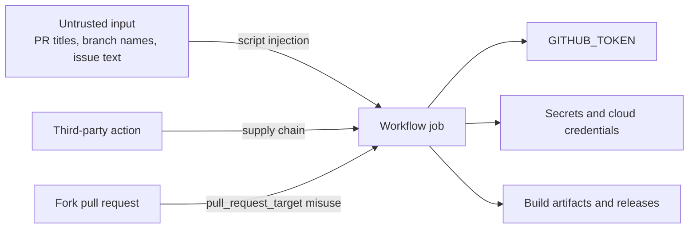

# Domain 5: Secure and Optimize Automation (10-15%)

New as a separate domain in the January 2026 outline. It has two skill groups: implement security best practices (environments and approvals, trustworthy actions, script injection, `GITHUB_TOKEN`, OIDC, SHA pinning, usage policies, artifact attestations) and optimize workflow performance and cost. It is the smallest domain by weight, but its ideas show up as distractors in every other domain.

**[📖 GH-200 study guide](https://learn.microsoft.com/en-us/credentials/certifications/resources/study-guides/gh-200)** - the skills list this note follows.
**[📖 Secure use reference](https://docs.github.com/en/actions/reference/security/secure-use)** - GitHub's hardening guidance for Actions.
**[📖 OpenID Connect](https://docs.github.com/en/actions/concepts/security/openid-connect)** - how OIDC federation works.

## The threat model in one picture

A workflow is code that runs with credentials. Attackers want those credentials (the `GITHUB_TOKEN`, cloud keys, registry tokens) or the ability to change what gets built and shipped. They get in through four doors: untrusted input pasted into scripts, a compromised third-party action, a privileged trigger that runs untrusted code, or a long-lived secret that leaks. Every control below closes one of those doors.



The diagram shows the three things a compromised job can reach (token, secrets, artifacts) and the four common ways in.

## Implement security best practices

### Environments and approval gates

Put production deployment jobs behind an **environment** with required reviewers, a wait timer if useful, and deployment branch rules that allow only `main` or release tags. The job pauses until a reviewer approves, and the environment's secrets are released only then. Reviewers can be prevented from approving their own runs ("prevent self-review"). This is the answer whenever a question asks how to make a human approve a deployment, or how to stop a feature branch from using production credentials.

### Choosing trustworthy actions

Every third-party action runs with your job's token and secrets, so treat adding one like adding a dependency. Signals of trust: published by GitHub (`actions/*`) or a **verified creator** on Marketplace; widely used and actively maintained; a readable source with a small, clear permission need; releases built from source rather than opaque binaries. When in doubt, fork the action into your organization and pin the fork, or rewrite the few lines you need as a `run:` step.

### Mitigating script injection

Expressions are substituted into `run:` scripts **before** the shell runs. If the value comes from someone outside your team (issue and PR titles and bodies, comment text, branch names, commit messages, `github.head_ref`), it can contain shell syntax.

```yaml
# Vulnerable: the title becomes part of the script
- run: echo "Triaging ${{ github.event.issue.title }}"

# Safe: the title is data in an environment variable, quoted in the shell
- run: echo "Triaging $TITLE"
  env:
    TITLE: ${{ github.event.issue.title }}
```

The full mitigation list from the guide: pass untrusted values through `env:` and quote them (`"$TITLE"`); validate or sanitise inputs (for example check a version string against a regular expression before use); prefer a vetted action that takes the value as an input over an inline script; and give the job least-privilege permissions so a successful injection can do little. Code scanning with CodeQL flags these patterns in workflow files.

### `pull_request` versus `pull_request_target`

`pull_request` from a fork runs the fork's code with a read-only token and no secrets: safe by design. `pull_request_target` runs the **base branch's** workflow with a write-capable token and secrets so that it can label or comment on fork PRs. Checking out and building the PR's head code inside `pull_request_target` hands your secrets to whoever opened the PR. The safe split is: build and test untrusted code under `pull_request`, then do privileged work in a separate `workflow_run` workflow that treats the first run's artifacts as untrusted data.

### `GITHUB_TOKEN` lifecycle and permissions

GitHub creates a fresh `GITHUB_TOKEN` (an installation token of the GitHub Actions app) at the start of each job and revokes it when the job finishes, or after 24 hours at most. It can only access the repository that runs the workflow. Its permissions come from the organization or repository default (read and write, or the recommended read-only `contents` and `packages`), narrowed by the workflow's `permissions:` key:

```yaml
permissions: {}                 # workflow default: nothing

jobs:
  release:
    runs-on: ubuntu-latest
    permissions:
      contents: write           # create the release
      id-token: write           # request an OIDC token
      attestations: write       # write a build attestation
    steps: ...
```

Once you name any scope, every unnamed scope becomes `none`. Fork pull requests never get write scopes.

Compare it with a **personal access token (PAT)**: a PAT belongs to a person, lives until it expires or is revoked, can reach every repository that person can, and keeps working after they leave the job they set it up for. Fine-grained PATs narrow that, and a **GitHub App** installation token is the right tool when automation must cross repositories or trigger other workflows. In exam answers, `GITHUB_TOKEN` with minimal `permissions:` beats a PAT whenever the work stays inside the repository.

**[📖 Use GITHUB_TOKEN for authentication in workflows](https://docs.github.com/en/actions/tutorials/authenticate-with-github_token)** - the permissions key and defaults.

### OIDC federation instead of long-lived cloud secrets

Storing an AWS access key or Azure client secret in GitHub means a credential that never expires sits next to every workflow that can read it. **OpenID Connect** removes it. With `id-token: write`, a job can request a short-lived signed JSON Web Token from GitHub's OIDC provider. The token's claims describe the run: `sub` (for example `repo:my-org/api:environment:production`), `repository`, `ref`, `environment`, `job_workflow_ref`, `actor` and more. The cloud provider has been configured to trust GitHub's issuer and to accept only tokens whose claims match a policy. It exchanges the token for temporary cloud credentials that expire within the hour.

```yaml
permissions:
  id-token: write
  contents: read
jobs:
  deploy:
    runs-on: ubuntu-latest
    environment: production
    steps:
      - uses: aws-actions/configure-aws-credentials@v5
        with:
          role-to-assume: arn:aws:iam::111122223333:role/gh-deploy-prod
          aws-region: us-east-1
      - run: aws s3 sync ./dist s3://my-site-prod
```

The security lives in the trust policy: match the full `sub` claim (repository plus environment or branch), never just the organization. Azure (federated credentials on an app registration or managed identity) and Google Cloud (Workload Identity Federation) follow the same model. Organizations can customise the `sub` claim template so policies can match on, for example, the reusable workflow that made the request.

**[📖 Configuring OpenID Connect in Amazon Web Services](https://docs.github.com/en/actions/how-tos/secure-your-work/security-harden-deployments/oidc-in-aws)** - an end-to-end example.

### Pinning actions to full commit SHAs

```yaml
- uses: actions/checkout@08c6903cd8c0fde910a37f88322edcfb5dd907a8  # v5.0.0
```

A tag (`@v4`) or branch (`@main`) is a pointer the action's owner, or anyone who compromises their account, can move. A full 40-character commit SHA cannot be moved. The 2025 compromise of a popular third-party action, in which existing version tags were re-pointed to code that dumped secrets into logs, is the textbook case. So:

- Pin third-party actions to a full SHA, with the version in a comment so humans and Dependabot can read it. Dependabot updates SHA-pinned actions and keeps the comment in sync.
- Do not use floating refs like `@main` or `@v*` patterns without a documented reason.
- Immutable actions, rolled out on hosted runners from 2025, make published releases unchangeable at the registry, which reduces the risk of tag re-pointing; SHA pinning is still the control you choose on the exam.
- Organizations can now **require** SHA pinning through the allowed-actions policy.

### Enforcing action usage policies

Covered in [05-enterprise-management.md](05-enterprise-management.md): allow lists and block lists of actions at enterprise, organization and repository level; allowing only GitHub-created and verified-creator actions; required approval for workflows from first-time contributors and outside collaborators; and the SHA-pinning requirement. The guide's phrase "required reviewers for unverified actions" maps to routing changes that add new actions through code review, for example with a `CODEOWNERS` entry on `.github/workflows/` and a ruleset that requires the platform team's approval.

### Artifact attestations and provenance

An **artifact attestation** is a signed statement, created in the workflow that built an artifact, saying which repository, workflow, commit and runner produced it. It follows the SLSA build provenance format and is signed with a short-lived certificate tied to the workflow's OIDC identity (Sigstore), so no signing key has to be stored.

```yaml
permissions:
  id-token: write
  attestations: write
  contents: read
steps:
  - run: make build                         # produces dist/app.tar.gz
  - uses: actions/attest-build-provenance@v3
    with:
      subject-path: dist/app.tar.gz
```

Consumers verify before deploying:

```bash
gh attestation verify dist/app.tar.gz --owner my-org
```

Verification fails if the artifact was built anywhere else or modified afterwards. Wire it into the deploy job, or into an admission controller for container images, so only artifacts built by your own trusted workflows reach production. Using a reusable workflow for the build step and verifying the signer workflow raises the bar further (SLSA build level 3).

**[📖 Using artifact attestations](https://docs.github.com/en/actions/how-tos/secure-your-work/use-artifact-attestations/use-artifact-attestations)** - generate and verify provenance.

## Optimize workflow performance and cost

### Caching and retention

- Cache dependency downloads with a key built from the lock file, and use the `cache:` input on `setup-*` actions where available. Do not cache build outputs that are cheap to recreate, and keep caches under the repository limit so useful entries are not evicted.
- Upload only what you need as artifacts, compress large outputs, and set `retention-days` short for intermediate artifacts (a day or two) while keeping release artifacts longer.
- Apply retention and cache policies centrally through organization settings or the REST API, and clean up old runs, artifacts and caches with scripted API calls (`DELETE /repos/{owner}/{repo}/actions/caches?key=...`).

### Scaling and optimization strategies

- **Run less.** Path filters, `paths-ignore` for docs, `concurrency` with `cancel-in-progress` for superseded commits, and skipping heavy jobs on draft pull requests.
- **Run smaller.** Keep pull request matrices narrow and run the full matrix on `main` or nightly. Exclude combinations that add no information.
- **Run in parallel.** Split long test suites across matrix jobs (`strategy.job-index` and `job-total`), and remove unnecessary `needs` chains.
- **Fail fast and time out.** Keep `fail-fast` on when one failure means the change is broken, and set `timeout-minutes` so a hung job does not burn the 6-hour default.
- **Pick the cheapest suitable runner.** Linux is cheapest; use Windows and macOS only for what needs them; Arm runners can be cheaper for Arm-native builds; larger runners pay off only if they shorten the job enough.
- **Scale capacity.** For heavy steady load, autoscaled ephemeral self-hosted runners (ARC) or larger runners, organised in runner groups.
- **Reuse.** Reusable workflows and composite actions mean one optimisation lands everywhere.

## Key terms

- **Script injection** - attacker-controlled text executed because an expression pasted it into a `run:` script.
- **pull_request_target** - trigger that runs the base branch's workflow with secrets and a write token for fork PRs.
- **GITHUB_TOKEN** - per-job installation token, scoped to one repository and revoked when the job ends.
- **Fine-grained PAT** - a personal access token limited to selected repositories and permissions.
- **id-token: write** - permission that lets a job request an OIDC token.
- **OIDC sub claim** - the subject string, such as `repo:org/repo:environment:prod`, that cloud trust policies match.
- **Workload identity federation** - exchanging an external OIDC token for short-lived cloud credentials.
- **SHA pinning** - referencing an action by its full commit SHA so the code cannot change underneath you.
- **Artifact attestation** - a signed SLSA provenance statement linking an artifact to the workflow that built it.
- **SLSA** - Supply-chain Levels for Software Artifacts, a framework for build integrity.
- **Required reviewers** - environment protection rule that pauses a job until an approver allows it.
