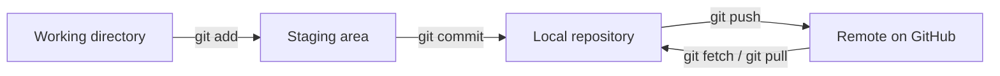
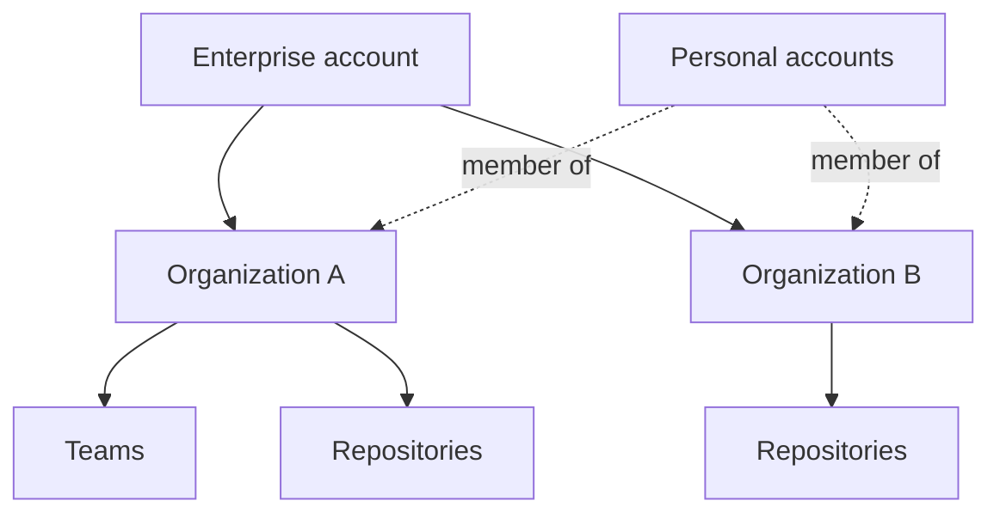
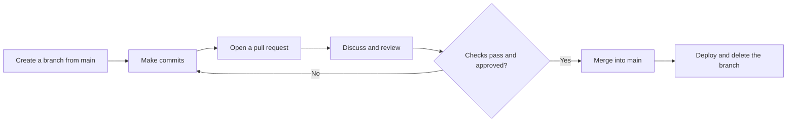

# Domain 1: Understand Git and GitHub basics (25-30%)

This is the heaviest domain on GH-900. It covers why version control exists, how Git and GitHub differ, the core Git objects (repositories, commits, branches), the account types GitHub offers, the GitHub Flow branching model, Markdown in issues and pull requests, and when to reach for GitHub Desktop or GitHub Mobile.

**[📖 GH-900 study guide](https://learn.microsoft.com/en-us/credentials/certifications/resources/study-guides/gh-900)** - the official skills list this note follows
**[📖 About GitHub and Git](https://docs.github.com/en/get-started/start-your-journey/about-github-and-git)** - GitHub's own explanation of the split
**[📖 About Git](https://docs.github.com/en/get-started/using-git/about-git)** - Git concepts from GitHub Docs
**[📖 Pro Git book](https://git-scm.com/book/en/v2)** - the free, official Git book

## Version control fundamentals

### Why version control exists

Imagine five people editing the same set of files and emailing copies back and forth. Nobody knows which copy is current. Nobody can say who changed a line or why. If a change breaks something, there is no easy way back. Version control solves all three problems. It records every change as a snapshot, it keeps the author and a message with each snapshot, and it lets you return to any earlier state.

The benefits the exam expects you to name are:

- **History** - every change is recorded, so you can see what changed, when, and by whom.
- **Collaboration** - many people can work on the same project at once without overwriting each other.
- **Recovery** - you can undo a bad change or restore a deleted file from history.
- **Parallel work** - branches let you build a feature in isolation and merge it when it is ready.
- **Accountability and audit** - each change carries an author and a message that explains intent.

### Centralized versus distributed

Older tools such as Subversion (SVN) are centralized. There is one server that holds the history, and each developer checks out a working copy. If the server is down, you cannot commit or see history.

Git is distributed. When you clone a repository you get the entire history on your own machine. You can commit, branch, view history and compare versions with no network at all. You only need the network to share work with others. This is why most Git commands feel instant: they run against local data.

| Feature | Git (distributed) | SVN (centralized) |
|---------|-------------------|-------------------|
| Where history lives | Full copy on every clone | Only on the central server |
| Offline work | Commit, branch, log, diff all work | Very limited |
| Branching | Cheap and fast | Heavier, slower |
| Single point of failure | No | Yes |

> **Exam trap:** "Distributed" does not mean "no server". Teams still agree on one shared remote (usually on GitHub). It means every clone is a complete repository, not a partial checkout.

### Git versus GitHub

This distinction is tested directly and often. **Git** is the version control tool. It is free, open source, created by Linus Torvalds in 2005 for Linux kernel development, and runs on your computer. **GitHub** is a cloud platform that hosts Git repositories and adds collaboration features on top: pull requests, issues, discussions, Actions, Projects, security scanning, Copilot and more.

You can use Git without GitHub (local only, or with another host). You cannot really use GitHub for code without Git underneath, because every GitHub repository is a Git repository.

| Aspect | Git | GitHub |
|--------|-----|--------|
| What it is | Version control software | Hosting and collaboration platform |
| Where it runs | Your machine | The cloud (or your servers with Enterprise Server) |
| Main interface | Command line | Web, CLI, Desktop, Mobile, API |
| Adds | Commits, branches, merges | PRs, issues, Actions, Projects, security, Copilot |

- **Git** - a free, open source, distributed version control system that runs locally.
- **GitHub** - a cloud platform that hosts Git repositories and adds collaboration, automation and security features.

### Repositories, commits and branches

A **repository** (repo) is a project folder plus its full history. Locally, the history lives in a hidden `.git` directory. On GitHub, the repository page shows the files, the history and all the collaboration features.

A **commit** is a snapshot of the project at a moment in time. Each commit has a unique SHA hash, an author, a timestamp, a message, and a pointer to its parent commit. Commits form a chain, and that chain is the project history. A good commit message explains why the change was made, not only what changed.

A **branch** is a lightweight, movable pointer to a commit. When you commit on a branch, the pointer moves forward to the new commit. Creating a branch is nearly free in Git, which is why the normal habit is a new branch for every piece of work. The default branch on new GitHub repositories is `main`.

- **Repository** - a project's files plus the complete history of changes to them.
- **Commit** - a snapshot of changes with a unique SHA, author, timestamp and message.
- **Branch** - a lightweight movable pointer to a commit, used to isolate work.
- **HEAD** - a pointer to the branch or commit you currently have checked out.
- **Remote** - a copy of the repository hosted elsewhere, conventionally named `origin`.
- **Default branch** - the branch GitHub shows first and targets for pull requests, usually `main`.

### The three areas of a Git project

Git moves your changes through three areas. The **working directory** is the files you see and edit. The **staging area** (also called the index) holds the changes you have chosen for the next commit. The **repository** is the committed history stored in `.git`.



The diagram shows how a change moves from your editor into a commit and out to GitHub, and how other people's changes come back.

The staging area is what lets you build tidy commits. If you edited five files but only three belong together, you stage those three and commit them, then deal with the other two separately.

A file can be **untracked** (Git has never seen it), **modified** (changed since the last commit), **staged** (marked for the next commit) or **committed** (safely in history).

### Essential Git commands

You do not need every flag for GH-900, but you must know what each everyday command does.

```bash
git init                      # turn the current folder into a new repository
git clone <url>               # copy a remote repository, with full history
git status                    # show what is modified, staged or untracked
git add file.txt              # stage a change
git commit -m "Add login"     # record staged changes as a commit
git log --oneline --graph     # view history
git diff                      # unstaged changes; add --staged for staged ones
git switch -c feature-x       # create and switch to a new branch
git merge feature-x           # merge a branch into the current branch
git fetch origin              # download remote changes without merging
git pull                      # fetch, then merge into the current branch
git push -u origin feature-x  # upload a branch and set its upstream
git stash / git stash pop     # shelve and restore uncommitted work
git revert <sha>              # new commit that undoes an old one
git reset --soft HEAD~1       # move the branch back, keep changes staged
```

The pair most often tested is **fetch versus pull**. `git fetch` downloads new commits from the remote but leaves your working files alone, so it is always safe. `git pull` is `fetch` followed by a merge (or rebase) into your current branch, so it can produce merge conflicts.

The second pair is **revert versus reset**. `git revert` adds a new commit that undoes an earlier one, so shared history is not rewritten. That makes it the safe choice for commits that are already pushed. `git reset` moves the branch pointer backwards, which rewrites history. Use it only on work nobody else has pulled.

The third pair is **merge versus rebase**. Merge joins two lines of history with a merge commit and keeps the true shape of what happened. Rebase replays your commits on top of another branch to give a straight line, but it rewrites those commits with new SHAs.

> **Exam trap:** Adding a file to `.gitignore` does not stop Git tracking a file that is already committed. You must also run `git rm --cached <file>`.

### Merge conflicts

A conflict happens when two branches change the same lines of the same file, or one deletes a file the other edited. Git cannot pick a winner, so it stops and marks the file:

```text
<<<<<<< HEAD
your version
=======
their version
>>>>>>> feature-x
```

You edit the file to the correct final content, delete the markers, `git add` the file and finish with `git commit`. GitHub can also resolve simple conflicts in the browser from the pull request page.

**[📖 Resolving a merge conflict on GitHub](https://docs.github.com/en/pull-requests/collaborating-with-pull-requests/addressing-merge-conflicts/resolving-a-merge-conflict-on-github)** - browser-based conflict resolution

## Working with GitHub

### Accounts: personal, organization and enterprise

GitHub has three account types, and a common question asks which one fits a situation.

A **personal account** is your identity. Every person who uses GitHub signs in with one. It can own repositories, and its plan is GitHub Free or GitHub Pro.

An **organization** is a shared account that many personal accounts belong to. Nobody signs in "as" an organization. Instead, members sign in as themselves and get access through the organization's roles and teams. Organizations own repositories, so the work survives when an employee leaves. Plans are GitHub Free for organizations, GitHub Team and GitHub Enterprise.

An **enterprise account** sits above organizations. It lets a large company manage many organizations together, with central policies, billing, audit logs and identity controls such as SAML single sign-on. Enterprise accounts are part of GitHub Enterprise.



The diagram shows an enterprise grouping organizations, with people joining organizations through their own personal accounts.

- **Personal account** - an individual identity on GitHub; every user has exactly one to sign in with.
- **Organization** - a shared account that owns repositories and grants access to members through roles and teams.
- **Enterprise account** - an account that centrally manages policies, billing and identity for multiple organizations.

**[📖 Types of GitHub accounts](https://docs.github.com/en/get-started/learning-about-github/types-of-github-accounts)** - personal, organization and enterprise

### Plans and enterprise options

| Plan | For | What it adds |
|------|-----|--------------|
| GitHub Free | Individuals and organizations | Unlimited public and private repositories, community support, a monthly Actions and Packages allowance |
| GitHub Pro | Individuals | More Actions minutes and advanced tools for private repositories (protected branches, wikis, Pages) |
| GitHub Team | Organizations | Advanced collaboration for private repositories, team access controls, more Actions minutes |
| GitHub Enterprise | Large organizations | Enterprise account, SAML SSO, audit log API, much larger allowances, Enterprise Managed Users option |

GitHub Enterprise comes in two deployment options. **GitHub Enterprise Cloud** runs on GitHub's infrastructure (github.com, or a dedicated subdomain of GHE.com when data residency is needed). **GitHub Enterprise Server** is self-hosted: the company runs the GitHub appliance in its own data centre or cloud account. The choice is usually about control and compliance, not features.

> **Exam trap:** GitHub Free includes unlimited private repositories with unlimited collaborators. Older study material says otherwise.

**[📖 GitHub's plans](https://docs.github.com/en/get-started/learning-about-github/githubs-plans)** - plan comparison
**[📖 About GitHub Enterprise Server](https://docs.github.com/en/enterprise-server@latest/admin/overview/about-github-enterprise-server)** - the self-hosted option

### GitHub Flow

GitHub Flow is the lightweight, branch-based workflow GitHub recommends. It has one long-lived branch, `main`, which should always be deployable. Every change happens on a short-lived branch and comes back through a pull request.



The diagram shows the GitHub Flow loop: branch, commit, pull request, review, then merge and delete.

The steps:

1. **Create a branch** from `main` with a descriptive name such as `fix-login-timeout`. This isolates your work, so `main` stays stable.
2. **Make changes and commit.** Small, focused commits with clear messages make review easier. Push the branch to GitHub often, which also backs up your work.
3. **Open a pull request.** The PR is where you explain what changed and why, link the issue it solves, and ask for feedback. You can open it early as a draft.
4. **Address review comments.** Reviewers comment, suggest changes and approve. Automated checks from GitHub Actions run on every push.
5. **Merge.** Once checks pass and reviewers approve, merge into `main`. Branch protection or rulesets can enforce these conditions.
6. **Delete the branch.** The work now lives in `main`. GitHub can delete merged branches automatically.

Why it works: `main` is always releasable, every change gets review, and history shows a pull request for each change. Compare it with **Git Flow**, an older model with long-lived `develop`, `release` and `hotfix` branches. Git Flow suits scheduled releases. GitHub Flow suits teams that deploy continuously.

> **Exam trap:** In GitHub Flow, you never commit straight to `main`. If an answer option says "commit directly to main to save time", it is wrong.

**[📖 GitHub flow](https://docs.github.com/en/get-started/using-github/github-flow)** - GitHub's description of the workflow

### Markdown in issues and pull requests

GitHub renders Markdown almost everywhere you type: README files, issues, pull requests, discussions, comments, wikis and gists. The dialect is **GitHub Flavored Markdown (GFM)**, which adds tables, task lists, strikethrough and autolinks to standard Markdown.

```markdown
# Heading 1
## Heading 2
**bold**, *italic*, ~~strikethrough~~, `inline code`

- bullet
1. numbered
- [ ] task list item
- [x] done item

[link text](https://example.com)


> quote

| Column | Column |
|--------|--------|
| cell   | cell   |
```

Fenced code blocks with a language name (` ```python `) get syntax highlighting. On top of that, GitHub adds collaboration features that plain Markdown does not have:

- **@mentions** - `@username` or `@org/team` notifies that person or team.
- **Issue and PR references** - `#123` links to issue or pull request 123 in the same repository; `owner/repo#123` links across repositories.
- **Commit references** - pasting a commit SHA turns it into a link.
- **Task lists** - checkboxes that show progress in the issue list.
- **Alerts** - `> [!NOTE]`, `> [!TIP]`, `> [!IMPORTANT]`, `> [!WARNING]` and `> [!CAUTION]` render as coloured callouts.
- **Diagrams and maths** - Mermaid code blocks render as diagrams, and `$...$` renders LaTeX maths.
- **Emoji shortcodes** - `:tada:` style codes.

Why Markdown matters here: issues and pull requests are where teams communicate. Clear headings, checklists and code blocks make a bug report reproducible and a PR easy to review.

**[📖 Basic writing and formatting syntax](https://docs.github.com/en/get-started/writing-on-github/getting-started-with-writing-and-formatting-on-github/basic-writing-and-formatting-syntax)** - the Markdown reference
**[📖 GitHub Flavored Markdown spec](https://github.github.com/gfm/)** - the formal GFM specification

### GitHub Desktop and GitHub Mobile

GitHub offers several ways to work. Knowing which one fits a situation is an exam objective.

**GitHub Desktop** is a free graphical app for Windows and macOS. It does Git work without the command line: clone, branch, stage individual lines, commit, push, pull and open pull requests. It suits people new to Git, visual learners and anyone who wants to see a diff before committing. It does not replace the GitHub website for things like reviewing PRs in depth, managing settings or Projects.

**GitHub Mobile** is the iOS and Android app. It is built for staying in the loop away from your desk: triage notifications, read and comment on issues, review and merge pull requests, and approve two-factor sign-in requests. It is not a code editor and does not run Git locally.

**GitHub CLI** (`gh`) brings GitHub features to the terminal: `gh pr create`, `gh issue list`, `gh repo clone`. It complements Git, which handles commits and branches.

| Tool | Best for | Not for |
|------|----------|---------|
| GitHub.com | Everything, especially reviews, settings, Projects | Offline work |
| GitHub Desktop | Visual Git workflow on Windows or macOS | Admin settings, deep review |
| GitHub Mobile | Notifications, quick reviews, merges, 2FA approval | Writing code |
| GitHub CLI | Scripting and terminal users | People who avoid the terminal |

> **Exam trap:** If a scenario says someone wants to "review and merge a pull request while travelling", the answer is GitHub Mobile, not Desktop. If they want "a visual way to commit and push without learning commands", the answer is GitHub Desktop.

**[📖 GitHub Desktop documentation](https://docs.github.com/en/desktop)** - install and use the desktop app
**[📖 GitHub Mobile](https://docs.github.com/en/get-started/using-github/github-mobile)** - mobile features
**[📖 GitHub CLI](https://docs.github.com/en/github-cli)** - the `gh` command-line tool

## Key exam points

- Version control gives history, collaboration, recovery and parallel work.
- Git is the tool; GitHub is the platform built around it.
- Every Git clone is a complete repository with full history.
- `git fetch` never changes your working files; `git pull` does.
- `git revert` is safe on shared history; `git reset` rewrites it.
- Personal accounts are people, organizations share ownership, enterprise accounts govern many organizations.
- Enterprise Cloud is hosted by GitHub; Enterprise Server is self-hosted.
- GitHub Flow: branch, commit, pull request, review, merge, delete. `main` stays deployable.
- `#123` links an issue or PR; `@name` notifies a person or team.
- Desktop is for visual Git on a computer; Mobile is for notifications and reviews on the go.
