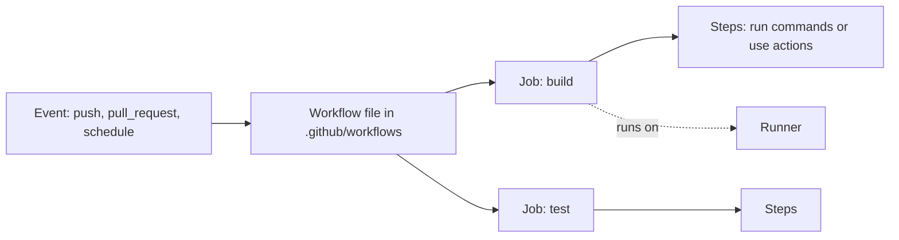

# Domain 4: Apply modern development practices (10-15%)

This domain covers the GitHub features that change how code gets written and shipped: GitHub Actions for automation, GitHub Copilot (including its agents and plans), and the two browser-based editing options, Codespaces and github.dev. The exam tests purpose and fit, not deep configuration.

**[📖 GH-900 study guide](https://learn.microsoft.com/en-us/credentials/certifications/resources/study-guides/gh-900)** - the official skills list
**[📖 Understanding GitHub Actions](https://docs.github.com/en/actions/get-started/understand-github-actions)** - Actions concepts
**[📖 GitHub Copilot documentation](https://docs.github.com/en/copilot)** - Copilot features and plans
**[📖 GitHub Codespaces overview](https://docs.github.com/en/codespaces/about-codespaces/what-are-codespaces)** - what a codespace is

## GitHub Actions: purpose and capabilities

### What problem Actions solves

Every team repeats the same chores: run the tests, check formatting, build the app, deploy it, label new issues. Doing them by hand is slow and easy to forget. **GitHub Actions** is GitHub's built-in automation platform. You describe a workflow in a YAML file, and GitHub runs it when something happens in the repository.

The best-known use is **CI/CD**. Continuous integration (CI) builds and tests every change automatically, so problems show up on the pull request instead of in production. Continuous delivery or deployment (CD) ships tested changes to an environment automatically. But Actions is broader than CI/CD: it can respond to almost any GitHub event, such as a new issue, a release, a schedule or a manual button press.

### The building blocks



The diagram shows an event starting a workflow, the workflow containing jobs, and each job running steps on a runner.

- **Workflow** - an automated process defined in a YAML file in `.github/workflows/`.
- **Event** - the trigger that starts a workflow, such as `push`, `pull_request`, `schedule` or `workflow_dispatch`.
- **Job** - a set of steps that run on the same runner; jobs run in parallel unless one `needs` another.
- **Step** - a single task in a job: a shell command (`run`) or a reusable action (`uses`).
- **Action** - a reusable unit of automation, often from GitHub Marketplace, such as `actions/checkout`.
- **Runner** - the machine that executes a job; GitHub-hosted (managed Linux, Windows or macOS) or self-hosted.

A minimal workflow:

```yaml
name: CI
on:
  pull_request:
    branches: [main]
jobs:
  test:
    runs-on: ubuntu-latest
    steps:
      - uses: actions/checkout@v4
      - run: npm ci
      - run: npm test
```

When this workflow runs on a pull request, its result appears as a **status check** on the PR. Branch protection or a ruleset can then require that check to pass before merging. That pairing, Actions producing checks and protection requiring them, is how teams make "tests must pass" an enforced rule instead of a hope.

### Hosted versus self-hosted runners

**GitHub-hosted runners** are fresh virtual machines that GitHub manages. Every job starts clean, and there is nothing to patch. **Self-hosted runners** are machines you register yourself. Use them when you need special hardware, software or network access to private resources.

### Cost at a glance

Actions is free for public repositories on GitHub-hosted standard runners. Private repositories get a monthly allowance of minutes that depends on the plan (GitHub Free 2,000, Pro and Team 3,000, Enterprise Cloud 50,000), and beyond that usage is billed. Windows and macOS minutes cost more than Linux minutes.

> **Exam trap:** Actions is not only CI/CD. A question like "automatically add a label when an issue is opened" is still an Actions answer.

**[📖 About continuous integration with GitHub Actions](https://docs.github.com/en/actions/get-started/continuous-integration)** - CI concepts
**[📖 GitHub Actions billing](https://docs.github.com/en/billing/concepts/product-billing/github-actions)** - included minutes and rates

## GitHub Copilot

### What Copilot is

**GitHub Copilot** is GitHub's AI coding assistant. It started as autocomplete for code and has grown into a family of features:

- **Inline suggestions** - code completions as you type, from a single line to a whole function, plus next edit suggestions.
- **Copilot Chat** - ask questions in the IDE, on GitHub.com or in GitHub Mobile: explain this code, write a test, why is this failing.
- **Agent mode** - an IDE mode where Copilot plans and carries out a multi-step task on its own.
- **Copilot cloud agent** - an agent that works on GitHub itself, in the background, and hands back a branch or pull request. The GH-900 outline calls this the **coding agent**, its earlier name.
- **Copilot code review** - Copilot reviews a pull request and leaves comments with suggested fixes.
- **Multi-model choice** - pick which AI model answers in Chat and agent mode.

Copilot works in VS Code, Visual Studio, JetBrains IDEs, Xcode, Eclipse, Neovim and others, on GitHub.com, in GitHub Mobile and in the terminal through Copilot CLI. It is not available for GitHub Enterprise Server.

### Agent mode versus the coding (cloud) agent

These two names sound alike, and the study guide lists both, so expect a question that separates them.

**Agent mode** runs **in your IDE**, on your machine, while you watch. You describe a task ("add input validation to the signup form and update the tests"). Copilot decides which files to read and change, edits several files, runs terminal commands such as tests, reads the output and fixes its own mistakes, iterating until the task is done. You approve or undo changes as it goes. It is synchronous: you are in the loop the whole time.

The **coding agent** (now named **Copilot cloud agent** in GitHub Docs) works **on GitHub**, in the background. You start it from an issue (by assigning the issue to Copilot), from a Copilot Chat conversation or from the agents panel. It researches the repository, plans, edits files and runs tests and linters in an ephemeral cloud environment powered by GitHub Actions, then pushes a branch and opens a **pull request** for you to review. It is asynchronous: you can do other work while it runs, and its output arrives through the normal pull request process, so branch protections and human review still apply. It suits well-scoped tasks like small features, bug fixes, test coverage and documentation.

| | Agent mode | Coding agent (Copilot cloud agent) |
|-|-----------|------------------------------------|
| Where it runs | Your IDE, locally | GitHub, in an ephemeral Actions-powered environment |
| How you start it | Chat prompt in the IDE | Assign an issue to Copilot, or start it from Chat or the agents panel |
| Interaction | Synchronous, you watch and approve | Asynchronous, works in the background |
| Output | Edits in your working copy | A branch and pull request for review |

> **Exam trap:** "Assign an issue and get a pull request back later" is the coding agent. "Copilot edits several files in VS Code and runs the tests while I watch" is agent mode.

### Multi-model support

Copilot is not tied to one AI model. On paid plans you can choose from models by several providers (for example OpenAI, Anthropic and Google models) in Chat and agent mode, trading speed against reasoning depth. The free plans use **auto model selection** only. In organizations, admins decide which models members may use.

Usage of chat and agents is metered in **GitHub AI Credits**: each plan includes a monthly allowance, and code completions remain unlimited on paid plans. (Earlier material called the metered unit "premium requests".)

### Copilot plans

| Plan | For | Key points (GitHub Docs, checked 2026-10-22) |
|------|-----|-----------|
| **Copilot Free** | Individuals trying Copilot | Limited completions and chat, auto model selection only, no payment needed |
| **Copilot Pro** | Individual developers | Paid monthly; a selection of models, agent mode, cloud agent, AI credit allowance |
| **Copilot Pro+** | Individual power users | Everything in Pro, premium models and a much larger AI credit allowance |
| **Copilot Business** | Organizations | Per-seat licences, organization-wide policy management, audit logs, content exclusion |
| **Copilot Enterprise** | Enterprises on GitHub Enterprise Cloud | Everything in Business plus a larger AI credit pool and enterprise-grade capabilities |

Free, Pro and Pro+ are the **individual** plans named in the GH-900 outline. GitHub has since added **Copilot Student** (free for verified students) and **Copilot Max** (above Pro+) to the individual line-up. Business and Enterprise are bought by an organization or enterprise and assigned to members as seats.

What Business and Enterprise add is mostly about **control**:

- **Policy management** - admins decide which features are on (Chat, agent mode, the cloud agent, Copilot CLI), which models are allowed, and whether suggestions matching public code are blocked.
- **Content exclusion** - admins can stop Copilot using specific files or repositories as context.
- **Audit logs** - Copilot events appear in the organization or enterprise audit log.
- **IP indemnity** - under GitHub's product terms, organization plans include legal protection if Copilot output is claimed to infringe copyright, subject to conditions such as the public code filter.
- **Data handling** - by default, Business and Enterprise prompts and code are not used to train models.
- **Shared organization knowledge** - the outline mentions Enterprise **knowledge bases** (curated documentation Copilot can draw on). In current GitHub Docs that role is filled by **Copilot Spaces**, which collect code, docs and notes as context and can be shared across a team.

> **Exam trap:** "A company wants central control over which developers get Copilot and which features and models they can use" points to Copilot Business (or Enterprise on Enterprise Cloud). Individual plans cannot be centrally managed.

**[📖 Plans for GitHub Copilot](https://docs.github.com/en/copilot/get-started/plans)** - plan comparison and AI credit allowances
**[📖 GitHub Copilot on GitHub](https://docs.github.com/en/copilot/concepts/copilot-surfaces/copilot-on-github)** - Chat, cloud agent and code review on GitHub.com
**[📖 Adding Copilot cloud agent to an organization](https://docs.github.com/en/copilot/how-tos/administer-copilot/manage-for-organization/add-copilot-cloud-agent)** - how admins enable the agent
**[📖 Copilot agent mode in VS Code](https://code.visualstudio.com/docs/copilot/chat/chat-agent-mode)** - agent mode in the IDE
**[📖 About Copilot Spaces](https://docs.github.com/en/copilot/concepts/prompting-and-context/spaces)** - shared context for Copilot
**[📖 Managing policies for Copilot in your organization](https://docs.github.com/en/copilot/how-tos/administer-copilot/manage-for-organization/manage-policies)** - organization policies

## Codespaces and dev containers

### What a codespace is

A **codespace** is a development environment that runs on a cloud virtual machine hosted by GitHub. You open it in the browser (a full VS Code) or connect from desktop VS Code or a JetBrains IDE. It has a real terminal, can install packages, run servers and tests, and forward ports so you can preview a web app.

Why use one? Onboarding drops from a day of setup to a minute. Everyone gets the same environment, so "works on my machine" problems shrink. You can work from a low-powered laptop or a borrowed computer, and you can choose a bigger machine type for heavy builds.

### Dev containers

What goes into a codespace is defined by a **dev container** configuration, a `devcontainer.json` file usually stored in `.devcontainer/`. It names the base image, extra tools ("features"), VS Code extensions, ports to forward and commands to run after creation:

```json
{
  "name": "Node app",
  "image": "mcr.microsoft.com/devcontainers/javascript-node:20",
  "customizations": { "vscode": { "extensions": ["dbaeumer.vscode-eslint"] } },
  "forwardPorts": [3000],
  "postCreateCommand": "npm install"
}
```

Dev containers are an open specification. The same file also works with the Dev Containers extension in local VS Code, so a team gets one definition for local and cloud development. If a repository has no configuration, Codespaces uses a default image with common languages installed.

**Prebuilds** prepare codespaces ahead of time for large repositories so they start faster. **Dotfiles** let you bring personal shell and editor settings into every codespace.

### Billing

Codespaces is billed for **compute** (per hour the codespace is running, scaled by machine size) and **storage** (per GB-month, even while stopped). Personal accounts get a free monthly allowance of core hours and storage. Codespaces stop automatically after a period of inactivity to save compute, and are deleted after a retention period if left unused.

- **Codespace** - a cloud-hosted development environment on a GitHub-managed virtual machine, opened in the browser or an IDE.
- **devcontainer.json** - the dev container configuration that defines a codespace's image, tools, extensions and setup commands.
- **Prebuild** - a prepared codespace image that makes large repositories start faster.

**[📖 Introduction to dev containers](https://docs.github.com/en/codespaces/setting-up-your-project-for-codespaces/adding-a-dev-container-configuration/introduction-to-dev-containers)** - dev container basics
**[📖 About billing for GitHub Codespaces](https://docs.github.com/en/billing/concepts/product-billing/github-codespaces)** - compute and storage

## github.dev versus Codespaces

The **github.dev** editor is a lightweight VS Code that runs entirely in your browser. Open it by pressing `.` (the period key) on any repository or pull request, or by changing `github.com` to `github.dev` in the URL. It is free and needs no setup.

The catch is that github.dev has **no compute behind it**. There is no terminal, you cannot run, build or debug code, and only extensions that run in the browser work. It is perfect for editing several files, fixing documentation, reviewing a pull request with full editor navigation, and committing changes. When you need to run anything, github.dev offers to move you to a codespace.

| | github.dev | Codespaces |
|-|-----------|------------|
| Open with | Press `.` or swap the URL to github.dev | **Code** button, **Codespaces** tab, or `gh codespace create` |
| Runs on | Your browser only | A cloud virtual machine |
| Terminal | No | Yes |
| Run, build, debug | No | Yes |
| Extensions | Web-compatible only | Most VS Code extensions |
| Cost | Free | Billed compute and storage (with a free monthly allowance for personal accounts) |
| Best for | Quick edits, docs, reviewing PRs | Real development and testing |

> **Exam trap:** "Quickly fix a typo in several Markdown files from a library computer, with no cost" is github.dev. "Run the test suite in the browser without installing anything" is Codespaces, because github.dev cannot run code.

**[📖 The github.dev web-based editor](https://docs.github.com/en/codespaces/the-githubdev-web-based-editor)** - what github.dev can and cannot do

## Key exam points

- Actions automates any repository event; CI/CD is the main use, not the only one.
- Workflow files live in `.github/workflows/`; jobs run in parallel by default; steps run in order.
- Actions results become status checks that branch protection can require.
- Agent mode works in your IDE while you watch; the coding agent (now Copilot cloud agent) works on GitHub in the background and returns a pull request.
- Copilot individual plans in the outline: Free, Pro, Pro+ (GitHub now also lists Student and Max). Organization plans: Business, Enterprise.
- Business and Enterprise add policy management, audit logs, IP indemnity and content exclusion; Enterprise adds a larger AI credit pool and shared organization knowledge (knowledge bases in the outline, Copilot Spaces today).
- Copilot supports multiple AI models on paid plans; free plans use auto model selection; admins control which models are allowed.
- `devcontainer.json` defines a codespace's environment.
- Codespaces bills compute while running and storage while it exists.
- github.dev is free and browser-only, with no terminal and no compute.
