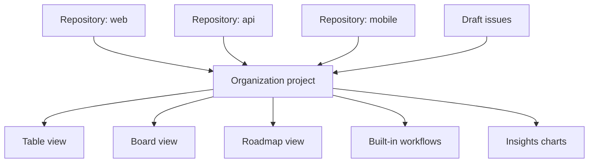

# Domain 5: Manage projects with GitHub (5-10%)

This domain covers planning and tracking work on GitHub: GitHub Projects and its three layouts, fields and iterations, built-in workflow automations, project insights charts, and the smaller tools that keep issues organized (labels, milestones, assignees and saved replies).

**[📖 GH-900 study guide](https://learn.microsoft.com/en-us/credentials/certifications/resources/study-guides/gh-900)** - the official skills list
**[📖 About Projects](https://docs.github.com/en/issues/planning-and-tracking-with-projects/learning-about-projects/about-projects)** - Projects overview
**[📖 Quickstart for Projects](https://docs.github.com/en/issues/planning-and-tracking-with-projects/learning-about-projects/quickstart-for-projects)** - build one in a few minutes

## What GitHub Projects is

Issues and pull requests on their own are lists, one per repository. Real work rarely fits in one repository, and a plain list cannot show priority, effort, sprint or a timeline. **GitHub Projects** is a flexible planning surface that sits on top of issues and pull requests. It is a spreadsheet, a task board and a roadmap at the same time, and it stays in sync with the underlying items: close an issue and the project shows it closed.

A project belongs to a user or an organization, not to a single repository. That is the key difference from per-repository lists: one project can collect issues and pull requests from many repositories, which is exactly what a product manager tracking several teams needs. A project can also hold **draft issues**, quick notes that live only in the project until you convert them into real issues in a repository.

The older **projects (classic)** experience, which used fixed Kanban columns per repository, has been retired. If an answer talks about classic project columns as the modern solution, it is out of date.

The diagram shows one organization project pulling items from several repositories and presenting them through different views, automations and charts.

## Layouts: table, board and roadmap

A project has one or more **views**, saved on tabs. Each view has a **layout**, plus its own filter, sort, grouping and visible fields. The three layouts are:

**Table** is a spreadsheet. Each row is an item, each column is a field. It is the best layout for bulk editing, sorting by priority and seeing lots of metadata at once.

**Board** is a Kanban board. Items are cards in columns, and the columns come from a single-select field such as Status (Todo, In progress, Done) or from an iteration. Dragging a card between columns changes that field's value. It is the best layout for day-to-day flow and standups.

**Roadmap** is a timeline. Items appear as bars positioned by date or iteration fields. It is the best layout for release planning and showing stakeholders when things land.

| Need | Layout |
|------|--------|
| Sort and bulk-edit many items | Table |
| Run a Kanban standup | Board |
| Show delivery dates to leadership | Roadmap |

Because views share the same data, you might keep "Team board" (board, grouped by Status, filtered to one team), "Backlog" (table, sorted by priority) and "Q3 roadmap" (roadmap, by iteration) in one project.

> **Exam trap:** Changing a view's layout or filter does not change the data. Every view reads the same items and fields.

**[📖 Changing the layout of a view](https://docs.github.com/en/issues/planning-and-tracking-with-projects/customizing-views-in-your-project/changing-the-layout-of-a-view)** - table, board and roadmap

## Configuring projects: fields and iterations

Every item carries built-in fields from the issue or PR (title, assignees, labels, milestone, repository, linked pull requests). On top of those you can add **custom fields**:

- **Text** - free text, such as a short note.
- **Number** - numeric values such as story points or estimates.
- **Date** - a single date, such as a target date for roadmap bars.
- **Single select** - one value from a list you define, such as Status, Priority or Team.
- **Iteration** - repeating time boxes (sprints) with a start date and length, with breaks if needed.

Custom fields live in the project, not in the repository. Setting Priority to High in a project does not add a label to the issue.

Iterations deserve a moment. You define a length (for example two weeks) and GitHub generates the series. Items are assigned to an iteration, boards can group by it, and roadmaps can lay out by it. Finished iterations move to a "completed" list, which keeps sprint history.

Projects can also be shared as **templates** inside an organization, so new teams start with the same fields, views and workflows.

- **View** - a saved layout plus filter, sort, grouping and visible fields in a project.
- **Custom field** - project-level metadata (text, number, date, single select or iteration) added to every item.
- **Iteration field** - a field of repeating time boxes such as two-week sprints.
- **Draft issue** - a project item that exists only in the project until converted into a repository issue.

**[📖 About iteration fields](https://docs.github.com/en/issues/planning-and-tracking-with-projects/understanding-fields/about-iteration-fields)** - sprints in Projects
**[📖 About single select fields](https://docs.github.com/en/issues/planning-and-tracking-with-projects/understanding-fields/about-single-select-fields)** - status and priority fields

## Built-in workflows (automations)

Projects include **built-in workflows** that keep the board honest without anyone dragging cards. You turn them on in the project's Workflows menu. Common ones:

- **Item closed** - set Status to Done when an issue is closed.
- **Pull request merged** - set Status to Done when a linked PR merges.
- **Item added to project** - set a starting Status such as Todo.
- **Item reopened** - move the item back to an active status.
- **Auto-add to project** - automatically add new issues or PRs from a repository that match a filter (for example `is:issue label:bug`).
- **Auto-archive items** - archive items that match a filter, such as closed more than two weeks ago, to keep views tidy.

For anything more complex, GitHub Actions and the GraphQL API can update projects too, but the built-in workflows need no code.

> **Exam trap:** "Keep the board's Status in sync when issues close, with no code" is a built-in workflow. "Run custom logic when a project item changes" needs GitHub Actions or the API.

**[📖 Using the built-in automations](https://docs.github.com/en/issues/planning-and-tracking-with-projects/automating-your-project/using-the-built-in-automations)** - available workflows
**[📖 Adding items automatically](https://docs.github.com/en/issues/planning-and-tracking-with-projects/automating-your-project/adding-items-automatically)** - auto-add filters

## Project insights

**Insights** builds charts from the project's own items and fields. You can create bar, column, line and stacked area charts, choose what goes on each axis, and filter the data the same way as a view. Typical uses are items by status per team, open work per assignee, or a burn-up of completed items over the current iteration. **Historical charts** show how values changed over time, which is how you see whether scope is creeping.

Project insights are different from the repository **Insights** tab in Domain 2. Repository Insights measures code activity (Pulse, Contributors, Traffic). Project insights measures planned work.

**[📖 About insights for Projects](https://docs.github.com/en/issues/planning-and-tracking-with-projects/viewing-insights-from-your-project/about-insights-for-projects)** - charts in Projects

## Labels, milestones, assignees and saved replies

### Labels

**Labels** categorize issues, pull requests and discussions. New repositories get a default set: `bug`, `documentation`, `duplicate`, `enhancement`, `good first issue`, `help wanted`, `invalid`, `question` and `wontfix`. You can add, rename and recolour labels, and an organization owner can set the default labels new repositories receive. An item can carry many labels, and labels drive filters (`label:bug`), auto-add workflows and contributor discovery (`good first issue`).

**[📖 Managing labels](https://docs.github.com/en/issues/using-labels-and-milestones-to-track-work/managing-labels)** - creating and editing labels

### Milestones

A **milestone** groups issues and pull requests toward a goal, usually a release, with an optional due date. The milestone page shows a progress bar based on how many of its items are closed. Each issue or PR can belong to **only one** milestone, and milestones belong to a single repository.

| | Label | Milestone | Project iteration |
|-|-------|-----------|-------------------|
| How many per item | Many | One | One per iteration field |
| Scope | Repository (or org defaults) | One repository | Project, across repositories |
| Purpose | Categorize | Track progress to a release or date | Plan sprints |

> **Exam trap:** "Track how close version 2.0 is to done, with a due date, in one repository" is a milestone. "Categorize issues as bug or enhancement" is a label.

**[📖 About milestones](https://docs.github.com/en/issues/using-labels-and-milestones-to-track-work/about-milestones)** - milestone progress and due dates

### Assignees

**Assignees** are the people responsible for an issue or pull request. Up to 10 people can be assigned. Assigning makes ownership clear, puts the item in that person's "Assigned" notification filter, and lets views filter by `assignee:@me`. Copilot can also be assigned an issue when the coding agent (Copilot cloud agent) is enabled (Domain 4).

### Saved replies

**Saved replies** are personal, reusable comment snippets. You create them in your settings and insert them from the comment box on any issue or pull request. Maintainers use them for responses they type often: "Thanks, can you share the steps to reproduce?" or "Closing as a duplicate of #...". They save time and keep tone consistent. Saved replies belong to your account, not to a repository.

> **Exam trap:** Saved replies are not issue templates. Templates shape what a reporter writes when opening an issue; saved replies are what a maintainer pastes when responding.

- **Label** - a coloured tag for categorizing issues, pull requests and discussions; many per item.
- **Milestone** - a repository-level goal with an optional due date and a progress bar; one per item.
- **Assignee** - a person responsible for an issue or pull request; up to 10 per item.
- **Saved reply** - a personal reusable comment snippet inserted when responding to issues and pull requests.

**[📖 About saved replies](https://docs.github.com/en/get-started/writing-on-github/working-with-saved-replies/about-saved-replies)** - creating and using saved replies

## Key exam points

- Projects is the modern planning tool; projects (classic) is retired.
- One project can track issues and PRs from many repositories, plus draft issues.
- Layouts: table (spreadsheet), board (Kanban), roadmap (timeline).
- Custom field types: text, number, date, single select, iteration.
- Built-in workflows set status on close, merge, add and reopen, and can auto-add and auto-archive items.
- Project insights charts planned work; repository Insights measures code activity.
- Many labels per item, one milestone per item, up to 10 assignees.
- Saved replies are personal reusable responses, not templates.
