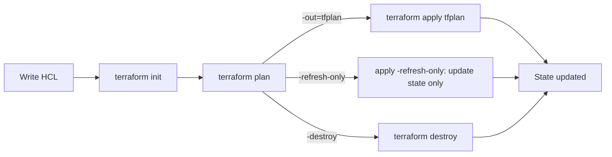

# Objective 1: Manage Resource Lifecycle

This note covers objective 1 of the HashiCorp Certified: Terraform Authoring and Operations Advanced exam: running `init`, `plan`, `apply` and `destroy` with the right options, and managing state, including imports and drift. It is the most hands-on objective. In the labs you are graded on what is left behind - the configuration, the state file and the settings on the provisioned resources - not on the commands you typed. So you need to know which option produces which end state, and you need to be able to check that end state yourself before you move on.

The exam tests **Terraform 1.6**. Several features you will read about online arrived later. This note flags them as "newer than the tested version". You can still learn them for your day job, but do not build a lab answer that depends on them.

**[📖 Terraform Authoring and Operations Advanced objectives](https://developer.hashicorp.com/terraform/tutorials/pro-cert/adv-review)** - the official objective list this note follows

## How the lifecycle fits together

The diagram below shows the normal path a configuration takes, plus the two side paths (refresh-only and destroy) that the exam likes to probe.



Every arrow ends in state. That is the thread through the whole objective: init prepares the working directory and connects it to the state, plan compares configuration with state and with the real world, and apply and destroy change the real world and then record the result in state.

## 1a. Initialize a configuration with terraform init

`terraform init` prepares a working directory. It does four jobs, in this order:

1. **Backend.** It reads the `backend` block (or the `cloud` block) and connects to where state lives. If the backend changed since the last init, it stops and asks what to do with the existing state.
2. **Modules.** It downloads every module called by the configuration into `.terraform/modules`.
3. **Providers.** It works out which provider versions satisfy every version constraint in the root module and all child modules, then installs them into `.terraform/providers`.
4. **Lock file.** It writes or checks `.terraform.lock.hcl`, which records the exact provider versions and their checksums.

You must re-run init whenever you add or change a module source or version, add a provider, change a provider version constraint, or change the backend configuration. A common lab failure is editing a backend block and then running `plan`, which fails with "Backend initialization required".

The options that matter:

| Option | What it does | When you use it |
|---|---|---|
| `-upgrade` | Ignores the versions in the lock file and picks the newest provider (and module) versions that still match the constraints, then rewrites the lock file | You loosened or raised a version constraint, or you deliberately want the newest patch |
| `-reconfigure` | Uses the new backend configuration and ignores the saved one. Does **not** copy state | You are pointing at a different backend on purpose and do not want the old state brought along |
| `-migrate-state` | Detects a backend change and copies existing state into the new backend | Moving from local to S3, from S3 to HCP Terraform, and so on |
| `-force-copy` | Answers "yes" to the migration prompt | Migration in automation |
| `-backend-config=...` | Supplies backend settings from a file or as `key=value` | Partial backend configuration, per-environment backends, keeping secrets out of HCL |
| `-backend=false` | Skips backend setup | Validating a module in CI with no state access |
| `-get=false` | Skips module download | Rare; modules already present |
| `-input=false` | Never prompts; fails instead | Every automated pipeline |
| `-lock=false`, `-lock-timeout=60s` | Controls state locking during init | Waiting out a short-lived lock in CI |
| `-lockfile=readonly` | Refuses to change the lock file; fails if it would need to | CI that must use exactly what was committed |
| `-plugin-dir=PATH` | Installs providers only from a local directory | Air-gapped environments |
| `-from-module=SOURCE` | Copies a module into an empty directory first | Bootstrapping from an example |

### Partial backend configuration

A backend block can leave settings out and have them supplied at init. This is how one configuration serves several environments without copying the `terraform {}` block, and how you keep access keys out of version control.

```hcl
terraform {
  backend "s3" {
    key = "network/terraform.tfstate"
    # bucket, region and dynamodb_table come from -backend-config
  }
}
```

```bash
# from a file (the .tfbackend extension is the convention)
terraform init -backend-config=prod.s3.tfbackend

# or key=value pairs
terraform init \
  -backend-config="bucket=acme-tfstate-prod" \
  -backend-config="region=us-east-1" \
  -backend-config="dynamodb_table=tf-locks"
```

Backend blocks cannot use variables or locals. That restriction is exactly why partial configuration exists, and the exam can test it: if a task asks you to make a backend environment-specific, the answer is `-backend-config`, not `var.bucket`.

### -reconfigure versus -migrate-state

These two are the classic trap. Both are answers to "the backend changed". `-migrate-state` keeps your state by copying it across. `-reconfigure` throws away the link to the old backend and starts against the new one as-is. If the new backend is empty and you use `-reconfigure`, Terraform will believe nothing exists and the next plan will propose creating everything again. Use `-reconfigure` only when the new backend already holds the right state, or when you really do want a fresh start.

```bash
# local state -> S3, keeping everything
terraform state pull > backup.tfstate   # always take a backup first
# edit the backend block, then:
terraform init -migrate-state
terraform plan                          # must show: No changes
```

## 1b. Generate an execution plan with terraform plan

`terraform plan` does three things. It **refreshes**: it asks each provider for the current real-world values of every resource in state. It **compares** configuration with that refreshed state. It **proposes** a set of actions to make the real world match the configuration. Nothing changes during a plan, except that a refresh can be recorded if you later apply it.

Reading the plan output quickly is a real exam skill:

| Symbol | Meaning |
|---|---|
| `+` | create |
| `-` | destroy |
| `~` | update in place |
| `-/+` | destroy then create (replacement) |
| `+/-` | create then destroy (replacement with `create_before_destroy`) |
| `<=` | read a data source during apply |

A line marked `# forces replacement` tells you which argument caused a `-/+`. If a task says "change X without replacing the resource", that note is what you check.

### Plan modes

There are three planning modes, and they are mutually exclusive:

- **Normal** (default): make the real world match the configuration.
- **Destroy** (`-destroy`): propose destroying everything this configuration manages.
- **Refresh-only** (`-refresh-only`): do not propose any infrastructure changes; only show how state would be updated to match the real world. This is the drift-detection mode, covered under 1e.

### The options that matter

```bash
terraform plan -out=tfplan                     # save the plan for a later apply
terraform plan -var-file=prod.tfvars -var="instance_count=3"
terraform plan -replace=aws_instance.web       # plan a forced replacement
terraform plan -target=module.network          # limit the plan to part of the graph
terraform plan -refresh=false                  # skip the refresh (faster, less safe)
terraform plan -refresh-only                   # drift report only
terraform plan -destroy -out=destroy.tfplan    # reviewable destroy
terraform plan -detailed-exitcode              # exit 0 = no changes, 1 = error, 2 = changes
terraform plan -generate-config-out=generated.tf   # with import blocks, 1.5 and later
terraform plan -parallelism=5 -lock-timeout=120s -input=false
```

**`-out`** is what makes a plan an artifact. A saved plan records exactly which actions will happen. You can inspect it with `terraform show tfplan` or `terraform show -json tfplan`, and the JSON form is what policy tools read. A saved plan is tied to the state it was made from. If the state changes before you apply it, apply refuses with a "saved plan is stale" error, and you must plan again.

**`-replace=ADDRESS`** replaces `terraform taint`. Taint wrote a mark into state before you had seen a plan. `-replace` shows the replacement in the plan so you can review it first. You can pass `-replace` more than once. On the exam, if you are asked to force the recreation of one resource, `-replace` is the modern answer; `taint` still exists but is deprecated.

**`-target=ADDRESS`** restricts the plan to that resource and whatever it depends on. HashiCorp's own docs describe it as for exceptional circumstances only, such as recovering from a mistake or working around a provider limit. It leaves the rest of the configuration un-reconciled, and Terraform prints a warning that the plan is incomplete. Use it only when a task explicitly asks.

**`-refresh=false`** skips asking providers for current values. It is faster but the plan is based on whatever state last recorded, so drift will be invisible. Do not combine it with `-refresh-only` - they contradict each other.

**`-var` and `-var-file`** set input variables. Precedence, lowest to highest: environment variables `TF_VAR_name`, then `terraform.tfvars`, then `terraform.tfvars.json`, then `*.auto.tfvars` files in lexical order, then `-var` and `-var-file` in the order given on the command line. The later one wins.

## 1c. Apply configuration changes with terraform apply

`terraform apply` has two forms:

- **Without a plan file**, it runs a fresh plan, shows it, and asks for confirmation. It accepts the same planning options as `plan` (`-var`, `-target`, `-replace`, `-refresh-only`, `-destroy`).
- **With a plan file** (`terraform apply tfplan`), it applies exactly what was saved and does not prompt. Planning options are not allowed in this form, because the plan already decided everything.

```bash
# two-step, reviewable (the CI pattern)
terraform plan -input=false -out=tfplan
terraform show tfplan
terraform apply -input=false tfplan

# one-step for a sandbox
terraform apply -auto-approve

# force one replacement
terraform apply -replace=aws_instance.web

# accept drift into state without touching infrastructure
terraform apply -refresh-only -auto-approve
```

Other options worth knowing:

- `-auto-approve` skips the prompt. Fine in a lab when you have already reviewed a plan; dangerous in production without a saved plan.
- `-parallelism=N` limits how many resource operations run at once (default 10). Lower it when a provider is hitting API rate limits.
- `-lock-timeout=DURATION` waits for a state lock instead of failing at once.
- `-compact-warnings` and `-json` change output format; `-json` implies no prompting, so it needs `-auto-approve` or a plan file.
- `-input=false` makes a missing variable an error rather than a prompt.

If an apply fails halfway, Terraform still writes to state every change that did succeed. Re-running plan shows only what is left. Resources that were created but then failed a later step (for example a provisioner) are marked tainted and will be replaced on the next apply.

## 1d. Destroy resources with terraform destroy

`terraform destroy` is a shortcut for `terraform apply -destroy`. It plans the removal of every resource this configuration manages and asks for confirmation. Terraform destroys in reverse dependency order, so a subnet goes before its VPC.

```bash
terraform destroy                       # everything, with prompt
terraform destroy -auto-approve
terraform destroy -target=aws_instance.web   # one resource and its dependents
terraform plan -destroy -out=destroy.tfplan  # reviewable destroy
terraform apply destroy.tfplan
```

Things the exam probes:

- **Removing a resource block from configuration also destroys it** on the next apply. That is often the intended way to remove one resource. `terraform destroy -target` does the same thing immediately but leaves your configuration out of step with reality until you also delete the block.
- **`lifecycle { prevent_destroy = true }`** makes any plan that would destroy that resource fail with an error, including `terraform destroy`. To destroy it you must first remove the setting. It does not protect against someone deleting the resource block along with the lifecycle block.
- **Forgetting without destroying** is a different operation: `terraform state rm`, or a `removed` block (newer than the tested version), covered in 1e.
- **Destroy-time provisioners** (`when = destroy`) run before the resource is destroyed, and only if the block is still in configuration.
- Data sources are not destroyed. They are only read.

## 1e. Manage resource state, imports and drift

State maps each resource address in your configuration to a real object, and records the attribute values Terraform last saw. Everything in this section is about keeping that map correct.

### Inspecting state

```bash
terraform state list                          # every address
terraform state list module.network           # filter by prefix
terraform state show 'aws_subnet.private["a"]'
terraform show                                # whole state, human readable
terraform show -json | jq '.values.root_module.resources[].address'
terraform output                              # root outputs
terraform output -raw db_endpoint
terraform output -json
```

Quote addresses that contain brackets and quotes in your shell, or the shell eats the quotes.

### Changing addresses: state mv and moved blocks

When you rename a resource, move it into a module, or switch from `count` to `for_each`, the address changes. Without help, Terraform sees one address disappear (destroy) and another appear (create). There are two ways to tell it the object simply moved:

```hcl
# Declarative (Terraform 1.1 and later) - reviewable and works in HCP Terraform
moved {
  from = aws_instance.web
  to   = aws_instance.app
}

moved {
  from = aws_iam_user.users[0]
  to   = aws_iam_user.users["alice"]
}
```

```bash
# Imperative - changes state immediately, nothing to review
terraform state mv aws_instance.web aws_instance.app
terraform state mv 'aws_iam_user.users[0]' 'aws_iam_user.users["alice"]'
```

Prefer `moved` blocks. They show up in the plan as "has moved to", they work for anyone who runs the configuration later (including HCP Terraform runs where you have no CLI access to state), and module consumers get the move automatically. Use `state mv` when you are moving objects between two different state files (`-state` and `-state-out` on local state), or when a task specifically asks for it. Moving across modules and refactoring modules is covered in more depth in [note 04](./04-modules.md).

### Forgetting: state rm (and removed blocks, newer)

`terraform state rm ADDRESS` deletes the address from state. The real object is **not** destroyed; Terraform simply stops managing it. If you leave the resource block in configuration, the next plan will try to create a new one, so in practice you remove the block in the same change.

The declarative version is the `removed` block with `lifecycle { destroy = false }`. **`removed` blocks arrived in Terraform 1.7, which is newer than the tested version.** On a 1.6 lab, use `terraform state rm`.

### Importing existing resources

Import brings an object that already exists into state, so Terraform manages it from now on. There are two ways in 1.6.

The **CLI command** imports one object immediately. You must write the resource block first, and nothing is reviewable:

```bash
terraform import aws_vpc.prod vpc-0abc1234
terraform import 'aws_subnet.private["a"]' subnet-0aaa
terraform import module.network.aws_vpc.this vpc-0abc1234
```

The **import block** (Terraform 1.5 and later) is declarative. Import happens as part of plan and apply, so you see it in the plan before anything is written to state:

```hcl
import {
  to = aws_vpc.prod
  id = "vpc-0abc1234"
}

resource "aws_vpc" "prod" {
  cidr_block = "10.0.0.0/16"
}
```

If you do not want to write the resource block by hand, leave it out and ask Terraform to generate it:

```bash
terraform plan -generate-config-out=generated.tf
```

Terraform writes HCL for every import block whose target has no resource block. In 1.5 and 1.6 this was marked experimental. The output usually needs tidying: it includes every attribute, sometimes conflicting ones, and hard-coded values you will want to replace with references. After tidying, run `terraform plan` again and aim for "1 to import, 0 to add, 0 to change, 0 to destroy".

Details to remember for 1.6:

- In 1.6 the `id` must be a literal string or an expression known at plan time, and each import block imports one object. **`for_each` inside an import block arrived in 1.7, which is newer than the tested version.**
- Import blocks only work in the root module, but `to` can point into a child module (`to = module.network.aws_vpc.this`).
- After a successful import you can delete the import block, or leave it; it has no further effect.
- Every resource type documents its import ID format at the bottom of its provider docs page. In the exam you have the provider docs, so look it up rather than guess.

### Reconciling drift

Drift is when the real object no longer matches what state recorded, usually because someone changed it outside Terraform. A normal plan refreshes first, sees the difference, and proposes changing the object back to match the configuration. Sometimes that is what you want. Sometimes the change outside Terraform was correct and should be kept.

The tool for looking before you decide is refresh-only mode:

```bash
terraform plan -refresh-only      # show what changed outside Terraform
terraform apply -refresh-only     # write those real values into state, change nothing
```

After that there are three possible decisions:

1. **Revert the drift.** Run a normal plan and apply. Terraform puts the object back to what the configuration says.
2. **Keep the drift.** Update the configuration so it matches the new real values, then plan should show no changes. Applying `-refresh-only` alone only updates state; the next normal plan would still revert the object unless the configuration also changed.
3. **Ignore that attribute for good.** Add `lifecycle { ignore_changes = [tags["LastScanned"]] }` when another system legitimately manages that value.

Objects deleted outside Terraform show up in a refresh-only plan as removed from state; a normal plan proposes creating them again.

### Locks, backups and the dangerous commands

```bash
terraform force-unlock LOCK_ID         # release a stale lock
terraform state pull > backup.tfstate  # raw copy of current remote state
terraform state push fixed.tfstate     # overwrite remote state (dangerous)
terraform state replace-provider hashicorp/aws registry.acme.com/acme/aws
```

`force-unlock` only removes the lock record; it does not stop a running operation. Before you use it, confirm the run that took the lock is really dead. `state push` refuses if the lineage differs or the serial is lower than the remote one, unless you add `-force`; treat `-force` as a last resort. `replace-provider` rewrites which provider manages resources, used after a provider moves namespace or you switch to a fork.

## Exam traps

- `-reconfigure` does not copy state. If the task says "keep the existing state", the answer is `-migrate-state`.
- Backend blocks cannot reference variables. Per-environment backends use `-backend-config`.
- `terraform apply tfplan` cannot take `-var`, `-target` or `-replace`. Those go on the plan.
- `-replace` replaced `taint`. `-refresh-only` replaced `terraform refresh` as the safe way to update state.
- `terraform state rm` and removing a resource block are opposites: one forgets and keeps the object, the other destroys it.
- `removed` blocks and `for_each` on import blocks are 1.7 features, newer than the tested version.
- Lab grading reads the final state. After every task, run `terraform plan` and make sure it says "No changes" unless the task wants pending changes.

## Key terms

- **terraform init -migrate-state** - Re-initializes after a backend change and copies the existing state into the new backend.
- **terraform init -reconfigure** - Uses the new backend configuration and ignores the saved one without copying any state across.
- **terraform init -upgrade** - Ignores the versions recorded in the lock file and selects the newest providers and modules that match the constraints.
- **Partial backend configuration** - Leaving backend settings out of the backend block and supplying them at init with -backend-config, because backend blocks cannot use variables.
- **terraform plan -out** - Saves the proposed actions to a plan file that terraform apply can later execute exactly, without prompting.
- **Refresh-only mode** - Plan or apply with -refresh-only, which updates state to match real infrastructure without proposing any infrastructure changes.
- **-replace** - Plan or apply option that forces replacement of one resource instance; the reviewable successor to terraform taint.
- **-target** - Option that limits planning to one resource or module and its dependencies; intended only for exceptional recovery situations.
- **terraform destroy** - Shortcut for terraform apply -destroy, which plans and executes removal of every resource the configuration manages.
- **terraform state rm** - Removes an address from state so Terraform stops managing the object, without destroying the real resource.
- **import block** - Declarative import (Terraform 1.5 and later) that brings an existing object into state as part of plan and apply.
- **-generate-config-out** - Plan option that writes HCL for import blocks whose target has no resource block yet; experimental in 1.5 and 1.6.
- **moved block** - Declarative record that a resource or module changed address, so Terraform updates state instead of destroying and recreating.
- **terraform force-unlock** - Removes a stale state lock by ID; it does not stop a running operation, so confirm the lock holder is dead first.

## Vendor docs

- **[📖 Command: init](https://developer.hashicorp.com/terraform/cli/commands/init)** - every init option, including backend migration
- **[📖 Command: plan](https://developer.hashicorp.com/terraform/cli/commands/plan)** - planning modes and options
- **[📖 Command: apply](https://developer.hashicorp.com/terraform/cli/commands/apply)** - automatic and saved-plan modes
- **[📖 Command: destroy](https://developer.hashicorp.com/terraform/cli/commands/destroy)** - destroy as an alias for `apply -destroy`
- **[📖 Import](https://developer.hashicorp.com/terraform/language/import)** - import blocks and config generation
- **[📖 Command: import](https://developer.hashicorp.com/terraform/cli/commands/import)** - the CLI import command
- **[📖 Refactoring with moved blocks](https://developer.hashicorp.com/terraform/language/modules/develop/refactoring)** - how `moved` blocks work
- **[📖 Command: state](https://developer.hashicorp.com/terraform/cli/commands/state)** - the state subcommands
- **[📖 Manage resource drift](https://developer.hashicorp.com/terraform/tutorials/state/resource-drift)** - tutorial on refresh-only workflows
