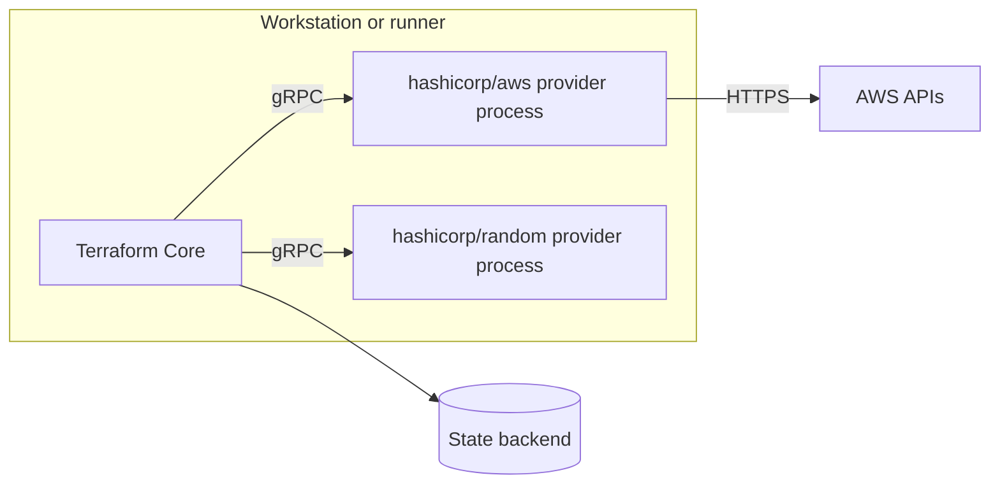

# Objective 5: Configure and Use Terraform Providers

This note covers objective 5 of the HashiCorp Certified: Terraform Authoring and Operations Advanced exam. Providers are the plugins that let Terraform talk to an API. The exam expects you to understand how Terraform loads them (5a), configure them precisely, including several configurations of one provider, and upgrade them safely (5b), give them credentials without leaking secrets (5c), and diagnose them when they fail (5d). You will sit either the AWS or the Azure version of the exam, so be fluent with that provider's authentication options.

The tested version is **Terraform 1.6**. Anything later is flagged as "newer than the tested version".

**[📖 Terraform Authoring and Operations Advanced objectives](https://developer.hashicorp.com/terraform/tutorials/pro-cert/adv-review)** - the official objective list this note follows

## 5a. Understand Terraform's plugin-based architecture

Terraform is split into two parts.

- **Terraform Core** is the `terraform` binary. It reads configuration, builds the dependency graph, manages state, computes plans and walks the graph during apply. It knows nothing about AWS, Azure or any other API.
- **Providers** are separate executables, one per provider and version. Each one knows the resource types and data sources for one API, validates their arguments, and makes the API calls.

Core starts each provider as a **child process** and talks to it over **gRPC** using the Terraform plugin protocol. For every resource, Core asks the provider to validate the configuration, plan the change (the provider decides what is an in-place update and what forces replacement), and apply it. That separation is why providers can be released independently of Terraform, and why a provider bug shows up as a provider error, not a Terraform one.



The diagram shows Core coordinating everything and talking only to the backend and to provider processes; only the providers call the cloud APIs.

### Where providers come from

During `terraform init`, Core reads every `required_providers` block, chooses a version satisfying all constraints and the lock file, and installs the package into `.terraform/providers/<hostname>/<namespace>/<type>/<version>/<os_arch>/`.

- By default it downloads from the **public Terraform Registry** (`registry.terraform.io`). Registry providers are labelled by tier: **official** (owned by HashiCorp, namespace `hashicorp`), **partner** (owned by a technology partner and reviewed by HashiCorp) and **community**.
- A private registry (for example in HCP Terraform) uses its own hostname in the source address.
- In restricted networks, the CLI configuration file (`~/.terraformrc`, or `terraform.rc` on Windows) can set a `provider_installation` block with a `filesystem_mirror` or `network_mirror`, and `terraform providers mirror <dir>` fills a mirror directory. `terraform init -plugin-dir=<dir>` installs only from a local directory.
- `TF_PLUGIN_CACHE_DIR` (or `plugin_cache_dir` in the CLI config) shares one download across many working directories.

Useful inspection commands:

```bash
terraform providers                 # tree of which module requires which provider and constraint
terraform version                   # Core version and installed provider versions
terraform providers schema -json    # full resource/data source schemas
terraform providers lock -platform=linux_amd64 -platform=darwin_arm64
terraform providers mirror ./mirror
```

## 5b. Configure providers: aliasing, versioning, sourcing and upgrades

### Source addresses and local names

Every provider has a **source address** of the form `[HOSTNAME/]NAMESPACE/TYPE`. The hostname defaults to `registry.terraform.io`, so `hashicorp/aws` means `registry.terraform.io/hashicorp/aws`. Inside a module you refer to it by a **local name**, the key in `required_providers`:

```hcl
terraform {
  required_providers {
    aws = {
      source  = "hashicorp/aws"
      version = "~> 5.30"
    }
    azurerm = {
      source  = "hashicorp/azurerm"
      version = "~> 3.80"
    }
    acme = {
      source  = "app.terraform.io/acme-corp/acme"   # private registry
      version = ">= 1.0"
    }
  }
}
```

Always declare `required_providers` with a `source`. If you omit it, Terraform assumes `hashicorp/<name>`, which is wrong for any partner or community provider and is a common cause of "provider not found" errors after someone forked a provider.

### Provider configuration and aliases

A `provider` block configures one instance of a provider. The first block without `alias` is the **default** configuration; resources whose type starts with that local name use it automatically. Additional configurations need an `alias`, and resources opt in with the `provider` meta-argument:

```hcl
provider "aws" {
  region = "us-east-1"
  default_tags {
    tags = { ManagedBy = "terraform" }
  }
}

provider "aws" {
  alias  = "dr"
  region = "us-west-2"
}

provider "aws" {
  alias  = "shared_services"
  region = "us-east-1"
  assume_role {
    role_arn = "arn:aws:iam::222222222222:role/terraform"
  }
}

resource "aws_s3_bucket" "primary" {
  bucket = "acme-data-primary"
}

resource "aws_s3_bucket" "replica" {
  provider = aws.dr
  bucket   = "acme-data-replica"
}

data "aws_route53_zone" "corp" {
  provider = aws.shared_services
  name     = "corp.acme.com"
}
```

For Azure, the same idea applies to subscriptions:

```hcl
provider "azurerm" {
  features {}                      # required, even if empty
  subscription_id = var.app_subscription_id
}

provider "azurerm" {
  alias           = "connectivity"
  features {}
  subscription_id = var.hub_subscription_id
}
```

### Passing providers to modules

Child modules inherit the **default** configuration of each provider automatically. Aliased configurations are never inherited; you pass them explicitly with the `providers` map, and the module declares that it expects them with `configuration_aliases`:

```hcl
# root
module "replicated_bucket" {
  source = "./modules/replicated-bucket"
  providers = {
    aws         = aws          # default for the module
    aws.replica = aws.dr       # the module's "replica" alias
  }
}

# modules/replicated-bucket/versions.tf
terraform {
  required_providers {
    aws = {
      source                = "hashicorp/aws"
      version               = ">= 5.0"
      configuration_aliases = [aws.replica]
    }
  }
}

# modules/replicated-bucket/main.tf
resource "aws_s3_bucket" "replica" {
  provider = aws.replica
  bucket   = "${var.name}-replica"
}
```

Provider configurations must be known at plan time and are static. You cannot choose a provider with a variable (`provider = "aws.${var.region}"` is invalid), and you cannot create provider configurations with `for_each` in Terraform 1.6.

### Removing a provider configuration

If you delete a provider block (or a module that used it) while resources created with it are still in state, the plan fails because Terraform needs that configuration to destroy them. Destroy or move those resources first, then remove the provider block.

### Upgrading providers

1. Read the provider's changelog and, for a major version, its upgrade guide (for example "AWS Provider Version 5 Upgrade Guide").
2. Raise the constraint in `required_providers` if needed.
3. Run `terraform init -upgrade`. This is the only way the lock file moves to a newer version.
4. Run `terraform plan`. Fix deprecation warnings and errors from renamed or removed arguments. A clean upgrade ends with "No changes".
5. Commit both the configuration and `.terraform.lock.hcl`.

Major provider upgrades can rename resources or change how state is stored; the provider performs state upgrades automatically the first time it reads old state (the `schema_version` in state). After that, older provider versions may not understand the state, so treat a major upgrade as one-way.

If a provider moves namespace (or you switch to a fork), update the `source`, then run `terraform state replace-provider registry.terraform.io/oldns/x registry.terraform.io/newns/x` so existing resources are associated with the new address.

## 5c. Manage provider authentication

The rule: **credentials never go in `.tf` files**. Provider blocks can accept keys as arguments, but those end up in version control and in plan files. Use the provider's own environment variables, the platform's identity, or short-lived federated credentials.

### AWS provider

The AWS provider looks for credentials in this order (simplified): arguments in the provider block, environment variables, shared credentials and config files, then container and instance roles.

| Method | How | Notes |
|---|---|---|
| Environment variables | `AWS_ACCESS_KEY_ID`, `AWS_SECRET_ACCESS_KEY`, `AWS_SESSION_TOKEN`, `AWS_REGION` | Simple, common in CI; keys are long-lived unless from STS |
| Named profile | `AWS_PROFILE=prod` or `profile = "prod"` | Shared config file, supports SSO and role chaining |
| Assume role | `assume_role { role_arn = "..." }` in the provider block | Cross-account access from one base identity |
| Web identity (OIDC) | `assume_role_with_web_identity { ... }` or `AWS_ROLE_ARN` + `AWS_WEB_IDENTITY_TOKEN_FILE` | CI systems such as GitHub Actions; no stored secret |
| Instance profile / ECS task role | Nothing to configure | When Terraform runs on AWS compute |

### azurerm provider

| Method | How | Notes |
|---|---|---|
| Azure CLI | `az login` | Default for local work; not for automation |
| Service principal with secret | `ARM_CLIENT_ID`, `ARM_CLIENT_SECRET`, `ARM_TENANT_ID`, `ARM_SUBSCRIPTION_ID` | Long-lived secret; rotate it |
| Service principal with certificate | `ARM_CLIENT_CERTIFICATE_PATH` plus the IDs | Stronger than a secret |
| Managed identity | `ARM_USE_MSI=true` (or `use_msi = true`) | When Terraform runs on Azure compute |
| OIDC | `ARM_USE_OIDC=true` plus client and tenant IDs | Federated credentials from CI; no stored secret |

### Short-lived over long-lived

The trend the exam reflects is away from static keys towards **workload identity**: the CI system or HCP Terraform proves who it is with an OIDC token and the cloud issues credentials that last for one run. In HCP Terraform this is called **dynamic provider credentials** and is configured with workspace environment variables such as `TFC_AWS_PROVIDER_AUTH` and `TFC_AWS_RUN_ROLE_ARN` (details in [note 06](./06-hcp-terraform.md)). When you use dynamic credentials, do not also configure static credentials or other auth arguments for that provider; HashiCorp warns they can interfere.

Each aliased provider configuration can authenticate differently, for example the default one with the pipeline's own role and an alias with `assume_role` into another account.

## 5d. Troubleshoot provider errors

### Logging

```bash
export TF_LOG=DEBUG              # TRACE, DEBUG, INFO, WARN, ERROR, or JSON
export TF_LOG_PATH=./terraform.log
export TF_LOG_CORE=ERROR         # Core only
export TF_LOG_PROVIDER=TRACE     # providers only
terraform plan
```

`TF_LOG` turns on logging for everything. `TF_LOG_CORE` and `TF_LOG_PROVIDER` take the same levels but enable only Terraform's own logs or only the providers' logs, which is what you want when you are chasing an API call. `TRACE` is the most verbose; `JSON` gives TRACE-level output as JSON lines. `TF_LOG_PATH` appends logs to a file instead of stderr. At DEBUG or TRACE, the AWS and azurerm providers log the HTTP requests and responses they make, so you can see the exact API call and error code. Unset the variables afterwards; logs can contain sensitive data.

### Reading the error

Provider errors usually say which resource, which provider, and the underlying API response. Sort the problem into one of these groups:

| Symptom | Likely cause | Fix |
|---|---|---|
| "Failed to query available provider packages" / "provider registry.terraform.io/hashicorp/x not found" | Wrong or missing `source`, typo, no network to the registry | Correct `required_providers`; configure a mirror for air-gapped runs |
| "no available releases match the given constraints" | Two modules have incompatible constraints, or the lock file pins a version outside a new constraint | `terraform providers` to see who requires what; loosen a constraint; `init -upgrade` |
| "the cached package ... does not match any of the checksums recorded in the dependency lock file" | Lock file built on another OS/arch | `terraform providers lock -platform=...` for every platform; commit |
| "Inconsistent dependency lock file" | Constraint changed but lock file not updated | `terraform init -upgrade` |
| "No valid credential sources found" / "NoCredentialProviders" (AWS), "building AzureRM Client" / "Authenticating using the Azure CLI is only supported as a User" (Azure) | Provider has no usable credentials | Check environment variables, profile, OIDC settings |
| `AccessDenied`, `UnauthorizedOperation`, `AuthorizationFailed` (403) | Credentials work but lack permission | Fix IAM or RBAC, not Terraform |
| `Throttling`, `TooManyRequests` (429) | API rate limits | Lower `-parallelism`; providers retry, and some expose `max_retries` |
| "Provider produced inconsistent result after apply" / "inconsistent final plan" | Provider bug or an attribute normalized by the API | Upgrade the provider, report it; sometimes `ignore_changes` as a workaround |
| "Plugin did not respond" / provider crashed with a panic stack | Provider crash | Check the log for the panic, upgrade, report |
| "Invalid provider configuration" / "Provider configuration not present" | Resources in state reference a provider configuration that was removed | Restore the provider block or alias until those resources are gone |

Two quick sanity checks before diving into logs: `terraform version` (are the expected provider versions installed?) and `terraform providers` (does the configuration require what you think?). Then run `terraform validate`, which catches argument errors from the provider schema without calling any API.

## Exam traps

- Aliased providers are never inherited by modules; pass them with `providers = { ... }` and declare `configuration_aliases`.
- Omitting `source` means `hashicorp/<name>`.
- `provider` arguments and the `providers` map are static; no variables, no `for_each` over providers in 1.6.
- `terraform init -upgrade` is required to move a locked provider version.
- `TF_LOG_PROVIDER` narrows logs to providers; there is no documented per-provider-name log variable.
- Never put access keys in provider blocks; use environment variables, roles, or dynamic credentials.
- `azurerm` requires a `features {}` block.

## Key terms

- **Terraform Core** - The terraform binary that reads configuration, builds the graph, manages state and drives providers, without knowing any cloud API.
- **Provider plugin** - Separate executable that Core runs as a child process and calls over gRPC to validate, plan and apply resources for one API.
- **Provider source address** - Global provider identifier in the form hostname/namespace/type, where the hostname defaults to registry.terraform.io.
- **required_providers** - terraform block setting that maps local provider names to source addresses and version constraints.
- **Provider alias** - Additional named configuration of a provider, selected with provider = NAME.ALIAS on resources, data sources and modules.
- **providers map** - Module block argument that passes specific provider configurations, including aliases, from the caller to a child module.
- **Registry tiers** - Terraform Registry labels for providers: official (HashiCorp-owned), partner (partner-owned, reviewed) and community.
- **Provider mirror** - Local filesystem or network copy of provider packages, configured in the CLI config file for restricted networks.
- **terraform state replace-provider** - Command that reassigns resources in state from one provider source address to another, for example after a namespace move.
- **TF_LOG** - Environment variable enabling logs at TRACE, DEBUG, INFO, WARN, ERROR or JSON; TF_LOG_PATH writes them to a file.
- **TF_LOG_PROVIDER** - Environment variable that enables logging for provider plugins only, at the same levels as TF_LOG.
- **TF_LOG_CORE** - Environment variable that enables logging for Terraform Core only, at the same levels as TF_LOG.

## Vendor docs

- **[📖 Plugin development: how Terraform works with plugins](https://developer.hashicorp.com/terraform/plugin/how-terraform-works)** - Core and provider responsibilities and the plugin protocol
- **[📖 Providers](https://developer.hashicorp.com/terraform/language/providers)** - what providers are and the registry tiers
- **[📖 Provider requirements](https://developer.hashicorp.com/terraform/language/providers/requirements)** - `required_providers`, source addresses and local names
- **[📖 Provider configuration](https://developer.hashicorp.com/terraform/language/providers/configuration)** - provider blocks and `alias`
- **[📖 Providers within modules](https://developer.hashicorp.com/terraform/language/modules/develop/providers)** - passing providers and `configuration_aliases`
- **[📖 CLI configuration file](https://developer.hashicorp.com/terraform/cli/config/config-file)** - provider installation, mirrors and plugin cache
- **[📖 Debugging Terraform](https://developer.hashicorp.com/terraform/internals/debugging)** - TF_LOG and related variables
- **[📖 AWS provider authentication](https://registry.terraform.io/providers/hashicorp/aws/latest/docs#authentication-and-configuration)** - credential sources and precedence
- **[📖 azurerm provider authentication](https://registry.terraform.io/providers/hashicorp/azurerm/latest/docs#authenticating-to-azure)** - CLI, service principal, managed identity and OIDC
