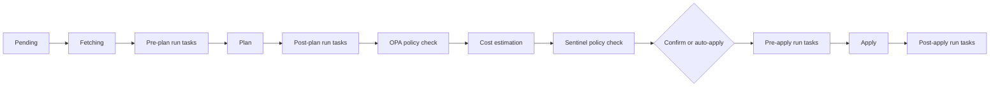

# Objective 6: Collaborate on Infrastructure as Code Using HCP Terraform

This note covers objective 6 of the HashiCorp Certified: Terraform Authoring and Operations Advanced exam. HCP Terraform (formerly Terraform Cloud; Terraform Enterprise is the self-hosted edition of the same product) adds a shared place to run Terraform, store state, hold variables and credentials, control who can do what, and enforce policy. **HashiCorp tests this objective with multiple-choice questions only**, not labs. So the goal is understanding: which stage of a run does what, which setting controls which behaviour, and which governance feature fits which requirement.

HCP Terraform's plan names and which features each plan includes have changed several times. This note does not tie features to tiers; check the current pricing page if you need that, and do not expect the exam to hinge on it.

**[📖 Terraform Authoring and Operations Advanced objectives](https://developer.hashicorp.com/terraform/tutorials/pro-cert/adv-review)** - the official objective list this note follows

## 6a. Analyze the HCP Terraform run workflow

A **run** is one plan, and optionally one apply, in a workspace. Runs in a workspace are queued and processed one at a time, which is how HCP Terraform avoids two applies racing on the same state.

### Three ways to start a run

| Workflow | How runs start | Typical use |
|---|---|---|
| **VCS-driven (UI/VCS)** | A push to the workspace's tracked branch starts a run; a pull request starts a **speculative plan** | Teams that review infrastructure changes as pull requests |
| **CLI-driven** | `terraform plan` / `terraform apply` on a workstation or CI runner with a `cloud` block; the run executes remotely and streams output back | Developers iterating; existing CI pipelines |
| **API-driven** | A tool uploads a configuration version and creates a run through the API | Custom orchestration and platforms |

A **speculative plan** is a plan-only run. It cannot be applied, it does not lock the workspace, and it does not show in the run queue the same way as normal runs. HCP Terraform posts its result back to the pull request as a status check. `terraform plan` from the CLI against a remote workspace is also speculative unless you save it.

### Run stages, in order



The diagram shows the order of stages documented by HashiCorp; stages that are not configured are skipped.

1. **Pending**: waiting in the workspace queue.
2. **Fetching**: retrieving the configuration from VCS (VCS-driven runs).
3. **Pre-plan**: run tasks configured for this stage.
4. **Plan**: `terraform plan`. If there are no changes, the run ends here.
5. **Post-plan**: run tasks that inspect the plan (security scanners, for example).
6. **OPA policy check**: Open Policy Agent policies, evaluated after the plan and before cost estimation.
7. **Cost estimation**: the estimated monthly cost change, if enabled.
8. **Sentinel policy check**: Sentinel policies, after cost estimation, so they can use the cost data.
9. **Needs confirmation**: a person with apply permission confirms, unless the workspace has **auto-apply** on. A failed soft-mandatory policy also waits here for an override.
10. **Pre-apply**: run tasks.
11. **Apply**: `terraform apply` of the saved plan.
12. **Post-apply**: run tasks.

### Run tasks

Run tasks call an external service at one of the four task stages (pre-plan, post-plan, pre-apply, post-apply). HCP Terraform sends the service a signed request with details and access to the plan; the service replies passed or failed. Each run task attached to a workspace has an **enforcement level**: **advisory** (a failure is shown but the run continues) or **mandatory** (a failure stops the run). Typical uses are security scanning, cost tools, and ticket or change-management checks.

### Run triggers

A **run trigger** connects workspaces: when a source workspace applies successfully, HCP Terraform queues a run in the connected workspace. Use it with `tfe_outputs` (see [note 03](./03-collaborative-workflows.md)) so a consumer workspace re-plans with the producer's new outputs.

### Health assessments

**Drift detection** re-runs a refresh-only plan on a schedule and reports resources that changed outside Terraform. **Continuous validation** re-evaluates `check` blocks and postconditions on the same schedule and reports failures. Both only report; they do not fix anything. Remediation is a normal run.

## 6b. Workspaces, configuration options and access management

In HCP Terraform a **workspace** is the unit of everything: one configuration, its state and state history, its variables, its run history, its settings and its permissions. Think "one workspace per configuration per environment" (for example `network-prod`, `network-staging`). This is different from CLI workspaces, which only partition state.

**Projects** group workspaces. Team access, variable sets and policy sets can be attached at project level so new workspaces in the project get them automatically.

### Workspace settings worth knowing

| Setting | What it controls |
|---|---|
| **Execution mode** | **Remote** (runs on HCP Terraform's workers), **Local** (HCP Terraform only stores state; plans and applies run wherever you run the CLI), **Agent** (runs on self-hosted HCP Terraform agents in your network, which pull work outbound, for private resources) |
| **Terraform version** | Which Core version runs execute with |
| **Apply method** | Auto-apply or manual confirmation |
| **VCS connection** | Repository, branch, **working directory** (subfolder where the configuration lives) |
| **Automatic run triggering** | Always, or only when files under specified **paths or patterns** change (useful for monorepos) |
| **Speculative plans** | Whether pull requests get plan-only runs |
| **Remote state sharing** | Which other workspaces may read this workspace's state and outputs (all in the organization or a named list) |
| **Run triggers** | Source workspaces whose applies queue runs here |
| **Notifications** | Email, Slack, Microsoft Teams or generic webhook on run events |
| **Locking** | A user can lock a workspace manually to stop new runs |

### Variables

Each workspace has two kinds of variables:

- **Terraform variables** become input variables (`var.x`). Tick **HCL** to enter a list, map or object.
- **Environment variables** are set in the run environment; this is how provider credentials and `TF_` settings are supplied.

Either kind can be marked **sensitive**: it becomes write-only in the UI and API, and is redacted from logs.

**Variable sets** are reusable groups of variables applied to the whole organization (global), to projects, or to specific workspaces. They are the standard way to share credentials or common settings. A **priority** variable set overrides everything else, including workspace variables and CLI values, which lets a platform team enforce a value.

Precedence, highest first (simplified from HashiCorp's 15-level list):

1. Priority variable sets (global first, then project-scoped, then workspace-scoped)
2. `-var` and `-var-file` on a CLI-driven run
3. Local `TF_VAR_` environment variables (CLI-driven runs)
4. Workspace-specific variables
5. Non-priority variable sets (workspace-scoped, then project-scoped, then global)
6. `*.auto.tfvars` files in the configuration
7. `terraform.tfvars` in the configuration

The pattern to remember: workspace variables beat variable sets, a narrower scope beats a wider one, and anything set in HCP Terraform beats tfvars files committed in the repository, except that priority sets beat everything.

### Access management

HCP Terraform grants permissions to **teams**, never directly to users. A user's effective permission is the sum of what all their teams grant. Organization **owners** (the `owners` team) can do everything.

- **Organization permissions** cover things that are not tied to one workspace: manage policies, manage policy overrides, manage run tasks, manage VCS settings, manage agent pools, manage private registry modules and providers, manage membership and teams, and view or manage all projects or all workspaces.
- **Project permissions** come as fixed roles **Read**, **Write**, **Maintain** and **Admin**, or **Custom**. Write is day-to-day: start, cancel and apply runs and manage variables, but not create or delete workspaces. Maintain adds creating and administering workspaces in the project. Admin adds managing the project and team access to it.
- **Workspace permissions** come as fixed roles **Read**, **Plan**, **Write** and **Admin**, or **Custom**. Plan can queue plans but not apply. Write can apply and lock. Admin can change settings, delete the workspace and manage team access.
- **Custom** roles mix individual permissions, for example "can read outputs but not full state", which is the permission `tfe_outputs` relies on.

Authentication options include SSO via SAML for the organization, and API tokens of three kinds: **user tokens** (act as a person), **team tokens** (act as a team, typical for CI), and **organization tokens** (organization management, cannot start runs).

## 6c. Manage provider credentials in HCP Terraform

Runs need cloud credentials. There are three ways to give them, from weakest to strongest.

1. **Static credentials as sensitive environment variables** (`AWS_ACCESS_KEY_ID` and `AWS_SECRET_ACCESS_KEY`, or `ARM_CLIENT_ID` and `ARM_CLIENT_SECRET`), ideally in a variable set scoped to the right project. Simple, but long-lived secrets must be rotated, and anyone with write access can use them.
2. **Agent identity**: with agent execution mode, the agent runs on your compute and can use that compute's instance role or managed identity. No secret is stored in HCP Terraform at all.
3. **Dynamic provider credentials**: HCP Terraform issues a signed OIDC token for each run phase, and the cloud exchanges it for short-lived credentials. Nothing long-lived is stored. Supported for AWS, Azure, Google Cloud, Kubernetes and Vault, and as **Vault-backed** dynamic credentials where Vault mints the cloud credentials.

### Dynamic credentials for AWS

1. In AWS, create an IAM OIDC identity provider for your HCP Terraform address (`https://app.terraform.io`) with audience `aws.workload.identity` (the default).
2. Create an IAM role that trusts that provider. Restrict the trust policy on the token's `sub` claim, which has the form `organization:ORG:project:PROJECT:workspace:WORKSPACE:run_phase:PHASE`. For example allow `organization:acme:project:networking:workspace:network-prod:run_phase:*`.
3. In the workspace or a variable set, set environment variables `TFC_AWS_PROVIDER_AUTH = true` and `TFC_AWS_RUN_ROLE_ARN = <role ARN>`. Optionally use `TFC_AWS_PLAN_ROLE_ARN` and `TFC_AWS_APPLY_ROLE_ARN` to give the plan phase a read-only role and the apply phase a write role.
4. Remove any static credentials and do not set other authentication arguments on the provider; HashiCorp warns they can interfere.

Azure follows the same pattern with `TFC_AZURE_PROVIDER_AUTH` and `TFC_AZURE_RUN_CLIENT_ID` and a federated credential on an Entra ID app registration whose subject matches the workspace and run phase. Vault uses `TFC_VAULT_PROVIDER_AUTH` with a JWT auth role.

The exam angle: dynamic credentials give per-run, per-phase, per-workspace credentials that expire, and a trust policy that limits which workspaces can assume the role. That is the answer whenever a question asks how to remove long-lived cloud keys from HCP Terraform.

## 6d. Analyze policy as code and governance features

Policies are rules evaluated against every run, before apply, so that non-compliant changes are stopped or flagged automatically. HCP Terraform supports two languages: **Sentinel** (HashiCorp's own) and **OPA** (Open Policy Agent, written in Rego).

### Policy sets

Policies are grouped into **policy sets**, each holding policies of one language. A policy set is sourced from a VCS repository, uploaded through the API, or created in the UI, and applied:

- **globally** to every workspace in the organization,
- to selected **projects**, or
- to selected **workspaces**,

with the option to **exclude** specific workspaces from a global or project set. All policy sets that apply to a workspace are evaluated on each run.

### Enforcement levels

| Language | Level | Effect on failure |
|---|---|---|
| Sentinel | `advisory` | Warning shown; run continues |
| Sentinel | `soft-mandatory` | Run stops; a user with override permission can override and continue |
| Sentinel | `hard-mandatory` | Run stops; no override by default; the code must change (current HCP Terraform docs add an option to let a policy set allow overrides, which is newer than the classic model) |
| OPA | `advisory` | Warning shown; run continues |
| OPA | `mandatory` | Run stops; can be overridden by a user with override permission |

Who can override: members of teams with the organization permission **Manage policy overrides**, organization owners, and, if the organization delegates overrides, project or workspace managers who have been granted it. Overrides are recorded in the run history. A sensible rollout is to introduce a new policy as advisory, watch what it would block, then raise it.

### Sentinel

A Sentinel policy is a file of rules; `main` decides pass or fail. It reads run data through imports: `tfplan/v2` (planned changes), `tfconfig/v2` (the configuration), `tfstate/v2` (current state) and `tfrun` (run metadata, including the cost estimate).

```python
# restrict-instance-type.sentinel
import "tfplan/v2" as tfplan

allowed_types = ["t3.micro", "t3.small", "t3.medium"]

instances = filter tfplan.resource_changes as _, rc {
  rc.type is "aws_instance" and
  rc.mode is "managed" and
  (rc.change.actions contains "create" or rc.change.actions contains "update")
}

main = rule {
  all instances as _, rc {
    rc.change.after.instance_type in allowed_types
  }
}
```

```hcl
# sentinel.hcl in the policy set
policy "restrict-instance-type" {
  source            = "./restrict-instance-type.sentinel"
  enforcement_level = "soft-mandatory"
}
```

A cost guard uses `tfrun`:

```python
import "tfrun"
import "decimal"

main = rule {
  decimal.new(tfrun.cost_estimate.delta_monthly_cost).less_than(500)
}
```

Policies are tested locally with the Sentinel CLI (`sentinel test`) against mock data. You can download Sentinel mocks generated from a real run in HCP Terraform.

### OPA

OPA policies are Rego queries over the run data (the plan JSON is under `input.plan`). In HCP Terraform each policy is declared in the policy set's `policies.hcl` with the Rego query that HCP Terraform evaluates:

```rego
package terraform.policies.public_s3

import future.keywords.in
import input.plan as tfplan

deny[msg] {
  r := tfplan.resource_changes[_]
  r.type == "aws_s3_bucket_acl"
  r.change.after.acl in ["public-read", "public-read-write"]
  msg := sprintf("%v grants public access", [r.address])
}
```

```hcl
# policies.hcl
policy "public_s3" {
  query             = "data.terraform.policies.public_s3.deny"
  enforcement_level = "mandatory"
}
```

The policy fails when the query returns a non-empty result.

### Choosing between them

Sentinel has the three-level enforcement model and the richest built-in Terraform data (including cost and run metadata through `tfrun`). OPA is a CNCF open standard, so a team already writing Rego for Kubernetes admission control can reuse its skills and tooling. Both run in the policy stages shown in 6a: OPA right after the plan, Sentinel after cost estimation.

### The wider governance toolbox

Policy as code is one control among several, and questions often ask which one fits:

| Requirement | Feature |
|---|---|
| Block non-compliant resources before apply | Sentinel or OPA policy set (mandatory) |
| Send the plan to an external scanner or ticket system | Run task (advisory or mandatory) |
| See the cost impact of a change, or cap it | Cost estimation, plus a Sentinel `tfrun` policy |
| Find changes made outside Terraform | Health assessments: drift detection |
| Keep checking that infrastructure still works | Health assessments: continuous validation of `check` blocks |
| Limit who can apply production | Team permissions at project or workspace level |
| Enforce one variable value everywhere | Priority variable set |
| Standardize what people build | Private registry modules (and no-code modules) |
| Know who did what | Audit trails and run history |

## Exam traps

- This objective is multiple-choice only; know concepts, stages and settings rather than click paths.
- OPA is evaluated before cost estimation; Sentinel after it.
- Speculative plans cannot be applied and do not lock the workspace.
- Workspace variables beat variable sets; priority variable sets beat everything, including CLI `-var`.
- Project roles are Read, Write, Maintain, Admin; workspace roles are Read, Plan, Write, Admin. Plan exists only at workspace level.
- Hard-mandatory Sentinel failures cannot be overridden by default (the classic answer). OPA has only advisory and mandatory, and mandatory behaves like soft-mandatory: overridable with Manage policy overrides.
- Run tasks and policies both have enforcement levels; run tasks call an external service, policies run inside HCP Terraform.
- Dynamic credentials need `TFC_<CLOUD>_PROVIDER_AUTH` plus a role or client ID, and a trust policy bound to the `sub` claim.

## Key terms

- **HCP Terraform workspace** - Unit holding one configuration with its state, variables, runs, settings and team access in HCP Terraform.
- **Speculative plan** - Plan-only run, for example on a pull request, that cannot be applied and does not lock the workspace.
- **Run task** - External service called at the pre-plan, post-plan, pre-apply or post-apply stage, with advisory or mandatory enforcement.
- **Run trigger** - Workspace link that queues a run in a workspace after a named source workspace applies successfully.
- **Execution mode** - Workspace setting choosing where runs execute: remote on HCP Terraform, local on your machine, or on self-hosted agents.
- **Variable set** - Reusable group of variables applied globally, to projects or to workspaces; priority sets override all other values.
- **Project roles** - Fixed project permission sets in HCP Terraform: Read, Write, Maintain and Admin, plus Custom.
- **Workspace roles** - Fixed workspace permission sets in HCP Terraform: Read, Plan, Write and Admin, plus Custom.
- **Dynamic provider credentials** - Per-run OIDC tokens from HCP Terraform exchanged for short-lived cloud credentials, removing stored static keys.
- **TFC_AWS_PROVIDER_AUTH** - Workspace environment variable that, set to true with TFC_AWS_RUN_ROLE_ARN, enables dynamic credentials for AWS.
- **Policy set** - Group of Sentinel or OPA policies applied globally, to projects or to workspaces, evaluated on every run in scope.
- **Soft-mandatory** - Sentinel enforcement level where a failed policy stops the run but a user with Manage policy overrides can override it.
- **Hard-mandatory** - Sentinel enforcement level where a failed policy stops the run and, by default, cannot be overridden.
- **Health assessments** - Scheduled drift detection and continuous validation of check blocks that report problems without remediating them.

## Vendor docs

- **[📖 HCP Terraform documentation](https://developer.hashicorp.com/terraform/cloud-docs)** - the product documentation home
- **[📖 Run states and stages](https://developer.hashicorp.com/terraform/cloud-docs/run/states)** - the order of run stages
- **[📖 Workspaces](https://developer.hashicorp.com/terraform/cloud-docs/workspaces)** - workspace concepts and settings
- **[📖 Workspace variables](https://developer.hashicorp.com/terraform/cloud-docs/workspaces/variables)** - variable types, variable sets and the full precedence list
- **[📖 Permissions](https://developer.hashicorp.com/terraform/cloud-docs/users-teams-organizations/permissions)** - organization, project and workspace permissions
- **[📖 Dynamic provider credentials](https://developer.hashicorp.com/terraform/cloud-docs/workspaces/dynamic-provider-credentials)** - OIDC-based credentials for each cloud
- **[📖 Dynamic credentials with the AWS provider](https://developer.hashicorp.com/terraform/cloud-docs/workspaces/dynamic-provider-credentials/aws-configuration)** - trust policy, sub claim and environment variables
- **[📖 Policy enforcement](https://developer.hashicorp.com/terraform/cloud-docs/policy-enforcement)** - Sentinel and OPA policy sets
- **[📖 Run tasks](https://developer.hashicorp.com/terraform/cloud-docs/workspaces/settings/run-tasks)** - integrating external services into runs
- **[📖 Health assessments](https://developer.hashicorp.com/terraform/cloud-docs/workspaces/health)** - drift detection and continuous validation
- **[📖 Sentinel documentation](https://developer.hashicorp.com/sentinel/docs)** - the Sentinel language and CLI
