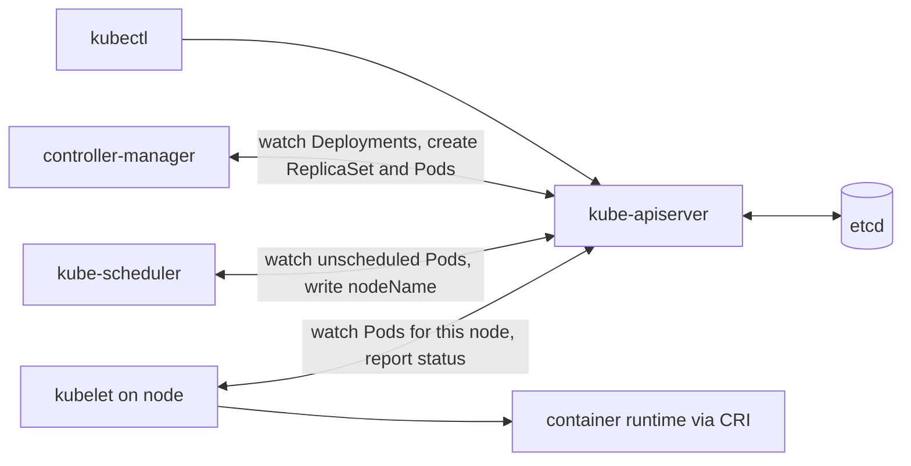

# Domain 1: Kubernetes Fundamentals (44%)

This domain covers four competencies: Kubernetes Core Concepts, Administration, Scheduling and Containerization. It is the largest domain, so close to half of your questions come from this note. Networking, security, troubleshooting and storage moved to Domain 2 in the revised outline and live in [02-container-orchestration.md](./02-container-orchestration.md).

**[📖 KCNA exam page](https://training.linuxfoundation.org/certification/kubernetes-cloud-native-associate/)** - Official domains, weights and exam details
**[📖 KCNA program changes](https://training.linuxfoundation.org/kcna-program-changes/)** - What changed for exams from 24 November 2025
**[📖 CNCF curriculum repository](https://github.com/cncf/curriculum)** - The published curriculum PDFs
**[📖 Kubernetes Components](https://kubernetes.io/docs/concepts/overview/components/)** - Control plane and node components
**[📖 Cluster Architecture](https://kubernetes.io/docs/concepts/architecture/)** - Nodes, controllers and the control plane in depth

---

## Kubernetes Core Concepts

### The idea behind Kubernetes

Kubernetes is a system for running containers across a group of machines. You do not tell it "start this container on that server". You describe the end state you want, such as "three copies of this web app, each with 256 MiB of memory", and Kubernetes works continuously to make the cluster match. That description is called the **desired state**. What is actually running is the **observed** or **current state**. The whole system is a set of loops that compare the two and close the gap.

This is the single most important idea on the exam. Many questions that look like they are about one component are really asking whether you understand that Kubernetes is declarative and self-correcting. If a Pod dies, nobody runs a restart script. A controller notices that the count of running Pods is lower than the desired count and creates a new one.

### Control plane components

The control plane makes cluster-wide decisions. In a production cluster it usually runs on dedicated machines, often three for high availability.

- **kube-apiserver** - The front door of the cluster. Every read and write, from kubectl, controllers or kubelets, goes through its REST API.
- **etcd** - A consistent, highly available key-value store that holds all cluster state. Only the API server talks to it.
- **kube-scheduler** - Watches for Pods with no node assigned and picks a node for each one. It does not start containers.
- **kube-controller-manager** - Runs the built-in controllers, such as the Deployment, ReplicaSet, Node, Job and EndpointSlice controllers, in one process.
- **cloud-controller-manager** - Runs controllers that talk to a cloud provider API, for example to create load balancers or to notice that a cloud VM was deleted. Only present when the cluster integrates with a cloud.

The API server is the hub. Components never talk to each other directly, and nothing but the API server touches etcd. When the scheduler picks a node, it does not call the kubelet. It writes the node name into the Pod object through the API server, and the kubelet on that node, which is watching the API server, sees the change. This "everything through the API" design is why Kubernetes is easy to extend: a new controller only needs API access.

etcd uses the Raft consensus algorithm, so it needs a majority (a quorum) of members to accept writes. That is why etcd clusters have an odd number of members, usually three or five. Losing etcd without a backup means losing the cluster's record of every object, which is why etcd backup is the classic administration task.

> **Exam trap:** The scheduler only *assigns* a node. Controllers *create* Pod objects. The kubelet *starts* containers. Questions often swap these roles.

### Node components

Every worker node runs three things.

- **kubelet** - The node agent. It watches the API server for Pods bound to its node, asks the container runtime to start them, runs probes and reports status back.
- **kube-proxy** - Programs packet-forwarding rules (iptables or nftables, or IPVS) so that traffic sent to a Service reaches one of its Pods. Some network plugins, such as Cilium, can replace it.
- **Container runtime** - The software that actually runs containers, such as containerd or CRI-O. The kubelet talks to it through the Container Runtime Interface (CRI).

The kubelet only manages containers that Kubernetes created. A container you start by hand on the node with a runtime CLI is invisible to Kubernetes.

The diagram shows how a `kubectl apply` of a Deployment flows through the components. Notice that every arrow goes through the API server.



*The API server sits between every component and etcd; controllers, the scheduler and the kubelet each watch it and write back through it.*

### The API, objects and reconciliation

Everything in Kubernetes is an **object** stored through the API: a Pod, a Service, a Namespace, a Node. Most objects have the same shape. The `apiVersion` and `kind` say what type it is. The `metadata` holds the name, namespace, labels and annotations. The `spec` is what you want. The `status` is what the system observed, and it is written by controllers, not by you.

A **controller** is a loop that watches one kind of object and acts to make reality match its spec. The Deployment controller watches Deployments and manages ReplicaSets. The ReplicaSet controller watches ReplicaSets and creates or deletes Pods. This chain of small controllers, each owning one job, is how complex behaviour emerges from simple parts. You can add your own types with a **CustomResourceDefinition (CRD)** and your own controller to manage them. A controller that encodes the operational knowledge of running a specific application, such as a database, is called an **operator**.

API groups are versioned. A resource moves through **alpha** (off by default, may change or vanish), **beta** and **stable** (GA, often called v1). That is why you see `apps/v1` for Deployments and `batch/v1` for Jobs.

- **Desired state** - The `spec` you declare for an object.
- **Reconciliation loop** - A controller repeatedly compares desired state with observed state and acts to remove the difference.
- **CustomResourceDefinition (CRD)** - Extends the Kubernetes API with a new object type.
- **Operator** - A custom controller plus CRDs that automate the operation of a specific application.

### Pods

A **Pod** is the smallest thing Kubernetes schedules. It wraps one or more containers that share a network namespace (one IP address, one port space, they reach each other on `localhost`) and can share volumes. Most Pods have one main container. Extra containers are used for helper patterns: a **sidecar** adds a supporting function such as log shipping or a proxy, an **ambassador** proxies outbound connections, and an **adapter** reshapes output, for example converting metrics to a standard format. **Init containers** run to completion, one after another, before the main containers start. Kubernetes also supports native sidecars, declared as init containers with `restartPolicy: Always`, so they start first and keep running alongside the app.

Pods are disposable. A Pod is bound to one node for its whole life. If the node fails, the Pod is not moved; a controller creates a replacement Pod with a new name and usually a new IP. This is why you almost never create bare Pods. You create a workload resource that manages Pods for you.

**[📖 Pods](https://kubernetes.io/docs/concepts/workloads/pods/)** - Pod concepts, multi-container Pods and init containers

### Workload resources

Each workload resource answers a different question about how your Pods should behave.

- **Deployment** - Runs a set of identical, interchangeable Pods for stateless apps. Manages ReplicaSets and supports rolling updates and rollbacks.
- **ReplicaSet** - Keeps a fixed number of Pod replicas running. Normally created by a Deployment, not by hand.
- **StatefulSet** - For apps that need a stable identity: predictable names (`db-0`, `db-1`), ordered start and stop, and a dedicated persistent volume per replica.
- **DaemonSet** - Runs one copy of a Pod on every node, or on every node that matches a selector. Used for node agents such as log shippers and monitoring agents.
- **Job** - Runs Pods until a set number complete successfully, then stops. Used for batch work.
- **CronJob** - Creates Jobs on a cron schedule.

The key distinction the exam tests is identity. Deployment replicas are cattle: any one can replace any other, and they get random suffixes in their names. StatefulSet replicas are pets: `db-1` is always `db-1`, comes back with the same name and reattaches the same volume. DaemonSets do not have a replica count at all; the number of Pods follows the number of matching nodes.

> **Exam trap:** "Run exactly one log collector on each node, including new nodes" is a DaemonSet, not a Deployment with replicas equal to the node count. A Deployment would not track nodes as they join or leave.

**[📖 Workload Resources](https://kubernetes.io/docs/concepts/workloads/controllers/)** - Deployments, StatefulSets, DaemonSets, Jobs, CronJobs

### Services in one paragraph

Pods come and go and their IPs change. A **Service** gives a group of Pods one stable virtual IP and DNS name, and spreads traffic across whichever Pods currently match its label selector. That is the whole idea you need for Domain 1. The Service types (ClusterIP, NodePort, LoadBalancer, ExternalName, headless) and how traffic flows are covered under Networking in [Domain 2](./02-container-orchestration.md#networking).

### Namespaces, labels, selectors and annotations

A **namespace** divides one cluster into named sections. Names must be unique within a namespace, not across the cluster, and many policies (RBAC roles, resource quotas, network policies) are scoped per namespace. A fresh cluster has `default`, `kube-system` (control plane add-ons), `kube-public` (readable by everyone) and `kube-node-lease` (node heartbeats). Some objects are **cluster-scoped** and do not live in any namespace: Nodes, PersistentVolumes, StorageClasses, ClusterRoles and Namespaces themselves.

Namespaces are a soft boundary. By default a Pod in one namespace can still reach a Pod in another over the network. Isolation needs NetworkPolicy, RBAC and quotas on top.

**Labels** are key-value pairs you attach to objects to identify them, such as `app=web` and `tier=frontend`. **Selectors** query by label, and this is how loose coupling works across the whole system: a Service finds its Pods by selector, a ReplicaSet counts its Pods by selector, a NetworkPolicy targets Pods by selector. Nothing is linked by name. **Annotations** are also key-value pairs, but they are not used for selection. They hold non-identifying metadata such as build info, a contact address or tool-specific settings.

- **Namespace** - A named scope inside a cluster for names, access control and quotas.
- **Label** - Identifying key-value metadata that selectors can match.
- **Selector** - A query over labels used to group objects.
- **Annotation** - Non-identifying key-value metadata that is not used for selection.

> **Exam trap:** If a question asks how a Service knows which Pods to send traffic to, the answer is the label selector, never the Pod name.

### ConfigMaps and Secrets

Twelve-factor apps keep configuration out of the image. Kubernetes supports that with two objects. A **ConfigMap** holds non-sensitive settings. A **Secret** holds sensitive values such as passwords, tokens and TLS keys. Both can be exposed to a container as environment variables or mounted as files. When mounted as files, updates eventually appear in the running container; environment variables are fixed at container start. Both can be marked `immutable`, which protects against accidental change and reduces load on the API server.

Secret values are only **base64-encoded**, which is an encoding, not encryption. How to actually protect them is a security topic covered in [Domain 2](./02-container-orchestration.md#security).

**[📖 ConfigMaps](https://kubernetes.io/docs/concepts/configuration/configmap/)** - Configuration data for Pods
**[📖 Secrets](https://kubernetes.io/docs/concepts/configuration/secret/)** - Sensitive data and its limits

---

## Administration

### kubectl and kubeconfig

**kubectl** is the command-line client for the API server. It reads a **kubeconfig** file (by default `~/.kube/config`) that lists **clusters** (API server addresses and CA certificates), **users** (credentials) and **contexts**. A context ties one cluster, one user and an optional default namespace together under a name. Switching context is how an administrator moves between clusters without editing anything else.

```bash
kubectl config get-contexts           # list contexts in the kubeconfig
kubectl config use-context prod-east  # make one active
```

There is no Kubernetes "User" object. Human users are identified by whatever the API server is configured to trust, such as client certificates or an OIDC identity provider. Workloads use ServiceAccounts, which are real API objects.

**[📖 Organizing Cluster Access Using kubeconfig Files](https://kubernetes.io/docs/concepts/configuration/organize-cluster-access-kubeconfig/)** - Clusters, users and contexts

### Imperative versus declarative management

You can manage objects in three ways. **Imperative commands** (`kubectl create deployment`, `kubectl scale`) act immediately and leave no record. **Imperative object configuration** (`kubectl create -f file.yaml`, `kubectl replace -f`) uses files but still tells the API exactly what operation to perform. **Declarative object configuration** (`kubectl apply -f dir/`) hands the API a desired state and lets Kubernetes work out what to create, update or leave alone.

Declarative `apply` is the cloud native default. It is repeatable, it works on whole directories, the files can live in Git, and running it twice is harmless. That last property, being **idempotent**, is what makes GitOps possible later in [Domain 3](./03-application-delivery.md).

**[📖 Object Management](https://kubernetes.io/docs/concepts/overview/working-with-objects/object-management/)** - Imperative and declarative techniques compared

### Resource quotas and limit ranges

Many teams can share one cluster safely only if one team cannot starve the others. A **ResourceQuota** caps the total that a namespace may consume: total CPU and memory requests and limits, number of Pods, number of Services, storage requested, and so on. A **LimitRange** works at the level of a single Pod or container in a namespace: it sets default requests and limits for containers that do not specify them, and minimums and maximums for those that do.

The two interact. If a namespace has a quota on CPU, every new Pod must state a CPU request, or the API server rejects it. A LimitRange that supplies defaults avoids those rejections.

- **ResourceQuota** - A cap on the total resources and object counts a namespace can use.
- **LimitRange** - Per-container or per-Pod defaults, minimums and maximums inside a namespace.

**[📖 Resource Quotas](https://kubernetes.io/docs/concepts/policy/resource-quotas/)** - Namespace-level caps
**[📖 Limit Ranges](https://kubernetes.io/docs/concepts/policy/limit-range/)** - Per-container defaults and bounds

### Building, upgrading and choosing clusters

**kubeadm** is the upstream tool for bootstrapping a cluster: `kubeadm init` sets up a control plane node and `kubeadm join` adds nodes. It does not provision machines and it does not install a network plugin; you add a CNI plugin yourself. A **managed** Kubernetes service (Amazon EKS, Azure AKS, Google GKE and others) runs and upgrades the control plane for you, so you only manage worker nodes or not even those. **Self-managed** clusters give full control and full responsibility, including etcd backups and upgrades.

Kubernetes releases about three minor versions a year, and each minor version gets roughly fourteen months of patch support. Clusters therefore need regular upgrades. The rules are conceptual but testable:

- Upgrade the control plane first, then the nodes.
- Move one minor version at a time (1.33 to 1.34, not 1.33 to 1.35).
- The **version skew policy** says how far components may drift. The kubelet may be older than the API server, by up to three minor versions, but never newer. kubectl is supported within one minor version of the API server in either direction.
- Before upgrading a node, **cordon** it (mark it unschedulable) and **drain** it (evict its Pods so they reschedule elsewhere). Then upgrade and **uncordon**.

**[📖 Version Skew Policy](https://kubernetes.io/releases/version-skew-policy/)** - Supported version differences between components
**[📖 Creating a cluster with kubeadm](https://kubernetes.io/docs/setup/production-environment/tools/kubeadm/create-cluster-kubeadm/)** - Bootstrapping a cluster

### Access control as an admin task

Granting access is a routine admin job, and the tool is **RBAC**: Roles and ClusterRoles define allowed verbs on resources, and bindings attach them to users, groups or ServiceAccounts. RBAC is part of the Security competency, so the detail is in [Domain 2](./02-container-orchestration.md#security). For Domain 1, remember that it is the admin who creates these objects and that RBAC is deny-by-default.

---

## Scheduling

### How the scheduler decides

When a Pod has no `nodeName`, kube-scheduler picks one in two phases. **Filtering** removes nodes that cannot run the Pod: not enough free CPU or memory requested, a taint the Pod does not tolerate, a node selector or required affinity that does not match, a port conflict. **Scoring** ranks the nodes that remain, for example preferring nodes with more free resources, or nodes that satisfy preferred affinity rules, or spreading replicas across zones. The highest-scoring node wins and the scheduler **binds** the Pod by writing the node name through the API server.

If no node passes filtering, the Pod stays **Pending** and an event explains why, for example "0/3 nodes are available: 3 Insufficient cpu". That message is the scheduler talking. Pending is therefore often a scheduling problem, not a container problem.

**[📖 Kubernetes Scheduler](https://kubernetes.io/docs/concepts/scheduling-eviction/kube-scheduler/)** - Filtering and scoring
**[📖 Scheduling, Preemption and Eviction](https://kubernetes.io/docs/concepts/scheduling-eviction/)** - The whole scheduling section

### Requests, limits and QoS classes

A container can declare **requests** and **limits** for CPU and memory. The scheduler uses only **requests**: it places a Pod where the sum of requests fits the node's allocatable capacity. It does not look at actual usage. **Limits** are enforced at runtime by the kubelet and the kernel. The two resources behave differently when a limit is hit. CPU is compressible, so a container over its CPU limit is **throttled** and runs slower. Memory is not compressible, so a container over its memory limit is killed, and you see the reason **OOMKilled**.

Requests and limits together decide a Pod's **Quality of Service (QoS) class**, which controls who is evicted first when a node runs short of memory.

- **Guaranteed** - Every container has CPU and memory requests equal to limits. Evicted last.
- **Burstable** - At least one container has a request or limit, but the Pod does not meet the Guaranteed rule.
- **BestEffort** - No container has any requests or limits. Evicted first.

> **Exam trap:** "The Pod fits on the node according to the scheduler but the node is actually busy" is possible, because the scheduler adds up requests, not live usage. Requests are a reservation, not a measurement.

**[📖 Resource Management for Pods and Containers](https://kubernetes.io/docs/concepts/configuration/manage-resources-containers/)** - Requests, limits, CPU and memory units
**[📖 Pod Quality of Service Classes](https://kubernetes.io/docs/concepts/workloads/pods/pod-qos/)** - Guaranteed, Burstable, BestEffort

### Steering Pods to nodes

There are two directions of control. Pods can be **attracted** to nodes, and nodes can **repel** Pods.

**nodeSelector** is the simplest attraction: the Pod lists labels and only nodes with all of them qualify. **Node affinity** is the richer version. It supports operators like `In` and `NotIn` and comes in two strengths: `requiredDuringSchedulingIgnoredDuringExecution` (a hard rule, used in filtering) and `preferredDuringSchedulingIgnoredDuringExecution` (a soft rule, used in scoring). The "IgnoredDuringExecution" part means that if node labels change later, running Pods are not evicted.

**Pod affinity** and **pod anti-affinity** place Pods relative to *other Pods* rather than relative to node labels. Affinity says "put me near Pods labelled `app=cache`", useful to reduce latency. Anti-affinity says "keep me away from other replicas of myself", useful for spreading replicas across nodes or zones so one failure does not take them all out. **Topology spread constraints** are a more general way to ask for an even spread across zones or nodes.

**Taints** are the repelling side. A taint on a node, such as `gpu=true:NoSchedule`, keeps away every Pod that does not have a matching **toleration**. The effect decides how strict it is: `NoSchedule` blocks new Pods, `PreferNoSchedule` tries to avoid placing Pods, and `NoExecute` also evicts running Pods that do not tolerate it. Control plane nodes usually carry a `NoSchedule` taint so ordinary workloads stay off them.

> **Exam trap:** A toleration *allows* a Pod onto a tainted node; it does not *send* it there. To dedicate nodes to a workload you combine a taint (keep others out) with node affinity or a nodeSelector (pull this workload in).

- **nodeSelector** - Simple label match that restricts a Pod to matching nodes.
- **Node affinity** - Required or preferred rules for placing a Pod on nodes by label.
- **Pod anti-affinity** - Rules that keep a Pod away from nodes or zones running matching Pods.
- **Taint** - A node property that repels Pods without a matching toleration.
- **Toleration** - A Pod property that lets it be scheduled onto, or stay on, a tainted node.

**[📖 Assigning Pods to Nodes](https://kubernetes.io/docs/concepts/scheduling-eviction/assign-pod-node/)** - nodeSelector, affinity and anti-affinity
**[📖 Taints and Tolerations](https://kubernetes.io/docs/concepts/scheduling-eviction/taint-and-toleration/)** - Effects and examples

### Priority and preemption

A **PriorityClass** gives Pods a numeric priority. When a high-priority Pod cannot be scheduled because the cluster is full, the scheduler can **preempt**: evict lower-priority Pods from a node to make room. Kubernetes ships two built-in classes for critical cluster components, `system-cluster-critical` and `system-node-critical`. Preemption is about scheduling. It is different from **node-pressure eviction**, where the kubelet evicts Pods because the node itself is running out of memory or disk, using QoS class and usage to choose.

**[📖 Pod Priority and Preemption](https://kubernetes.io/docs/concepts/scheduling-eviction/pod-priority-preemption/)** - PriorityClass and preemption

### DaemonSet placement

A DaemonSet does not pick a replica count. The DaemonSet controller creates one Pod per eligible node and gives each one node affinity pinning it to that node, and the default scheduler binds it. If you want the DaemonSet on only some nodes, add a nodeSelector or affinity to its Pod template. If you want it on tainted nodes, including control plane nodes, its Pods need matching tolerations. When a new node joins, the controller adds a Pod for it automatically; when a node leaves, that Pod is garbage-collected.

---

## Containerization

### Containers versus virtual machines

A **virtual machine** emulates hardware, and each VM runs its own full operating system kernel on top of a hypervisor. A **container** is an ordinary process on the host that the kernel isolates. Linux **namespaces** give it its own view of process IDs, network, mounts and hostname. **cgroups** limit how much CPU and memory it can use. Every container on a host shares the host kernel.

That shared kernel is the source of every trade-off. Containers start in seconds, use megabytes rather than gigabytes and pack densely onto a host. But isolation is weaker than a VM's, and a container cannot run a different kernel from its host. A Linux container needs a Linux kernel.

> **Exam trap:** Containers are not "lightweight VMs". They do not have their own kernel. Answers that say each container boots its own OS are wrong.

### Images, layers, registries, tags and digests

A **container image** is a read-only, layered filesystem plus metadata such as the default command. Each layer records the changes from one build step. Layers are content-addressed and shared, so ten images built on the same base image store that base only once, and a rebuild that changes only the last step reuses all earlier layers from cache. When a container starts, the runtime adds a thin writable layer on top. Anything written there is lost when the container is removed, which is why persistent data needs volumes.

Images live in a **registry**, such as Docker Hub, GitHub Container Registry, Amazon ECR or the CNCF project Harbor. An image reference has a repository and either a **tag** or a **digest**. A tag like `:1.4` or `:latest` is a movable pointer that the publisher can repoint at different content. A **digest** like `@sha256:...` is a hash of the content and can never change. For reproducible deployments, pin by digest or use immutable tags. If you omit the tag, `latest` is assumed, and with `latest` the kubelet's default pull policy is to pull every time.

- **Image layer** - A read-only filesystem diff produced by one build step and shared between images.
- **Registry** - A service that stores and distributes container images.
- **Tag** - A human-readable, mutable name for an image version.
- **Digest** - An immutable content hash that identifies exactly one image.

**[📖 Images](https://kubernetes.io/docs/concepts/containers/images/)** - Image names, tags, digests and pull policy

### OCI: the standards underneath

The **Open Container Initiative (OCI)** is a Linux Foundation project that defines open standards so images and runtimes from different vendors work together. It publishes three specifications.

- **OCI Image Specification** - The format of an image: layers, manifest and configuration.
- **OCI Runtime Specification** - How to run a container from an unpacked filesystem bundle. `runc` is the reference implementation.
- **OCI Distribution Specification** - The API for pushing and pulling images to and from registries.

Because of OCI, an image built with Docker, Podman, Buildah or BuildKit runs on any OCI-compliant runtime, and any compliant registry can store it.

**[📖 Open Container Initiative](https://opencontainers.org/)** - The OCI specifications

### CRI, containerd, CRI-O and the dockershim removal

The kubelet does not hard-code a container runtime. It talks to one over the **Container Runtime Interface (CRI)**, a gRPC API. Any runtime that implements CRI can be used. The two common ones are both CNCF graduated projects: **containerd**, which grew out of Docker and is the default in most distributions and managed services, and **CRI-O**, built specifically and only for Kubernetes. Under both, a low-level OCI runtime such as runc actually creates the container.

Docker Engine itself never implemented CRI. Kubernetes used a built-in adapter called **dockershim** to talk to it, and that adapter was removed in **Kubernetes v1.24**. The practical impact was small. Images built with Docker are OCI images and run unchanged on containerd or CRI-O. What stopped working was using Docker Engine as the node runtime without an extra adapter.

> **Exam trap:** "Kubernetes removed Docker support, so Docker images no longer work" is false. The dockershim was removed; Docker-built images still run.

- **CRI** - The gRPC API between the kubelet and a container runtime.
- **containerd** - A CNCF graduated, industry-standard container runtime that implements CRI.
- **CRI-O** - A CNCF graduated, lightweight runtime built only for Kubernetes.
- **dockershim** - The removed kubelet adapter for Docker Engine, gone since v1.24.

**[📖 Container Runtimes](https://kubernetes.io/docs/setup/production-environment/container-runtimes/)** - Supported runtimes and CRI
**[📖 Container Runtime Interface](https://kubernetes.io/docs/concepts/containers/cri/)** - How the kubelet uses CRI

### Building images: Dockerfiles and multi-stage builds

A **Dockerfile** (also called a Containerfile) is a recipe. `FROM` chooses a base image, `COPY` adds files, `RUN` executes a build command and creates a layer, `ENV` sets environment variables, `USER` sets who the process runs as, and `CMD` or `ENTRYPOINT` sets what runs at start. Order matters for caching: put the steps that change least, such as installing dependencies, before the steps that change most, such as copying source code.

A **multi-stage build** uses several `FROM` stages in one file. An early stage has the compilers and build tools; the final stage starts from a small base and copies in only the built artifact. The result is a much smaller image with far less attack surface, because the shipped image contains no compiler, package manager or shell that it does not need. Minimal "distroless" or scratch-based final images take this further.

Good image habits that show up in exam answers: run as a non-root user, keep images small, do not bake secrets or environment-specific configuration into the image, and treat images as immutable. Fixing a bug means building and deploying a new image, never patching a running container.

**[📖 Cloud Native Glossary](https://glossary.cncf.io/)** - Definitions for container, image, immutable infrastructure and more

---

## Check yourself

1. Which component writes the chosen node into a Pod object, and which component then starts the containers?
2. Why does a Pod with no CPU request in a namespace with a CPU quota get rejected, and what object fixes that?
3. A memory-hungry container keeps restarting with reason OOMKilled while a CPU-hungry one is merely slow. Why the difference?
4. What is the difference between a taint with `NoSchedule` and one with `NoExecute`?
5. Why did removing dockershim not break images built with Docker?
