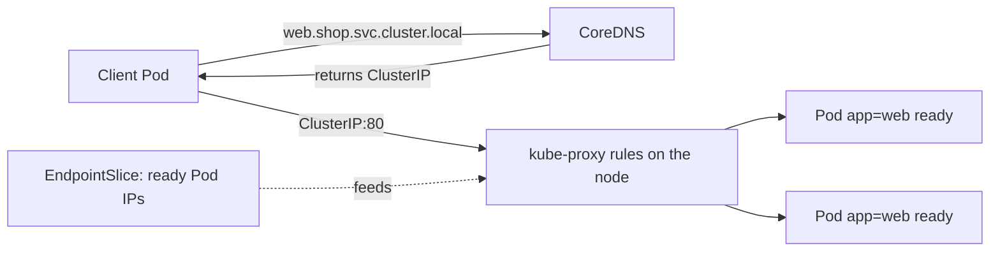
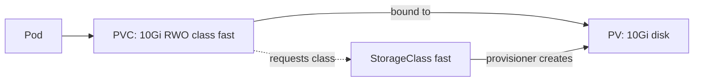

# Domain 2: Container Orchestration (28%)

This domain covers four competencies: Networking, Security, Troubleshooting and Storage. In the November 2025 revision it gained weight and now holds the topics that used to be spread across the old Fundamentals and Architecture domains. Container basics (images, runtimes, OCI) are in [Domain 1](./01-kubernetes-fundamentals.md#containerization); rollout strategies are in [Domain 3](./03-application-delivery.md).

**[📖 KCNA exam page](https://training.linuxfoundation.org/certification/kubernetes-cloud-native-associate/)** - Official domains and weights
**[📖 Services, Load Balancing, and Networking](https://kubernetes.io/docs/concepts/services-networking/)** - The networking section of the docs
**[📖 Security](https://kubernetes.io/docs/concepts/security/)** - The security concepts section
**[📖 Storage](https://kubernetes.io/docs/concepts/storage/)** - Volumes, PVs, PVCs and StorageClasses
**[📖 Troubleshooting Applications](https://kubernetes.io/docs/tasks/debug/debug-application/)** - Debugging Pods, Services and more

---

## Why orchestration

Running one container is easy. Running hundreds across many machines raises questions that a single host cannot answer: where should each container run, what happens when one dies, how do containers find each other when their addresses keep changing, how do you update them without downtime, and how do they get storage that outlives them. An orchestrator answers all of these with the same declarative, reconciling approach described in Domain 1. This domain looks at four of those answers in turn: how traffic finds Pods, how the cluster is protected, how you find out what went wrong, and how data survives.

---

## Networking

### The Kubernetes network model

Kubernetes sets a few simple rules and leaves the implementation to plugins:

- Every Pod gets its own IP address.
- Every Pod can reach every other Pod on any node directly, without NAT.
- Agents on a node, such as the kubelet, can reach all Pods on that node.

The result is a flat network where a Pod behaves much like a VM on a LAN. Containers in the same Pod share that one IP and talk over `localhost`.

Kubernetes itself does not wire this up. A **Container Network Interface (CNI)** plugin does. When the kubelet creates a Pod, the runtime calls the CNI plugin to give the Pod a network interface and an IP. Common plugins include Calico, Cilium and Flannel. They differ in how they move packets (overlays, BGP routing, eBPF) and in whether they enforce NetworkPolicy. A cluster built with kubeadm has no working Pod network until you install one; nodes stay **NotReady** until then.

**[📖 Cluster Networking](https://kubernetes.io/docs/concepts/cluster-administration/networking/)** - The network model and how it is implemented
**[📖 Network Plugins](https://kubernetes.io/docs/concepts/extend-kubernetes/compute-storage-net/network-plugins/)** - CNI in Kubernetes

### Services and how traffic reaches a Pod

A **Service** gives a set of Pods, chosen by a label selector, one stable virtual IP (the ClusterIP) and one DNS name. Behind the scenes the **EndpointSlice** controller keeps a list of the IPs of matching Pods that are **ready**. kube-proxy on every node watches Services and EndpointSlices and programs forwarding rules, so a packet sent to the ClusterIP is rewritten to one of the ready Pod IPs. The ClusterIP is virtual: no interface owns it, and you cannot ping it in most setups.



*A client resolves the Service name through CoreDNS, sends to the ClusterIP, and node-level rules built from the EndpointSlice forward the packet to one ready Pod.*

The Service **types** build on each other.

- **ClusterIP** - The default. A virtual IP reachable only from inside the cluster.
- **NodePort** - Adds a port (by default from 30000-32767) on every node's IP that forwards to the Service.
- **LoadBalancer** - Asks the cloud provider, through the cloud-controller-manager, for an external load balancer that forwards to the Service. Builds on NodePort by default.
- **ExternalName** - No proxying at all. Returns a DNS CNAME to an external hostname such as a managed database.
- **Headless Service** - A Service with `clusterIP: None`. DNS returns the individual Pod IPs instead of one virtual IP. StatefulSets use it so each replica gets its own stable DNS name.

> **Exam trap:** kube-proxy implements *Services*. It does not give Pods their IPs or carry Pod-to-Pod traffic in general; that is the CNI plugin's job.

**[📖 Service](https://kubernetes.io/docs/concepts/services-networking/service/)** - Service types, selectors and headless Services

### DNS with CoreDNS

**CoreDNS**, a CNCF graduated project, is the cluster DNS server. It watches the API and creates records automatically. A Service named `web` in namespace `shop` is reachable as `web.shop.svc.cluster.local`. From a Pod in the same namespace, plain `web` works because the Pod's DNS search path includes its own namespace. From another namespace use `web.shop`. A headless Service's name returns the Pod IPs, and a StatefulSet Pod gets a name like `db-0.db.shop.svc.cluster.local`.

**[📖 DNS for Services and Pods](https://kubernetes.io/docs/concepts/services-networking/dns-pod-service/)** - Record formats and search paths

### Ingress and the Gateway API

A LoadBalancer Service per app gets expensive and gives you only layer 4. For HTTP, Kubernetes offers **Ingress**: one object holding host and path rules ("`shop.example.com/api` goes to the `api` Service") plus TLS settings. An Ingress object does nothing by itself. An **Ingress controller**, such as one based on NGINX, Traefik or Envoy, must be running to read it and route traffic. The Ingress API is stable but frozen: it gets no new features. Note that the community `ingress-nginx` controller was announced for retirement in 2026, which is one more push towards the Gateway API.

The **Gateway API** is the newer, more expressive successor, developed by Kubernetes SIG Network and installed as CRDs. It splits responsibility across roles. A **GatewayClass** describes a kind of load balancer (set by the infrastructure provider). A **Gateway** is an actual listener (owned by the cluster operator). **HTTPRoute** and other route types attach application routing rules (owned by app teams). It supports features Ingress needed annotations for, such as header matching and weighted traffic splitting, which also makes it useful for canary releases.

- **Ingress** - An HTTP and HTTPS routing object that needs an Ingress controller to work.
- **Gateway API** - The role-oriented successor to Ingress, built from GatewayClass, Gateway and Route objects.

**[📖 Ingress](https://kubernetes.io/docs/concepts/services-networking/ingress/)** - Ingress rules and controllers
**[📖 Gateway API](https://kubernetes.io/docs/concepts/services-networking/gateway/)** - Gateways and routes

### NetworkPolicy

By default every Pod can talk to every other Pod. A **NetworkPolicy** narrows that. It selects Pods by label and lists which sources may connect in (ingress) and which destinations they may reach (egress), by Pod selector, namespace selector, IP block and port. Two rules make policies predictable. First, a Pod is only isolated in a direction once at least one policy selects it for that direction; until then, all traffic is allowed. Second, policies are additive allow-lists. There is no "deny" rule; you deny by not allowing. A common baseline is a "default deny" policy that selects every Pod in a namespace with no allowed sources, followed by narrow allow policies.

> **Exam trap:** A NetworkPolicy only works if the CNI plugin enforces it. Creating one on a plugin without policy support is silently ignored.

**[📖 Network Policies](https://kubernetes.io/docs/concepts/services-networking/network-policies/)** - Selectors, ingress and egress rules

### Service mesh at a concept level

A **service mesh** moves cross-cutting network features out of application code and into the platform. Traditionally it injects a proxy, usually Envoy, next to each app container (a sidecar) or runs a shared per-node proxy (Istio's ambient mode and Cilium take this route). The proxies give you mutual TLS between services, retries, timeouts, traffic splitting and uniform metrics and traces, all without changing code. A **control plane** configures the proxies; the proxies themselves form the **data plane**. Istio and Linkerd are both CNCF graduated meshes. A mesh adds operational cost, so it is a choice, not a requirement.

---

## Security

### The 4Cs and defence in depth

Cloud native security is taught as layers, often called the **4Cs**: **Cloud** (the infrastructure and provider account), **Cluster** (the Kubernetes components and their configuration), **Container** (the images and runtime settings) and **Code** (the application and its dependencies). Each layer depends on the one outside it. Perfect application code does not help if the cloud account is open, and a hardened cluster cannot save a container image with a known critical vulnerability. That is **defence in depth**: controls at every layer, so one failure is not a breach.

### Authentication, authorization and admission

Every API request passes three gates in order.

1. **Authentication** answers "who are you?". The API server checks a client certificate, a bearer token, or an OIDC identity. Pods authenticate as a **ServiceAccount** using a short-lived token the kubelet mounts for them.
2. **Authorization** answers "may you do this?". The usual mode is **RBAC**.
3. **Admission control** answers "is this request acceptable, and should it be changed?". Mutating admission can modify the object (for example inject a sidecar or a default); validating admission can reject it.

> **Exam trap:** Authentication is identity, authorization is permission. A 401 response is an authentication failure; a 403 is an authorization failure.

**[📖 Controlling Access to the Kubernetes API](https://kubernetes.io/docs/concepts/security/controlling-access/)** - Authentication, authorization and admission in sequence

### RBAC and ServiceAccounts

**RBAC** has four objects. A **Role** grants verbs (`get`, `list`, `watch`, `create`, `update`, `delete` and so on) on resources inside one namespace. A **ClusterRole** does the same cluster-wide, or for cluster-scoped resources such as Nodes. A **RoleBinding** grants a Role, or a ClusterRole, to subjects within one namespace. A **ClusterRoleBinding** grants a ClusterRole across the whole cluster. Subjects are users, groups or ServiceAccounts.

RBAC is deny-by-default and purely additive. There are no deny rules, so the only way to remove access is to remove a binding. The principle of **least privilege** means giving each subject only the verbs and resources it needs. A useful pattern is to define a ClusterRole once and bind it per namespace with RoleBindings.

A **ServiceAccount** is the identity of a workload. Every namespace has a `default` ServiceAccount, and Pods use it unless told otherwise. Give each app its own ServiceAccount with only the permissions it needs, and disable token mounting for Pods that never call the API.

- **Role** - Namespaced set of permissions.
- **ClusterRole** - Cluster-wide or cluster-scoped set of permissions.
- **RoleBinding** - Grants a Role or ClusterRole to subjects within one namespace.
- **ClusterRoleBinding** - Grants a ClusterRole to subjects across the whole cluster.
- **ServiceAccount** - A namespaced identity for processes running in Pods.

**[📖 Using RBAC Authorization](https://kubernetes.io/docs/reference/access-authn-authz/rbac/)** - Roles, bindings and examples
**[📖 Service Accounts](https://kubernetes.io/docs/concepts/security/service-accounts/)** - Workload identity and tokens

### Pod Security Standards and securityContext

A container's **securityContext** controls how its process runs: `runAsNonRoot`, `runAsUser`, `readOnlyRootFilesystem`, `allowPrivilegeEscalation`, dropped Linux capabilities, and whether it is `privileged`. These settings are where most real container hardening happens.

The **Pod Security Standards** define three profiles. **Privileged** is unrestricted. **Baseline** blocks known privilege escalations such as host namespaces and privileged containers. **Restricted** follows hardening best practice, such as running as non-root and dropping capabilities. **Pod Security Admission**, a built-in admission controller, enforces a profile per namespace using labels, in one of three modes: `enforce` (reject), `audit` (record in the audit log) or `warn` (warn the user). It replaced PodSecurityPolicy, which was removed in Kubernetes v1.25.

**[📖 Pod Security Standards](https://kubernetes.io/docs/concepts/security/pod-security-standards/)** - Privileged, Baseline and Restricted
**[📖 Pod Security Admission](https://kubernetes.io/docs/concepts/security/pod-security-admission/)** - Enforce, audit and warn modes

### Secrets done properly

Secret values are **base64-encoded, not encrypted**. Anyone who can read the Secret object through the API, or read etcd, can decode them. Protecting Secrets means: limit `get` and `list` on Secrets with RBAC, turn on **encryption at rest** so the API server encrypts Secret data before writing it to etcd (ideally with a KMS provider so keys live outside the cluster), and consider an external secret manager such as HashiCorp Vault or a cloud secret store, synced in by a tool such as the External Secrets Operator.

**[📖 Good practices for Kubernetes Secrets](https://kubernetes.io/docs/concepts/security/secrets-good-practices/)** - Encryption, RBAC and handling
**[📖 Encrypting Confidential Data at Rest](https://kubernetes.io/docs/tasks/administer-cluster/encrypt-data/)** - EncryptionConfiguration and providers

### Supply chain: scanning and signing

Most container risk arrives inside the image. **Image scanning** compares the packages in an image against vulnerability databases, ideally in CI and again in the registry, since new CVEs are published for old images. **Image signing** proves who built an image and that it has not changed; Sigstore's cosign and the CNCF Notary Project are common tools. A cluster can then refuse to run unsigned images. A **software bill of materials (SBOM)** lists every component in an image so you can answer "are we affected?" quickly when a new vulnerability appears.

### Admission controllers and policy engines

Beyond the built-in admission controllers, clusters enforce custom rules with **policy engines** that run as admission webhooks. **OPA Gatekeeper** uses Open Policy Agent (a CNCF graduated project) and its Rego language. **Kyverno** (a CNCF project) writes policies as Kubernetes YAML. Both can validate (reject Pods without resource limits, block the `latest` tag, require signed images) and mutate (add default labels). Kubernetes also has a built-in **ValidatingAdmissionPolicy** that expresses rules in the CEL language without running a webhook.

- **Admission controller** - Code that intercepts API requests after authorization to mutate or reject them.
- **OPA Gatekeeper** - A policy controller using Open Policy Agent and Rego for Kubernetes admission.
- **Kyverno** - A Kubernetes-native policy engine whose policies are written as YAML resources.

**[📖 Admission Control](https://kubernetes.io/docs/reference/access-authn-authz/admission-controllers/)** - Built-in admission controllers and webhooks

---

## Troubleshooting

### Read the state before guessing

Troubleshooting on the exam is about recognising symptoms. Kubernetes tells you a lot if you know where to look. The workflow is nearly always the same:

```bash
kubectl get pods -o wide             # phase, restarts, node, IP
kubectl describe pod web-7d9f-abc    # spec, conditions, and the Events list at the bottom
kubectl logs web-7d9f-abc            # container stdout and stderr
kubectl get events --sort-by=.lastTimestamp
kubectl exec -it web-7d9f-abc -- sh  # look around inside a running container
```

`describe` is usually the most useful single command, because the Events at the bottom show what the scheduler, kubelet and controllers tried and why it failed.

### Pod phases and common states

A Pod's **phase** is one of five values: **Pending** (accepted, but not all containers are running yet; still scheduling or pulling images), **Running** (bound to a node, at least one container running), **Succeeded** (all containers exited zero and will not restart), **Failed** (all containers stopped and at least one failed) and **Unknown** (the node cannot be reached). The words you see in the STATUS column of `kubectl get pods`, such as CrashLoopBackOff, are often container **reasons**, not phases.

> **Exam trap:** CrashLoopBackOff is not a Pod phase. The Pod is usually in phase Running while one container keeps crashing.

| Symptom | What it means | Usual causes |
|---|---|---|
| **Pending** | Not scheduled, or scheduled but still starting | Insufficient CPU or memory requests, untolerated taints, unmatched affinity, PVC not bound |
| **ImagePullBackOff / ErrImagePull** | The kubelet cannot pull the image and is backing off | Typo in image name or tag, image does not exist, private registry without pull secret |
| **CrashLoopBackOff** | The container starts, exits, and Kubernetes waits longer between each restart | App error at startup, missing config or Secret, bad command, failing liveness probe |
| **OOMKilled** | The container exceeded its memory limit and was killed | Limit too low, memory leak |
| **Running but not receiving traffic** | Pod is not ready or not selected | Readiness probe failing, Service selector mismatch |

For a crashing container, the current log may be empty because the new instance just started. `kubectl logs --previous` shows the last crashed instance.

**[📖 Pod Lifecycle](https://kubernetes.io/docs/concepts/workloads/pods/pod-lifecycle/)** - Phases, container states and restart policy
**[📖 Debug Pods](https://kubernetes.io/docs/tasks/debug/debug-application/debug-pods/)** - Pending, waiting and crashing Pods

### Probes

The kubelet runs three kinds of **probe** against each container, using an HTTP GET, a TCP connection, a gRPC health check or a command.

- **Liveness probe** - "Is the process healthy?" On failure the kubelet restarts the container.
- **Readiness probe** - "Can it serve traffic now?" On failure the Pod is removed from Service endpoints, but it is not restarted.
- **Startup probe** - "Has it finished starting?" While it has not passed, liveness and readiness checks are held off, which protects slow-starting apps from being killed.

These interact with troubleshooting. An over-eager liveness probe on a slow app causes CrashLoopBackOff even though the app is fine. A failing readiness probe makes a Pod look Running in `kubectl get pods` (with `0/1` in the READY column) while getting no traffic.

**[📖 Configure Liveness, Readiness and Startup Probes](https://kubernetes.io/docs/tasks/configure-pod-container/configure-liveness-readiness-startup-probes/)** - Probe types and settings

### A Service with no endpoints

A classic exam scenario: the Pods are Running, the Service exists, but requests time out. Check the Service's endpoints (`kubectl get endpointslices -l kubernetes.io/service-name=web`, or `kubectl describe service web`). If the list is empty, either the Service's **selector does not match the Pods' labels** (for example `app: web` against `app: web-frontend`), or the Pods exist but are **not ready**. Also check that the Service `targetPort` matches the port the container actually listens on.

### Node NotReady

A node is **NotReady** when the kubelet stops reporting healthy status. Causes include a stopped or crashed kubelet, a broken container runtime, no CNI plugin installed, disk or memory pressure, or the node being unreachable on the network. The node lifecycle controller taints a NotReady or unreachable node; Pods on it are evicted after a default toleration period of five minutes, and their controllers recreate them elsewhere. `kubectl describe node` shows the node's conditions (Ready, MemoryPressure, DiskPressure, PIDPressure, NetworkUnavailable).

**[📖 Debugging Kubernetes Nodes](https://kubernetes.io/docs/tasks/debug/debug-cluster/)** - Cluster and node troubleshooting

---

## Storage

### Volumes versus persistent volumes

A container's writable layer disappears with the container. A **volume** is a directory mounted into a Pod that outlives individual container restarts. Some volumes live only as long as the Pod. **emptyDir** is created empty when the Pod starts on a node, is shared by the Pod's containers, and is deleted when the Pod is removed. It suits scratch space and caches. ConfigMap, Secret and projected volumes are also Pod-lifetime volumes that expose API data as files. **Generic ephemeral volumes** give a Pod its own dynamically provisioned volume that is deleted with it.

Data that must outlive any Pod needs a **PersistentVolume**.

**[📖 Volumes](https://kubernetes.io/docs/concepts/storage/volumes/)** - Volume types including emptyDir
**[📖 Ephemeral Volumes](https://kubernetes.io/docs/concepts/storage/ephemeral-volumes/)** - Pod-lifetime volumes

### PV, PVC and StorageClass

The storage model separates "what storage exists" from "what storage an app wants".

- **PersistentVolume (PV)** - A cluster-scoped piece of storage, such as a cloud disk or an NFS share, with its own lifecycle independent of Pods.
- **PersistentVolumeClaim (PVC)** - A namespaced request for storage by size, access mode and class. Pods mount the PVC, never the PV directly.
- **StorageClass** - Describes a kind of storage (fast SSD, standard disk) and which provisioner creates it.

With **static provisioning**, an admin creates PVs in advance and Kubernetes binds each PVC to a suitable one. With **dynamic provisioning**, a PVC names a StorageClass and the provisioner creates a matching PV on demand. A StorageClass can be marked the cluster default, and its `volumeBindingMode: WaitForFirstConsumer` delays provisioning until a Pod is scheduled, so the disk is created in the same zone as the node that needs it.



*A Pod mounts a claim; the claim names a StorageClass; the class's CSI provisioner creates the PV that the claim binds to.*

### Access modes and reclaim policies

**Access modes** describe how a volume can be mounted:

- **ReadWriteOnce (RWO)** - Read-write by a single node (several Pods on that node can share it).
- **ReadOnlyMany (ROX)** - Read-only by many nodes.
- **ReadWriteMany (RWX)** - Read-write by many nodes. Needs shared storage such as NFS or a cloud file service; most block disks cannot do it.
- **ReadWriteOncePod (RWOP)** - Read-write by a single Pod in the whole cluster.

The **reclaim policy** on a PV decides what happens after its PVC is deleted. **Delete** removes the PV and the underlying disk; it is the usual default for dynamically provisioned volumes. **Retain** keeps the PV and the data for an admin to recover manually. The old Recycle policy is deprecated.

> **Exam trap:** RWO limits a volume to one *node*, not one Pod. If the question needs exactly one Pod, the answer is ReadWriteOncePod.

**[📖 Persistent Volumes](https://kubernetes.io/docs/concepts/storage/persistent-volumes/)** - PVs, PVCs, access modes and reclaim policies
**[📖 Storage Classes](https://kubernetes.io/docs/concepts/storage/storage-classes/)** - Provisioners and binding modes

### CSI

The **Container Storage Interface (CSI)** is a standard API between container orchestrators and storage systems. Storage vendors ship a CSI driver that runs in the cluster, and Kubernetes calls it to create, attach, mount, snapshot and resize volumes. Before CSI, storage drivers were compiled into Kubernetes itself ("in-tree"); those have been migrated to CSI drivers. CSI is the storage counterpart of CRI for runtimes and CNI for networking: three plug-in interfaces that keep the core of Kubernetes vendor-neutral.

- **CSI** - Standard interface that lets external storage drivers plug into Kubernetes.
- **Dynamic provisioning** - Creating a PV automatically when a PVC requests a StorageClass.

### StatefulSets and volumeClaimTemplates

A StatefulSet's **volumeClaimTemplates** make one PVC per replica: `data-db-0`, `data-db-1`, and so on. When `db-1` is rescheduled to another node, it reattaches the same claim and finds its data. By default, scaling down or deleting a StatefulSet keeps those PVCs, so the data is not lost by accident. This is why a database cluster uses a StatefulSet with per-replica PVCs and a headless Service, rather than a Deployment sharing one PVC.

**[📖 StatefulSets](https://kubernetes.io/docs/concepts/workloads/controllers/statefulset/)** - Stable identity and per-replica storage

---

## Self-healing and scaling in one view

The orchestration features from the old outline still matter here because they tie the four competencies together. Self-healing comes from controllers (replace missing Pods), the kubelet (restart failed containers, run probes) and the node lifecycle controller (evict from failed nodes). Scaling comes from changing replica counts, either by hand or with an autoscaler. Those autoscalers and the rollout strategies that move from one version to the next are part of delivery and are covered in [Domain 3](./03-application-delivery.md).

---

## Check yourself

1. A Pod can reach another Pod by IP but not by the Service name. Which component would you check first?
2. Why might a NetworkPolicy have no effect at all?
3. A RoleBinding references a ClusterRole. What scope do the permissions have?
4. A Pod is Running with READY `0/1`. What kind of probe is failing, and what does Kubernetes do about it?
5. Which access mode lets several Pods on several nodes write to the same volume, and what storage does it need?
