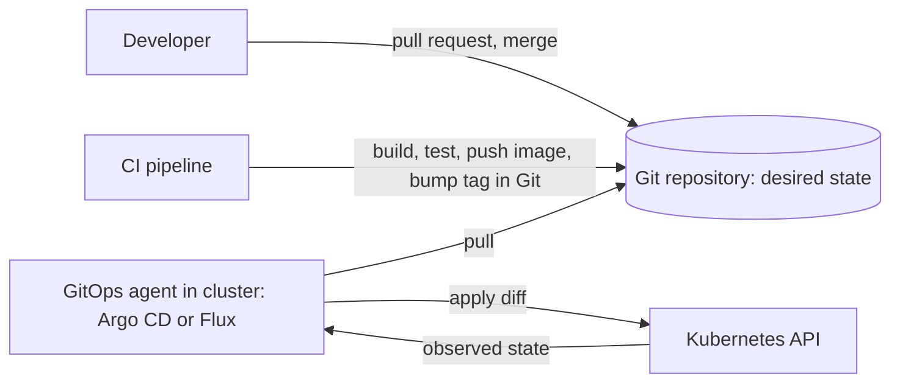

# Domain 3: Cloud Native Application Delivery (16%)

This domain covers two competencies: Application Delivery and Debugging. It doubled in weight in the November 2025 revision and gained an explicit debugging competency, so expect questions about rollouts going wrong as well as about GitOps and Helm. Observability, which shared a domain with delivery in the old outline, now lives in [Domain 4](./04-cloud-native-architecture.md#observability).

**[📖 KCNA exam page](https://training.linuxfoundation.org/certification/kubernetes-cloud-native-associate/)** - Official domains and weights
**[📖 OpenGitOps](https://opengitops.dev/)** - The four GitOps principles
**[📖 Deployments](https://kubernetes.io/docs/concepts/workloads/controllers/deployment/)** - Rolling updates, rollout history and rollback
**[📖 Helm documentation](https://helm.sh/docs/)** - Charts, releases and repositories
**[📖 Cloud Native Glossary](https://glossary.cncf.io/)** - Definitions for CI, CD, GitOps and more

---

## Application Delivery

### CI, continuous delivery and continuous deployment

Three terms sound alike and the exam likes to separate them.

- **Continuous integration (CI)** - Developers merge small changes often, and every merge triggers an automated build and test run. The output is a tested artifact, such as a container image pushed to a registry.
- **Continuous delivery** - Every change that passes the pipeline is kept in a releasable state and can be deployed at any time, but a human decides when it goes to production.
- **Continuous deployment** - Every change that passes the pipeline goes to production automatically, with no manual approval step.

The difference between the last two is one approval gate. Continuous deployment needs very good automated tests and safe rollout strategies, because nobody checks each release by hand. CI tools include GitHub Actions, GitLab CI, Jenkins and the CNCF-hosted Tekton. CD tools include Argo CD, Flux and Spinnaker.

A classic "push" pipeline ends with the CI system running `kubectl apply` or `helm upgrade` against the cluster. That works, but it means the CI system holds powerful cluster credentials, and nothing notices if someone later changes the cluster by hand. GitOps is a response to both problems.

### GitOps principles

**GitOps** is an operating model in which the desired state of a system is stored in Git and software agents keep the running system matched to it. The CNCF's OpenGitOps project defines four principles, and the exam uses their wording.

1. **Declarative** - The system's desired state is expressed declaratively, such as Kubernetes manifests, not as a script of steps.
2. **Versioned and immutable** - Desired state is stored in a way that keeps a complete version history and cannot be silently changed. Git is the usual store; every change is a commit with an author and a timestamp.
3. **Pulled automatically** - Software agents pull the desired state from the source. The cluster reaches out to Git; the CI system does not push into the cluster.
4. **Continuously reconciled** - Agents keep observing the actual state and work to make it match the desired state, not just once at deploy time.

The fourth principle is what separates GitOps from "keeping YAML in Git". If someone runs `kubectl edit` in production, a GitOps agent detects the difference, called **drift**, and either reverts it or reports the application as out of sync. Rollback becomes `git revert`. An audit trail comes for free from Git history. And the CI system no longer needs credentials for the production cluster, since the agent inside the cluster does the applying.



*CI builds the image and updates Git; the in-cluster agent pulls from Git, applies the difference, then keeps comparing observed with desired state.*

- **GitOps** - Operating model where desired state lives in a versioned store and agents pull and continuously reconcile it.
- **Drift** - A difference between what is running and what the desired state in Git says should run.
- **Reconciliation** - The repeated act of comparing desired and actual state and correcting the difference.

> **Exam trap:** "GitOps means running kubectl apply from a CI job when Git changes" is the push model. GitOps is pull-based and continuously reconciled.

### Argo CD and Flux

Both are CNCF graduated GitOps tools, and both are controllers running inside the cluster.

**Argo CD** models each deployed thing as an **Application** that points to a Git repository, a path and a target cluster and namespace. It renders the manifests (plain YAML, Kustomize or Helm), compares them with the live objects and reports two statuses: **sync status** (Synced or OutOfSync, meaning whether live matches Git) and **health status** (such as Healthy, Progressing or Degraded, meaning whether the resources are working). It has a web UI that shows the resource tree and diffs. Syncing can be manual or automated, with optional self-heal (revert drift) and prune (delete objects removed from Git).

**Flux** is a set of composable controllers called the GitOps Toolkit. A **source** object such as `GitRepository`, `HelmRepository` or `OCIRepository` fetches content; a **Kustomization** applies a path from a source; a **HelmRelease** installs a Helm chart declaratively. Each reconciles on an interval. Flux has no built-in UI; it is driven by its CLI and its custom resources.

**[📖 Argo CD documentation](https://argo-cd.readthedocs.io/en/stable/)** - Applications, sync and health
**[📖 Flux documentation](https://fluxcd.io/flux/)** - The GitOps Toolkit controllers

### Helm: charts, releases, values and repositories

**Helm** is the package manager for Kubernetes and a CNCF graduated project.

- **Chart** - A package of templated Kubernetes manifests plus a `Chart.yaml` with its name and version.
- **Values** - The parameters a chart's templates read. Defaults live in `values.yaml`; users override them with their own file or `--set`.
- **Release** - One installed instance of a chart in a cluster. The same chart installed twice with different names gives two releases.
- **Revision** - Each install, upgrade or rollback of a release creates a new numbered revision.
- **Repository** - A place that serves charts, either an HTTP chart repository or an OCI registry.

The flow is: Helm combines chart templates with values to render plain YAML, then applies it. `helm install` creates a release, `helm upgrade` creates a new revision, `helm history` lists revisions and `helm rollback` returns to an earlier one (as a new revision). Helm 3 removed the old in-cluster Tiller component; Helm now talks to the API with the user's own credentials and stores release records as Secrets in the release's namespace.

**[📖 Helm Quickstart and concepts](https://helm.sh/docs/intro/using_helm/)** - Charts, repositories and releases

### Kustomize: bases and overlays

**Kustomize** customises plain YAML without a templating language, and it is built into kubectl (`kubectl apply -k`). You keep a **base** with the common manifests and one **overlay** per environment that references the base and changes only what differs: a replica count patch for production, a different image tag for staging, a name prefix or extra labels. A `kustomization.yaml` file in each directory lists resources and transformations.

Helm and Kustomize are complementary rather than rival. Helm is good for distributing configurable software to many users. Kustomize is good for managing your own manifests across environments. GitOps tools render either, and it is common to install a third-party chart with Helm and patch it with Kustomize.

- **Base** - The shared set of manifests that overlays build on.
- **Overlay** - An environment-specific set of patches and settings applied on top of a base.

**[📖 Declarative Management of Kubernetes Objects Using Kustomize](https://kubernetes.io/docs/tasks/manage-kubernetes-objects/kustomization/)** - Bases, overlays and generators

### Rollout strategies

How you replace version 1 with version 2 decides your risk, your cost and whether users see downtime.

- **Rolling update** - The Deployment default. New Pods are added and old ones removed a few at a time. `maxSurge` sets how many extra Pods may exist during the update (default 25%) and `maxUnavailable` how many may be missing (default 25%). No downtime if readiness probes are right, but both versions serve traffic for a while.
- **Recreate** - Stop all old Pods, then start new ones. Brief downtime, but the two versions never run together, which matters for apps that cannot share a database schema across versions.
- **Blue-green** - Run the full new version (green) next to the old (blue), test it, then switch all traffic at once, for example by changing a Service selector. Instant rollback by switching back. Costs double capacity during the switch.
- **Canary** - Send a small share of traffic to the new version, watch error rates and latency, and increase the share step by step. Smallest blast radius. Needs traffic splitting, from replica ratios, an ingress or Gateway API weights, or a service mesh.

The built-in Deployment only does rolling update and recreate. Blue-green and canary need either manual work with labels and Services or a dedicated tool.

> **Exam trap:** A canary built from plain replica counts (one new Pod and nine old Pods behind one Service) gives roughly 10% of traffic, but only roughly. Precise percentages need a traffic-splitting layer.

### Progressive delivery

**Progressive delivery** automates canary and blue-green releases with metric checks between steps. **Argo Rollouts** replaces a Deployment with a `Rollout` resource that defines steps (send 10%, pause, analyse metrics, send 50%) and can roll back automatically if an analysis fails. **Flagger**, part of the Flux family, does the same by watching a normal Deployment and driving a mesh or ingress to shift traffic. Both query a metrics source such as Prometheus to decide whether to continue. That is a good example of how observability (Domain 4) feeds delivery.

- **Progressive delivery** - Releasing gradually with automated, metric-driven promotion or rollback.

### Autoscaling as it affects delivery

Autoscalers change what is running without anyone editing Git, so delivery has to account for them.

- **Horizontal Pod Autoscaler (HPA)** - Changes the replica count of a Deployment or StatefulSet based on metrics such as CPU utilisation, from metrics-server, or custom metrics.
- **Vertical Pod Autoscaler (VPA)** - An add-on that recommends or sets CPU and memory requests for containers.
- **Cluster Autoscaler** - Adds nodes when Pods are Pending for lack of capacity and removes underused nodes. Karpenter is a popular alternative node autoscaler.
- **KEDA** - A CNCF graduated project for event-driven autoscaling, including scaling to zero, based on queue length and other external events.

The practical point: if a GitOps repo hard-codes `replicas: 3` and an HPA is managing the same Deployment, the two fight. The usual answer is to leave `replicas` out of the manifest, or tell the GitOps tool to ignore that field. HPA also needs resource requests set, because CPU utilisation is measured as a percentage of the request.

**[📖 Horizontal Pod Autoscaling](https://kubernetes.io/docs/concepts/workloads/autoscaling/horizontal-pod-autoscale/)** - How HPA computes desired replicas

---

## Debugging

### Reading rollout status and history

A Deployment rollout is itself observable. `kubectl rollout status deployment/web` waits and reports progress. If new Pods never become ready, the rollout stalls, and after `progressDeadlineSeconds` (600 seconds by default) the Deployment's `Progressing` condition reports **ProgressDeadlineExceeded**. Kubernetes does not roll back by itself; the old ReplicaSet keeps serving with whatever Pods remain, which is why a bad rolling update often leaves a mix of old and new Pods.

```bash
kubectl rollout status deployment/web
kubectl rollout history deployment/web
kubectl rollout undo deployment/web                  # back to the previous revision
kubectl rollout undo deployment/web --to-revision=3
```

Each change to the Pod template creates a new ReplicaSet and a new revision. Rollback works by scaling an older ReplicaSet back up, and Kubernetes keeps ten old ReplicaSets by default (`revisionHistoryLimit`). Scaling the Deployment does not create a revision, because only Pod template changes do.

> **Exam trap:** If the cluster is managed by GitOps, `kubectl rollout undo` is only a stop-gap. The agent will see drift and put the bad version back. The lasting fix is a `git revert`.

### Looking inside: logs, events, exec, debug and port-forward

When a new version misbehaves, the tools from Domain 2 troubleshooting apply, plus a few more.

- `kubectl logs deploy/web` reads a container's output; `--previous` reads the last crashed instance; `-c` selects a container in a multi-container Pod.
- `kubectl get events` and the Events at the end of `kubectl describe` show image pull failures, failed probes and scheduling problems in time order.
- `kubectl exec` runs a command in a running container, but only if the image has the tool you need.
- `kubectl debug` adds an **ephemeral container** to a running Pod. It can use a different image full of debugging tools and share the target's process namespace, which solves the problem of minimal or distroless images having no shell. `kubectl debug` can also copy a Pod with changes, or start a debugging Pod on a node.
- `kubectl port-forward` tunnels a local port to a Pod or Service, so you can test a component directly, bypassing Ingress and load balancers, to tell whether the app or the route is broken.

- **Ephemeral container** - A temporary container added to a running Pod for debugging; it is never restarted and cannot be removed once added.
- **Port-forward** - A kubectl tunnel from a local port to a port on a Pod or Service.

**[📖 Debug Running Pods](https://kubernetes.io/docs/tasks/debug/debug-application/debug-running-pod/)** - kubectl debug and ephemeral containers
**[📖 Ephemeral Containers](https://kubernetes.io/docs/concepts/workloads/pods/ephemeral-containers/)** - What they are and their limits

### Diagnosing failed Helm releases

`helm list` shows each release's status, such as **deployed**, **failed** or a pending state like **pending-upgrade**. A release stuck in a pending state usually means an earlier operation was interrupted, and Helm will refuse new upgrades until it is resolved, often by rolling back. `helm history <release>` shows every revision with its status and description. Rendering problems (bad values, template errors) can be caught before they reach the cluster with `helm template` or `helm upgrade --dry-run`. If an upgrade applies cleanly but Pods fail, the issue is in the workload, and you go back to rollout status, events and logs. Helm can also be told to roll back automatically when an upgrade fails (the `--atomic` flag in Helm 3).

### Diagnosing GitOps drift and out-of-sync apps

In Argo CD, **OutOfSync** means the live state differs from Git, and the diff view shows exactly which fields differ. Common reasons: someone changed the cluster by hand; a controller or webhook modified a field after apply (a mutating admission webhook adding a label, an HPA changing `replicas`); or a sync failed partway, for example because a manifest was invalid or a CRD was missing. **Degraded** health is a different signal: the objects match Git, but the workload is not working, so you debug Pods as normal. In Flux, `flux get kustomizations` and `flux get helmreleases` show a Ready condition and the last error message.

The fix for expected differences (an HPA-managed replica count) is to tell the tool to ignore that field. The fix for unexpected drift is to find who is changing the cluster outside Git and stop it.

---

## Check yourself

1. Which OpenGitOps principle is violated when a CI job pushes manifests into the cluster with kubectl?
2. What separates continuous delivery from continuous deployment?
3. When would you choose Recreate over a rolling update?
4. A rollout reports ProgressDeadlineExceeded. Does Kubernetes roll back automatically? What do you do?
5. The production image has no shell. How do you inspect the running Pod?
