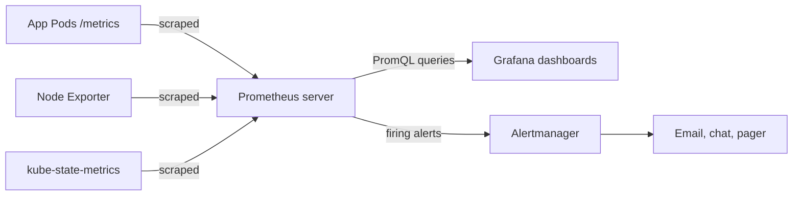

# Domain 4: Cloud Native Architecture (12%)

This domain covers three competencies: Observability, Cloud Native Ecosystem and Principles, and Cloud Native Community and Collaboration. In the November 2025 revision observability stopped being a separate domain and was folded in here, and the community competency is new. The weight is the smallest on the exam, but the material is broad, and much of it is vocabulary you can learn quickly.

**[📖 KCNA exam page](https://training.linuxfoundation.org/certification/kubernetes-cloud-native-associate/)** - Official domains and weights
**[📖 CNCF Cloud Native Definition](https://github.com/cncf/toc/blob/main/DEFINITION.md)** - The official definition
**[📖 CNCF Landscape](https://landscape.cncf.io/)** - Interactive map of cloud native projects and products
**[📖 Cloud Native Glossary](https://glossary.cncf.io/)** - Plain-language definitions of cloud native terms
**[📖 CNCF Projects](https://www.cncf.io/projects/)** - Every hosted project with its current maturity level

---

## Observability

### Monitoring versus observability

**Monitoring** watches for known failure conditions: a dashboard of CPU use, an alert when disk is 90% full. **Observability** is the property of a system that lets you ask new questions about its behaviour from the outside, including about failures you did not predict. In a distributed system of many small services, most incidents are new combinations of partial failures, so you need data rich enough to explore, not only fixed alerts. Cloud native systems produce that data as three main signals, often called the three pillars.

- **Metrics** - Numeric measurements over time, such as request rate, error count or memory use. Cheap to store and ideal for dashboards and alerts.
- **Logs** - Timestamped records of discrete events, structured (such as JSON) or free text. Rich detail for one component.
- **Traces** - The path of one request across many services, made of spans. Show where time was spent and where an error started.

A typical investigation uses all three. An alert on a metric says something is wrong. A trace shows which service in the chain is slow. The logs of that service show why.

### Prometheus and the pull model

**Prometheus**, a CNCF graduated project and the second project to join the CNCF after Kubernetes, is the standard metrics system for Kubernetes. Its defining choice is the **pull model**: the Prometheus server **scrapes** HTTP endpoints (usually `/metrics`) on a schedule, rather than applications pushing data to it. Pull makes it easy to tell when a target is down (the scrape fails) and lets Prometheus discover targets automatically through Kubernetes service discovery. For short-lived batch jobs that end before they can be scraped, the **Pushgateway** holds their final metrics for Prometheus to collect.

Each time series is a metric name plus a set of **labels**, such as `http_requests_total{method="GET", status="500"}`. Labels make the data dimensional: you can sum across all Pods, or filter to one route. The four metric types are **counter** (only goes up, such as requests served), **gauge** (goes up and down, such as memory in use), **histogram** and **summary** (both describe distributions such as request latency).

Software that does not expose Prometheus metrics itself gets an **exporter**, a small process that translates. Node Exporter exposes host metrics such as CPU and disk.

**PromQL** is the query language. You do not need to write it for KCNA, but recognise the shape: `rate(http_requests_total[5m])` turns an ever-increasing counter into a per-second rate over the last five minutes, and `sum by (service)` aggregates across labels.

**Alertmanager** receives alerts fired by Prometheus alerting rules and handles what happens next: deduplicating, grouping related alerts, silencing during maintenance and routing to email, chat or paging tools. Prometheus decides that something is wrong; Alertmanager decides who to tell.

**Grafana** is the usual dashboard layer on top of Prometheus and many other data sources. It is open source from Grafana Labs, not a CNCF project.

*Prometheus pulls metrics from targets, Grafana queries it for dashboards, and Alertmanager routes the alerts Prometheus fires.*

- **Pull model** - The monitoring server scrapes targets on a schedule instead of targets pushing data.
- **Exporter** - A process that exposes another system's metrics in Prometheus format.
- **PromQL** - The Prometheus query language for selecting and aggregating time series.
- **Alertmanager** - Deduplicates, groups, silences and routes alerts from Prometheus.

**[📖 Prometheus overview](https://prometheus.io/docs/introduction/overview/)** - Architecture and components

### metrics-server versus kube-state-metrics

These two names confuse many candidates.

- **metrics-server** - Collects current CPU and memory usage of Pods and nodes from the kubelets and serves it through the Kubernetes resource metrics API. It powers `kubectl top` and the Horizontal Pod Autoscaler. It keeps only recent values and is not a monitoring system.
- **kube-state-metrics** - Watches the API server and exposes the *state* of objects as Prometheus metrics: how many replicas a Deployment wants and has, which Pods are Pending, how often a container restarted. It does not measure CPU or memory use.

> **Exam trap:** "What does HPA read CPU utilisation from?" is metrics-server, not kube-state-metrics or Prometheus (unless a custom metrics adapter is installed).

**[📖 Resource metrics pipeline](https://kubernetes.io/docs/tasks/debug/debug-cluster/resource-metrics-pipeline/)** - metrics-server and the Metrics API

### Logging: Fluentd and Fluent Bit

The cloud native convention is that applications write logs to **stdout and stderr**, and the container runtime writes those streams to files on the node. A log agent, usually a **DaemonSet** so there is one per node, reads those files, adds Kubernetes metadata such as Pod and namespace names, and ships them to a backend such as Elasticsearch, OpenSearch, Loki or a cloud logging service. **Fluentd** is a CNCF graduated log collector with a large plugin ecosystem. **Fluent Bit** is its lightweight sibling written in C, well suited to running on every node. A common pattern is Fluent Bit on nodes forwarding to a central Fluentd or straight to the backend.

Without a log agent, logs disappear when Pods are deleted, since `kubectl logs` only reads what is still on the node.

### Tracing: OpenTelemetry and Jaeger

A **trace** follows one request. Each unit of work, such as one HTTP handler or one database call, is a **span** with a start time, duration and attributes. Spans share a **trace ID** that is passed between services in request headers (context propagation), so a backend can stitch them into one tree.

**OpenTelemetry (OTel)** is the CNCF project that standardises how telemetry is produced and moved. It provides APIs and SDKs for many languages, automatic instrumentation for common frameworks, the OTLP wire protocol, and the **OpenTelemetry Collector**, which receives, processes and exports metrics, logs and traces to any backend. It was formed by merging OpenTracing and OpenCensus. OpenTelemetry does not store or display data; it feeds backends. **Jaeger**, a CNCF graduated project, is a tracing backend that stores traces and lets you search and visualise them.

- **Span** - One timed operation within a trace.
- **Trace** - The full tree of spans for one request as it crosses services.
- **OpenTelemetry** - Vendor-neutral standard, SDKs and Collector for generating and exporting telemetry.
- **Jaeger** - CNCF graduated distributed tracing backend.

**[📖 OpenTelemetry documentation](https://opentelemetry.io/docs/)** - Concepts, SDKs and the Collector

### SLIs, SLOs and cost visibility

Observability data becomes a business tool through service levels. A **service level indicator (SLI)** is a measured quantity, such as the share of requests served successfully in under 300 ms. A **service level objective (SLO)** is the target for it, such as 99.9% over 30 days. The gap between the SLO and perfection is the **error budget**: how much unreliability you can spend on releases and experiments before you must slow down. A **service level agreement (SLA)** is a contract with consequences, and is usually looser than the internal SLO.

Cost is another signal. In a shared cluster the cloud bill does not say which team or app used what. **OpenCost**, a CNCF project, allocates cluster costs to namespaces, workloads and labels using resource requests and usage, which supports FinOps practices such as showback and right-sizing requests.

---

## Cloud Native Ecosystem and Principles

### What cloud native means

The CNCF definition says cloud native technologies let organisations build and run scalable applications in modern, dynamic environments such as public, private and hybrid clouds. Containers, service meshes, microservices, immutable infrastructure and declarative APIs exemplify the approach. These techniques enable loosely coupled systems that are resilient, manageable and observable, and combined with robust automation they let engineers make high-impact changes frequently and predictably with minimal toil.

Notice what the definition is *not*: it is not "running in a public cloud". A Kubernetes cluster in your own data centre can be cloud native; a single VM lifted into a cloud provider is not.

### The twelve-factor app

The **twelve-factor app** methodology, written by engineers at Heroku, predates Kubernetes but maps onto it closely.

| Factor | Principle | Kubernetes mapping |
|--------|-----------|--------------------|
| Codebase | One codebase in version control, many deploys | One Git repo per service |
| Dependencies | Declare and isolate dependencies | Everything packed into the container image |
| Config | Store config in the environment | ConfigMaps, Secrets, environment variables |
| Backing services | Treat them as attached resources | Databases and queues reached by Service name or URL |
| Build, release, run | Separate the stages strictly | CI builds the image, a release pairs image with config, Pods run it |
| Processes | Run as stateless processes | Stateless Pods, state in external stores |
| Port binding | Export services by binding a port | Container port behind a Service |
| Concurrency | Scale out with more processes | More replicas, HPA |
| Disposability | Start fast, shut down gracefully | Probes, SIGTERM handling, preStop hooks |
| Dev/prod parity | Keep environments similar | Same image everywhere, Kustomize overlays |
| Logs | Treat logs as event streams | Write to stdout, collect with a DaemonSet agent |
| Admin processes | Run one-off tasks as processes | Jobs |

**[📖 The Twelve-Factor App](https://12factor.net/)** - The full methodology

### Microservices, immutability and declarative APIs

**Microservices** split an application into small services that each own one business capability and their own data, talk over well-defined APIs (REST, gRPC or events), and can be deployed and scaled independently. The benefits are independent team velocity, independent scaling and fault isolation. The costs are network calls that can fail, distributed data, and far more moving parts to observe and secure. That cost is exactly why the rest of the cloud native toolset exists: orchestration, service discovery, meshes and tracing.

**Immutable infrastructure** means you never change a running server or container in place. You build a new image and replace the old instances. That makes every environment reproducible and rollback a matter of redeploying the previous version.

**Declarative APIs** describe the target, not the steps, and pair with reconciliation loops that drive towards it. Kubernetes is the canonical example, and Crossplane extends the same idea to cloud infrastructure, letting you manage databases and buckets as Kubernetes objects.

Resilience patterns appear in architecture questions: **circuit breakers** stop calling a failing dependency so it can recover, **retries with backoff** handle transient errors, **timeouts** stop a slow dependency from tying up every thread, and **bulkheads** isolate resources so one failure cannot exhaust everything.

### Autoscaling and serverless

Cloud native systems scale with demand. **Horizontal scaling** adds instances (more Pods, more nodes); **vertical scaling** gives an instance more CPU or memory. Horizontal is preferred because it also adds redundancy, but it needs stateless design.

**Serverless** pushes this to the limit: developers provide a function or container, and the platform handles servers, scaling and often billing per request, including **scale to zero** when idle. On Kubernetes, **Knative** provides this. Knative Serving runs request-driven containers that scale to zero and back, and Knative Eventing routes events between producers and consumers. **CloudEvents** is a CNCF specification that describes event data in a common format, so producers and consumers from different vendors interoperate.

### Service mesh as an architecture choice

A service mesh (introduced in [Domain 2](./02-container-orchestration.md#service-mesh-at-a-concept-level)) is an architectural answer to microservice communication: mTLS, retries, traffic shifting and telemetry handled uniformly by a proxy layer. **Envoy** is the proxy at the heart of many meshes and gateways. Istio and Linkerd are the best-known meshes.

### CNCF project maturity

CNCF projects sit at one of three maturity levels, decided by the Technical Oversight Committee (TOC).

- **Sandbox** - Early-stage projects. Entry point for experiments and new ideas.
- **Incubating** - Used successfully in production by several adopters, with a healthy contributor base.
- **Graduated** - Widely adopted, with a third-party security audit, a defined governance model and committers from multiple organisations.

Examples that are safe to know: **Graduated** includes Kubernetes, Prometheus, Envoy, CoreDNS, containerd, CRI-O, etcd, Fluentd, Helm, Jaeger, Argo, Flux, Linkerd, Istio, Cilium, Open Policy Agent, Falco and Harbor. **Incubating** includes OpenTelemetry, Backstage and Thanos. Projects move up over time, so check the live list on the CNCF projects page before relying on a borderline case.

> **Exam trap:** Grafana, Terraform, Docker Engine and Jenkins are widely used in cloud native work but are not CNCF projects.

- **Sandbox** - Entry maturity level for early-stage CNCF projects.
- **Incubating** - Middle CNCF maturity level for projects with real production use.
- **Graduated** - Highest CNCF maturity level, for widely adopted projects with mature governance.

---

## Cloud Native Community and Collaboration

### CNCF and the Linux Foundation

The **Cloud Native Computing Foundation (CNCF)** was founded in 2015 as part of the **Linux Foundation**, a non-profit that hosts many open source foundations. Google contributed Kubernetes as the CNCF's seed project, and Kubernetes became its first graduated project in 2018. The CNCF provides a vendor-neutral home for projects: it holds trademarks, funds infrastructure and security audits, runs events, and runs certifications such as KCNA, CKA, CKAD and CKS together with Linux Foundation Training.

Governance has several parts. The **Governing Board** handles budget and business decisions. The **Technical Oversight Committee (TOC)** sets technical vision and votes on accepting and promoting projects. **Technical Advisory Groups (TAGs)** are CNCF-level groups that support the TOC in a domain such as security or observability, publishing guidance and reviewing projects. The TOC reorganised its TAG structure in 2025, so check the TOC repository for the current list.

**[📖 CNCF TOC repository](https://github.com/cncf/toc)** - TOC, TAGs and project process

### How the Kubernetes project is organised

Kubernetes itself has its own community structure under the CNCF umbrella.

- **Special Interest Groups (SIGs)** - Long-lived groups that own a part of Kubernetes, such as SIG Network, SIG Storage, SIG Node, SIG Apps, SIG Auth and SIG Release. Code and decisions live with the owning SIG.
- **Working groups (WGs)** - Short-lived groups that bring several SIGs together to solve a cross-cutting problem, then disband.
- **Steering Committee** - The elected body that governs the Kubernetes project as a whole.
- **Kubernetes Enhancement Proposal (KEP)** - The design document and tracking process every significant change goes through, from proposal to alpha, beta and stable.

> **Exam trap:** CNCF TAGs and Kubernetes SIGs are different things at different levels. TAGs advise the CNCF across many projects; SIGs own parts of the Kubernetes codebase.

The Kubernetes **release cadence** is roughly **three minor releases a year**, each taking about fifteen weeks and run by a volunteer release team under SIG Release. Features graduate through alpha, beta and stable over several releases, and each KEP records its stage.

**[📖 Kubernetes community repository](https://github.com/kubernetes/community)** - SIGs, working groups and governance
**[📖 Kubernetes Enhancements](https://github.com/kubernetes/enhancements)** - The KEP process and every KEP
**[📖 Kubernetes Releases](https://kubernetes.io/releases/)** - Release history and support periods

### Open governance and contributing

Open governance means decisions are made in public, by documented processes, by people from many companies, so no single vendor controls a project. That neutrality is the main reason companies that compete commercially still collaborate on Kubernetes. Contributing is not only code: documentation, testing, issue triage, release team roles, localisation and answering questions all count. New contributors usually start by joining a SIG's meetings and Slack channel and picking up issues labelled `good first issue`. The Kubernetes contributor guide explains signing the CNCF Contributor License Agreement and the review process.

All CNCF projects and events follow the **CNCF Code of Conduct**, which sets expected behaviour and a process for reporting problems.

### KubeCon + CloudNativeCon

**KubeCon + CloudNativeCon** is the CNCF's flagship conference, held several times a year across North America, Europe and other regions. It is where projects announce releases and graduations, SIGs and TAGs meet in person, and maintainers run project updates. Smaller community events such as Kubernetes Community Days are organised locally with CNCF support.

**[📖 CNCF Code of Conduct](https://github.com/cncf/foundation/blob/main/code-of-conduct.md)** - Expected behaviour in CNCF communities
**[📖 Kubernetes contributor guide](https://www.kubernetes.dev/docs/guide/)** - How to start contributing

---

## Check yourself

1. Why does Prometheus pull metrics rather than receive pushes, and what is the exception for batch jobs?
2. Which component feeds `kubectl top` and the HPA, and which exposes object state as metrics?
3. What does OpenTelemetry do, and what does it leave to a backend such as Jaeger?
4. Name the three CNCF maturity levels and what distinguishes Graduated.
5. What is the difference between a CNCF TAG and a Kubernetes SIG, and where are significant Kubernetes changes proposed?
