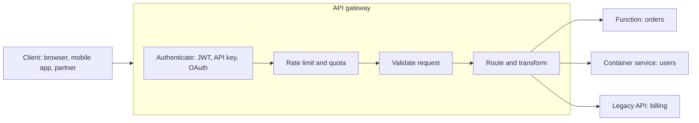

# API Gateways Explained

> **8-minute read. Assumes you've read [HTTP and APIs](../day-one/http-and-apis.md) and [Load balancing explained](./load-balancing-explained.md).**

## The one-line answer

An API gateway is a managed front door for your APIs. Every request hits it first, and it handles the jobs every API needs - authentication, rate limiting, routing, request validation, logging - before passing the request to whatever actually does the work: a function, a container, a VM or another company's service.

## Why it exists

Picture ten backend services, each exposed directly to the internet. Each team has to implement token checking, throttling, CORS headers, API keys for partners, request logging and TLS. They will each do it slightly differently, and one of them will get it wrong.

An API gateway pulls those **cross-cutting concerns** into one place. The backend services shrink to business logic, and security rules are enforced consistently at the edge.

It also gives you a stable public contract. Clients call `api.example.com/orders`. Behind the gateway you can split one service into three, move from VMs to functions, or run two versions side by side, and the client never knows.

## What a gateway does

A request passes through the gateway's checks in order - identity, limits, validation - and is then routed to one of several backends, which can be completely different kinds of compute.

The common features:

- **Authentication and authorization.** Validate a JWT from your identity provider, check an API key, or call a custom authorizer function. Unauthenticated requests never reach your code.
- **Throttling and quotas.** "100 requests per second per client, 10,000 per day on the free plan." This protects your backend and lets you sell API tiers.
- **Routing.** Map paths and methods to backends: `GET /orders/*` to one service, `POST /payments` to another.
- **Request and response transformation.** Rename fields, add headers, convert a legacy XML backend into JSON for clients.
- **Validation.** Reject a malformed body against a schema before it costs compute.
- **Caching.** Return a stored response for identical `GET` requests.
- **Observability.** One place to log every call, measure latency and count errors per route.
- **Versioning and stages.** `/v1` and `/v2`, or `dev` and `prod` stages on one definition.

## Gateway vs load balancer vs service mesh

These three overlap and confuse everyone.

| | Load balancer | API gateway | Service mesh |
|---|---|---|---|
| Main job | Spread traffic across copies of one service | Manage APIs for external clients | Manage service-to-service calls inside |
| Traffic direction | Mostly north-south (into the system) | North-south | East-west (between services) |
| Knows about | Connections, HTTP paths and hosts | API consumers, keys, plans, schemas | Every service identity and call |
| Typical extras | Health checks, TLS | Auth, quotas, transformation, developer portal | mTLS, retries, traffic splitting |

A Layer 7 load balancer can route by path and even validate a JWT on some platforms, so for a simple internal API it may be all you need. Reach for a gateway when you have **API consumers to manage**: keys, quotas, usage plans, partner onboarding, many routes with different auth. See [Service mesh explained](./service-mesh-explained.md) for the east-west side.

## The managed options

- **AWS:** Amazon API Gateway, with **HTTP APIs** (cheaper, simpler, JWT auth), **REST APIs** (more features: usage plans, API keys, request validation, caching) and **WebSocket APIs**. A very common pairing is API Gateway in front of Lambda.
- **Azure:** Azure API Management (APIM), a full API platform with policies written in XML, a developer portal, products and subscriptions. Tiers range from Consumption (serverless) to Premium (multi-region, VNet-injected).
- **GCP:** API Gateway for simple serverless backends, and **Apigee** for full API management: monetization, analytics and complex policies.
- **Self-managed:** Kong, Tyk, and the Kubernetes Gateway API implementations (Envoy Gateway and others).

## A worked example

A startup has a mobile app and is about to open its API to partners.

1. The mobile app authenticates users with an identity provider and gets a JWT. The gateway validates the token on every call, so backend functions trust the user ID in the request context.
2. Partners get **API keys** tied to a **usage plan**: 50 requests per second, 1 million per month. Over the limit, the gateway returns `429 Too Many Requests` without touching the backend.
3. `GET /products` responses are cached at the gateway for 60 seconds. The product catalog changes rarely, and the cache absorbs most of the load.
4. When the team rewrites the orders service, they deploy it as `/v2/orders` and move clients over gradually. `/v1` keeps working until traffic drops to zero.

## Common mistakes

- **Putting business logic in gateway policies.** Transformations and complex scripts in the gateway become a hidden, hard-to-test application. Keep the gateway thin.
- **Treating the gateway as the only security layer.** Backends should still check authorization for the specific resource. The gateway knows who you are, not whether order 1042 belongs to you.
- **Ignoring timeouts.** Gateways enforce integration timeouts (Amazon API Gateway's default is 29 seconds). Long-running work belongs behind a queue, with the API returning `202 Accepted`.
- **Adding a gateway for one internal service.** It is another hop, another bill and another thing to configure. A load balancer may be enough.
- **Forgetting the bill.** Per-request pricing is cheap at low volume and significant at billions of calls.

## How exams test it

- "Expose Lambda functions as a REST API with throttling and API keys for partners" -> Amazon API Gateway (REST API with usage plans).
- "Publish APIs to external developers with a portal, products and subscription keys" -> Azure API Management.
- "Full lifecycle API management with monetization and analytics on Google Cloud" -> Apigee.
- "Protect the backend from traffic spikes" -> throttling at the gateway, often plus a queue.

## Go deeper

- **[📖 What is Amazon API Gateway?](https://docs.aws.amazon.com/apigateway/latest/developerguide/welcome.html)** - REST, HTTP and WebSocket API types
- **[📖 Azure API Management key concepts](https://learn.microsoft.com/en-us/azure/api-management/api-management-key-concepts)** - gateway, management plane and developer portal
- **[📖 About API Gateway (Google Cloud)](https://cloud.google.com/api-gateway/docs/about-api-gateway)** - the simple serverless gateway; see Apigee for full management

## What to look at next

- **[API gateway pattern](../../resources/architecture-patterns/api-gateway-pattern.md)** - the deep dive: BFF, aggregation, offloading, versioning per cloud
- **[Serverless explained](./serverless-explained.md)** - the backend most often behind a managed gateway
- **[Message queues and pub/sub](./message-queues-and-pub-sub-for-cloud.md)** - where long-running work goes instead of a synchronous API call
- **[What is an API call?](../day-one/what-is-an-api-call.md)** - the request anatomy the gateway inspects
