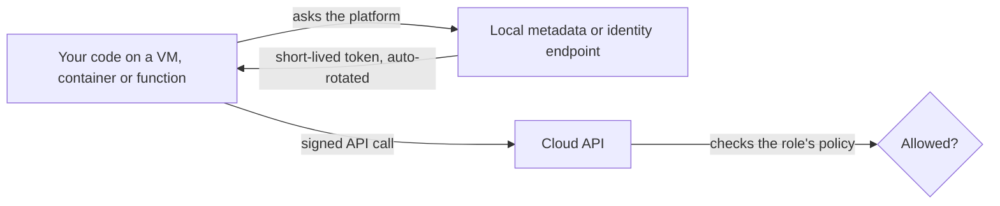

# Cloud Identity Basics for Builders

> **7-minute read.** This is the builder's short version: how your code and your pipelines should get cloud credentials. For IAM in depth (policies, evaluation logic, federation, least privilege at scale), read **[IAM explained](https://security.noblerworks.com/learn/concepts/iam-explained/)** and the **[IAM topic](https://security.noblerworks.com/topics/iam/)** on Security Zero to Hero.

## The one-line answer

Every call to a cloud API is made by an identity, and the right identity for code is almost never a person's account or a long-lived access key. Give your workloads **roles** (AWS), **managed identities** (Azure) or **service accounts** (GCP), and let the platform hand them short-lived credentials automatically.

## Two kinds of identity

- **Human identities** are people. They should sign in through single sign-on with MFA and get temporary access to the accounts they need.
- **Workload identities** are code: a VM, a container, a function, a CI pipeline. They are the majority of identities in any real system, and they are where most leaked credentials come from.

The classic mistake is giving code a human-style credential: an access key and secret pasted into an environment variable, a config file or, worst of all, a Git repository. Those keys never expire on their own, they get copied into laptops and logs, and attackers scan public repositories for them within minutes of a push.

## How workloads should get credentials

The workload never stores a secret: the SDK fetches a short-lived token from the platform's local identity endpoint, refreshes it before expiry, and every API call is checked against the permissions attached to that identity.

| | AWS | Azure | GCP |
|---|---|---|---|
| Identity for a workload | IAM role (instance profile, task role, execution role) | Managed identity (system- or user-assigned) | Service account attached to the resource |
| Kubernetes pods | EKS Pod Identity, IRSA | Microsoft Entra Workload ID | GKE Workload Identity Federation |
| Outside the cloud (CI, other clouds) | IAM roles trusted via OIDC | Workload identity federation on an app registration or managed identity | Workload Identity Federation |

The SDKs pick these up automatically through their default credential chain. Code that does `boto3.client("s3")`, `DefaultAzureCredential()` or `storage.Client()` with no keys at all is the goal.

## CI/CD without stored keys

Pipelines used to need a cloud access key stored as a secret. Modern CI systems (GitHub Actions, GitLab, Azure Pipelines and others) issue an **OIDC token** for each job that says "I am repository X, branch main". The cloud trusts that issuer and swaps the token for short-lived credentials, restricted to that exact repository and branch.

The result: there is no long-lived secret to leak, rotate or forget. Configure the trust tightly. Trusting "any repository in the organization" or "any branch" lets a pull request from a fork assume your production role.

## Least privilege, practically

- **One identity per workload.** The orders service and the reporting job get separate roles, so a bug in one cannot use the other's permissions.
- **Scope to resources, not just actions.** `s3:GetObject` on `arn:aws:s3:::invoices-prod/*`, not `s3:*` on `*`.
- **Start narrow and add**, using denied-call errors and access analyzers to find what is missing, rather than starting with admin and promising to tighten later.
- **Separate deploy and run.** The pipeline that creates the function needs broad rights; the function itself needs very few.

## Common mistakes

- **Access keys in code, `.env` files committed to Git, or container images.**
- **One shared "app" role** for every service in an account.
- **Wildcard trust** in OIDC federation.
- **Using the root or owner account** for daily work or automation.
- **Service account key files on GCP** downloaded and passed around, when attached service accounts or federation would work. Many organizations block key creation with an organization policy.
- **Instance metadata without protection.** On AWS, require IMDSv2 so a server-side request forgery bug cannot easily read the instance's credentials.

## How exams test it

Almost every associate exam has the question: "An application on EC2 / a VM / Cloud Run needs to read from storage. What is the most secure way to provide credentials?" The answer is always the attached identity (IAM role, managed identity, service account), never access keys in a config file or environment variable. Variants ask about CI pipelines (OIDC federation) and Kubernetes pods (pod-level identity, not the node's identity).

## Go deeper

- **[IAM explained](https://security.noblerworks.com/learn/concepts/iam-explained/)** - users, roles, policies and federation in depth (Security Zero to Hero)
- **[Secrets management](https://security.noblerworks.com/learn/concepts/secrets-management/)** - for the credentials that cannot be replaced by an identity (Security Zero to Hero)
- **[📖 IAM roles (AWS)](https://docs.aws.amazon.com/IAM/latest/UserGuide/id_roles.html)** - roles, trust policies and temporary credentials
- **[📖 Managed identities for Azure resources](https://learn.microsoft.com/en-us/entra/identity/managed-identities-azure-resources/overview)** - system- and user-assigned identities
- **[📖 Workload Identity Federation (Google Cloud)](https://cloud.google.com/iam/docs/workload-identity-federation)** - keyless access from outside Google Cloud

## What to look at next

- **[Multi-account strategy and landing zones](./multi-account-and-landing-zones.md)** - how human access is organized across many accounts
- **[CI/CD explained](./cicd-explained.md)** - where OIDC federation fits in a pipeline
- **[Environment variables and config](../day-one/environment-variables-and-config.md)** - why config belongs in the environment, and secrets mostly do not
