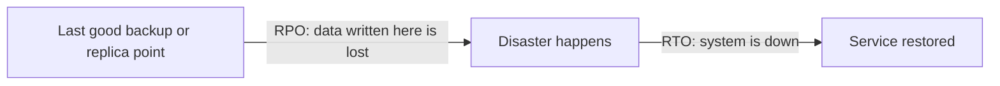

# Disaster Recovery: RPO and RTO

> **9-minute read. Assumes you've read [High availability and fault tolerance](./high-availability-and-fault-tolerance.md).**

## The one-line answer

Disaster recovery (DR) is the plan for getting a system back after something big goes wrong: a region outage, a ransomware attack, a deleted database. Two numbers define every DR plan. **RPO** (recovery point objective) is how much data you can afford to lose. **RTO** (recovery time objective) is how long you can afford to be down.

Pick those two numbers first, with the business. The technology follows from them.

## Why HA is not enough

High availability handles small, expected failures automatically: a server dies, a zone goes dark, the standby takes over. DR handles the failures HA cannot, and the uncomfortable truth is that many of them **replicate**:

- A bad migration drops a column. Synchronous replication drops it on the standby too, within milliseconds.
- Ransomware encrypts the primary. The replica faithfully copies the encrypted data.
- A whole region has a control-plane problem. Every zone in it is affected.
- Someone runs `terraform destroy` in the wrong workspace.

For these you need a copy that is **separate in time** (a backup from before the damage) and often **separate in place** (another region or account).

## RPO and RTO on a timeline

The timeline reads left to right: everything written between the last recoverable point and the disaster is lost (that gap is your RPO), and everything between the disaster and full service is downtime (that gap is your RTO).

- **RPO 24 hours** means a nightly backup is acceptable. Losing a day of orders is survivable for this system.
- **RPO 5 minutes** means you need continuous log shipping or frequent snapshots.
- **RPO near zero** means synchronous or near-synchronous replication to the recovery site.
- **RTO 24 hours** means you can rebuild from code and restore backups by hand.
- **RTO 15 minutes** means the infrastructure must already exist in the recovery site and failover must be scripted.
- **RTO near zero** means traffic is already flowing to both sites (active-active).

The objective is a target. What you actually achieve in a test is sometimes called RPA and RTA (recovery point and time *actual*). The gap between objective and actual is what drills uncover.

## The four classic strategies

Every provider's guidance describes the same ladder. Cost and complexity rise as RPO and RTO fall.

| Strategy | What runs in the recovery site | Typical RTO | Typical RPO | Cost |
|---|---|---|---|---|
| **Backup and restore** | Nothing. Backups are copied there. | Hours to a day | Hours (last backup) | Lowest |
| **Pilot light** | Data replicates; core infrastructure is defined but scaled to zero or off | Tens of minutes to hours | Minutes | Low |
| **Warm standby** | A smaller, fully working copy of the stack | Minutes | Seconds to minutes | Medium |
| **Multi-site active-active** | A full copy serving live traffic | Near zero | Near zero | Highest, often double |

The [disaster recovery patterns](../../resources/architecture-patterns/disaster-recovery-patterns.md) page walks through each strategy with architecture, Terraform and per-cloud detail.

## A worked example

An online booking system takes about 2,000 bookings a day and earns most of its revenue during business hours.

1. **Ask the business.** Losing an hour of bookings means phoning a few dozen customers: painful but survivable. Being down for four hours in the afternoon costs real money and reputation. Agreed: **RPO 15 minutes, RTO 1 hour.**
2. **Rule out the ends of the ladder.** Nightly backups give a 24-hour RPO: too much loss. Active-active across regions is far more than a one-hour RTO needs.
3. **Choose pilot light.** The database replicates continuously to a second region (cross-region read replica, or Azure SQL geo-replication, or Cloud SQL cross-region replica). The app tier is defined in IaC but not running. Container images are already copied to the recovery region's registry.
4. **Write the runbook.** Promote the replica, run the IaC pipeline against the recovery region, scale the app up, switch DNS. Script as much of it as possible.
5. **Add point-in-time backups too.** Replication protects against losing a region. It does not protect against a bad migration, so keep automated backups with point-in-time restore, copied to another account so a compromised account cannot delete them.
6. **Test it.** Run the drill twice a year and record the actual RPO and RTO.

## The parts people forget

- **Backups you have never restored are a hope, not a plan.** Restore tests are the only proof.
- **Everything besides the database.** Secrets, DNS zones, certificates, container images, IAM roles and configuration all have to exist in the recovery site.
- **Quotas in the recovery region.** A new region may not let you launch 200 instances on short notice. Request limits ahead of time.
- **Isolation for backups.** Store copies in a separate account or subscription, with immutability (S3 Object Lock, Azure immutable blob storage, GCS bucket lock) so an attacker with admin access to production cannot delete them.
- **Failing back.** Returning to the primary region is a second migration and needs its own plan.
- **Who decides.** Someone must have the authority to declare a disaster. A clear trigger saves the first hour of debate.

## Provider services worth knowing

- **AWS:** AWS Backup (cross-account and cross-region copies), Aurora Global Database, DynamoDB global tables, S3 Cross-Region Replication, and AWS Elastic Disaster Recovery for server replication.
- **Azure:** Azure Backup, Azure Site Recovery for VM replication, geo-redundant storage, and failover groups for Azure SQL.
- **GCP:** Backup and DR Service, cross-region Cloud SQL replicas, multi-region and dual-region Cloud Storage buckets.

## How exams test it

DR questions nearly always hand you an RPO and RTO and four options from the ladder. Match the numbers, then pick the **cheapest** option that meets both. Tells:

- "RTO of hours, cost is the priority" -> backup and restore.
- "Core database must be current, the rest can be started when needed" -> pilot light.
- "RTO of minutes, a scaled-down copy is acceptable" -> warm standby.
- "Zero downtime, zero data loss across regions" -> multi-site active-active.
- "Protect backups from deletion by a compromised administrator" -> cross-account copies plus immutability.

## Go deeper

- **[📖 Disaster recovery options in the cloud (AWS whitepaper)](https://docs.aws.amazon.com/whitepapers/latest/disaster-recovery-workloads-on-aws/disaster-recovery-options-in-the-cloud.html)** - the four strategies as AWS defines them
- **[📖 Azure Site Recovery overview](https://learn.microsoft.com/en-us/azure/site-recovery/site-recovery-overview)** - replication and orchestrated failover on Azure
- **[📖 Google Cloud disaster recovery planning guide](https://cloud.google.com/architecture/dr-scenarios-planning-guide)** - RPO, RTO and DR building blocks on Google Cloud

## What to look at next

- **[Disaster recovery patterns](../../resources/architecture-patterns/disaster-recovery-patterns.md)** - the deep dive: each strategy with diagrams and Terraform
- **[Run a DR drill](../../resources/hands-on-projects/disaster-recovery-drill.md)** - hands-on: fail over and measure your real RPO and RTO
- **[Multi-region active-active](../../resources/architecture-patterns/multi-region-active-active.md)** - the top rung of the ladder
- **[Object, block, and file storage](./object-block-file-storage.md)** - where snapshots and backups live
