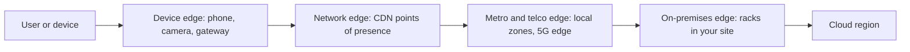

# Edge Computing Explained

> **8-minute read. Assumes you've read [CDN explained](./cdn-explained.md) and [Regions and availability zones](./regions-and-availability-zones.md).**

## The one-line answer

Edge computing means running code or storing data physically close to where it is used - near the user, the device or the factory floor - instead of only in a big central cloud region. You do it when the round trip to a region is too slow, too expensive, or not allowed.

## Why distance matters

Light in fibre covers roughly 200 km per millisecond. A user in Sydney calling a server in Virginia has a round trip of well over 200 ms before any work happens, and a typical page needs many round trips (DNS, TLS handshake, API calls). No amount of server tuning fixes physics.

There are other reasons besides latency:

- **Bandwidth.** A factory with 500 cameras cannot stream raw video to the cloud. Process it locally and send only the events.
- **Intermittent connectivity.** A ship, a mine or a retail store must keep working when the link drops.
- **Data residency.** Some data must not leave a country, a hospital or a building.
- **Cost.** Data transfer out of a region is billed; handling requests at the edge avoids some of it.

## The many meanings of "edge"

"Edge" covers a spectrum, from a few hundred global locations run by the provider to a box in your own building.

Moving left in the diagram puts compute closer to the user, with lower latency but less capacity and fewer services; moving right gives you the full cloud with more distance.

| Layer | What runs there | AWS | Azure | GCP / others |
|---|---|---|---|---|
| **CDN edge functions** | Small, fast functions on every request | CloudFront Functions, Lambda@Edge | Front Door rules engine | Cloudflare Workers, Fastly Compute, Akamai EdgeWorkers |
| **Metro and telco edge** | Regular compute in a nearby city or carrier network | Local Zones, Wavelength | Extended zones, Azure Operator Nexus | Google Distributed Cloud connected |
| **On-premises edge** | Cloud-managed hardware in your building | Outposts | Azure Local, Azure Stack Edge | Google Distributed Cloud |
| **Device edge** | Code on gateways and IoT devices | IoT Greengrass | Azure IoT Edge | Open-source runtimes such as KubeEdge |

## CDN edge functions

This is the edge most web developers meet first. Code runs in the CDN's points of presence, in front of the cache, on every request or response. Good jobs for it:

- Redirects, URL rewrites and A/B test routing
- Adding security headers
- Checking a signed cookie or JWT before a request reaches the origin
- Choosing a localized page by country
- Simple personalization of cached pages

Limits are strict. CloudFront Functions run JavaScript for at most about a millisecond with no network access; Lambda@Edge allows more time, network calls and larger packages, but runs in fewer regional edge caches; Cloudflare Workers allow more compute and come with edge storage (KV, Durable Objects, D1). The general rule: the closer to the user, the smaller the function.

## The hard part: data

Running code at the edge is easy. Running it next to the **data** it needs is the real problem. A function in Sydney that calls a database in Virginia has gained nothing.

Patterns that work:

- **Read-mostly data replicated outward**: configuration, feature flags, product catalogs, cached API responses.
- **Edge key-value stores** with eventual consistency, accepting that a write in one place takes time to appear elsewhere.
- **Write locally, sync later**: devices and on-premises sites buffer and forward when connected.
- **Keep the writes central**: the edge handles reads, auth and routing; transactions still go to the region.

See [Eventual consistency](https://data.noblerworks.com/learn/concepts/eventual-consistency/) on Data Zero to Hero for why this is a trade-off, not a bug.

## A worked example

A global news site serves most readers from cache, but the page shows a paywall depending on the reader's subscription.

- **Before:** every page request goes to the origin in one region to check the subscription. Readers in Asia wait 300 ms extra, and the origin handles all traffic.
- **After:** the login service issues a signed token. An edge function verifies the signature at the nearest point of presence and serves the cached full article or the cached paywall version. No call to the origin for most requests. The origin load drops sharply and every reader gets a cached response from nearby.

The edge function holds no database. It only needs a public key to verify signatures, which is exactly the kind of read-only data that belongs at the edge.

## Common mistakes

- **Moving compute to the edge but not the data**, then calling back to the region on every request.
- **Putting business logic in edge functions** that is hard to test and deploy consistently.
- **Ignoring runtime limits**: execution time, memory, package size, missing APIs.
- **Assuming strong consistency** in edge stores.
- **Buying on-premises edge hardware** when a nearby region or Local Zone would meet the latency target.

## How exams test it

- "Modify headers or redirect at the CDN with the lowest latency and cost" -> CloudFront Functions. "Needs network calls or longer execution" -> Lambda@Edge.
- "Single-digit millisecond latency to users in a specific metro area" -> Local Zones (AWS).
- "Ultra-low latency for 5G mobile devices" -> Wavelength.
- "Run AWS services on premises for data residency or low latency to local systems" -> Outposts; on Azure, Azure Local or Azure Stack Edge.
- "Process IoT data locally when disconnected" -> IoT Greengrass or Azure IoT Edge.

## Go deeper

- **[📖 Customize at the edge with CloudFront Functions and Lambda@Edge](https://docs.aws.amazon.com/AmazonCloudFront/latest/DeveloperGuide/edge-functions.html)** - choosing between the two
- **[📖 Cloudflare Workers](https://developers.cloudflare.com/workers/)** - a widely used edge runtime
- **[📖 What is AWS Outposts?](https://docs.aws.amazon.com/outposts/latest/userguide/what-is-outposts.html)** - cloud-managed racks on premises

## What to look at next

- **[CDN explained](./cdn-explained.md)** - the caching layer edge functions sit in front of
- **[Serverless explained](./serverless-explained.md)** - edge functions are serverless with tighter limits
- **[Hybrid cloud connectivity](../../resources/architecture-patterns/hybrid-cloud-connectivity.md)** - linking on-premises edge sites to the cloud
- **[Regions and availability zones](./regions-and-availability-zones.md)** - the central end of the spectrum
