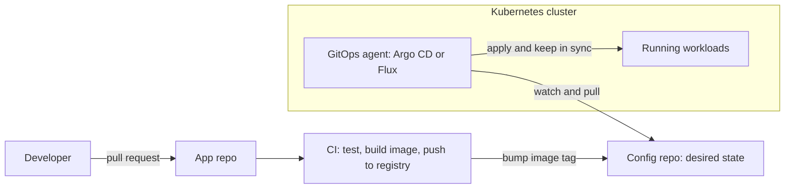

# GitOps Explained

> **8-minute read. Assumes you've read [CI/CD explained](./cicd-explained.md) and [Kubernetes in 10 minutes](./kubernetes-in-10-minutes.md).**

## The one-line answer

GitOps is a way of running deployments where a Git repository holds the desired state of your system, and an agent running *inside* the environment continuously pulls that state and makes reality match it. You deploy by merging a pull request. You roll back by reverting one.

## Push vs pull

Classic CI/CD **pushes**: after tests pass, the pipeline runs `kubectl apply` or `helm upgrade` against the cluster. That means the pipeline holds cluster admin credentials, and once the deploy finishes, nothing notices if someone changes the cluster by hand.

GitOps **pulls**: an agent in the cluster watches a Git repository. When the repository changes, the agent applies the change. When the cluster changes and the repository did not, the agent puts it back.



CI still builds and tests the image, but it stops at updating the config repository. The agent inside the cluster pulls from that repository and reconciles the workloads, so no outside system needs cluster credentials.

## The four principles

The CNCF OpenGitOps project defines GitOps with four principles:

1. **Declarative.** The whole desired state is described declaratively (Kubernetes manifests, Helm values, Kustomize overlays).
2. **Versioned and immutable.** That state is stored somewhere that keeps full history and cannot be silently rewritten. Git is the usual choice.
3. **Pulled automatically.** Agents fetch the desired state themselves.
4. **Continuously reconciled.** Agents keep comparing actual with desired state and correct any difference, not just at deploy time.

The fourth principle is what separates GitOps from "we keep our YAML in Git". It is the same **reconciliation loop** Kubernetes controllers already use, extended to the whole system.

## Why teams adopt it

- **Audit trail for free.** Every change to production is a commit with an author, a reviewer and a timestamp.
- **Easy rollback.** `git revert`, merge, and the agent rolls back.
- **No cluster credentials in CI.** The pull model shrinks the attack surface.
- **Drift correction.** A manual `kubectl edit` at 2am is reverted, or at least flagged as out of sync.
- **Disaster recovery.** Point a fresh cluster's agent at the repository and it rebuilds every application.
- **Multi-cluster.** One repository can drive dozens of clusters, each pulling its own folder.

## Argo CD and Flux

The two CNCF-graduated tools:

- **Argo CD** is application-centric with a strong web UI. You define `Application` resources that point to a repository path and a target cluster and namespace. It shows each app as synced or out of sync, healthy or degraded, with a diff view. ApplicationSets generate many applications from one template.
- **Flux** is a set of small controllers (source, kustomize, helm, notification, image automation). It is CLI and YAML first, with no built-in UI, and composes well with other tools.

Both support Helm and Kustomize, multi-cluster setups and automatic image updates. The managed cloud options build on them: **Azure** offers GitOps with Flux v2 as an AKS and Arc extension, **Google Cloud** offers Config Sync, and on **AWS** you typically run Argo CD or Flux yourself on EKS, or use the **EKS Capability for Argo CD** (part of Amazon EKS Capabilities), where AWS runs Argo CD in its own control plane.

## Repository layout

A common structure separates application code from deployment config:

```text
app-repo/              # source code, Dockerfile, tests
config-repo/
  apps/
    orders/
      base/            # shared manifests
      overlays/
        dev/           # replicas: 1, image tag: 1.4.0-rc2
        prod/          # replicas: 6, image tag: 1.3.2
```

Promotion from dev to prod is a pull request that changes the image tag in `overlays/prod`. That keeps the deploy decision reviewable and keeps every environment's state visible in one place.

## GitOps beyond Kubernetes

GitOps grew up on Kubernetes because Kubernetes already has a declarative API and controllers. For cloud infrastructure, the ideas carry over through tools that reconcile continuously: **Crossplane** (cloud resources as Kubernetes objects), the **Flux Terraform controller**, or a Terraform pipeline triggered by merges with scheduled drift detection. The last one is "GitOps-style" rather than strict GitOps, because nothing reconciles between runs.

## Common mistakes

- **Secrets in plain YAML in Git.** Use Sealed Secrets, SOPS, or the External Secrets Operator pulling from a cloud secret manager. See [Secrets management](https://security.noblerworks.com/learn/concepts/secrets-management/).
- **Fighting the autoscaler.** If Git sets `replicas: 3` and an HPA scales to 10, the agent may keep resetting it. Remove `replicas` from the manifest or tell the tool to ignore that field.
- **Auto-sync with auto-prune on day one.** Pruning deletes anything not in Git. Start with manual sync until the repository is trusted.
- **Tags like `latest`.** Git says the same thing before and after, so nothing deploys. Use immutable version tags or digests.
- **Everyone has write access to the config repo's main branch.** Then the audit trail and review guarantee are fiction. Protect the branch.

## How exams test it

GitOps has its own CNCF certifications: **CGOA** (Certified GitOps Associate) tests the principles and patterns, and **CAPA** (Certified Argo Project Associate) tests Argo CD, Rollouts, Workflows and Events. Common angles:

- "Which principle is violated when a pipeline pushes with `kubectl apply`?" -> pulled automatically.
- "What happens when someone changes a resource by hand?" -> the agent detects drift and reconciles (if self-heal is on).
- "Where should the desired state live?" -> a versioned, immutable store, normally Git.
- Cloud DevOps exams (AZ-400, Google Professional Cloud DevOps Engineer) ask about Flux on AKS and Config Sync on GKE.

## Go deeper

- **[📖 OpenGitOps principles](https://opengitops.dev/)** - the four principles from the CNCF working group
- **[📖 Argo CD documentation](https://argo-cd.readthedocs.io/en/stable/)** - applications, sync policies and health checks
- **[📖 Flux documentation](https://fluxcd.io/flux/)** - controllers, sources and Kustomizations
- **[📖 Continuous Deployment with Argo CD (EKS Capability for Argo CD)](https://docs.aws.amazon.com/eks/latest/userguide/argocd.html)** - AWS's managed Argo CD
- **[📖 GitOps with Flux v2 on AKS and Arc](https://learn.microsoft.com/en-us/azure/azure-arc/kubernetes/conceptual-gitops-flux2)** - Azure's managed Flux

## What to look at next

- **[GitOps with Argo CD](../../resources/hands-on-projects/gitops-with-argo-cd.md)** - hands-on: install Argo CD, deploy, promote and roll back by Git
- **[Infrastructure as Code explained](./infrastructure-as-code-explained.md)** - the declarative idea GitOps is built on
- **[Deployment strategies](./deployment-strategies.md)** - canary and blue-green, which Argo Rollouts automates
- **[Platform engineering explained](./platform-engineering-explained.md)** - GitOps is often the deploy engine of an internal platform
