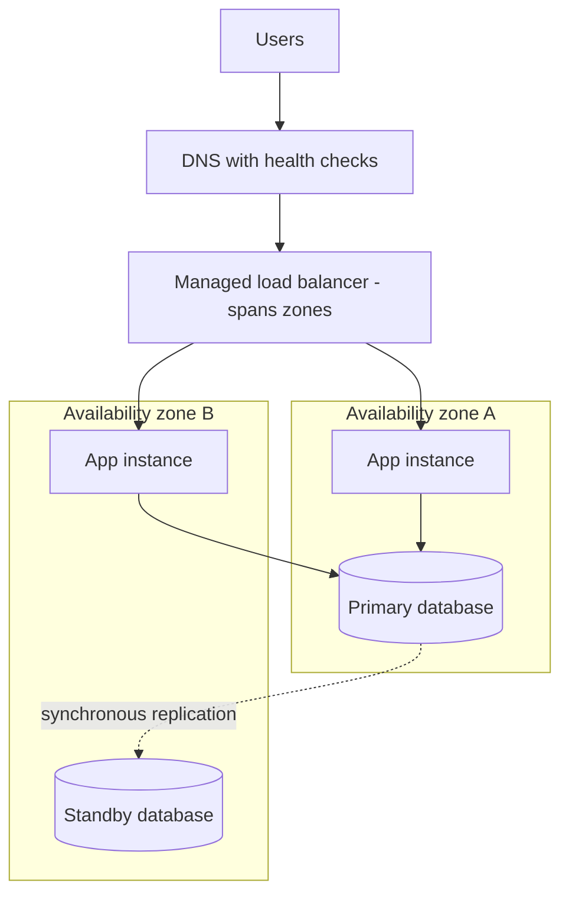

# High Availability and Fault Tolerance

> **9-minute read. Assumes you've read [Regions and availability zones](./regions-and-availability-zones.md) and [Load balancing explained](./load-balancing-explained.md).**

## The one-line answer

**High availability (HA)** means the system stays up most of the time, recovering from failures quickly enough that users barely notice. **Fault tolerance** means the system keeps working *through* a failure with no interruption at all. Fault tolerance is the stricter, more expensive end of the same scale.

Both are built the same way: remove every single point of failure by having more than one of everything that matters, and make the switch between them automatic.

## The words people mix up

| Term | Question it answers | Example |
|---|---|---|
| **Availability** | What fraction of time does it work? | 99.9% uptime |
| **High availability** | Does it recover fast and on its own? | A database fails over to a standby in 60 seconds |
| **Fault tolerance** | Does a failure cause *any* interruption? | Two active copies; losing one drops no requests |
| **Durability** | Will the data still exist? | S3's eleven nines: data survives, even if access is briefly down |
| **Disaster recovery** | Can we come back after a big loss? | Restore the whole stack in another region |
| **Resilience** | The umbrella word for all of the above | |

Availability and durability are different promises. A storage service can be unavailable for an hour and lose nothing. A cache can be always available and lose everything on restart.

## What the nines mean

Availability is usually quoted as a percentage of time. The numbers look close together, but each extra nine cuts the allowed downtime by ten:

| Availability | Downtime per year | Downtime per 30-day month |
|---|---|---|
| 99% | about 3.65 days | about 7.2 hours |
| 99.9% | about 8.8 hours | about 43 minutes |
| 99.95% | about 4.4 hours | about 22 minutes |
| 99.99% | about 53 minutes | about 4.3 minutes |
| 99.999% | about 5 minutes | about 26 seconds |

At 99.99%, a human cannot be in the loop. Four minutes a month is less than the time it takes to get paged, log in and read the dashboard. Anything at four nines or above needs **automatic** detection and failover.

## The math of chains and copies

**Components in series multiply.** If a request goes through a load balancer (99.99%), an app tier (99.9%) and a database (99.95%), and all three must work, the whole thing is:

`0.9999 x 0.999 x 0.9995 = about 0.9984`, or 99.84%.

The system is less available than its weakest part. Every new dependency in the request path lowers the ceiling.

**Redundant copies in parallel add.** Two independent app instances that are each 99% available fail together only when both are down:

`1 - (0.01 x 0.01) = 0.9999`, or 99.99%.

That is the whole trick of HA: put redundant copies at every layer so the series chain is made of very reliable links. The catch is the word **independent**. Two instances on the same physical host, in the same zone, or sharing the same bad config push will fail together, and the math stops working.

## Single points of failure

A single point of failure (SPOF) is anything that, if it breaks, takes everything down. Hunting them is most of HA design.

This is the standard multi-AZ shape: the load balancer spreads traffic over app instances in two zones, and the database keeps a synchronous standby in the second zone that takes over automatically if the primary's zone fails.

Common SPOFs people miss:

- **One NAT gateway** for private subnets in three zones. If its zone fails, every zone loses outbound internet.
- **One database instance**, even if the app tier is redundant.
- **A self-managed load balancer or bastion** on a single VM.
- **State on the instance**: sessions in memory, uploads on local disk. Losing the instance loses the user.
- **A shared dependency**: one Redis node, one license server, one external API.
- **People and process**: one person who knows how to fail over.

## Active-passive vs active-active

**Active-passive** keeps a standby that does not serve traffic until the primary fails. Cheaper and simpler, especially for databases. The cost is the **failover time**: detecting the failure, promoting the standby, and updating DNS or endpoints. Managed database failover is typically tens of seconds to a couple of minutes.

**Active-active** runs every copy and serves traffic from all of them. Losing one just shrinks capacity. That is fault tolerance for the stateless tier, and it is easy there. For data it is hard, because two copies accepting writes can conflict. That is why most designs are active-active for app servers and active-passive for the database.

Remember to size for failure. If two zones each run at 70% load and one fails, the survivor needs 140%. Run at most around 50% per zone with two zones, or use three zones so each survivor absorbs less.

## How the providers express it

- **AWS:** spread an Auto Scaling group across subnets in at least two AZs, put an ALB or NLB in front, and turn on RDS Multi-AZ or use Aurora replicas. Many managed services (S3, DynamoDB, SQS, Lambda) are multi-AZ by default.
- **Azure:** choose **zone-redundant** SKUs where offered (zone-redundant storage, zone-redundant App Service and SQL Database), or spread VMs across availability zones with a Standard Load Balancer. Availability sets are the older rack-level spread inside one data centre.
- **GCP:** use **regional** resources rather than zonal ones: regional managed instance groups, regional persistent disks, Cloud SQL high-availability configuration, regional GKE clusters.

Each provider publishes an SLA per service, often with a higher figure for the multi-zone configuration. The SLA is a refund promise, not a guarantee of uptime, and it only covers the provider's part.

## Common mistakes

- **Multi-AZ app servers with a single-AZ database.** The weakest link sets the availability.
- **Health checks that only test "the process is running"**, so a broken instance stays in rotation.
- **Never testing failover.** The first real failover is a bad time to find the standby was misconfigured. Practice with game days and chaos experiments.
- **Treating HA as DR.** Multi-AZ protects against a zone failure. It does not protect against a bad deploy, a deleted table or a region-wide outage, because those replicate instantly to the standby.
- **Chasing nines nobody needs.** Each nine costs roughly an order of magnitude more effort. Agree an SLO with the business first.

## How exams test it

The most common pattern is a scenario with a hidden SPOF: "a web app runs on EC2 instances in two AZs behind an ALB and uses a single RDS instance" -> the answer is enable Multi-AZ. Other tells:

- "**Highly available** with **minimal operational overhead**" -> a managed multi-AZ or regional service over a hand-built cluster.
- "Survive the loss of an **availability zone**" -> multi-AZ. "Survive the loss of a **region**" -> that is a DR question, not HA.
- "**No downtime** during an instance failure" -> stateless instances behind a load balancer, sessions externalized to a cache or database.

## Go deeper

- **[📖 Reliability pillar - AWS Well-Architected](https://docs.aws.amazon.com/wellarchitected/latest/reliability-pillar/welcome.html)** - AWS's full guidance on fault isolation and failure management
- **[📖 Azure reliability documentation](https://learn.microsoft.com/en-us/azure/reliability/overview)** - zone redundancy and per-service reliability guides
- **[📖 Google Cloud Well-Architected Framework: reliability](https://cloud.google.com/architecture/framework/reliability)** - Google's reliability principles and regional design

## What to look at next

- **[Disaster recovery, RPO and RTO](./disaster-recovery-rpo-rto.md)** - what HA does not cover
- **[Autoscaling explained](./autoscaling-explained.md)** - replacing failed capacity automatically
- **[Multi-region active-active](../../resources/architecture-patterns/multi-region-active-active.md)** - the deep end of fault tolerance
- **[Cell-based architecture](../../resources/architecture-patterns/cell-based-architecture.md)** - limiting the blast radius of any single failure
- **[SRE and reliability topic](../../topics/sre-and-reliability.md)** - SLOs, error budgets and the rest of the reliability material
