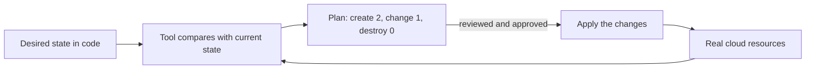

# Infrastructure as Code Explained

> **9-minute read. Tool-neutral. For one tool in depth, see [Terraform explained](./terraform-explained.md).**

## The one-line answer

Infrastructure as Code (IaC) means describing your servers, networks, databases and permissions in text files, keeping those files in version control, and letting a tool create and update the real resources to match. The files become the source of truth; the console becomes somewhere you look, not somewhere you change things.

## The problem it solves

Build an environment by clicking through a console and you get something that works, once. Then:

- Staging and production drift apart, because someone fixed a setting in one and not the other.
- Nobody knows why a firewall rule exists or who added it.
- Rebuilding after a disaster means remembering 200 clicks in the right order.
- A reviewer cannot review a click.

IaC turns infrastructure changes into the same workflow as code changes: write, review in a pull request, test, merge, apply, and roll back by reverting.

## Declarative vs imperative

This is the most important idea on the page.

**Imperative** means writing the steps: "create a VPC, then create two subnets, then attach a gateway." A shell script calling the CLI is imperative. Run it twice and you get two VPCs, or an error.

**Declarative** means writing the end state: "there is a VPC with two subnets and a gateway." The tool compares what you declared with what exists and works out the steps. Run it twice and the second run does nothing, because reality already matches. That property is **idempotency**, and it is why declarative tools dominate (see [Idempotency explained](./idempotency-explained.md)).

The declarative loop: the tool reads both the desired state and the real resources, shows a plan of the difference, and after approval makes reality match the code.

## The tool landscape

| Tool | Language | Scope | State |
|---|---|---|---|
| **Terraform / OpenTofu** | HCL | Any cloud or SaaS with a provider | State file you store (S3, Azure Storage, GCS, HCP Terraform) |
| **AWS CloudFormation** | YAML or JSON | AWS | Managed by AWS (stacks) |
| **AWS CDK** | TypeScript, Python, Java, C#, Go | AWS (synthesizes CloudFormation) | CloudFormation stacks |
| **Azure Bicep / ARM** | Bicep (compiles to ARM JSON) | Azure | Azure itself; deployment history in Azure |
| **Pulumi** | TypeScript, Python, Go, C#, Java | Any cloud | State backend you choose or Pulumi Cloud |
| **Google Infrastructure Manager** | Terraform HCL | Google Cloud | Managed Terraform runs |
| **Crossplane** | Kubernetes YAML | Any cloud, via Kubernetes controllers | The Kubernetes API |

Configuration management tools (Ansible, Chef, Puppet) overlap: they are best at configuring what runs *inside* servers. Modern practice favors provisioning with an IaC tool and baking images or using containers instead of configuring servers in place.

How to choose, briefly:

- **One cloud, want native support on day one of a new feature:** CloudFormation or CDK on AWS, Bicep on Azure.
- **Several clouds or SaaS providers (DNS, monitoring, GitHub):** Terraform or OpenTofu.
- **Team prefers real programming languages and tests:** CDK or Pulumi.
- The [IaC decision matrix](../../resources/decision-matrix-iac-tool.md) compares them in detail.

## State and drift

Declarative tools need to know what they created. CloudFormation and Bicep keep that inside the cloud. Terraform and Pulumi keep a **state file**, which must be stored remotely, encrypted, and **locked** so two people cannot apply at once. Losing or corrupting state is one of the worst IaC incidents, so version the bucket that holds it.

**Drift** is when reality no longer matches the code, usually because someone changed something by hand. The next plan will try to undo the manual change, which is surprising at best and an outage at worst. Fixes: restrict console write access in production, run scheduled drift detection, and when a manual fix was necessary, port it into code straight away.

## A worked example

A team needs the same three-tier stack in dev, staging and production.

1. They write one **module** describing a VPC, a load balancer, an autoscaling group and a database.
2. Each environment calls the module with different inputs: small instances and a single-AZ database in dev, larger instances and Multi-AZ in production.
3. A pull request that changes the instance type shows the **plan** as a comment: "1 to change". A reviewer checks it.
4. On merge, a pipeline applies to dev, then staging, then (after approval) production. Same code, three environments, no clicks.
5. When the region fails, the same code is applied to another region. That is half of a disaster recovery plan written for free.

## Common mistakes

- **Mixing console changes and IaC** on the same resources, then fighting drift forever.
- **Secrets in code or state.** Reference a secrets manager; remember state files can contain sensitive values in plain text.
- **One giant configuration** for everything. A single typo plans against hundreds of resources and every apply is slow and risky. Split by lifecycle and team.
- **No plan review.** Applying without reading the plan is how databases get replaced instead of modified.
- **Copy-paste environments** instead of a shared module with inputs, so fixes have to be made three times.
- **Hard-coded IDs** (subnet IDs, AMI IDs) instead of lookups or outputs.

## How exams test it

- "Provision identical environments repeatedly and consistently" -> IaC (CloudFormation, Bicep, Terraform, Deployment templates).
- "Deploy the same stack across many accounts and regions" -> CloudFormation StackSets.
- "Detect resources changed outside of CloudFormation" -> drift detection.
- "Preview what a change will do before applying" -> change sets (CloudFormation), what-if (Bicep / ARM), `plan` (Terraform).
- Terraform Associate questions focus on state, locking, modules, providers and the plan/apply workflow.

## Go deeper

- **[📖 What is AWS CloudFormation?](https://docs.aws.amazon.com/AWSCloudFormation/latest/UserGuide/Welcome.html)** - stacks, change sets and drift detection
- **[📖 What is Bicep?](https://learn.microsoft.com/en-us/azure/azure-resource-manager/bicep/overview)** - Azure's declarative language
- **[📖 Infrastructure Manager overview](https://cloud.google.com/infrastructure-manager/docs/overview)** - managed Terraform on Google Cloud
- **[📖 What is Terraform?](https://developer.hashicorp.com/terraform/intro)** - the most widely used multi-cloud tool

## What to look at next

- **[Terraform explained](./terraform-explained.md)** - one tool in depth: providers, state, modules
- **[GitOps explained](./gitops-explained.md)** - Git as the trigger and source of truth for deployments
- **[Build infra with Terraform](../../resources/hands-on-projects/terraform-infrastructure.md)** - hands-on
- **[Terraform CLI cheat sheet](../../resources/cli-cheat-sheet-terraform.md)** - the commands you will use daily
