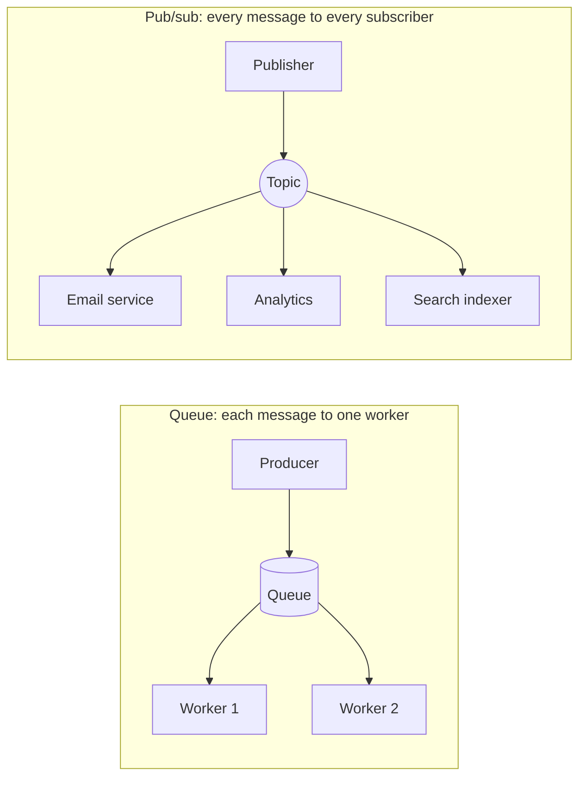

# Message Queues and Pub/Sub for Cloud Builders

> **6-minute read. Assumes you've read [Serverless explained](./serverless-explained.md).**
>
> This is the short cloud-builder version. For queues vs streams, delivery guarantees and ordering in depth, read **[Queues vs streams](https://data.noblerworks.com/learn/concepts/queues-vs-streams/)** on Data Zero to Hero.

## The one-line answer

A **queue** holds messages until one worker takes each one and processes it. **Pub/sub** (publish/subscribe) delivers a copy of every message to every subscriber. Both let one part of a system hand off work to another without waiting for it and without knowing who is on the other end.

## Why you want one

Without a queue, a web request that has to resize an image, send an email and update a search index does all three before it answers. If the email provider is slow, the user waits. If it is down, the request fails.

With a queue, the request writes "order 1042 placed" to a queue and returns in milliseconds. Workers process it in the background. That buys you:

- **Decoupling.** The web tier and the workers deploy, scale and fail independently.
- **Load levelling.** A burst of 10,000 orders sits in the queue while a steady pool of workers drains it. Nothing falls over.
- **Retries for free.** If a worker crashes mid-message, the message becomes visible again and another worker retries it.
- **A natural scaling signal.** Queue depth tells you exactly how far behind you are (see [Autoscaling explained](./autoscaling-explained.md)).

## Queue vs pub/sub

On the left, two workers share the queue and each message is handled once by whichever worker takes it. On the right, one event fans out so three different services each get their own copy.

The two combine. The **fan-out pattern** puts a queue behind each pub/sub subscriber: the topic copies the event to three queues, and each service drains its own queue at its own pace. If analytics is down for an hour, its queue just fills up and nothing is lost.

## The managed services

| Job | AWS | Azure | GCP |
|---|---|---|---|
| Simple work queue | SQS | Storage Queues, Service Bus queues | Pub/Sub (pull subscription), Cloud Tasks |
| Pub/sub fan-out | SNS | Service Bus topics, Event Grid | Pub/Sub |
| Event routing by content | EventBridge | Event Grid | Eventarc |
| Ordered, replayable stream | Kinesis, MSK | Event Hubs | Pub/Sub with ordering keys, Managed Kafka |

## Four things every builder must know

1. **At-least-once delivery is the normal case.** SQS standard queues, SNS and Pub/Sub can deliver the same message more than once. Your consumer must be **idempotent**: processing message 1042 twice must not charge the customer twice. See [Idempotency explained](./idempotency-explained.md).
2. **The visibility timeout.** When a worker takes a message from SQS, it is hidden, not deleted. The worker deletes it after success. If the timeout is shorter than your processing time, a second worker grabs the same message while the first is still working.
3. **Dead-letter queues (DLQs).** A message that fails every time ("poison message") will retry forever and block or waste workers. After a set number of attempts, move it to a DLQ, and alarm on the DLQ being non-empty.
4. **Ordering is not free.** Standard queues are best-effort ordered. If order matters, use FIFO queues (SQS FIFO), sessions (Service Bus) or ordering keys (Pub/Sub), and accept lower throughput per group.

## Common mistakes

- **Non-idempotent consumers**, then surprise duplicates in production.
- **No DLQ**, or a DLQ nobody watches.
- **Visibility timeout shorter than the work**, causing duplicate processing.
- **Using a queue when the caller needs the answer now.** Queues are for work that can finish later.
- **Scaling workers on CPU** instead of queue depth or age of the oldest message.

## How exams test it

- "Decouple the web tier from order processing" or "absorb traffic spikes" -> a queue (SQS, Service Bus, Pub/Sub).
- "One event must trigger several independent services" -> pub/sub fan-out (SNS to multiple SQS queues, Service Bus topics, Pub/Sub subscriptions).
- "Exactly-once processing, strict order" -> SQS FIFO or Service Bus sessions.
- "Messages that repeatedly fail" -> dead-letter queue.

## Go deeper

- **[Queues vs streams](https://data.noblerworks.com/learn/concepts/queues-vs-streams/)** - the full comparison, on Data Zero to Hero
- **[Service comparison: messaging and queues](https://data.noblerworks.com/resources/service-comparison-messaging-queues/)** - every messaging service across clouds, on Data Zero to Hero
- **[📖 What is Amazon SQS?](https://docs.aws.amazon.com/AWSSimpleQueueService/latest/SQSDeveloperGuide/welcome.html)** - standard and FIFO queues, visibility timeout, DLQs
- **[📖 Azure Service Bus overview](https://learn.microsoft.com/en-us/azure/service-bus-messaging/service-bus-messaging-overview)** - queues, topics and sessions
- **[📖 Pub/Sub overview](https://cloud.google.com/pubsub/docs/overview)** - topics, subscriptions and delivery on Google Cloud

## What to look at next

- **[Event-driven architecture](../../resources/architecture-patterns/event-driven-architecture.md)** - systems designed around events from the start
- **[Build a serverless app](../../resources/hands-on-projects/serverless-application.md)** - hands-on: API, queue and function together
- **[API gateways explained](./api-gateways-explained.md)** - the synchronous front door that often hands work to a queue
