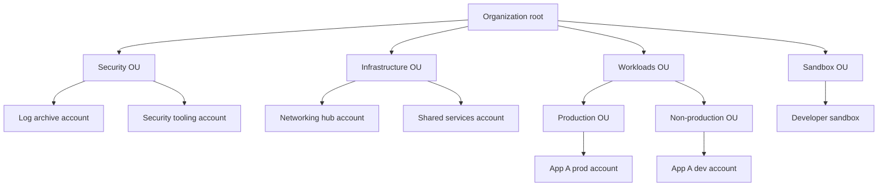

# Multi-Account Strategy and Landing Zones

> **10-minute read. Assumes you've read [VPC explained](./vpc-explained.md) and [IAM explained](https://security.noblerworks.com/learn/concepts/iam-explained/) on Security Zero to Hero.**

## The one-line answer

Serious cloud estates do not live in one account. They are split across many **accounts** (AWS), **subscriptions** (Azure) or **projects** (GCP), grouped into a hierarchy, with rules applied from the top. A **landing zone** is the pre-built, governed starting point for that hierarchy: the accounts, identity, networking, logging and guardrails that exist before the first application arrives.

## Why one account stops working

Everyone starts with one account. It works until:

- **A developer's test script deletes a production table**, because both live in the same account and the developer had broad permissions "to get things done".
- **The bill is one number.** Nobody can say which team or product spent what.
- **A compromised key reaches everything.** There is no wall between the payment system and the intern's experiment.
- **Quotas are shared.** A load test in dev uses up the instance limit production needs.
- **Auditors ask** which systems handle card data, and the answer is "all of them, technically".

The account is the strongest isolation boundary a cloud provider offers. Permissions, quotas, billing and blast radius all stop at its edge by default. Using many accounts turns those defaults into free security and governance.

## The hierarchy in each cloud

| Concept | AWS | Azure | GCP |
|---|---|---|---|
| Top of the tree | Organization (management account) | Microsoft Entra tenant, root management group | Organization node |
| Grouping | Organizational units (OUs) | Management groups | Folders |
| Isolation unit | Account | Subscription (resources in resource groups) | Project |
| Guardrails from above | Service control policies (SCPs), resource control policies | Azure Policy, RBAC inherited down the tree | Organization policies, IAM inherited down the tree |
| Landing zone tooling | AWS Control Tower, Landing Zone Accelerator | Azure landing zones (Cloud Adoption Framework) | Google Cloud setup, Fabric FAST and the Terraform foundation blueprint |



A typical layout: policies attached to an OU apply to every account beneath it, so production accounts inherit stricter rules than sandboxes, and logs from every account flow to a locked-down log archive account that application teams cannot touch.

## What a landing zone contains

A landing zone is opinionated plumbing. The usual pieces:

1. **Account structure.** The OU or folder tree above, plus a vending process so a new team gets a new account in minutes, already wired in.
2. **Central identity.** People sign in once through an identity provider (IAM Identity Center, Microsoft Entra ID, Cloud Identity) and get roles in specific accounts. No per-account IAM users with passwords.
3. **Centralized logging.** Every account's audit trail (CloudTrail, Azure Activity Log, Cloud Audit Logs) is sent to an archive account where it cannot be edited or deleted by the account that produced it.
4. **Security baseline.** Threat detection and config recording turned on everywhere by default (GuardDuty, Security Hub, Defender for Cloud, Security Command Center).
5. **Network design.** A hub for shared connectivity (VPN, Direct Connect or ExpressRoute or Interconnect, egress inspection, DNS), with spoke VPCs or VNets for workloads. See [hybrid connectivity](../../resources/networking-deep-dives/hybrid-connectivity.md).
6. **Guardrails.** Preventive rules that cannot be bypassed from inside an account, and detective rules that flag drift.
7. **Billing and tagging.** Budgets and alerts per account, and required tags for cost allocation.

## Guardrails: preventive and detective

**Preventive guardrails** stop an action before it happens. Examples:

- Deny all actions outside approved regions.
- Deny turning off CloudTrail or deleting the log bucket.
- Deny creating public IPs in production.
- Deny leaving the organization.

On AWS these are SCPs. An important detail: **an SCP never grants permissions.** It sets the maximum an account's own IAM policies can allow. A user needs an IAM allow *and* no SCP deny. SCPs also do not restrict the management account, which is one reason nothing should run there.

On Azure, **Azure Policy** with a `deny` effect does the same job, and on GCP, **organization policy constraints** (for example "restrict resource locations", "disable service account key creation").

**Detective guardrails** let the action happen and report it: AWS Config rules, Azure Policy in `audit` mode, Security Command Center findings. Use them where a hard block would be too disruptive, or to measure compliance before switching a rule to deny.

## Worked example: a policy that blocks unapproved regions

The intent: workloads may only run in `us-east-1` and `us-west-2`, but global services like IAM must still work.

```json
{
  "Version": "2012-10-17",
  "Statement": [
    {
      "Sid": "DenyOutsideApprovedRegions",
      "Effect": "Deny",
      "NotAction": ["iam:*", "organizations:*", "sts:*", "support:*", "cloudfront:*", "route53:*"],
      "Resource": "*",
      "Condition": {
        "StringNotEquals": { "aws:RequestedRegion": ["us-east-1", "us-west-2"] }
      }
    }
  ]
}
```

Attached to the Workloads OU, this applies to every account beneath it. `NotAction` exempts global services, which would otherwise break. The Azure equivalent is the built-in "Allowed locations" policy; the GCP equivalent is the `gcp.resourceLocations` organization policy constraint.

## Common mistakes

- **Running workloads in the management account.** It is not constrained by SCPs and holds the keys to the whole organization.
- **Too few accounts.** "Prod" and "non-prod" for twenty teams recreates the shared-account problem at a larger size.
- **Too many guardrails on day one.** Teams hit unexplained denies and route around the platform. Start with a few high-value rules, run others in audit mode first.
- **IAM users in every account.** Use federation and short-lived role sessions.
- **Overlapping CIDR ranges** across accounts, which makes peering or transit routing impossible later. Plan IP space centrally.
- **Building it all by hand.** A landing zone should itself be code, so it can be reviewed, reproduced and updated.

## How exams test it

This is core material for professional architect exams (SAP-C02, AZ-305, Google Professional Cloud Architect):

- "Prevent any account in the organization from disabling CloudTrail" -> SCP on the root or OU.
- "Set up a governed multi-account environment quickly with best-practice guardrails" -> AWS Control Tower.
- "Apply the same rules to many subscriptions" -> Azure Policy assigned at a management group.
- "Separate billing and isolation per team on Google Cloud" -> one project per team and environment, grouped in folders.
- A distractor: "an SCP that allows S3 access grants users S3 access" - false, SCPs only limit.

## Go deeper

- **[📖 What is AWS Organizations?](https://docs.aws.amazon.com/organizations/latest/userguide/orgs_introduction.html)** - accounts, OUs and policies
- **[📖 What is AWS Control Tower?](https://docs.aws.amazon.com/controltower/latest/userguide/what-is-control-tower.html)** - the managed AWS landing zone
- **[📖 What is an Azure landing zone?](https://learn.microsoft.com/en-us/azure/cloud-adoption-framework/ready/landing-zone/)** - Microsoft's Cloud Adoption Framework reference
- **[📖 Landing zone design in Google Cloud](https://cloud.google.com/architecture/landing-zones)** - Google's decisions for identity, hierarchy, network and security

## What to look at next

- **[Build a landing zone](../../resources/hands-on-projects/build-a-landing-zone.md)** - hands-on: an organization, OUs, guardrails and central logging
- **[Cloud identity basics for builders](./cloud-identity-basics-for-builders.md)** - how people and workloads get into those accounts
- **[Cloud cost basics](./cloud-cost-basics.md)** - why per-account billing helps
- **[Well-Architected explained](./well-architected-explained.md)** - the frameworks that landing zones put into practice
