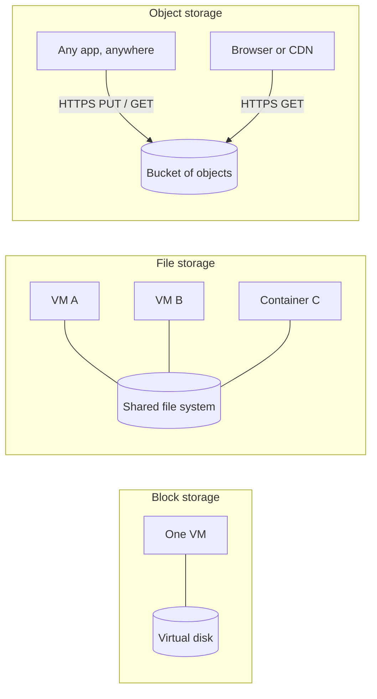

# Object, Block, and File Storage

> **9-minute read. Assumes you've read [What is cloud computing?](./what-is-cloud-computing.md).**

## The one-line answer

Cloud storage comes in three shapes. **Block storage** is a virtual hard disk attached to one machine. **File storage** is a shared network folder many machines mount at once. **Object storage** is a giant key-value store you reach over HTTP, where each "file" is a whole object you write and read in one go.

The shape decides what the storage is good at, what it costs, and what breaks when you pick the wrong one.

## Why there are three

A laptop hides all of this. You save a file, it lands on a disk, done. In a data centre the questions get separated:

- Does **one** machine need very fast, low-level access to bytes? That is a disk.
- Do **many** machines need to see the same folder at the same time? That is a file share.
- Do you need to store **billions** of files cheaply, reachable from anywhere, and never think about capacity? That is object storage.

No single design does all three well. A disk is fast because only one machine writes to it. A file share has to coordinate locks between many writers, which costs latency. Object storage gives up in-place edits and directory semantics, and in return it scales almost without limit.

The diagram shows the access pattern that defines each type: block is one machine to one disk, file is many machines sharing a mounted folder, and object is anything that can speak HTTPS reaching a bucket.

## Block storage

A block volume looks to the operating system exactly like a physical disk. The OS formats it with a file system (ext4, XFS, NTFS) and reads and writes fixed-size blocks.

- **AWS:** Amazon EBS. **Azure:** Managed Disks. **GCP:** Persistent Disk and Hyperdisk.
- **Attached to one VM at a time** in the normal case. Multi-attach exists for special cluster-aware software, but a regular file system on a multi-attached disk will corrupt itself, because each machine thinks it owns the disk.
- **Lives in one availability zone.** An EBS volume in `us-east-1a` cannot be attached to an instance in `us-east-1b`. To move it, you take a snapshot and create a new volume from it in the other zone.
- **You pay for provisioned size**, not used size. A 500 GB volume holding 20 GB costs the same as a full one. Some types also charge for provisioned IOPS and throughput.

Use it for: boot disks, databases you run yourself, anything that needs low-latency random reads and writes.

Watch out for: the zone lock-in, and forgetting that **snapshots are your backup**. A volume replicates inside its zone to survive a disk failure, but it does not protect you from deleting data or losing the zone.

## File storage

File storage is a managed network file system. Many machines mount it at once and see the same directory tree, with normal file operations: open, append, rename, lock.

- **AWS:** Amazon EFS (Linux, NFS) and the FSx family (Windows File Server, Lustre, NetApp ONTAP, OpenZFS). **Azure:** Azure Files (SMB and NFS) and Azure NetApp Files. **GCP:** Filestore.
- **Shared across machines and usually across zones.** EFS Standard stores data across several zones in a region, so instances in any zone can mount it.
- **You usually pay for what you store** (EFS) or for a provisioned capacity tier (Filestore, some FSx types).

Use it for: shared content between web servers, home directories, lift-and-shift apps that expect a shared drive, and containers that need a shared persistent volume.

Watch out for: latency. Every operation crosses the network and may need coordination, so a workload doing millions of tiny file operations (a big `npm install`, a build cache) can be slow on a network file system that is perfectly fine for large files.

## Object storage

Object storage holds **objects** inside **buckets** (Azure calls them **containers** inside a **storage account**). An object is the data plus metadata, addressed by a key such as `invoices/2026/10/inv-1042.pdf`.

- **AWS:** Amazon S3. **Azure:** Blob Storage. **GCP:** Cloud Storage.
- **Reached over an HTTPS API**, not mounted as a disk. You `PUT` a whole object and `GET` a whole object (or a byte range).
- **No in-place edits.** To change one line in a 1 GB object you upload a new 1 GB object. Appends are not a thing in standard S3.
- **The slashes are not real folders.** `invoices/2026/` is just a shared prefix in the key. Consoles draw folders to be friendly. Renaming a "folder" means copying and deleting every object under it.
- **Huge durability by design.** S3 is designed for 99.999999999% (eleven nines) durability by storing copies across multiple zones.
- **Pay for what you store, plus requests and data transfer out.** Storage classes trade price for retrieval speed: S3 Standard down to Glacier Deep Archive, Azure Hot / Cool / Cold / Archive, GCS Standard / Nearline / Coldline / Archive.

Use it for: backups, logs, images and video, static websites, data lakes, build artifacts, anything written once and read many times.

Watch out for: treating it like a disk. Running a database on top of a bucket-mounting tool usually ends in poor performance and broken locking.

## Side by side

| | Block | File | Object |
|---|---|---|---|
| Access | Attached disk | Mounted share (NFS/SMB) | HTTPS API |
| Who can use it | One machine | Many machines | Anyone with permission |
| Edit in place | Yes | Yes | No, replace the whole object |
| Scope | One zone | Region (often) | Region (or multi-region) |
| Billing | Provisioned size | Used or provisioned | Used, plus requests and egress |
| Typical use | Boot disk, self-run DB | Shared folders | Backups, media, data lakes |

## A worked example

A photo-sharing app runs on two VMs behind a load balancer.

1. Each VM has a **block** boot volume. Nothing else lives there, so a VM can be replaced at any time.
2. User uploads go straight to **object storage**. The app hands the browser a pre-signed URL, the browser uploads to the bucket, and the VMs never touch the bytes. A CDN serves the photos back out.
3. A legacy thumbnail tool expects to read and write a shared folder, so it gets a small **file share** mounted on both VMs.
4. The database is a managed service (see [Managed databases explained](./managed-databases-explained.md)), which uses block storage under the hood, but you never see it.

If the team had put uploads on the VMs' block disks instead, a user would upload to VM A and then get a 404 from VM B. That single mistake is the most common reason beginners discover object storage.

## Common mistakes

- **Storing user uploads on a VM's local disk.** It breaks as soon as you have two instances, and it disappears when an autoscaling group replaces the VM.
- **Expecting a block volume to follow you across zones.** It cannot. Snapshot, then restore.
- **Paying for an oversized disk** "just in case". Block storage bills for the size you provision.
- **Making a bucket public to serve a website**, instead of putting a CDN in front with origin access control.
- **Ignoring request costs.** Millions of tiny objects can cost more in `PUT` and `GET` requests than in storage.
- **Using a network file system for a write-heavy database.** Use block storage or a managed database.

## How exams test it

Associate cloud exams love the "which storage" scenario. The keyword usually gives it away:

- "**Shared** between multiple instances", "concurrent access", "POSIX" -> file (EFS, Azure Files, Filestore).
- "**Lowest latency** for a database on an instance", "boot volume", "IOPS" -> block (EBS io2/gp3, Premium SSD, Hyperdisk).
- "**Durable**, cheap, unlimited, static website, archive for seven years" -> object, often with a lifecycle rule to a colder class.
- "Instance in another AZ needs the data" -> snapshot and restore, or switch to a regional option.

## Go deeper

- **[📖 What is Amazon S3?](https://docs.aws.amazon.com/AmazonS3/latest/userguide/Welcome.html)** - buckets, keys, storage classes and consistency
- **[📖 What is Amazon EBS?](https://docs.aws.amazon.com/ebs/latest/userguide/what-is-ebs.html)** - volume types, snapshots, and AZ scope
- **[📖 What is Amazon EFS?](https://docs.aws.amazon.com/efs/latest/ug/whatisefs.html)** - the managed NFS model
- **[📖 Introduction to Azure Storage](https://learn.microsoft.com/en-us/azure/storage/common/storage-introduction)** - Blob, Files, Disks, Queues and Tables in one account model
- **[📖 Cloud Storage overview](https://cloud.google.com/storage/docs/introduction)** - GCP buckets, objects and storage classes

## What to look at next

- **[Service comparison: storage](../../resources/service-comparison-storage.md)** - every storage service across AWS, Azure and GCP
- **[CDN explained](./cdn-explained.md)** - how object storage gets served fast worldwide
- **[Disaster recovery, RPO and RTO](./disaster-recovery-rpo-rto.md)** - snapshots and backups in a recovery plan
- **[File formats and partitioning](https://data.noblerworks.com/learn/concepts/file-formats-and-partitioning/)** - how data lakes lay out objects (Data Zero to Hero)
