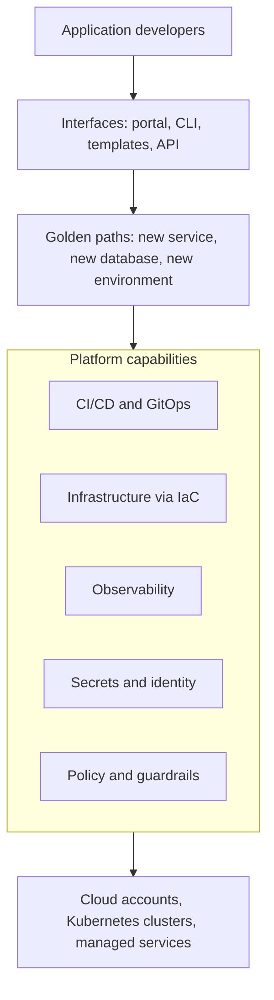

# Platform Engineering Explained

> **8-minute read. Assumes you've read [CI/CD explained](./cicd-explained.md) and [Infrastructure as Code explained](./infrastructure-as-code-explained.md).**

## The one-line answer

Platform engineering is building an **internal developer platform**: a self-service product, run by a dedicated team, that lets application teams create, deploy and operate services through paved, pre-approved paths instead of each team assembling its own cloud plumbing.

## How we got here

DevOps said "you build it, you run it". That was right about ownership, and it went wrong at scale. Each product team now had to understand Kubernetes, Terraform, IAM, VPCs, CI pipelines, observability stacks, secret management and compliance controls, on top of their actual product. Twenty teams each solved those problems slightly differently, so the estate became twenty snowflakes, and developers spent a large part of their week on infrastructure instead of features.

That burden has a name: **cognitive load**. Platform engineering's answer is to have one team solve the common problems once, well, and offer the result as a product.

## What a platform is

Developers use friendly interfaces; behind them, golden paths compose the platform's capabilities, which in turn sit on the cloud and cluster substrate the platform team operates.

The key ideas:

- **Golden paths** (also "paved roads"): the supported, opinionated way to do a common task. "Create a new Go service" produces a repository with a Dockerfile, a pipeline, dashboards, alerts, a service catalog entry and a deployment to dev, all in a few minutes. Teams may leave the path, but then they support what they built.
- **Self-service.** No ticket, no waiting for another team. If a developer has to file a request and wait three days for a database, it is not a platform.
- **Platform as a product.** The platform team has users, a roadmap, documentation, and measures adoption and satisfaction. Nobody is forced onto it; it wins by being the easiest option.
- **Thinnest viable platform.** Start with the smallest thing that removes the most pain. Sometimes that is a wiki page and three templates, not a portal.

## The building blocks

- **Developer portal and service catalog:** Backstage (CNCF incubating, created by Spotify) is the common open-source choice; Port and Cortex are commercial options. It shows who owns each service, its docs, its pipelines and its health.
- **Templates and scaffolding:** Backstage software templates, cookiecutter, or internal CLIs that create a new service on the golden path.
- **Infrastructure orchestration:** Terraform modules, Crossplane compositions or a platform orchestrator, so "give me a Postgres database" maps to a vetted, compliant definition.
- **Delivery:** shared CI templates and GitOps with Argo CD or Flux (see [GitOps explained](./gitops-explained.md)).
- **Runtime:** usually Kubernetes, sometimes serverless or a PaaS. A platform does not require Kubernetes.
- **Guardrails:** policy as code (OPA Gatekeeper, Kyverno, cloud-native policies) so the golden path is also the compliant path.
- **Observability by default:** every service on the path gets logs, metrics, traces and dashboards without asking.

## Platform team vs DevOps team vs SRE

These titles blur in practice. A useful distinction:

- A **DevOps** culture is about shared ownership between development and operations. It is not a team.
- An **SRE** team focuses on the reliability of production services: SLOs, incident response, toil reduction.
- A **platform** team builds the product other teams use to ship and run software. It enables; it does not run your service for you.

The Team Topologies book frames platform teams as one of four team types, whose job is to reduce the load on stream-aligned (product) teams.

## A worked example

Before: a company with 30 product teams takes two weeks to get a new service into production. Each team writes its own pipeline. Half the services have no alerts. Security finds public buckets every quarter.

The platform team starts small: one golden path for "HTTP service on Kubernetes". A template creates the repository, pipeline, Helm chart, GitOps entry, dashboards and an on-call alert. Buckets are created through a module that blocks public access. Six months later, new services reach production in a day, 80% of new services use the path, and security findings drop because the default is safe. The platform team tracks those numbers, along with the DORA metrics (deployment frequency, lead time, change failure rate, time to restore).

## Common mistakes

- **Building a portal first.** A beautiful UI over a broken pipeline fixes nothing. Fix the paths, then add the interface.
- **Mandating the platform** instead of making it better than the alternative. Forced adoption breeds workarounds.
- **The platform team becomes a ticket queue.** If humans fulfil requests, it is an operations team with a new name.
- **Over-abstracting.** Hiding everything means developers cannot debug production. Good platforms let you see underneath.
- **No product management.** Without user research and metrics, the team builds what it finds interesting.

## How exams test it

The CNCF offers the **Certified Cloud Native Platform Engineering Associate (CNPA)**, covering platform concepts, golden paths, GitOps, observability and developer experience. Cloud architect and DevOps exams touch it indirectly: "reduce the time for teams to provision compliant environments" points to self-service templates (AWS Service Catalog, Azure deployment environments, landing zone vending) rather than a ticketing process.

## Go deeper

- **[📖 CNCF Platforms white paper](https://tag-app-delivery.cncf.io/whitepapers/platforms/)** - what a platform is, its capabilities and how to measure it
- **[📖 What is Backstage?](https://backstage.io/docs/overview/what-is-backstage)** - the open-source developer portal
- **[📖 Platform engineering guide (Microsoft)](https://learn.microsoft.com/en-us/platform-engineering/)** - Microsoft's guidance on building internal platforms

## What to look at next

- **[Platform engineering topic](../../topics/platform-engineering.md)** - every related page across the site
- **[Platform engineer certification roadmap](../../resources/certification-roadmap-platform-engineer.md)** - the cert path
- **[Multi-account strategy and landing zones](./multi-account-and-landing-zones.md)** - the cloud foundation a platform sits on
- **[GitOps explained](./gitops-explained.md)** - the most common deployment engine of a platform
