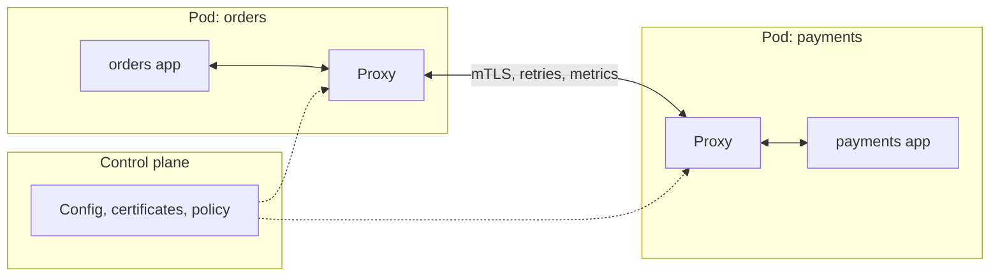

# Service Mesh Explained

> **8-minute read. Assumes you've read [Kubernetes in 10 minutes](./kubernetes-in-10-minutes.md) and [Load balancing explained](./load-balancing-explained.md).**

## The one-line answer

A service mesh is an infrastructure layer that handles the network calls *between* your services: encrypting them, retrying them, timing them out, routing them and measuring them, without changing application code. It does that by putting a proxy next to (or underneath) every service and controlling all those proxies from one place.

## The problem

One monolith makes function calls. Forty microservices make network calls, and network calls fail in ways function calls do not: they time out, they hit an instance that is restarting, they cross a network someone else can sniff.

So every service needs the same code: retries with backoff, timeouts, circuit breakers, mutual TLS, metrics per call, trace headers. In a polyglot estate (Java, Go, Python, Node) that means the same logic written four times in four libraries, kept in sync forever. A mesh moves that logic out of the application and into the platform.

## How it works

Each service talks only to its local proxy. The proxies talk to each other over mutual TLS, and the control plane pushes routing rules, policies and certificates to every proxy.

Two parts:

- **Data plane:** the proxies that carry traffic. Envoy is the most common; Linkerd uses its own lightweight Rust proxy.
- **Control plane:** the brain that configures the proxies, issues certificates and exposes an API for policy.

Two deployment models:

- **Sidecar:** a proxy container runs inside every pod. Simple to reason about, but it adds memory and latency per pod and must be restarted with the app.
- **Sidecarless / ambient:** a per-node proxy handles encryption and basic Layer 4 features, with optional Layer 7 proxies only where needed. Istio's ambient mode and Cilium's mesh work this way. Less overhead, newer.

## What you get

- **Mutual TLS (mTLS) everywhere.** Every service gets a certificate identity, and traffic is encrypted and authenticated in both directions, rotated automatically. This is the backbone of zero-trust networking inside a cluster.
- **Authorization by identity.** "Only `orders` may call `payments` on `POST /charge`", enforced by the proxies rather than by IP address.
- **Traffic management.** Send 5% of traffic to v2 (canary), mirror traffic to a test version, route by header, inject faults for chaos testing.
- **Resilience.** Timeouts, retries and circuit breaking configured centrally.
- **Observability.** Request rate, error rate and latency for every service-to-service edge, plus trace propagation, with no code changes.

## The cost

A mesh is not free, and plenty of teams adopt one too early.

- **Operational complexity.** Another critical system to upgrade, debug and understand. When the mesh is misconfigured, everything breaks at once.
- **Resource overhead.** Sidecar proxies consume CPU and memory in every pod.
- **Latency.** Each hop through a proxy adds a little; usually a millisecond or less, but it adds up across a call chain.
- **Debugging gets harder.** "Is it my app or the proxy?" becomes a daily question until the team is fluent.

A rough rule: below about a dozen services, or with one language and a good shared library, you probably do not need a mesh. Kubernetes Services, network policies and a tracing library get you most of the way.

## The options

- **Istio:** the most feature-rich, Envoy-based, sidecar or ambient mode. CNCF graduated.
- **Linkerd:** focused on simplicity and low overhead, with its own proxy. CNCF graduated.
- **Cilium Service Mesh:** eBPF-based, sidecarless, built on the Cilium networking plugin.
- **Consul:** HashiCorp's mesh, which also spans VMs and multiple platforms.
- **Managed:** Google Cloud Service Mesh (managed Istio for GKE and beyond), the Istio-based service mesh add-on for AKS. On AWS, App Mesh reached end of support on September 30, 2026; AWS points users to ECS Service Connect and Amazon VPC Lattice, or to running Istio or Linkerd on EKS.

## Mesh vs API gateway

An [API gateway](./api-gateways-explained.md) manages **north-south** traffic: external clients coming in, with API keys, quotas and developer portals. A mesh manages **east-west** traffic: services calling each other inside. Many systems use both: a gateway at the edge, a mesh inside. The Kubernetes Gateway API is starting to give both a common configuration model.

## Common mistakes

- **Adopting a mesh for one feature** you could get more simply (for example, only for metrics).
- **Retries at every layer.** If the app retries 3 times and the mesh retries 3 times, one failure becomes 9 calls and can create a retry storm. Retry in one place.
- **Turning on strict mTLS before every workload has a proxy**, cutting off anything outside the mesh.
- **Skipping capacity planning** for sidecar CPU and memory.

## How exams test it

- CKA and CKAD do not require a mesh, but knowing what a sidecar is helps. The Linux Foundation's **Istio Certified Associate (ICA)** tests Istio directly: traffic management, security, observability.
- "Encrypt all service-to-service traffic without changing application code" -> service mesh with mTLS.
- "Gradually shift traffic between versions of an internal service" -> mesh traffic splitting.
- On cloud exams, look for the provider's current managed option rather than a retired one.

## Go deeper

- **[📖 What is Istio?](https://istio.io/latest/docs/overview/what-is-istio/)** - architecture, sidecar and ambient modes
- **[📖 What is a service mesh? (Linkerd)](https://linkerd.io/what-is-a-service-mesh/)** - a clear explanation from the Linkerd maintainers
- **[📖 Cloud Service Mesh overview](https://cloud.google.com/service-mesh/docs/overview)** - Google's managed mesh
- **[📖 Istio-based service mesh add-on for AKS](https://learn.microsoft.com/en-us/azure/aks/istio-about)** - Azure's managed Istio

## What to look at next

- **[Microservices architecture](../../resources/architecture-patterns/microservices-architecture.md)** - the architecture that creates the need for a mesh
- **[Observability basics](./observability-basics.md)** - what the mesh's metrics and traces feed into
- **[Deployment strategies](./deployment-strategies.md)** - canary releases a mesh can drive
- **[Kubernetes topic](../../topics/kubernetes.md)** - the rest of the Kubernetes material
