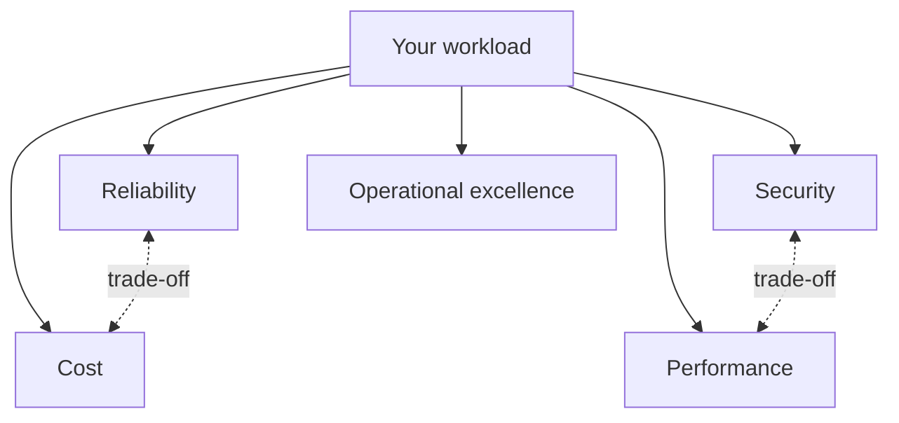

# Well-Architected Explained

> **8-minute read. Assumes you've read [What is cloud computing?](./what-is-cloud-computing.md).**

## The one-line answer

A Well-Architected Framework is a cloud provider's published checklist of what a good cloud system looks like, organized into **pillars** such as security, reliability and cost. AWS, Azure and Google Cloud each have one. They are not rules you must follow; they are a structured way to ask the right questions about a design and to find the risks before production finds them for you.

## Why the frameworks exist

Most cloud failures are not exotic. They are the same few mistakes repeated: no backups tested, one availability zone, admin keys in code, nobody watching the bill, no alarms. Providers saw thousands of customers make them and wrote the lessons down as design principles and review questions.

The value is not the document. It is the **review**: sitting down with the team that built a workload and walking through the questions honestly. "How do you know your backups work?" is a question nobody asks until something forces it. The framework forces it on a schedule instead.

## The pillars

The three frameworks agree far more than they differ.

| Pillar | AWS | Azure | Google Cloud | The question it asks |
|---|---|---|---|---|
| Operational excellence | ✅ | ✅ | ✅ | Can we run, change and improve this safely? |
| Security | ✅ | ✅ | ✅ (security, privacy and compliance) | Is data and access protected, and would we know if it was not? |
| Reliability | ✅ | ✅ | ✅ | Does it keep working, and recover when it does not? |
| Performance efficiency | ✅ | ✅ | ✅ (performance optimization) | Are we using the right resources for the load? |
| Cost optimization | ✅ | ✅ | ✅ | Are we paying only for value? |
| Sustainability | ✅ | (guidance, not a pillar) | ✅ | Are we minimizing environmental impact? |

AWS has six pillars, Azure has five, and Google Cloud organizes its framework around system design plus pillars that map to the same themes, including sustainability. Learn the shared five and you can read any of them.

Every workload is judged against all the pillars, and the dotted lines show the tension between them: more reliability usually costs more, and some security controls add latency.

## The pillars in one paragraph each

**Operational excellence.** Everything is code, changes are small and reversible, you have runbooks, and you learn from incidents. The tell-tale gap: deploys done by hand by one person.

**Security.** Strong identity with least privilege, traceability (logs you can trust), protection at every layer, encryption in transit and at rest, and a plan for incidents. The tell-tale gap: long-lived access keys and no audit trail.

**Reliability.** Automatic recovery from failure, horizontal scaling, tested recovery procedures, and no single points of failure. The tell-tale gap: a single-AZ database. See [High availability and fault tolerance](./high-availability-and-fault-tolerance.md) and [Disaster recovery, RPO and RTO](./disaster-recovery-rpo-rto.md).

**Performance efficiency.** Choose resource types by measurement, use managed services, go global when users are global, and experiment. The tell-tale gap: instance sizes chosen three years ago and never revisited.

**Cost optimization.** Know where money goes, pay for consumption rather than peak, use the right pricing model, and stop paying for idle. The tell-tale gap: dev environments running all weekend. See [Cloud cost basics](./cloud-cost-basics.md).

**Sustainability.** Maximize utilization, pick efficient regions and hardware, and reduce the data and compute you need in the first place.

## Trade-offs are the point

The pillars pull against each other, and a good review makes the trade-off explicit rather than pretending every box can be ticked.

- A multi-region active-active design improves **reliability** and roughly doubles **cost**.
- Inspecting all traffic through a firewall improves **security** and adds **latency** and cost.
- Spot instances cut **cost** and reduce **reliability** for that tier.

An internal admin tool used by five people does not need four nines. A payments API does. The framework helps you decide deliberately, and write the decision down.

## How a review works

1. Pick one **workload** (an application and everything it depends on), not the whole company.
2. Answer the questions for each pillar with the people who build and run it. Be honest; the output is for you.
3. The tool flags **high and medium risks**.
4. Pick the few highest-value fixes, put them on the backlog with owners, and review again in six months.

The tooling: the **AWS Well-Architected Tool** in the console (with **lenses** for serverless, SaaS, machine learning and more), the **Azure Well-Architected Review** assessment plus **Azure Advisor** scores, and Google's framework checklists alongside **Active Assist** recommendations.

## Common mistakes

- **Treating it as a compliance audit.** Teams hide problems and the review finds nothing useful.
- **Reviewing everything at once.** Scope to one workload.
- **Trying to fix every finding.** Prioritize by risk and cost.
- **Reading it once.** Systems drift. Review on a schedule and after big changes.

## How exams test it

Every provider's architect exams are built on their framework, often without naming it. The answer that is "more automated, more managed, multi-AZ, least privilege, and pay-per-use" is usually right. Direct questions are common on foundational exams: "Which pillar covers recovering from failure?" (reliability), "Which pillar includes running workloads in fewer, more utilized resources?" (sustainability on AWS). Professional exams test the trade-offs: the cheapest design that still meets the stated reliability requirement.

## Go deeper

- **[📖 AWS Well-Architected Framework](https://docs.aws.amazon.com/wellarchitected/latest/framework/welcome.html)** - the six pillars and design principles
- **[📖 Azure Well-Architected Framework](https://learn.microsoft.com/en-us/azure/well-architected/)** - the five pillars and workload guidance
- **[📖 Google Cloud Well-Architected Framework](https://cloud.google.com/architecture/framework)** - pillars and cross-pillar perspectives

## What to look at next

The deep dives on this site, one per provider, with each pillar's practices, services and exam relevance:

- **[AWS Well-Architected](../../resources/well-architected/aws-well-architected.md)**
- **[Azure Well-Architected](../../resources/well-architected/azure-well-architected.md)**
- **[GCP Well-Architected](../../resources/well-architected/gcp-well-architected.md)**
- **[Architecture patterns](../../resources/architecture-patterns/)** - reference designs that apply the pillars
