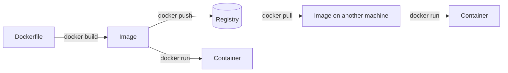

# Your First Docker Container

> **12-minute read, plus 20 minutes if you follow along. Assumes you've read [Terminal basics](./terminal-basics.md) and [Linux processes and services](./linux-processes-and-services.md).**

## Why this page exists

"It works on my machine" is the oldest problem in software. Your laptop has Python 3.12 and the right libraries; the server has Python 3.9 and a different OS. A **container** packages your app with everything it needs to run, so it behaves the same on your laptop, a colleague's laptop, a CI runner and a cloud service. Most code shipped to the cloud today ships as a container image.

This page gets you from zero to a running container you built yourself. The concept page [Containers vs VMs](../concepts/containers-vs-vms.md) explains the theory.

## Four words to know

- **Image**: a read-only package containing a filesystem (your app, its libraries, a minimal OS userland) and instructions for how to start it. Like a template.
- **Container**: a running instance of an image. It is just a process on the host, isolated so it sees only its own files, network and process list. You can run many containers from one image.
- **Dockerfile**: the recipe for building an image.
- **Registry**: where images are stored and shared. Docker Hub is the public default; clouds have their own (Amazon ECR, Azure Container Registry, Google Artifact Registry).



You build an image once from a Dockerfile, push it to a registry, and any machine can pull it and run identical containers from it.

## Step 0: install

Install **Docker Desktop** on Mac or Windows (with WSL integration on Windows), or **Docker Engine** on Linux. Check it works:

```bash
$ docker --version
$ docker run hello-world
```

`hello-world` pulls a tiny image from Docker Hub and runs it. If you see "Hello from Docker!", everything is wired up.

## Step 1: run someone else's container

```bash
$ docker run -d -p 8080:80 --name web nginx
```

- `-d` runs it in the background (detached).
- `-p 8080:80` maps port 8080 on **your machine** to port 80 **inside the container**. Without it, the container's port is unreachable from your browser.
- `--name web` gives it a name so you do not have to use its ID.
- `nginx` is the image. Docker pulls it if you do not have it.

Open `http://localhost:8080` and you will see the nginx welcome page. Then:

```bash
$ docker ps                 # running containers
$ docker logs web           # what it printed
$ docker exec -it web sh    # a shell inside the running container (type exit to leave)
$ docker stop web           # sends SIGTERM, then SIGKILL after 10 seconds
$ docker rm web             # delete the stopped container
```

## Step 2: build your own image

Make a folder with two files. `app.py`:

```python
import os
from http.server import BaseHTTPRequestHandler, HTTPServer

GREETING = os.environ.get("GREETING", "Hello")

class Handler(BaseHTTPRequestHandler):
    def do_GET(self):
        self.send_response(200)
        self.send_header("Content-Type", "text/plain")
        self.end_headers()
        self.wfile.write(f"{GREETING} from a container!\n".encode())

HTTPServer(("0.0.0.0", 8000), Handler).serve_forever()
```

And a `Dockerfile`:

```dockerfile
FROM python:3.12-slim
WORKDIR /app
COPY app.py .
RUN useradd --create-home appuser
USER appuser
EXPOSE 8000
CMD ["python", "app.py"]
```

What each line does:

- `FROM` - start from an official image that already has Python. `slim` variants are smaller.
- `WORKDIR` - the folder inside the image where the following commands run.
- `COPY` - copy your file from the build folder into the image.
- `RUN` - run a command at build time. Here, create a non-root user.
- `USER` - run the app as that user, not root.
- `EXPOSE` - documents the port; it does not publish it (that is `-p`).
- `CMD` - the command that starts when a container runs. It becomes the container's main process.

Build and run it:

```bash
$ docker build -t hello-app:1.0 .
$ docker run -d -p 8000:8000 --name hello hello-app:1.0
$ curl localhost:8000
Hello from a container!
```

## Step 3: configure it from outside

The same image, different config, using an [environment variable](./environment-variables-and-config.md):

```bash
$ docker rm -f hello
$ docker run -d -p 8000:8000 -e GREETING=Howdy --name hello hello-app:1.0
$ curl localhost:8000
Howdy from a container!
```

This is how the same image runs in dev, staging and production with different settings.

## Step 4: understand that containers are disposable

Write a file inside the running container, remove the container, start a new one: the file is gone. A container's own filesystem lives only as long as the container. Anything that must survive goes in a **volume** (`-v mydata:/data`), a database, or object storage. This is why cloud apps keep state outside the container, and it is exactly what lets platforms replace containers freely.

## Step 5: where it goes next

To run your image in the cloud, push it to a registry and point a container service at it:

- **Simplest:** Google Cloud Run, Azure Container Apps, or Amazon ECS on Fargate. You give them an image and they run it, with no servers to manage. Cloud Run and Container Apps even hand you a URL.
- **More control:** Kubernetes (EKS, AKS, GKE). See [Kubernetes in 10 minutes](../concepts/kubernetes-in-10-minutes.md).

## Common mistakes

- **Forgetting `-p`**, then wondering why `localhost` refuses the connection.
- **Listening on `127.0.0.1` inside the container.** Inside a container, localhost means the container itself. Listen on `0.0.0.0`.
- **Using `latest` as a tag** in anything that matters. Tag versions so you know what is running.
- **Running as root** inside the container.
- **Huge images** from copying the whole project folder, `node_modules` and `.git` included. Add a `.dockerignore`.
- **Secrets baked into the image** with `COPY .env` or `ENV API_KEY=...`. Anyone who pulls the image can read them. Pass them at runtime.
- **Storing data in the container** and losing it on restart.

## Clean up

```bash
$ docker rm -f hello
$ docker image ls
$ docker system prune     # removes stopped containers, unused networks and dangling images
```

## Go deeper

- **[📖 Docker: get started](https://docs.docker.com/get-started/)** - the official walkthrough
- **[📖 Dockerfile reference](https://docs.docker.com/reference/dockerfile/)** - every instruction
- **[Docker CLI cheat sheet](../../resources/cli-cheat-sheet-docker.md)** - the commands on one page

## What to look at next

- **[Containers vs VMs](../concepts/containers-vs-vms.md)** - what is actually isolating your container
- **[Kubernetes in 10 minutes](../concepts/kubernetes-in-10-minutes.md)** - running many containers across many machines
- **[CI/CD explained](../concepts/cicd-explained.md)** - building images automatically on every commit
