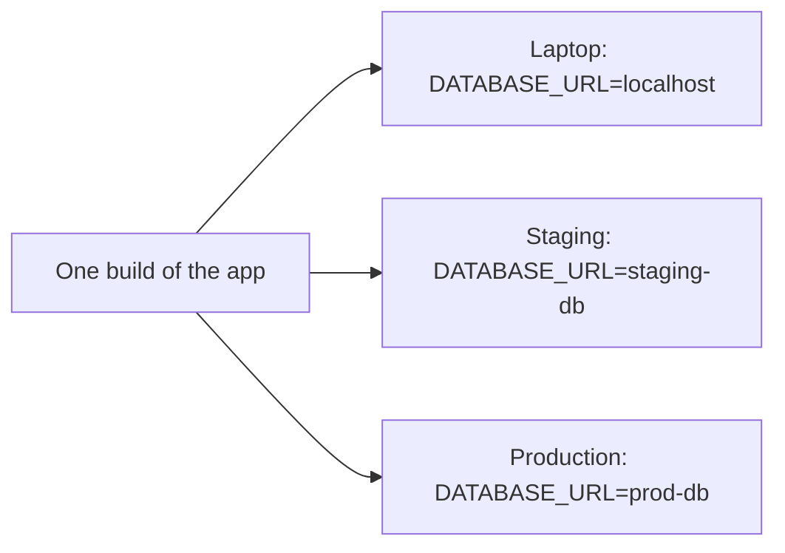

# Environment Variables and Config

> **8-minute read. Assumes you've read [Terminal basics](./terminal-basics.md).**

## Why this page exists

Every tutorial eventually says "set `DATABASE_URL`" or "export your `AWS_REGION`", as if you already know what that means and where it goes. Then something works in one terminal and not in another, or on your laptop and not on the server, and the reason is almost always an environment variable.

## What an environment variable is

Every running program carries a small list of named text values: its **environment**. The program can read them at any time. They are how the outside world tells a program things like "which database to use" or "which mode to run in" without changing the program's code.

Look at your own:

```bash
$ echo $HOME
/home/alice
$ echo $PATH
/usr/local/bin:/usr/bin:/bin
$ env | head
```

`HOME`, `PATH`, `USER` and `SHELL` are set for you when you log in. `PATH` is the important one: it is the list of folders the shell searches when you type a command. "command not found" right after installing something often means the install folder is not on your `PATH`.

## Setting them

```bash
# Only for this one command
$ GREETING=hello python3 app.py

# For this shell and every program it starts from now on
$ export GREETING=hello
$ python3 app.py

# Remove it
$ unset GREETING
```

The rule that confuses everyone: **a variable is inherited by child processes, never by parents or siblings.**

- A program started from your shell gets a copy of the shell's exported variables.
- If that program changes a variable, your shell does not see the change.
- A variable exported in one terminal tab does not exist in another tab.
- Closing the terminal throws them all away.

To make one permanent for your user, add the `export` line to `~/.bashrc` (bash) or `~/.zshrc` (zsh) and open a new terminal.

On Windows PowerShell the syntax is `$env:GREETING = "hello"`, and permanent variables are set in System Properties. On WSL, use the Linux syntax above.

## Reading them in code

```python
import os

db_url = os.environ["DATABASE_URL"]          # crash loudly if missing
log_level = os.environ.get("LOG_LEVEL", "info")  # default if missing
```

```javascript
const dbUrl = process.env.DATABASE_URL;
```

Two habits worth keeping: fail at startup with a clear message when a required variable is missing, and remember that every value is a **string**. `DEBUG=false` is the text `"false"`, which is truthy in most languages. Convert it deliberately.

## Why config lives outside the code

The same code should run on your laptop, in staging and in production. What differs between them is **configuration**: database addresses, feature flags, log levels, external API URLs.



One artifact, three environments: only the environment variables change, so what you tested in staging is exactly what runs in production.

This idea comes from the **Twelve-Factor App**: "store config in the environment". It is why containers, serverless functions and platforms like Heroku, Cloud Run and App Service all let you set environment variables per deployment.

## `.env` files

Typing twenty `export` lines is tedious, so many projects keep a `.env` file:

```text
DATABASE_URL=postgres://localhost:5432/app
LOG_LEVEL=debug
STRIPE_KEY=sk_test_123
```

Libraries such as `python-dotenv` or `dotenv` for Node load it at startup, and Docker Compose reads it automatically.

**Never commit `.env` to Git.** Add it to `.gitignore` on day one, and commit a `.env.example` with the variable names and fake values so others know what to set. Leaked `.env` files are one of the most common ways real credentials end up public.

## Secrets are a special case

Environment variables are fine for ordinary config. For secrets (passwords, API keys), they are acceptable on your laptop and weak in production: they show up in crash dumps, debug pages, process listings and container inspection output.

In the cloud, prefer:

- **No secret at all**, where an identity can replace it. Code running on a cloud VM or function can be given a role instead of an access key. See [Cloud identity basics for builders](../concepts/cloud-identity-basics-for-builders.md).
- **A secrets manager** (AWS Secrets Manager, Azure Key Vault, Google Secret Manager), with the app fetching the value at startup or the platform injecting it.

## Common mistakes

- **"It works in this terminal but not that one."** The variable was exported in one shell only.
- **Editing `~/.bashrc` and expecting the current terminal to change.** Open a new one, or run `source ~/.bashrc`.
- **Spaces around `=`.** `export NAME = value` is an error in bash; it must be `NAME=value`.
- **Committing `.env`** with real keys.
- **Treating `"false"` as false.**
- **Setting a variable with `sudo` and expecting it to stick.** `sudo` starts with a cleaned environment by default.

## Try it

```bash
$ export COLOR=blue
$ bash -c 'echo "child sees: $COLOR"'
child sees: blue
$ bash -c 'export COLOR=red; echo "child set: $COLOR"'
child set: red
$ echo "parent still: $COLOR"
parent still: blue
```

That last line is the whole inheritance rule in one experiment.

## Go deeper

- **[📖 The Twelve-Factor App: Config](https://12factor.net/config)** - the original argument for config in the environment
- **[📖 Bash reference: environment](https://www.gnu.org/software/bash/manual/html_node/Environment.html)** - how bash passes variables to commands

## What to look at next

- **[Linux processes and services](./linux-processes-and-services.md)** - how services started by the system get their environment
- **[Your first Docker container](./docker-first-container.md)** - passing variables into containers
- **[Secrets management](https://security.noblerworks.com/learn/concepts/secrets-management/)** - production secrets done properly (Security Zero to Hero)
