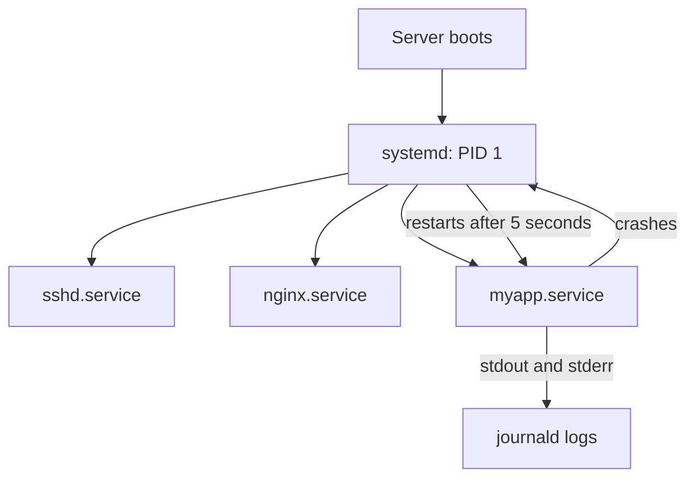

# Linux Processes and Services

> **10-minute read. Assumes you've read [Terminal basics](./terminal-basics.md) and [What is a server?](./what-is-a-server.md).**

## Why this page exists

You SSH into a server and the website is down. Is the app running? Did it crash? Will it start again after a reboot? Where did its error go? Those questions are all about **processes** and **services**, and you will ask them on every server you ever touch, including the ones hidden inside containers and cloud VMs.

## A process is a running program

A program is a file on disk. A **process** is that program running: it has memory, a process ID (PID), an owner, an environment and a parent that started it.

```bash
$ ps aux | head -5
USER   PID  %CPU %MEM  COMMAND
root     1   0.0  0.1  /sbin/init
root   412   0.0  0.2  /usr/sbin/sshd -D
www    981   2.1  3.4  node /srv/app/server.js
alice 1203   0.0  0.0  ps aux
```

- **PID 1** is the first process the kernel starts. On almost every modern Linux distribution, that is **systemd**. Every other process descends from it.
- `top` (or the friendlier `htop`) shows the same list live, sorted by CPU or memory.
- `pgrep -a node` finds processes by name.

## Signals: how processes are stopped

You do not "close" a process on a server. You send it a **signal**.

| Signal | Number | Meaning | Sent by |
|---|---|---|---|
| `SIGTERM` | 15 | "Please shut down cleanly" | `kill PID` (the default) |
| `SIGINT` | 2 | "Interrupted" | Ctrl+C in the terminal |
| `SIGKILL` | 9 | "Stop now", cannot be caught | `kill -9 PID` |
| `SIGHUP` | 1 | "Your terminal went away", often used to mean "reload config" | Closing SSH, `kill -HUP PID` |

Always try `SIGTERM` first. A well-written app catches it, finishes in-flight requests, closes database connections and exits. `kill -9` skips all of that, which can leave half-written files and dropped requests. The same rule applies to containers and Kubernetes: they send `SIGTERM`, wait a grace period, then `SIGKILL`.

## Foreground, background, and why your app died when you logged out

```bash
$ node server.js          # runs in the foreground; Ctrl+C stops it
$ node server.js &        # runs in the background of this shell
```

Both are children of your SSH session. When you log out, the session ends, the shell sends `SIGHUP` to its children, and your app dies. Beginners work around this with `nohup` or by leaving a `screen` or `tmux` session open. That keeps it running, but it will not restart after a crash or a reboot, and its logs go nowhere useful.

The right answer is to make it a **service**.

## Services and systemd

A **service** (also called a daemon) is a long-running process managed by the system rather than by a person. On modern Linux, **systemd** is the manager. It starts services at boot, restarts them when they crash, captures their logs and starts them in the right order.



systemd starts each service at boot, watches it, restarts it if it crashes, and collects everything it prints into the journal.

The everyday commands:

```bash
$ systemctl status nginx          # running? since when? last log lines
$ sudo systemctl start nginx
$ sudo systemctl stop nginx
$ sudo systemctl restart nginx
$ sudo systemctl enable nginx     # start automatically at boot
$ journalctl -u nginx -n 50       # last 50 log lines for this service
$ journalctl -u nginx -f          # follow the log live
```

`start` and `enable` are different and both matter. `start` runs it now. `enable` makes it start at boot. Forgetting `enable` is why an app "worked yesterday" and was gone after a patch reboot. `sudo systemctl enable --now myapp` does both.

## Writing your own service

A **unit file** tells systemd how to run your app. Save it as `/etc/systemd/system/myapp.service`:

```ini
[Unit]
Description=My web app
After=network-online.target
Wants=network-online.target

[Service]
User=www
WorkingDirectory=/srv/app
Environment=PORT=8080
EnvironmentFile=/etc/myapp/env
ExecStart=/usr/bin/node /srv/app/server.js
Restart=on-failure
RestartSec=5

[Install]
WantedBy=multi-user.target
```

Line by line, the important parts:

- `After=` / `Wants=network-online.target`: start once the network is up.
- `User=www`: do not run as root.
- `Environment=` and `EnvironmentFile=`: the service's environment variables. A service does **not** read your `~/.bashrc`, which is why "it works when I run it by hand" and fails as a service. See [Environment variables and config](./environment-variables-and-config.md).
- `ExecStart=`: the full path to the command. systemd does not use your shell's `PATH`.
- `Restart=on-failure`: restart if it exits with an error or is killed.
- `WantedBy=multi-user.target`: what `enable` hooks into, so it starts at normal boot.

Then:

```bash
$ sudo systemctl daemon-reload        # re-read unit files after any edit
$ sudo systemctl enable --now myapp
$ systemctl status myapp
```

## Debugging a service that will not start

1. `systemctl status myapp` - is it `active (running)`, `failed`, or restarting in a loop?
2. `journalctl -u myapp -n 100 --no-pager` - the real error is almost always here. Read it like any [error message](./reading-error-messages.md): the last lines first.
3. Common causes: a relative path in `ExecStart`, a missing environment variable, the `User` lacking [permission](./file-permissions.md) to read a file, the port already in use (`ss -ltnp | grep 8080`), or forgetting `daemon-reload` after editing.
4. Run the exact `ExecStart` command by hand as the service user (`sudo -u www /usr/bin/node /srv/app/server.js`) to see it fail interactively.

## Where this shows up in the cloud

- **Cloud VMs** are ordinary Linux: user data scripts often end with `systemctl enable --now myapp`, and agents like the CloudWatch agent, Azure Monitor agent and Google's Ops Agent run as systemd services.
- **Containers** usually do not run systemd. The container runtime plays its role: the app is PID 1, and the platform restarts the container when it exits. Your app still needs to handle `SIGTERM`.
- **Kubernetes** applies the same ideas at cluster scale: restart policies, liveness probes, and logs collected from stdout.

## Common mistakes

- **Running the app in a terminal or `tmux`** on a production server instead of as a service.
- **`start` without `enable`**, so it disappears after a reboot.
- **Editing a unit file and forgetting `daemon-reload`.**
- **Logging to a file nobody rotates** instead of stdout, which the journal already captures and rotates.
- **Reaching for `kill -9` first.**
- **Running services as root.**

## Go deeper

- **[📖 systemd.service manual](https://www.freedesktop.org/software/systemd/man/latest/systemd.service.html)** - every `[Service]` option
- **[📖 journalctl manual](https://www.freedesktop.org/software/systemd/man/latest/journalctl.html)** - filtering and following logs

## What to look at next

- **[Your first Docker container](./docker-first-container.md)** - the process model inside containers
- **[Networking troubleshooting](./networking-troubleshooting.md)** - when the service runs but nobody can reach it
- **[Observability basics](../concepts/observability-basics.md)** - logs at scale
