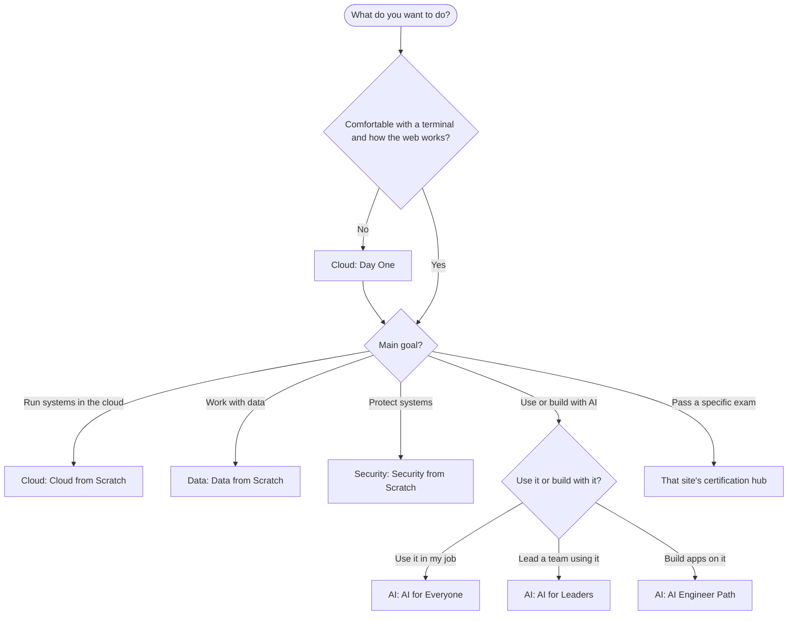

# Which Zero to Hero Site Should I Start With?

**In one line:** Four free sites cover cloud, data, security and AI; this page tells you which one fits your goal, the exact page to open first, and the order to take them in if you want all four.
**Last reviewed:** 2026-10-22

---

## The short version

- **Cloud Zero to Hero** is the foundation: computers, networks, servers, the big cloud providers, Kubernetes and DevOps. If you have never opened a terminal, start there.
- **Data Zero to Hero** is for working with data: SQL, databases, pipelines, streaming and analytics.
- **Security Zero to Hero** is for protecting systems and people: identity, encryption, detection, compliance and the security certifications.
- **AI Zero to Hero** is for using and building with AI: what models are, using AI well at work, building AI apps, and keeping them safe.
- Not sure? Pick the job you want, find it in the table below, and open the page it names. You can switch sites at any point; they link to each other wherever subjects meet.

All four sites are free, need no signup, and are built by [Nobler Works](https://noblerworks.com/).

## Who each site is for

### Cloud Zero to Hero

**[cloud.noblerworks.com](https://cloud.noblerworks.com/)** is for people who want to run software on AWS, Azure, Google Cloud or Oracle Cloud: cloud engineers, solutions architects, DevOps engineers, platform engineers and SREs, plus developers who want to understand where their code runs.

What you would learn there:

- **The basics, assuming nothing.** [Day One](https://cloud.noblerworks.com/learn/day-one/) covers the terminal, git, HTTP, servers and your first container.
- **The core of cloud.** [Cloud from Scratch](https://cloud.noblerworks.com/learn/cloud-from-scratch/) walks from "what is cloud?" through compute, storage, networking, identity, infrastructure as code, containers and Kubernetes, to designing a real system.
- **Hands-on builds, architecture patterns and CLI cheat sheets** for when you want to make something.
- **Certification study guides** across the major cloud, Kubernetes, Terraform, Linux and networking exams, plus career roadmaps that put them in order.

### Data Zero to Hero

**[data.noblerworks.com](https://data.noblerworks.com/)** is for people who want to work with data: data engineers, analytics engineers, database administrators, and analysts who want to go deeper than spreadsheets.

What you would learn there:

- **[Data from Scratch](https://data.noblerworks.com/learn/data-from-scratch/)**, a path from "what is a table?" through SQL, modeling for analytics, pipelines, streaming, data quality and governance, and data in the cloud, then a fork into data engineer, analytics engineer or DBA.
- **Concept pages** on ideas like ETL versus ELT, batch versus streaming, warehouses versus lakehouses, and indexes.
- **Builds and patterns**: a data pipeline, a dbt project, lakehouse and data mesh designs.
- **Certification study guides** for the cloud data exams and for platforms such as Databricks, Snowflake, Kafka and MongoDB.

### Security Zero to Hero

**[security.noblerworks.com](https://security.noblerworks.com/)** is for people who want to protect systems: security analysts, security engineers, cloud security specialists, and anyone who owns a compliance audit.

What you would learn there:

- **[Security from Scratch](https://security.noblerworks.com/learn/security-from-scratch/)**, a path from "I have never thought about security" through how attacks work, identity and access, protecting data, cloud security, detection and response, and governance, then a choice of specialism.
- **Concept pages** on identity and MFA, encryption, zero trust, threat modeling, logging and incident response.
- **Compliance guides** to frameworks such as SOC 2, ISO 27001, NIST CSF, HIPAA, PCI DSS and GDPR, in plain English.
- **Certification study guides** from Security+ through CISSP, CCSP, OSCP and the cloud security exams.

### AI Zero to Hero

**[ai.noblerworks.com](https://ai.noblerworks.com/)** is for everyone touched by AI, technical or not: people who want to use AI well in their job, managers rolling it out, developers building AI apps, machine learning engineers, and the curious.

What you would learn there:

- **Paths by audience**: [AI for Everyone](https://ai.noblerworks.com/learn/start-here/ai-for-everyone/), [AI for Leaders](https://ai.noblerworks.com/learn/start-here/ai-for-leaders/), the [AI Engineer Path](https://ai.noblerworks.com/learn/start-here/ai-engineer-path/), the [ML Engineer Path](https://ai.noblerworks.com/learn/start-here/ml-engineer-path/), and the full [AI Zero to Hero Path](https://ai.noblerworks.com/learn/start-here/zero-to-hero-path/).
- **AI at work**: playbooks by role, real use cases, and a kit for rolling AI out to a team.
- **Building**: chatbots, retrieval (RAG), agents, evals and fine-tuning, step by step.
- **Safety and governance**: prompt injection, agent security, and the rules such as the EU AI Act.
- **AI certification study guides**, plus plain-language summaries of the research papers the field rests on.

## Pick by goal

Find the row closest to what you want, then open the starting page. It is fine to start on one site and drift to another.

| Your goal | Site | Start here |
|---|---|---|
| I am a career changer with no tech background | Cloud | [Day One](https://cloud.noblerworks.com/learn/day-one/) |
| I want to get a cloud job | Cloud | [Cloud from Scratch](https://cloud.noblerworks.com/learn/cloud-from-scratch/) |
| I want to work in DevOps or SRE | Cloud | [DevOps and SRE roadmap](https://cloud.noblerworks.com/resources/certification-roadmap-devops-sre/) |
| I need to pass a cloud certification | Cloud | [Cloud certification hub](https://cloud.noblerworks.com/STUDY-HUB/) |
| I am moving into data engineering | Data | [Data from Scratch](https://data.noblerworks.com/learn/data-from-scratch/) |
| I want to get better at SQL | Data | [SQL joins explained](https://data.noblerworks.com/learn/concepts/sql-joins-explained/) |
| I need to pass a data certification | Data | [Data certification hub](https://data.noblerworks.com/STUDY-HUB/) |
| I want to become a security engineer | Security | [Security from Scratch](https://security.noblerworks.com/learn/security-from-scratch/) |
| I need to pass Security+ | Security | [CompTIA Security+ guide](https://security.noblerworks.com/exams/comptia/security-plus/) |
| My company needs SOC 2, ISO 27001 or similar | Security | [Compliance guides](https://security.noblerworks.com/resources/compliance-guides/) |
| My company wants us using AI | AI | [AI for Everyone](https://ai.noblerworks.com/learn/start-here/ai-for-everyone/) |
| I am a manager deciding what to do about AI | AI | [AI for Leaders](https://ai.noblerworks.com/learn/start-here/ai-for-leaders/) |
| I want to build AI apps | AI | [The AI Engineer Path](https://ai.noblerworks.com/learn/start-here/ai-engineer-path/) |
| I want to train and serve models myself | AI | [The ML Engineer Path](https://ai.noblerworks.com/learn/start-here/ml-engineer-path/) |
| I need to pass an AI certification | AI | [AI certifications hub](https://ai.noblerworks.com/certifications/) |
| I need to secure or govern AI systems | AI | [Safety and governance](https://ai.noblerworks.com/safety/) |

A note on the manager row: AI for Leaders is written for managers of any team. If you manage a cloud, data or security team, the career roadmaps on that team's site show what your people are working towards.

## The decision, as a flowchart

The flowchart starts with one question about the basics, sends beginners to Cloud's Day One first, then routes by main goal to the starting page on the cloud, data, security or AI site, with AI split into using it, leading a team that uses it, and building with it.

## If you want all four

A sensible order for someone who wants the whole picture:

1. **Cloud first.** Day One and Cloud from Scratch teach the ground everything else stands on: servers, networks, identity, and how cloud providers work. The other three sites assume it and link back to it.
2. **Then data or security, in whichever order your job needs.** Data from Scratch and Security from Scratch both start with a short "basics" phase that points back to Cloud; with Cloud done you can skim it.
3. **AI last, or alongside.** The non-technical AI paths (AI for Everyone, AI for Leaders) need no background and can be read at any point. The AI Engineer Path is easier once you know cloud basics, and retrieval makes more sense once you know how data is stored and searched.

You do not have to finish one site before opening the next. Most people end up dipping into all four as their work crosses subjects.

## Where the sites overlap

The four sites split one subject area between them, so each topic has one home and the others link to it rather than repeat it. The main crossings:

| Topic | Its home | What the other sites do |
|---|---|---|
| Terminal, git, HTTP, Linux basics | Cloud ([Day One](https://cloud.noblerworks.com/learn/day-one/)) | Data and Security send beginners there before their own paths start |
| Identity and access (IAM) | Security ([IAM explained](https://security.noblerworks.com/learn/concepts/iam-explained/)) | Cloud covers [the identity basics a builder needs](https://cloud.noblerworks.com/learn/concepts/cloud-identity-basics-for-builders/), then hands off |
| Databases | Data ([Data from Scratch](https://data.noblerworks.com/learn/data-from-scratch/)) | Cloud explains [managed databases](https://cloud.noblerworks.com/learn/concepts/managed-databases-explained/) as a service you run; Data goes deep on modeling, SQL and pipelines |
| Data in the cloud | Data | Data from Scratch uses Cloud from Scratch as its cloud primer |
| AI on the cloud | AI ([AI Engineer Path](https://ai.noblerworks.com/learn/start-here/ai-engineer-path/)) | Cloud sends AI learners to the AI site rather than covering it |
| Vector databases | Data and AI | Data covers [vector databases for data engineers](https://data.noblerworks.com/learn/concepts/vector-databases-for-data-engineers/); AI covers embeddings and retrieval from the application side |
| AI security | AI ([Safety and governance](https://ai.noblerworks.com/safety/)) | Security from Scratch points there for prompt injection and agent security |

## Next steps

- [Cloud Zero to Hero](https://cloud.noblerworks.com/learn/) - the learn hub
- [Data Zero to Hero](https://data.noblerworks.com/learn/) - the learn hub
- [Security Zero to Hero](https://security.noblerworks.com/learn/) - the learn hub
- [AI Zero to Hero](https://ai.noblerworks.com/learn/) - the learn hub
