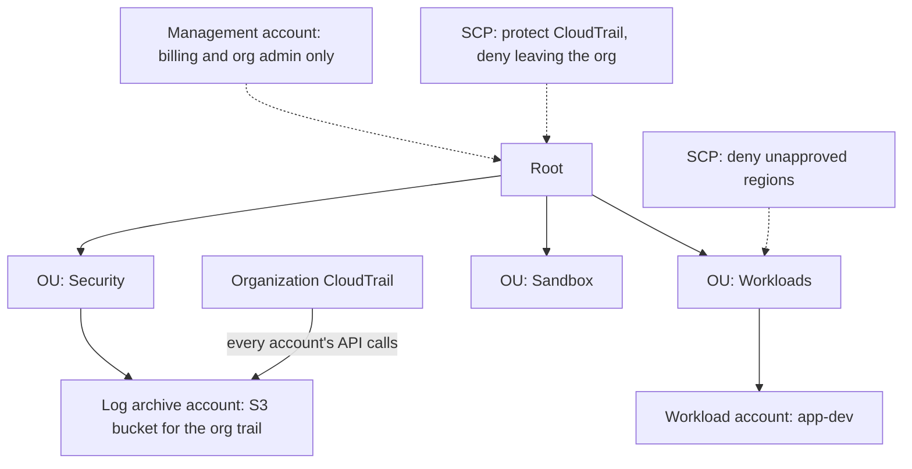

# Hands-On Project: Build a Landing Zone

Build a small multi-account landing zone by hand: an organization with organizational units, a log archive account, an organization-wide audit trail, preventive guardrails, and a budget alarm. Then prove the guardrails work by trying to break them.

**Estimated Time:** 3-4 hours
**Difficulty:** Intermediate
**Prerequisites:** An AWS account you control that is **not** already a member of someone else's organization, AWS CLI v2 configured with admin credentials for it, two spare email addresses (plus-addressing like `you+log@example.com` works), and [Multi-account strategy and landing zones](../../learn/concepts/multi-account-and-landing-zones.md) read first. Azure and Google Cloud equivalents are at the end.

**Cost:** close to zero. Organizations, OUs, SCPs and the first CloudTrail copy of management events are free; you pay pennies for S3 storage of logs. Nothing here launches compute.

---

## What you are building



The management account owns the organization but runs nothing. Two member accounts sit in OUs, an organization trail sends every account's API activity to a bucket in the log archive account, and service control policies attached at the root and OU levels set limits no member account can override.

This is a hand-built miniature of what AWS Control Tower or the Landing Zone Accelerator automate. Building it by hand once makes the automated versions understandable.

---

## Step 1: Create the organization

Run these from the account that will become the **management account**.

```bash
aws organizations create-organization --feature-set ALL

ROOT_ID=$(aws organizations list-roots --query 'Roots[0].Id' --output text)
ORG_ID=$(aws organizations describe-organization --query 'Organization.Id' --output text)
MGMT_ID=$(aws sts get-caller-identity --query Account --output text)
echo "root=$ROOT_ID org=$ORG_ID mgmt=$MGMT_ID"
```

`--feature-set ALL` matters: without it you get consolidated billing only and cannot use SCPs.

## Step 2: Create the OUs

```bash
for OU in Security Workloads Sandbox; do
  aws organizations create-organizational-unit --parent-id "$ROOT_ID" --name "$OU"
done

SEC_OU=$(aws organizations list-organizational-units-for-parent --parent-id "$ROOT_ID" \
  --query "OrganizationalUnits[?Name=='Security'].Id" --output text)
WORK_OU=$(aws organizations list-organizational-units-for-parent --parent-id "$ROOT_ID" \
  --query "OrganizationalUnits[?Name=='Workloads'].Id" --output text)
```

## Step 3: Vend two member accounts

```bash
aws organizations create-account --email you+log@example.com --account-name log-archive
aws organizations create-account --email you+dev@example.com --account-name app-dev

# Account creation is asynchronous. Check until State is SUCCEEDED:
aws organizations list-create-account-status \
  --query 'CreateAccountStatuses[].[AccountName,State,AccountId]' --output table
```

Record the two account IDs, then move each into its OU:

```bash
LOG_ID=<log-archive account id>
DEV_ID=<app-dev account id>

aws organizations move-account --account-id "$LOG_ID" \
  --source-parent-id "$ROOT_ID" --destination-parent-id "$SEC_OU"
aws organizations move-account --account-id "$DEV_ID" \
  --source-parent-id "$ROOT_ID" --destination-parent-id "$WORK_OU"
```

Each new account gets a role named `OrganizationAccountAccessRole` that the management account can assume. That is how you will work inside them. In a real landing zone, people would instead sign in through IAM Identity Center with permission sets; enable it in the console under IAM Identity Center if you want to try that path.

## Step 4: Central logging

Create the log bucket **in the log archive account**, so nobody working in the workload accounts can touch it.

```bash
# Get temporary credentials for the log archive account
CREDS=$(aws sts assume-role \
  --role-arn "arn:aws:iam::${LOG_ID}:role/OrganizationAccountAccessRole" \
  --role-session-name landing-zone-setup --query Credentials --output json)
export AWS_ACCESS_KEY_ID=$(echo "$CREDS" | jq -r .AccessKeyId)
export AWS_SECRET_ACCESS_KEY=$(echo "$CREDS" | jq -r .SecretAccessKey)
export AWS_SESSION_TOKEN=$(echo "$CREDS" | jq -r .SessionToken)

BUCKET=org-trail-${ORG_ID}
aws s3api create-bucket --bucket "$BUCKET" --region us-east-1
aws s3api put-bucket-versioning --bucket "$BUCKET" --versioning-configuration Status=Enabled
aws s3api put-public-access-block --bucket "$BUCKET" --public-access-block-configuration \
  BlockPublicAcls=true,IgnorePublicAcls=true,BlockPublicPolicy=true,RestrictPublicBuckets=true
```

Save this as `bucket-policy.json`, replacing the placeholders, and apply it. It lets CloudTrail write logs for the management account and for every account in the organization.

```json
{
  "Version": "2012-10-17",
  "Statement": [
    {
      "Sid": "AclCheck",
      "Effect": "Allow",
      "Principal": { "Service": "cloudtrail.amazonaws.com" },
      "Action": "s3:GetBucketAcl",
      "Resource": "arn:aws:s3:::BUCKET"
    },
    {
      "Sid": "WriteOrgLogs",
      "Effect": "Allow",
      "Principal": { "Service": "cloudtrail.amazonaws.com" },
      "Action": "s3:PutObject",
      "Resource": [
        "arn:aws:s3:::BUCKET/AWSLogs/MGMT_ID/*",
        "arn:aws:s3:::BUCKET/AWSLogs/ORG_ID/*"
      ],
      "Condition": { "StringEquals": { "s3:x-amz-acl": "bucket-owner-full-control" } }
    }
  ]
}
```

```bash
aws s3api put-bucket-policy --bucket "$BUCKET" --policy file://bucket-policy.json

# Back to the management account
unset AWS_ACCESS_KEY_ID AWS_SECRET_ACCESS_KEY AWS_SESSION_TOKEN
```

Now create the **organization trail** from the management account:

```bash
aws organizations enable-aws-service-access --service-principal cloudtrail.amazonaws.com

aws cloudtrail create-trail --name org-trail --s3-bucket-name "$BUCKET" \
  --is-organization-trail --is-multi-region-trail --region us-east-1
aws cloudtrail start-logging --name org-trail --region us-east-1
```

Within about 15 minutes, objects appear under `AWSLogs/<org-id>/<account-id>/` for every account, including ones you create later. For extra protection in production, turn on S3 Object Lock so even an administrator cannot delete logs during the retention period.

## Step 5: Preventive guardrails (SCPs)

Enable SCPs on the root:

```bash
aws organizations enable-policy-type --root-id "$ROOT_ID" --policy-type SERVICE_CONTROL_POLICY
```

**Guardrail 1: protect the audit trail and the organization** (attach to the root, so every member account inherits it). Save as `protect-baseline.json`:

```json
{
  "Version": "2012-10-17",
  "Statement": [
    {
      "Sid": "ProtectCloudTrail",
      "Effect": "Deny",
      "Action": ["cloudtrail:StopLogging", "cloudtrail:DeleteTrail", "cloudtrail:UpdateTrail"],
      "Resource": "*"
    },
    {
      "Sid": "DenyLeavingOrg",
      "Effect": "Deny",
      "Action": "organizations:LeaveOrganization",
      "Resource": "*"
    },
    {
      "Sid": "DenyRootUser",
      "Effect": "Deny",
      "Action": "*",
      "Resource": "*",
      "Condition": { "StringLike": { "aws:PrincipalArn": "arn:aws:iam::*:root" } }
    }
  ]
}
```

**Guardrail 2: approved regions only** (attach to the Workloads OU). Save as `deny-regions.json`:

```json
{
  "Version": "2012-10-17",
  "Statement": [
    {
      "Sid": "DenyOutsideApprovedRegions",
      "Effect": "Deny",
      "NotAction": [
        "iam:*", "organizations:*", "sts:*", "support:*", "budgets:*",
        "cloudfront:*", "route53:*", "waf:*", "health:*", "account:*"
      ],
      "Resource": "*",
      "Condition": {
        "StringNotEquals": { "aws:RequestedRegion": ["us-east-1", "us-west-2"] }
      }
    }
  ]
}
```

Create and attach both:

```bash
BASE_ID=$(aws organizations create-policy --name protect-baseline \
  --type SERVICE_CONTROL_POLICY --description "Protect trail, org, deny root user" \
  --content file://protect-baseline.json --query 'Policy.PolicySummary.Id' --output text)
REGION_ID=$(aws organizations create-policy --name deny-unapproved-regions \
  --type SERVICE_CONTROL_POLICY --description "us-east-1 and us-west-2 only" \
  --content file://deny-regions.json --query 'Policy.PolicySummary.Id' --output text)

aws organizations attach-policy --policy-id "$BASE_ID" --target-id "$ROOT_ID"
aws organizations attach-policy --policy-id "$REGION_ID" --target-id "$WORK_OU"
```

Keep the default `FullAWSAccess` policy attached. SCPs are filters: an action needs an allow at every level of the tree, and removing `FullAWSAccess` without a replacement denies everything.

## Step 6: Prove the guardrails work

Assume the access role in `app-dev` (same pattern as Step 4, with `$DEV_ID`), then:

```bash
# Allowed region: works
aws ec2 describe-vpcs --region us-east-1

# Unapproved region: denied by the SCP
aws ec2 describe-vpcs --region eu-west-1
# An error occurred (UnauthorizedOperation) ... with an explicit deny in a service control policy

# Try to switch off the audit trail from inside a member account: denied
aws cloudtrail stop-logging --name "arn:aws:cloudtrail:us-east-1:${MGMT_ID}:trail/org-trail" --region us-east-1
```

Note what happened: the role you assumed has `AdministratorAccess` inside `app-dev`, and it was still denied. That is the point of an SCP. It caps what any identity in the account can do, admins included. Then check the log archive bucket: your denied calls are recorded there too, with `errorCode` set.

## Step 7: A budget alarm per account

From the management account, save `budget.json`:

```json
{
  "BudgetName": "app-dev-monthly",
  "BudgetLimit": { "Amount": "20", "Unit": "USD" },
  "TimeUnit": "MONTHLY",
  "BudgetType": "COST",
  "CostFilters": { "LinkedAccount": ["DEV_ACCOUNT_ID"] }
}
```

```bash
aws budgets create-budget --account-id "$MGMT_ID" --budget file://budget.json \
  --notifications-with-subscribers '[{"Notification":{"NotificationType":"ACTUAL","ComparisonOperator":"GREATER_THAN","Threshold":80,"ThresholdType":"PERCENTAGE"},"Subscribers":[{"SubscriptionType":"EMAIL","Address":"you@example.com"}]}]'
```

---

## Verification checklist

- [ ] `aws organizations list-accounts` shows three accounts, each in the expected OU.
- [ ] The log archive bucket holds CloudTrail files for both member accounts.
- [ ] A call to an unapproved region from `app-dev` fails with an explicit SCP deny.
- [ ] Stopping the org trail from a member account fails.
- [ ] A budget exists for `app-dev` with an 80% email alert.
- [ ] You can explain why nothing should run in the management account.

## Stretch goals

- Rebuild the whole thing in Terraform (`aws_organizations_organization`, `aws_organizations_organizational_unit`, `aws_organizations_account`, `aws_organizations_policy`, `aws_organizations_policy_attachment`) so the landing zone is itself code.
- Enable IAM Identity Center, create a `ReadOnly` permission set and assign it to `app-dev`.
- Turn on GuardDuty with a delegated administrator account.
- Compare your result with what AWS Control Tower creates.

## The same build on Azure and Google Cloud

**Azure** uses management groups, subscriptions and Azure Policy:

```bash
az account management-group create --name lz-workloads --display-name "Workloads"
az account management-group subscription add --name lz-workloads --subscription <subscription-id>

# Built-in "Allowed locations" policy, assigned at the management group
az policy assignment create --name allowed-locations \
  --policy e56962a6-4747-49cd-b67b-bf8b01975c4c \
  --scope /providers/Microsoft.Management/managementGroups/lz-workloads \
  --params '{"listOfAllowedLocations":{"value":["eastus","westus2"]}}'
```

Central logging is a diagnostic setting that sends the Activity Log of each subscription to a Log Analytics workspace in a dedicated management subscription. The Azure landing zone accelerator deploys the full reference design.

**Google Cloud** uses folders, projects and organization policies (requires an organization, which comes with Cloud Identity or Workspace):

```bash
gcloud resource-manager folders create --display-name=Workloads --organization=ORG_ID
gcloud projects create app-dev-<unique-suffix> --folder=FOLDER_ID
```

```yaml
# locations.yaml - apply with: gcloud org-policies set-policy locations.yaml
name: folders/FOLDER_ID/policies/gcp.resourceLocations
spec:
  rules:
    - values:
        allowedValues:
          - in:us-locations
```

```bash
# Organization-wide audit log sink to a bucket in a logging project
gcloud logging sinks create org-audit storage.googleapis.com/<bucket> \
  --organization=ORG_ID --include-children \
  --log-filter='logName:"cloudaudit.googleapis.com"'
```

The sink prints a writer service account; grant it `roles/storage.objectCreator` on the bucket.

---

## Cleanup

```bash
# Detach and delete the SCPs
aws organizations detach-policy --policy-id "$REGION_ID" --target-id "$WORK_OU"
aws organizations detach-policy --policy-id "$BASE_ID" --target-id "$ROOT_ID"
aws organizations delete-policy --policy-id "$REGION_ID"
aws organizations delete-policy --policy-id "$BASE_ID"

# Stop and delete the trail
aws cloudtrail delete-trail --name org-trail --region us-east-1

# Close the member accounts (they stay suspended for 90 days, then are deleted)
aws organizations close-account --account-id "$DEV_ID"
aws organizations close-account --account-id "$LOG_ID"
```

Empty the log bucket before closing the log archive account if you do not want to keep the logs. An organization can only be deleted once it has no member accounts left.

---

## Additional Resources

- **[📖 AWS Organizations user guide](https://docs.aws.amazon.com/organizations/latest/userguide/orgs_introduction.html)** - accounts, OUs and policies
- **[📖 Service control policies](https://docs.aws.amazon.com/organizations/latest/userguide/orgs_manage_policies_scps.html)** - how SCPs evaluate, with examples
- **[📖 Creating a trail for an organization](https://docs.aws.amazon.com/awscloudtrail/latest/userguide/creating-trail-organization.html)** - organization trail requirements
- **[📖 Azure landing zones](https://learn.microsoft.com/en-us/azure/cloud-adoption-framework/ready/landing-zone/)** - the Cloud Adoption Framework reference
- **[📖 Landing zone design in Google Cloud](https://cloud.google.com/architecture/landing-zones)** - Google's landing zone decisions
