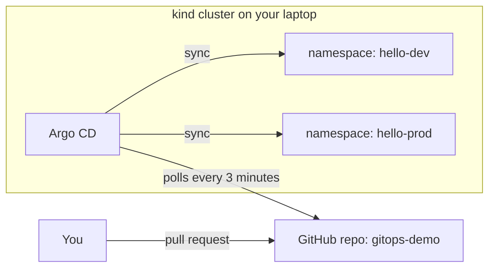

# Hands-On Project: GitOps with Argo CD

Run a GitOps workflow end to end on a local Kubernetes cluster: install Argo CD, point it at a Git repository, deploy an app to two environments, promote a new version with a pull request, watch Argo CD undo a manual change, and roll back with `git revert`.

**Estimated Time:** 2-3 hours
**Difficulty:** Intermediate
**Prerequisites:** Docker, [kind](https://kind.sigs.k8s.io/), `kubectl`, a GitHub (or GitLab) account, and [GitOps explained](../../learn/concepts/gitops-explained.md) read first. Comfortable with [Kubernetes basics](../../learn/concepts/kubernetes-in-10-minutes.md).

**Cost:** free. Everything runs on your laptop.

---

## What you are building



You only ever change the Git repository. Argo CD, running inside the cluster, pulls the repository and keeps two namespaces matching the dev and prod folders in it.

---

## Step 1: Create the cluster and install Argo CD

```bash
kind create cluster --name gitops

kubectl create namespace argocd
kubectl apply -n argocd --server-side --force-conflicts \
  -f https://raw.githubusercontent.com/argoproj/argo-cd/stable/manifests/install.yaml

kubectl -n argocd rollout status deploy/argocd-server
```

`--server-side` avoids an error on Argo CD's large CRDs. Get the initial admin password and open the UI:

```bash
kubectl -n argocd get secret argocd-initial-admin-secret \
  -o jsonpath="{.data.password}" | base64 -d; echo

kubectl -n argocd port-forward svc/argocd-server 8080:443
```

Browse to `https://localhost:8080` (accept the self-signed certificate) and log in as `admin`. Optionally install the `argocd` CLI and run `argocd login localhost:8080 --insecure`.

## Step 2: Create the config repository

Create a **public** GitHub repository called `gitops-demo` (public means Argo CD needs no credentials for this lab). Clone it and build this layout:

```text
gitops-demo/
  hello/
    base/
      deployment.yaml
      service.yaml
      kustomization.yaml
    overlays/
      dev/kustomization.yaml
      prod/kustomization.yaml
```

`hello/base/deployment.yaml`:

```yaml
apiVersion: apps/v1
kind: Deployment
metadata:
  name: hello
spec:
  replicas: 1
  selector:
    matchLabels: { app: hello }
  template:
    metadata:
      labels: { app: hello }
    spec:
      containers:
        - name: podinfo
          image: ghcr.io/stefanprodan/podinfo:6.7.0
          ports:
            - containerPort: 9898
          readinessProbe:
            httpGet: { path: /readyz, port: 9898 }
```

`hello/base/service.yaml`:

```yaml
apiVersion: v1
kind: Service
metadata:
  name: hello
spec:
  selector: { app: hello }
  ports:
    - port: 80
      targetPort: 9898
```

`hello/base/kustomization.yaml`:

```yaml
resources:
  - deployment.yaml
  - service.yaml
```

`hello/overlays/dev/kustomization.yaml`:

```yaml
resources:
  - ../../base
namespace: hello-dev
images:
  - name: ghcr.io/stefanprodan/podinfo
    newTag: "6.7.0"
```

`hello/overlays/prod/kustomization.yaml`:

```yaml
resources:
  - ../../base
namespace: hello-prod
replicas:
  - name: hello
    count: 3
images:
  - name: ghcr.io/stefanprodan/podinfo
    newTag: "6.7.0"
```

Check the rendered output locally, then push:

```bash
kubectl kustomize hello/overlays/prod
git add hello && git commit -m "hello app: base plus dev and prod overlays" && git push
```

## Step 3: Tell Argo CD about the two environments

Save as `apps.yaml` (outside the repo, or in a separate `argocd/` folder), replacing `YOUR-USER`:

```yaml
apiVersion: argoproj.io/v1alpha1
kind: Application
metadata:
  name: hello-dev
  namespace: argocd
spec:
  project: default
  source:
    repoURL: https://github.com/YOUR-USER/gitops-demo.git
    targetRevision: main
    path: hello/overlays/dev
  destination:
    server: https://kubernetes.default.svc
    namespace: hello-dev
  syncPolicy:
    automated:
      prune: true
      selfHeal: true
    syncOptions:
      - CreateNamespace=true
---
apiVersion: argoproj.io/v1alpha1
kind: Application
metadata:
  name: hello-prod
  namespace: argocd
spec:
  project: default
  source:
    repoURL: https://github.com/YOUR-USER/gitops-demo.git
    targetRevision: main
    path: hello/overlays/prod
  destination:
    server: https://kubernetes.default.svc
    namespace: hello-prod
  syncPolicy:
    automated:
      prune: true
      selfHeal: true
    syncOptions:
      - CreateNamespace=true
```

```bash
kubectl apply -f apps.yaml
kubectl get applications -n argocd
kubectl get pods -n hello-dev
kubectl get pods -n hello-prod     # three replicas
```

In the UI, both applications should show **Synced** and **Healthy**. You never ran `kubectl apply` on the app itself; Argo CD did it from Git.

The automated policy fields matter:

- `automated` - sync when Git changes, without anyone pressing a button.
- `prune` - delete resources that were removed from Git.
- `selfHeal` - revert changes made directly in the cluster.

## Step 4: Promote a new version through a pull request

In a branch, change dev to the new version:

```bash
git checkout -b dev-6.7.1
sed -i 's/newTag: "6.7.0"/newTag: "6.7.1"/' hello/overlays/dev/kustomization.yaml
git commit -am "dev: podinfo 6.7.1" && git push -u origin dev-6.7.1
```

Open a pull request on GitHub, review the one-line diff, and merge it. Within about three minutes (or immediately if you press **Refresh** in the UI), `hello-dev` rolls to 6.7.1 while `hello-prod` stays on 6.7.0:

```bash
kubectl -n hello-dev port-forward svc/hello 9898:80 &
curl -s localhost:9898 | grep version
```

Promoting to prod is the same change in `overlays/prod`. Every promotion is now a reviewed commit with an author and a timestamp.

## Step 5: Watch self-heal undo a manual change

Simulate someone "fixing" production by hand:

```bash
kubectl -n hello-prod scale deployment hello --replicas=1
kubectl -n hello-prod get deploy hello -w
```

Within seconds Argo CD detects the drift and scales it back to 3. Try deleting the Service too; it comes back. The cluster is not the source of truth any more. Git is.

## Step 6: Roll back with Git

Suppose 6.7.1 is bad in prod after you promoted it. Find the promotion commit and revert it:

```bash
git log --oneline -3
git revert <commit-sha>
git push
```

Argo CD syncs the revert, and prod returns to the previous version. The rollback is itself a commit, so the history shows exactly what happened and when.

---

## Verification checklist

- [ ] `hello-dev` and `hello-prod` are both Synced and Healthy.
- [ ] Dev and prod ran different versions after Step 4, and you can say which commit put each there.
- [ ] Manually scaling prod was reverted automatically.
- [ ] A `git revert` rolled prod back without any `kubectl` command.
- [ ] You can explain push-based vs pull-based deployment and which credentials each needs.

## Stretch goals

- Replace the two Applications with one **ApplicationSet** using a list or Git directory generator.
- Make the repository private and add it to Argo CD with a deploy key (read-only).
- Add a secret the GitOps way with **Sealed Secrets** or the **External Secrets Operator**; never commit a plain Secret.
- Install **Argo Rollouts** and turn the Deployment into a canary Rollout (see [Deployment strategies](../../learn/concepts/deployment-strategies.md)).
- Repeat the lab with **Flux** (`flux bootstrap github`) and compare the experience.
- Use the **app of apps** pattern: one Application that points at a folder of Application manifests.

## How this maps to the cloud

- **AKS and Azure Arc:** the managed GitOps extension uses Flux v2 (`az k8s-configuration flux create`).
- **GKE:** Config Sync provides managed GitOps from a Git repository or OCI artifact.
- **EKS:** run Argo CD or Flux as you did here, or use the managed **EKS Capability for Argo CD**, which runs Argo CD in the AWS control plane (no Notifications controller or Config Management Plugins there).

---

## Cleanup

```bash
kind delete cluster --name gitops
```

Delete or archive the `gitops-demo` repository if you no longer need it.

---

## Additional Resources

- **[📖 Argo CD getting started](https://argo-cd.readthedocs.io/en/stable/getting_started/)** - the official install and first app
- **[📖 Comparing EKS Capability for Argo CD to self-managed Argo CD](https://docs.aws.amazon.com/eks/latest/userguide/argocd-comparison.html)** - what the AWS-managed version does and does not support
- **[📖 Argo CD automated sync policy](https://argo-cd.readthedocs.io/en/stable/user-guide/auto_sync/)** - prune and self-heal in detail
- **[📖 Kustomize](https://kubectl.docs.kubernetes.io/references/kustomize/)** - bases, overlays and image overrides
- **[📖 OpenGitOps principles](https://opengitops.dev/)** - the four principles this lab demonstrates
